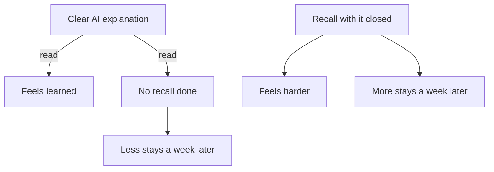

## Three times through

The night before her practice test, Lina read the AI's explanation of splitting a network three times. The first reading was slow. The second was faster. By the third, she knew what each sentence would say before she reached it. She rated her understanding 4 out of 5 and went to sleep calm.

The next day she scored 9 out of 20. Reading the explanation faster had felt like knowing subnetting better. What she knew better was the explanation itself: its words, its order, its example. The skill the test asked for, rebuilding the steps alone on a blank page, had not been practised once.

This chapter shows you the trap from the inside. You will read a short, clear explanation, rate yourself, and then try to recall it with the text out of sight. Most people are surprised by the result. Then you will see what Lina did with her own gaps, and why it worked.

## Why ease feels like knowing

Your brain uses ease as a signal. When something reads smoothly, it feels familiar, and familiar feels known. Usually the signal is useful. But a clear explanation is easy to read because the writer did the hard work, not because the ideas are already in your memory. The feeling comes from the text, and the text will not be there in the exam.

You met one study on this in chapter 3.1: students rated a fluent lecturer higher but did not learn more. A second study points the same way, in a real university course. In randomised physics classes at Harvard, students in active classes learned more but felt they had learned less than students in polished lectures. The authors link this to the extra effort active learning takes. In that course, effort felt like less learning, and polish felt like more.

The common study habits follow the feeling. A large review of ten study methods rated rereading and highlighting low, because they do not reliably improve results. It rated two methods highest: practice testing and spreading study over time. Those two helped learners of different ages and abilities, on many kinds of tests.

Testing yourself does more than measure. In one study, taking a memory test helped people remember for longer than restudying the same material, even when they got no feedback on their answers. In another, recalling from memory produced more learning a week later than drawing concept maps. The students had expected the maps to work better. There is an honest limit: the gains show up more on a test days later than on a test straight away. So recall can feel slower today and still be the better choice for the exam.

## Try it yourself

Here is a short, clear explanation of the kind a chat assistant writes. Read it once, at your normal speed. Do not take notes.

> **How a website checks your password.** When you sign up, a well-built website does not store your password. First it makes a salt: a random value made just for you. Then it runs your password and the salt through a hash function. A hash function turns any text into a fixed jumble of characters, and the jumble cannot practically be turned back into the text. The site stores only the salt and the jumble, which is called the hash. When you log in, the site takes the password you typed, adds your stored salt, and runs the hash function again. If the new hash matches the stored one, you are in. Because each person has their own salt, two people with the same password get different hashes. So the site never needs to keep your password at all.

Now rate yourself on paper or in a note: how well do you understand it, from 1 to 5? Write the number down. Then turn your phone face down, or scroll this paragraph out of sight. On a blank page, answer four questions. What does the site store when you sign up? What is the salt for? What happens, step by step, when you log in? Why can the site check your password without keeping it?

When you have written everything you can, come back and compare. Mark each answer as got it, partly, or missed. Be strict: partly means something important was wrong or left out.

Here is how the comparison went for Odai, Lina's classmate. He rated himself 4 out of 5. His recall said: "The site keeps your password in a scrambled form. At login it unscrambles it and checks it against what you typed. The salt makes the password stronger." Read it next to the explanation and the gaps appear quickly.

His first answer is partly right. The site does store a jumble, but he left out the salt, and "scrambled" hints that it can be unscrambled. His third answer is wrong: the site never unscrambles anything. It runs the typed password through the same steps again and compares the two hashes. His second answer is missed: the salt is not about strength, it is about two people with the same password getting different hashes. His fourth answer is missed too, and it follows from the third. If you think the site unscrambles, you cannot explain why it never needs your password.

So a rating of 4 out of 5 hid one partly right answer and three gaps. Notice also what kind of gaps they were. Odai did not forget random words. He missed the one idea that holds the rest together: the hash only goes one way. That is typical. Recall finds the idea you followed while reading but never had to build yourself.

What Odai does next matters as much as the test. He does not reread the whole explanation. He goes back only to the one-way idea and the salt. He writes each in his own words: "The site cannot get my password back from the hash. So at login it does the same steps again and compares the results." Explaining an idea in your own words helps you learn it, with a moderate benefit in studies. Then he closes everything and answers the four questions again. Three days later, he answers them once more.

## Feeling and learning come apart

The diagram puts the two routes side by side. One starts from a clear explanation and stops at reading. The other starts from a recall attempt.



What to notice: each route produces a feeling and a result, and they point in opposite directions. Reading gives the good feeling and the weaker result. Recall gives the uncomfortable feeling and the stronger result. The takeaway: you cannot use the feeling to choose your method. Choose the method that makes you produce the answer, and expect it to feel harder.

## Lina closes the explanation

Now go back to Lina, a week before her second practice test. She asks the AI for its five steps for splitting one network of 256 addresses into four equal parts. She reads them once and rates herself 4 out of 5, the same rating that failed her last time.

```predict
prompt: "Lina reads the AI's five steps once and rates herself 4 out of 5. Then she closes the explanation and writes the steps on a blank page. What do you expect?"
options:
  - id: writes-all
    label: "She writes all five, as she followed each one"
  - id: misses-some
    label: "She misses a step she followed while reading"
correctOptionId: misses-some
explanation: "Following a step while reading is recognition: the explanation does the remembering for you. Writing it alone is recall. Lina's rating came from how easy the reading felt, so it could not tell her which steps she could rebuild. The canvas shows which ones she missed."
```

Step through what happens after she closes it, one state at a time.

<InteractiveCanvas slug="close-it-and-recall" />

The canvas showed the gap between the rating and the recall. Lina felt 4 out of 5, and her blank page showed two of the five steps missing. She could not say why four parts need the mask to grow from /24 to /26. And she wrote 64 usable addresses per part. She forgot that the first address names the network and the last is the <GlossaryTerm term="broadcast address" definition="The last address in a network. A message sent to it goes to every device in that network, so no single device can use it." />. So only 62 are left for devices.

Then the loop did its job. She re-studied two steps, not five, and wrote each one in her own words. Three days later she recalled all five from a blank page. The last step showed the other route. If she had reread the explanation a fourth time, she would have stayed at "feels known". Both gaps would have stayed hidden until the next test found them.

The AI fits into this loop well. It wrote the clear explanation at the start. And when Lina found her two gaps, she asked it to explain only those: "Explain only why the first and last address in each part cannot be used. Keep it short." Then she closed it again. The AI explained; Lina recalled. That division of work is the whole chapter in one line.

## Where it goes wrong

The first mistake is the quick peek. You glance at the explanation "just to get started", and after that every step looks familiar. That turns recall back into <GlossaryTerm term="recognition" definition="Knowing something when you see it again. It is much easier than producing it from memory, so it can hide gaps." />. Write everything you can first, even if it is little, and open the text only to compare.

The second mistake is a test that is too easy. Asking yourself "do I understand this?" is not recall; neither is asking an AI the same question and answering yes. A real recall test makes you produce something: written steps, a worked answer, an explanation said aloud to an empty room. If you can answer by nodding, it is not a test.

The third mistake is re-studying everything. After a recall test, it is tempting to reread the whole explanation, because it feels safe and complete. But most of that time goes to parts you already know. Re-study only what you marked as partly or missed, and put each gap in your own words.

The fourth mistake is stopping after one good recall. Recall straight after studying is the easy version, and the benefit shows up more on a test days later. Come back in a few days and recall again from a blank page. Chapter 3.4 turns this into a plan.

<Callout type="tip" title="Recall on a phone">
Turn the phone face down, or open a blank note and close every other app. Write or say aloud everything you can, then compare. A paper notebook works just as well, and needs no battery.
</Callout>

## Check your understanding

```quiz
type: mcq
question: "Samer is at a coding bootcamp. He read an AI explanation of three JavaScript array methods, map, filter and reduce, and rated his understanding 5 out of 5. His test is in 4 days. Which next step will tell him most about what he really knows?"
options:
  - "Ask the AI to explain the three methods again, more slowly"
  - "Highlight the most useful lines in the AI's explanation"
  - "Close the chat and write each method's job and an example"
  - "Read the explanation once more on the night before the test"
correct: 2
explanations:
  - "Another explanation would feel clear too, so his 5 out of 5 would stay untested. The AI would be doing the recall for him again."
  - "Highlighting was rated a low-value study method in a large review. It marks lines he recognises, but it does not show whether he can produce them."
  - "Right. Writing from memory is the test his rating never had. Whatever he cannot write is a gap he can re-study now, with four days still left."
  - "Rereading the night before feels reassuring, but it repeats the fluency trap and leaves no time to fix a gap."
```

```quiz
type: mcq
question: "Layan builds websites for 2 small shops. With her notes closed, she wrote the 9 steps she follows to put a site update live. She got 6 right and missed 3. What is the best next step?"
options:
  - "Re-study the 3 she missed, then recall all 9 in a few days"
  - "Reread all 9 steps from the start until they feel easy again"
  - "Ask an AI for a new and longer explanation of the whole process"
  - "Move on to a new topic, since 6 of 9 is already a good score"
correct: 0
explanations:
  - "Right. Her recall showed exactly where the gaps are. Re-studying those three, then recalling the whole list again after a gap of days, is the loop the canvas showed."
  - "Rereading all nine spends most of her time on the six she already knows. Feeling easy is the signal this chapter warns about, not a test."
  - "A longer explanation of everything hides her three gaps among steps she already knows, and the AI does the work again."
  - "Six of nine leaves three steps she cannot do alone. In client work, one missed step in an update can break a shop's site."
```

**Next:** One topic, five angles: how a picture, an example and a failure case each find a different gap.
