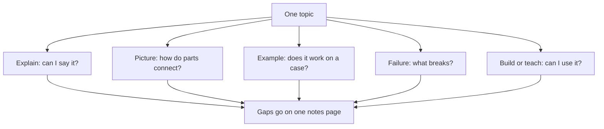

## "The cache makes it faster"

Yara is building Qasir, her link shortener for small shops and NGOs. This week her new area is caching. She read three AI explanations of it, and they all made sense. On a call, her mentor asked why Qasir needs a <GlossaryTerm term="cache" definition="A small, fast store that keeps copies of answers that are asked for often, so the app does not have to fetch them from the database every time." />.

"It makes Qasir faster," Yara said. Her mentor asked two more questions. "Faster how, exactly? And what happens when a shop changes where one of its short links points?" Yara did not know. She had read about caching from one side three times. Every explanation answered the question "what is a cache?", and none of them made her think about what goes wrong.

That is the limit of one explanation, however good. It shows the topic from one side. This chapter gives you five sides, so that each one can show you a gap the others hide.

## Five angles, five questions

The course calls them the five angles. Each one asks a different question about the same topic.

The first angle is a plain explanation in your own words. Ask the AI to explain the topic simply. Then close it and write your own version, as you did in chapter 3.2. The question it answers is: can I say it simply, without the text in front of me?

The second angle is a picture. Ask a chat assistant to draw the idea as boxes and arrows, then check every box and arrow against a source you trust. The question is: how do the parts connect? At the time of writing (checked 2026-10-24), chat assistants such as Gemini, ChatGPT and Claude can draw a simple diagram. Claude can make a small diagram next to the chat, called an artifact, but Claude is only for people aged 18 or over. Tools change, so check what yours can do today.

The third angle is a worked example. Take one real case, with real names and numbers, and trace it step by step yourself. The AI can suggest the case, but you do the tracing before you read its answer. The question is: does it work on a real case?

The fourth angle is a failure case. Ask "what breaks?" What happens when one part stops, is slow, gets wrong data or fills up? The question is: where are its limits? This is the angle most explanations leave out, because they describe the topic when everything works.

The fifth angle is building or teaching it. Build a tiny version in a lab, or explain it to a person who can ask questions. The question is: can I use it? A person's questions and a build's errors come from outside your own head, so they find gaps you cannot see.

Where does this come from? No study tests these five angles as a package, and five is the course's number, not a law. But each part is supported on its own. Explaining an idea in your own words helps you learn it, with a moderate benefit in studies. Words with a picture that explains the idea help more than words alone, though decorative pictures do not help. Worked examples help beginners. And every angle ends in recall, which you met in 3.2. Spread the angles over a week, not one evening, and you also get the benefit of spacing.

## Worked example: Lina learns DNS

Lina's exam also covers <GlossaryTerm term="DNS" definition="The Domain Name System: the system that turns a website's name into the number address that computers use to reach it." />. She gives it four evenings and uses all five angles. Watch what each angle finds.

**Angle 1, her own words.** She asks a chat assistant for a plain explanation, reads it once and closes it. Then she writes: "When I type a website's name, my phone asks DNS for its number address. Then it connects to that number." It is correct as far as it goes. But when she tries to add the next sentence, she stops. Who exactly does her phone ask? She writes the question at the bottom of her page. That is gap one.

**Angle 2, a picture.** She asks the chat assistant to draw a DNS lookup as boxes and arrows. Its drawing shows three boxes: the phone, a root server, and the website. She checks it against the DNS slide from her lecture. The slide shows more. The phone asks a resolver, a server often run by the internet provider. The resolver asks the root server, then the server for the ending, such as ".edu", then the domain's own name server. Then it brings the answer back to the phone. The AI's picture skipped the resolver and two servers. She redraws it on paper from the slide. Gap two found, and gap one answered: the phone asks the resolver.

**Angle 3, a worked example.** She traces one lookup by hand for a made-up name, library.example.edu. Phone to resolver. Resolver to root: who handles ".edu"? Root points to the ".edu" servers. They point to the name server for example.edu. That server gives the number address. The resolver passes it to the phone. While tracing the last step in her textbook, she notices something no explanation had mentioned. The answer comes with a time limit: how long the resolver may keep a copy and reuse it. That is gap three.

**Angle 4, a failure case.** She asks herself, then the AI: what breaks if the resolver stops answering? The website itself is still running. But her phone cannot turn the name into a number, so the browser says it cannot find the site. She had always thought "the site is down" and "DNS is down" were the same problem. They are not, and an exam question can test exactly that difference. Gap four.

**Angle 5, teaching.** On her way home she explains DNS to her younger brother in a voice note. He sends back a question. "If a website moves to a new number address, why does the old one still open for some people for a while?" She cannot answer at first. Then she connects it to angle 3: resolvers keep the old answer until its time limit ends. She writes his question and her answer on her notes page. Gap five, and it was found by someone who knew nothing about DNS.

Look at the result. Five angles found five different gaps. The plain explanation found a missing piece. The picture found a wrong drawing. The example found a detail. The failure case found a difference the exam could test. And the teaching found a question Lina would never have asked herself. No single angle found more than two of them.

## What each angle asks

The diagram puts the five questions side by side. Every angle points at the same topic and ends at the same notes page.



What to notice: the five arrows leave the topic in five directions, because each angle asks a question the others do not. They all end at one notes page, which is where the gaps are kept and answered. The takeaway: the angles are not five ways to repeat the same explanation. They are five different tests of one topic, and each test is aimed at a different kind of gap.

## Yara's five angles on caching

Back to Yara. After the call, she gives caching four evenings of her week and works through the five angles with a chat assistant, her notes and her lab. The canvas starts with her first two angles. She writes caching in her own words, and she checks the AI's diagram against the caching chapter of her system design book. Before you step through, make a guess about the third.

```predict
prompt: "Yara has written caching in her own words and checked the AI's diagram against her book. Which angle is more likely to show her that Qasir's click counts could go wrong?"
options:
  - id: trace-two-clicks
    label: "Tracing two clicks on one link, step by step"
  - id: explain-again
    label: "Asking the AI to explain caching more simply"
correctOptionId: trace-two-clicks
explanation: "Click counts only appear when you follow real clicks through the parts. A simpler explanation of caching would describe the cache when everything works. Tracing two clicks shows that the second click never reaches the database."
```

Step through her week, one angle at a time.

<InteractiveCanvas slug="five-angles-on-caching" />

## What the angles found

The canvas showed five gaps, and each came from a different angle. Her own words found that she could not say what happens on a miss, when a short code is not in the cache yet. The picture looked complete but had no arrow for the app saving a copy into the cache after it reads the database. The worked example found the gap that matters most for Qasir. In her first plan, a click was counted when the app read the database. With a cache, the second click never reaches the database, so it would not be counted at all.

None of the other angles would have found the lost clicks, because none of them follows real clicks through the parts. Where to count clicks is a real design decision, and module 5 comes back to it. The failure case answered her mentor's question. When a shop changes where its link points, the cache keeps sending people to the old page until the copy expires or is deleted. And the tiny cache she built in her lab kept every link forever. That raised a question she had never thought to ask: what does a real cache do when it is full?

Notice who did what. The chat assistant explained, drew and answered the failure question, quickly and mostly well. Once it was incomplete: the picture missed an arrow. The gaps were found by Yara's own work: writing from memory, checking the drawing against her book, tracing on paper, building in her lab. The AI made each angle faster. It did not do the angles for her.

## Where it goes wrong

The first mistake is letting the AI do the angles. "Give me a worked example of caching" produces a clear example that you read, and reading is the fluency trap again. Ask the AI for a case if you need one, then trace it yourself before you read its answer.

The second mistake is trusting the picture. An AI diagram looks finished and official, so it is easy to copy straight into your notes. Yara's diagram was neat and still missed an arrow; Lina's skipped the resolver. Check every box and every arrow against a source you trust.

The third mistake is teaching only to an AI. Explaining a topic to a chat assistant can help you put it in words. But AI assistants tend to agree with the user, even when the user is wrong, so it may praise an explanation with a mistake in it. If you teach an AI, ask it to find what is wrong or missing, and check what it says. A person with real questions is better.

The fourth mistake is ticking boxes. You can do all five angles and learn nothing new, if you only do what feels easy. End each angle with one line on your notes page: what did this angle show me that I did not know? If the answer is "nothing" five times, look harder at the failure case.

<Callout type="tip" title="If no tool can draw for you">
Ask any chat assistant for the diagram as text: a list of boxes, then a list of arrows from one box to another. Draw it by hand on paper, then check it against your source. A hand-drawn picture works just as well.
</Callout>

## Check your understanding

```quiz
type: mcq
question: "Odai, Lina's classmate, is learning database indexes for his databases course. He has explained indexes in his own words and drawn a picture he checked against his textbook. In a practice interview with 3 classmates, someone asks: 'What does an index cost you when the table gets 1,000 new rows a day?' He has no idea. Which angle would most likely have found this gap?"
options:
  - "A clearer plain explanation of what an index is"
  - "A failure case: asking what an index makes slower"
  - "A second picture, drawn by a different chat assistant"
  - "A worked example of finding one row with the index"
correct: 1
explanations:
  - "His plain explanation is already fine. Explaining again what an index is says nothing about what it costs."
  - "Right. The question is about a cost and a limit, which is what the failure angle asks: what gets slower, what breaks, what does it cost? An index speeds up finding rows but adds work every time a row is added."
  - "His picture already matches his textbook. A second picture of the same parts would not show a cost."
  - "A worked search shows the index helping. The gap is about adding rows, which that example never touches."
```

```quiz
type: mcq
question: "Jana is at a coding bootcamp. She asked a chat assistant to draw how login works in her class project: browser, server and database, with 6 arrows. The drawing is neat and clear. What should she do before it goes into her notes?"
options:
  - "Copy it into her notes, since a neat diagram is usually right"
  - "Ask the chat assistant for a more colourful version of it"
  - "Ask the chat assistant whether its own diagram is correct"
  - "Check every arrow against her project's own code"
correct: 3
explanations:
  - "Neat is not the same as correct. Yara's caching diagram in this chapter was clear and still had an arrow missing."
  - "Colour can make a picture nicer, but decoration does not help learning. What matters is whether each arrow is true."
  - "AI assistants tend to agree with the user, and a tool checking its own drawing can repeat its own mistake. The check needs a source outside the chat."
  - "Right. A picture helps only if it explains the real thing. Checking each arrow against her own code turns the drawing into something she can trust and learn from."
```

**Next:** Make the AI quiz you, one question at a time, and plan your reviews days apart.
