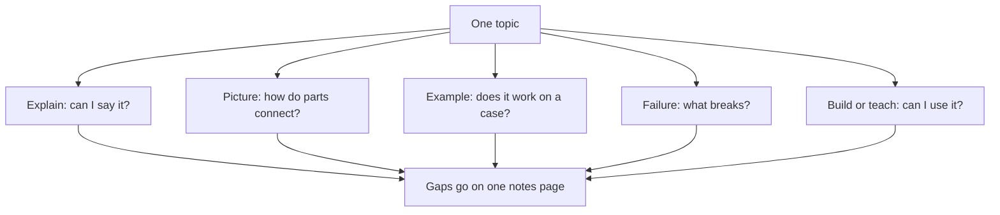

## "The cache makes it faster"

Yara is building Qasir, her link shortener for small shops and NGOs. In week 7 of her plan, her new area is caching. She read three AI explanations of it, and they all made sense. On a call, her mentor asked why Qasir needs a <GlossaryTerm term="cache" definition="A small, fast store that keeps copies of answers that are asked for often, so the app does not have to fetch them from the database every time." />.

"It makes Qasir faster," Yara said. Her mentor asked two more questions. "Faster how, exactly? And what happens when a shop changes where one of its short links points?" Yara did not know. She had read about caching from one side three times. Every explanation answered the question "what is a cache?", and none of them made her think about what goes wrong.

That is the limit of one explanation, however good. It shows the topic from one side. This chapter gives you five sides, so that each one can show you a gap the others hide.

## Five angles, five questions

The course calls them the five angles. Each one asks a different question about the same topic.

The first angle is a plain explanation in your own words. Ask the AI to explain the topic simply. Then close it and write your own version, as you did in chapter 3.2. The question it answers is: can I say it simply, without the text in front of me?

The second angle is a picture. The question is: how do the parts connect? Ask any chat assistant for a diagram as text, a list of boxes and then a list of arrows, and draw it yourself. Or use the diagram it draws, if it can draw one. At the time of writing (checked 2026-10-24), Claude can make a small diagram next to the chat, called an artifact; Claude is only for people aged 18 or over. Gemini's Guided Learning replies may include images and diagrams. Tools change, so check what yours can do today. Whichever way you get the picture, check every box and arrow against a source you trust.

The third angle is a worked example. Take one real case, with real names and numbers, and trace it step by step yourself. The AI can suggest the case, but you do the tracing before you read its answer. The question is: does it work on a real case?

The fourth angle is a failure case. Ask "what breaks?" What happens when one part stops, is slow, gets wrong data or fills up? The question is: where are its limits? Most explanations leave this angle out, because they describe the topic when everything works.

The fifth angle is building or teaching it. Build a small version in a lab, or explain it to a person who can ask questions. The question is: can I use it? A person's questions and a build's errors come from outside your own head, so they find gaps you cannot see.

Where does this come from? No study tests these five angles as a package, and five is the course's number, not a law. But each part is supported on its own. Explaining an idea in your own words helps you learn it, with a moderate benefit in studies. Words with a picture that explains the idea help more than words alone, though decorative pictures do not help. Worked examples help beginners. And every angle ends in recall, which you met in 3.2. Spread the angles over a week, not one evening, and you also get the benefit of spacing.

## Worked example: Lina learns the library's laptop rule

Lina's exam is about computer networks, but this week she practises the five angles on something every reader can check: the community library's laptop rule from chapter 3.2. She wants to borrow a laptop for her revision. She gives the rule four evenings and uses all five angles. Watch what each angle finds.

**Angle 1, her own words.** She asks a chat assistant for a plain explanation of the rule, reads it once and closes it. Then she writes: "A member books a laptop the day before and can keep it for a week. If nobody else wants it, you can keep it for a second week." When she tries to add the next sentence, she stops. How exactly do you get the second week? She writes the question at the bottom of her page. That is gap one.

**Angle 2, a picture.** She asks the chat assistant for the loan as boxes and arrows. Its picture goes from Book to Collect to Use to Return, with a Renew arrow from Use back to Collect. She checks it against the rules sheet. The sheet says you renew in person, with the laptop in your hands, and only if nobody else has booked it. The AI's Renew arrow has no condition at all. She redraws it with a question on the arrow: "Has anyone else booked it?" Gap two found, and gap one answered.

**Angle 3, a worked example.** She traces one loan for herself, with dates, line by line from the sheet. She books on Sunday, collects the laptop on Monday after 10:00, and it is due the next Monday. On that Monday she returns the laptop but leaves the charger at home. The sheet says a laptop returned without its charger counts as not returned. So she is late until she brings the charger on Tuesday, and she cannot borrow for one day. No explanation had said that a small thing like a charger can make you late. That is gap three.

**Angle 4, a failure case.** She asks herself, then the AI: what breaks when I need a laptop on a certain day? You book only the day before, and the library has six laptops for forty members. So on a busy day, there may be none left, and the rule gives her no way to reserve one earlier. She had always thought "I am a member" meant "I can have one". The rule only says she may ask. A plan for her revision week needs a second way to study. Gap four.

**Angle 5, teaching.** On her way home she explains the rule to her younger brother in a voice note. He sends back a question. "If the library is closed on the day I must return it, am I late?" She cannot answer. The sheet does not say. She writes his question on her notes page as one to ask the staff. Gap five, and it was found by someone who had never read the rule.

Five angles found five different gaps. The plain explanation found a missing step. The picture found a wrong drawing. The example found a small detail that changes the result. The failure case found a limit of the rule. And the teaching found a question Lina would never have asked herself.

## What each angle asks

The diagram puts the five questions side by side. Every angle points at the same topic and ends at the same notes page.



Which angle would have found Lina's gap three, the charger that makes a loan late? Only one: tracing a real loan to the end. The five arrows leave the topic in five directions because each angle tests it in a different way. A gap that one test cannot reach is often easy to see from another.

## Yara's five angles on caching

Back to Yara, in week 7. She works through the five angles with a chat assistant, her notes and her lab. Her build angle comes from her lab days 3 and 4, which you will follow more closely in module 4. The canvas starts with her first two angles. She writes caching in her own words, and she checks the AI's diagram against the caching chapter of her system design book.

```predict
prompt: "Yara has written caching in her own words and checked the AI's diagram against her book. Next she traces two clicks on one short link, step by step on paper. What will the trace show her?"
options:
  - id: all-fine
    label: "That both clicks work, so the plan is ready"
  - id: count-gap
    label: "That one click might not be counted at all"
correctOptionId: count-gap
explanation: "Both clicks do send the person to the right page. But in Yara's first plan, a click was counted when the app read the database. The second click is answered by the cache and never reaches the database, so it would not be counted."
```

Step through her week, one angle at a time.

<InteractiveCanvas slug="five-angles-on-caching" />

## What the angles found

The canvas showed five gaps, and each came from a different angle. Her own words found that she could not say what happens on a miss, when a short code is not in the cache yet. The picture looked complete but had no arrow for the app saving a copy into the cache after it reads the database. The worked example found the gap that matters most for Qasir: the second click would not be counted, because it never reaches the database.

None of the other angles would have found the lost clicks, because none of them follows real clicks through the parts. Where to count clicks when many people click is a real design decision, and module 5 comes back to it. The failure case answered her mentor's question. When a shop changes where its link points, the cache keeps sending people to the old page until the copy expires or is deleted.

Her lab gave the fifth gap. On lab day 3 she made Qasir's log say, for each click, whether the cache or the database answered it. Before that she had no way to tell. A click answered by the cache and one answered by the database look the same to the person clicking. So how would she know the cache was working at all? Now the log shows it, and on lab day 4 she uses that log when she stops the cache on purpose.

Notice who did what. The chat assistant explained, drew and answered the failure question, quickly and mostly well. Once it was incomplete: the picture missed an arrow. The gaps were found by Yara's own work: writing from memory, checking the drawing against her book, tracing on paper, building in her lab. The AI made each angle faster. It did not do the angles for her.

## Where it goes wrong

Who should do the angles, you or the AI? You. If you ask "Give me a worked example of caching", you get a clear example that you read, and reading is the fluency trap again. Ask the AI for a case if you need one, then trace it yourself before you read its answer.

A second mistake is trusting the picture. An AI diagram looks finished and official, so it is easy to copy straight into your notes. Yara's diagram was neat and still missed an arrow; the library diagram let anyone renew. Check every box and every arrow against a source you trust.

A third mistake is teaching only to an AI. Explaining a topic to a chat assistant can help you put it in words. But remember the agreeing habit from chapter 2.2: it may praise an explanation with a mistake in it. If you teach an AI, ask it to find what is wrong or missing, and check what it says. A person with real questions is better.

<Callout type="tip" title="If no tool can draw for you">
Ask any chat assistant for the diagram as text: a list of boxes, then a list of arrows from one box to another. Draw it by hand on paper, then check it against your source. A hand-drawn picture works just as well.
</Callout>

## Check your understanding

```quiz
type: mcq
question: "Tareq is learning how websites send password reset emails, for his bootcamp project. His notes page shows: own words, done; picture, done and checked against his course notes; worked example, done (one reset email traced); what breaks, empty; build or teach, empty. His mentor asks: 'What happens if the reset email arrives an hour late, or arrives twice?' Which angle should he work on next?"
options:
  - "The failure case, because his mentor is asking what goes wrong"
  - "Teaching it, because a listener's questions find hidden gaps"
  - "A second worked example, because one traced email is too few"
  - "A clearer own-words version, because that angle comes first"
correct: 0
explanations:
  - "Right. A late or doubled email is a failure case: the question is what breaks, and that row of his page is empty. Teaching may find it too, later, but this angle aims straight at it."
  - "Teaching does find gaps a person cannot see alone, so it is worth doing. But the mentor has already asked the failure question, and the failure angle answers it directly."
  - "A second example would show another email working. The mentor's question is about what happens when sending goes wrong."
  - "His own-words version is already done. Writing it again would not touch late or doubled emails."
```

```quiz
type: mcq
question: "Jana, at a coding bootcamp, asked a chat assistant to draw how login works in her class project. 1) The drawing has 6 arrows. 2) She checked 5 of them against her project's code, and they match. 3) The sixth arrow shows the server sending her password back to the browser. 4) Her code never sends the password back. What should she do?"
options:
  - "Keep the drawing as it is, since 5 of the 6 arrows match"
  - "Ask the assistant if arrow 6 is right, since it made the drawing"
  - "Remove arrow 6, since her code is the source to check against"
  - "Change her code to match the drawing, since AI knows the pattern"
correct: 2
explanations:
  - "Five matching arrows are a good sign, but a picture with one false arrow teaches a false step. The sixth arrow disagrees with her code."
  - "Asking feels like checking, but remember the agreeing habit from chapter 2.2: the assistant may simply defend or repeat its own drawing. The check needs a source outside the chat."
  - "Right. Her own code is the source here. Removing the false arrow turns the drawing into a picture she can trust and learn from."
  - "AI drawings can be wrong, and sending a password back to the browser is a step her design deliberately leaves out. The code is the source; the drawing must follow it."
```

**Next:** Make the AI quiz you, one question at a time, and plan your reviews days apart.
