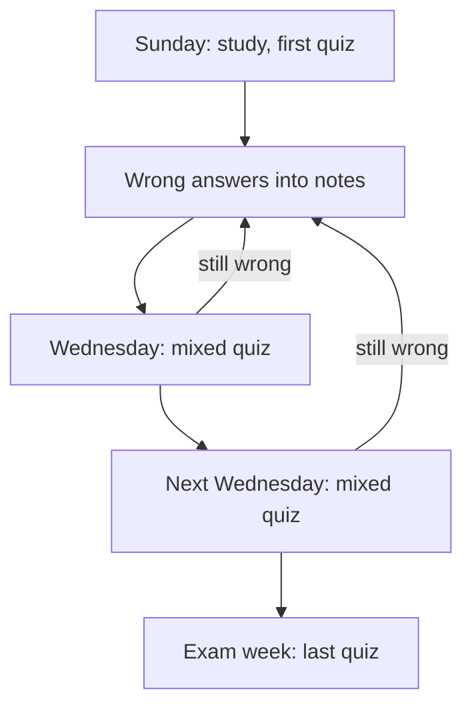

## Ten questions, ten answers

Lina's next topic is the difference between <GlossaryTerm term="TCP" definition="A way of sending data across a network that checks every piece arrives, puts the pieces in order, and sends lost pieces again." /> and <GlossaryTerm term="UDP" definition="A way of sending data that sends each piece once and does not wait or resend, so it has less delay but pieces can be lost." />. After chapter 3.2, she knows reading is not enough. So she types: "Quiz me on TCP and UDP."

The chat assistant replies at once with ten questions. Under each question is its answer. Lina reads question 1, and before she has thought about it, her eyes drop to the answer. The same happens with question 2, and with every question after it. Ten questions later she has "done a quiz" and recalled nothing. It was an explanation in the shape of a quiz.

The AI did what she asked, in the way that looked most helpful. It could not know that the help she needed was for it to stop and wait. This chapter shows you how to ask for that, and how to plan when to ask again.

## Who does the recall

The difference between a useful quiz and a useless one is simple. Who pulls the answer out of memory: you, or the AI? If the answer is on the screen before you try, the AI did the recall and you read it.

There is research on why this matters. Producing an answer yourself, for example filling in a gap, leads to better memory than reading the same answer. A review of 86 studies found a moderate benefit on average. Most of those studies used word lists, and the size changes with the conditions, so take the direction more seriously than the number.

You also met a study in chapter 1.4 that fits here exactly. Students who used a normal AI chat during maths practice did better in practice and worse in the exam without it. A version that gave hints instead of answers did not cause that harm. A quiz with the answers attached is the answer-giving version. A quiz that waits, and gives hints before answers, is the other one.

Some chat assistants now have a mode built for this. At the time of writing (checked 2026-10-24), ChatGPT has a study mode that asks you questions instead of giving the answer. Its own help page says it can make mistakes. Gemini has a Guided Learning mode that teaches step by step; check whether it works in your language and your country. These modes are designed to make you think. We found no large study that has tested whether they improve learning yet.

You do not need a special mode. Any chat assistant will quiz you well if you tell it how. That is your fallback for every tool: "Do not give me the answer. Ask me one question at a time." Check the age rule too. Claude is only for people aged 18 or over, ChatGPT needs a guardian's permission under 18, and Gemini is for people aged 13 or over.

## Mix two topics that look alike

The second habit is about which questions go together. Lina could practise all her TCP questions, then all her UDP questions. That is called blocked practice. Or she could mix them, so that each question first makes her decide which of the two fits. That mixing is interleaving, from the key words in chapter 3.1.

Mixing helps because the exam will not tell her which protocol a question is about. Deciding which one fits is part of the skill. Blocked practice skips that decision, so it feels smoother and teaches less of it.

The evidence is real but has limits. A review of many studies found a medium benefit overall, with big differences between studies. The benefit was largest for telling apart visual things, such as the styles of different painters, and small for maths tasks. In one study, most learners still believed blocked practice had worked better for them, even after their own test showed the opposite. That is the fluency trap again.

So use mixing for similar things that you must tell apart: TCP and UDP, two kinds of database join, two ways to lay out a web page. Do not treat it as a rule for everything. Mixing two unrelated topics gives you little.

## Come back after a few days

The third habit is about when. Spreading study over several days beats cramming it into one session. It is one of the two highest-rated study methods in the large review you met in 3.2, next to testing yourself.

How long should the gap be? It depends on how long you need to remember. In one large study, the best gap was longer when the test was further away. So there is no magic number of days. This course uses a rule of thumb, which means a simple guide that usually works but is not exact. Come back after a few days, then after a week or two. Each time, quiz yourself again, mixed, starting with what you got wrong last time.

## Worked example: Lina writes her quiz prompt

Lina tries again, and this time she writes her request line by line. Here is what she sends, followed by the reason for each line.

```text
I am studying TCP and UDP for a computer networks exam.
Quiz me on both, mixed together, using real cases
such as a video call, a file download or an online game.
Ask one question at a time, then stop and wait for my answer.
Do not give me the answer before I try.
If I am wrong or stuck, give me a hint first, not the answer.
After my second try, tell me if I was right and why, in two sentences.
After 8 questions, list the questions I got wrong.
```

The first line gives the AI her context: a networks exam, not a job interview or a research paper. Without it, the questions could be pitched far too high or too low. The second and third lines ask for mixing, and for real cases rather than definitions. "Which one does a video call use, and why?" makes her apply the idea. "What does TCP stand for?" only tests a name.

The fourth and fifth lines matter most. One question at a time, then stop. Without "stop and wait", many assistants will ask a question and answer it in the same reply, because that looks complete. The sixth line asks for a hint before the answer, which keeps the recall with Lina even when she is stuck.

The seventh line keeps feedback short. A long explanation after every answer would pull her back into reading. Two sentences tell her whether she was right and why, and then the next question comes. The last line gives her a list to copy into her notes: the questions she got wrong are where her next review starts.

Lina also decides what not to paste. She wants the quiz to match her course, so she pastes a page of her own lecture notes. First she runs the check from module 2: would she be fine if a stranger read this? Her notes are fine. The page of the group project, with her classmates' names and phone numbers, stays out.

One more rule goes in her notes rather than in the prompt. The quiz partner can be wrong. If its answer disagrees with her lecture notes or her textbook, the sources win, and she checks before she believes either. A disagreement is worth writing down, because it is often exactly the point an exam tests.

## Lina's review plan

A good quiz session is only the first visit. The diagram shows how Lina spreads her TCP and UDP practice over the weeks before her exam, and where her mistakes go.



Look at the two arrows marked "still wrong". Without them, the diagram would be a list of dates. With them, each quiz starts from what the last one found, so the plan keeps aiming at her gaps. The gaps between quizzes also grow, from three days to a week, as the course's rule of thumb suggests.

## Lina's quiz session

Now watch the session itself, from the first ask to the planned reviews. Before you step through, make a guess about the second question.

```predict
prompt: "In Lina's quiz, the first question is about a video call, and she answers it correctly with a good reason. The next question, mixed in, is about sending a file. What do you expect from her first answer?"
options:
  - id: right-again
    label: "Right, as she has just shown she knows the difference"
  - id: wrong-rule
    label: "Wrong, because the mixed question exposes a faulty rule"
correctOptionId: wrong-rule
explanation: "A right answer can come from a wrong rule. If Lina is choosing by 'which one is faster', the video call question rewards her, and only a question where speed is the wrong reason shows the problem. Mixed questions put those two side by side."
```

Step through it and watch who produces each answer.

<InteractiveCanvas slug="ai-quiz-partner" />

## What it showed

The first step looked like studying, yet Lina produced none of the answer. It was clear and correct, and the AI did all of the recall. From the second step on, the work moved to her. Each question made her decide between TCP and UDP for a real case, and say why.

The mixed questions showed something a block of TCP questions would have hidden. After the video call, she answered the file question with UDP "because it is faster". She was choosing by speed, not by what the task needs. The hint, "What happens to the file if one piece never arrives?", let her find the right answer herself, and the reason came with it. Then the miss went into her notes, and her next two reviews were set three days and then a week apart.

Notice the division of work. The AI chose the questions, waited and gave hints. Lina did every act of recall. That is the same AI as in step 1, used in a different way.

## Where it goes wrong

The first problem is drift. After a few questions, the assistant may slide back into long explanations, or start answering before you try. When that happens, say so plainly: "Remember: one question, then wait for my answer." Your saved prompt in your notes makes this quick to fix.

The second problem is trusting the quiz partner over your sources. It can mark a right answer wrong, or a wrong answer right. When its answer disagrees with your lecture notes or textbook, check the source before you accept either.

The third problem is a plan that never happens. Reviews you meant to do "in a few days" are easy to forget. Write the dates on your notes page or in your phone's calendar, with the first question to ask.

<Callout type="tip" title="Save the prompt">
Keep your quiz prompt in your notes. Next time, change only the topic line. It works the same in any chat assistant.
</Callout>

## Check your understanding

```quiz
type: mcq
question: "Maram is learning CSS for her small online shop, which sells 40 handmade products. She sends a chat assistant this request: 'Quiz me on the 5 CSS layout rules I studied today. Ask all 5 questions now, and put the answers at the bottom.' Which change would make her do the recall?"
options:
  - "Put each answer under its question, so checking is quicker"
  - "Ask for 10 questions instead of 5, so she gets more practice"
  - "Ask it to explain the rules first, so the questions feel easier"
  - "Ask one question at a time and wait, so she answers first"
correct: 3
explanations:
  - "Quicker checking sounds useful, but an answer right under its question is read before she tries. The quiz turns into reading."
  - "More practice helps only if she is recalling. Ten questions with the answers on the screen have the same problem as five."
  - "An explanation first means the chat assistant does the recalling, and easier questions test recognition, not memory."
  - "Right. With one question at a time and the assistant waiting, Maram must pull each answer from memory before she sees any help."
```

```quiz
type: mcq
question: "Tareq is at a 3-month coding bootcamp. He learned how web forms send data on day 1, and his test on it is on day 15. Which review plan follows this chapter's rule of thumb?"
options:
  - "Review on days 2, 3, 4 and 5, so it never has time to fade"
  - "Quiz himself on day 4 and day 12, so the gaps grow over time"
  - "One long review on day 14, so it is fresh for the test"
  - "Reread his notes on days 1 and 2, since it is easy to follow then"
correct: 1
explanations:
  - "Four reviews close together feel safe, but they leave ten days before the test with no review at all. The rule of thumb adds a later, longer gap."
  - "Right. Day 4 is a few days after learning, and day 12 is about a week after that, three days before the test. It is a rule of thumb, not an exact law."
  - "Fresh on the day feels useful, but one long session the night before is cramming. Spreading study over days is one of the two best-supported study methods."
  - "Easy to follow is the problem: rereading is not recall, and nothing happens in the twelve days before the test."
```

**Next:** Listen to meet a topic, then read the sources and check what the audio got wrong.
