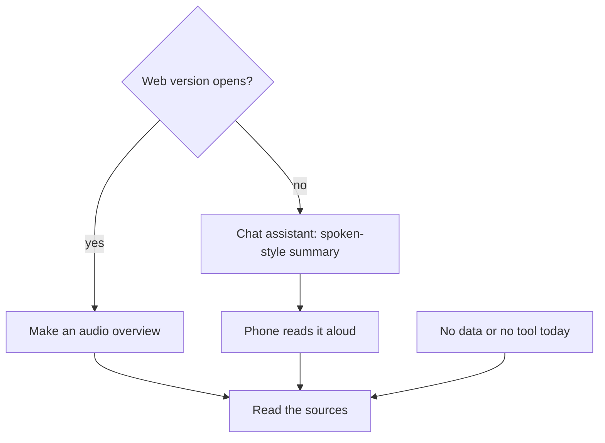

## Every word, and no use

Odai, Lina's classmate, found a way to study on his long walk to the university. He made an audio overview of the routing chapter and listened to it three times in one week. By the end, every word felt familiar: next hop, default route, <GlossaryTerm term="routing table" definition="A list inside a router that says, for each group of addresses, where to send a packet (a small piece of data) next." />.

Then, in the network lab, the lecturer put a routing table on the screen and gave him an address. "Which way does this packet go?" Odai knew every word in the table. He could not use them. He picked the first line that looked right, and it was the wrong one.

Listening was not a mistake. It did the first part of the job: the words were familiar, and the topic no longer felt strange. But Odai stopped there, as if meeting the words were the same as being able to use them. This chapter shows you how to use audio for what it does well, and what to do after it.

## Listen to meet it, read to learn it

Most fellows have time when they cannot read but can listen: walking to university or work, waiting at a clinic or a bus stop, doing chores. Listening while you walk, wait or do chores is a good way to meet a topic for the first time. You hear the main ideas and the new words, so that when you sit down to read, less of it is new.

What does the research say about listening and reading? A review of 46 studies found no reliable overall difference between understanding from listening and from reading. Reading had a small advantage in two cases. One was when readers could set their own pace. The other was on questions that need you to work something out, not just repeat it. That fits Odai's lab question exactly. Reading lets you slow down, go back, and stop at the hard part until it makes sense.

So the course's design is: listen first, then read. Let the audio introduce the topic while you walk or wait, then read the sources at your desk, slowly, where the hard parts are. This order is the course's design, not a tested sequence. What the evidence supports is that both work, and that reading at your own pace helps with the hard parts.

There is one more step, because the audio is made by AI. After you read, pick one claim the audio made and check it against the page. That turns the audio from something you trust into something you test.

## What a source notebook adds, and what it does not

You met the source notebook in module 2: a tool that answers from the files and links you give it. At the time of writing (checked 2026-10-24), Gemini Notebook, called NotebookLM until July 2026, is one example. It can turn your sources into an audio overview in several formats, short or long. You can focus it with a prompt, for example on one part of a chapter or for a beginner. It can make the audio in many languages, including Arabic. But the longest option, and the mode where you talk back to the speakers, were English only when we checked. It also makes study guides, flashcards, quizzes and mind maps. Check its help page for what it can do today.

Access matters more than features. When we checked, its web version listed Palestine as a supported place, and its phone app did not. So open the web version in your phone's browser rather than looking for the app. The web version has a download option for the audio. Before you download, check the size of the file, because audio can use a lot of data.

Now the limit. Answering from your sources makes mistakes less likely, but it does not stop them. Google itself says audio overviews "may contain inaccuracies". The speakers summarise, simplify and talk in a friendly way, and a simplification can quietly become wrong. Treat the overview as a starting point, not as the source.

If the tool does not open for you, is out of free use, or has changed, use the fallback. Paste the text of your sources into a chat assistant such as Gemini, ChatGPT or Claude (Claude is for people aged 18 or over). Ask for a spoken-style summary, then let your phone's <GlossaryTerm term="text-to-speech" definition="A phone feature that reads the text on the screen aloud." /> read it to you. Or skip the audio and go straight to reading. The audio is optional; the reading and the check are not.

## Worked example: Lina sets up her routing week

Lina wants to learn routing without falling into Odai's trap. Here is how she sets up her week, step by step, with her reasons.

**She chooses three trusted sources.** Her lecturer's slides on routing, the routing chapter of the textbook her lecturer set, and the lab sheet from her university network lab. She leaves out a video by a channel she does not know and an old forum thread with no author. Her reason: a source notebook only answers from what you give it. Weak sources go in, and confident audio comes out.

**She runs the check from module 2 before uploading.** Would she be fine if a stranger read this? The slides and the textbook pages are fine. The last page of the lab sheet has her lab partner's name and student number, so she leaves that page out. If she were unsure whether her course allows uploading its slides, she would use her own notes instead.

**She writes a focus prompt.** "Focus on how a router decides where to send a packet. I am a second-year student with an exam in three weeks. Use the words from my lecture slides." Without a focus, the overview might spend most of its time on history or on parts her exam does not cover.

**She chooses a short overview and a language.** A short one is enough to meet the topic, and she can make another later. She chooses English, because her exam and her textbook use English words. Some of her classmates make a first overview in Arabic to meet the ideas, then read the English sources. Either way, she checks what she actually gets.

**She checks the size before she downloads.** She has little mobile data left this week. Her plan's data is cheaper at night, so she downloads the file after midnight and listens offline the next day. On the day the download option did not work in her browser, she listened while connected at a café with internet instead.

**She plans the reading.** Listening is on the walk to the university. Reading is at her desk, the same evening, with the textbook chapter open and a pen. And she writes one question on her notes page before she starts: "Which claim from the audio will I check?"

## If the tool will not open

The diagram shows Lina's choices when a tool, an app or her data runs out. Every route ends in the same place.



What to notice: there are three ways in, and they all end at "Read the sources". The audio is the part that can be swapped or dropped. The reading cannot. The takeaway: a missing tool changes how you meet a topic, not how you learn it.

## From the walk to the page

Lina's audio overview was made only from her three trusted sources. She listens on her walk, reads the textbook chapter that evening, and then picks one claim to check.

```predict
prompt: "The audio overview was made only from Lina's three trusted sources. She picks one claim it made about how a router chooses a route, and opens the textbook page. What do you expect?"
options:
  - id: it-matches
    label: "It will match, since it used only her sources"
  - id: it-differs
    label: "The page may say something different"
correctOptionId: it-differs
explanation: "Using only her sources makes mistakes less likely, not impossible. The overview is a spoken summary, and summaries simplify. Google itself warns that audio overviews may contain inaccuracies. The only way to know is to read the page."
```

Step through her week, from choosing sources to checking the claim.

<InteractiveCanvas slug="listen-then-read" />

## What the check found

The audio did its job on the walk. Lina knew the main words before she opened the chapter, so she could spend her reading time on the hard part instead of on new vocabulary. That is what "listen to meet it" means.

Then the check found a real mistake. The audio said a router sends each packet using the first route in its table that matches. The textbook says that when several routes match, the router uses the most specific one: the route that matches the most of the address. In Lina's own example, a table has one route for 10.0.0.0/8 and another for 10.1.0.0/16. A packet for 10.1.5.9 matches both, and it takes the /16 route, because that one is more specific. The audio also left out what happens when no route matches: the router uses its default route if it has one.

Both details are exactly what an exam question would test. And the first one is the mistake Odai made in the lab, when he picked the first line that looked right. The audio was friendly, confident and made from good sources, and it still taught the wrong rule. Reading the page found it. Without the check, Lina would have studied a wrong fact with full confidence.

## Where it goes wrong

The first mistake is listening only. Audio does the first part of the job, as it did for Odai. If you never read and never test yourself, you know the words and not how to use them.

The second mistake is trusting the audio because it came from your sources. "It only used my sources, so it is correct" is a sentence this course asks you never to believe. The overview can still be wrong. Read the source.

The third mistake is weak sources. An old forum post or a video from an unknown channel goes in looking just like your textbook. The audio then repeats it in the same calm voice. Choose the sources before you choose the format.

The fourth mistake is checking the audio with more audio. Asking the notebook to make the overview again, or asking it whether it was right, can repeat the same mistake. The check needs the page.

The fifth mistake is an expensive download. Check the size before you download, use cheaper data or Wi-Fi when you can, and remember that skipping the audio is always allowed.

<Callout type="info" title="The audio is optional">
Every step in this chapter works without audio. If a tool does not open, your data is low or you prefer to read, go straight to the sources and the check.
</Callout>

## Check your understanding

```quiz
type: mcq
question: "Wael is at a coding bootcamp. He made an audio overview from 3 trusted sources about storing passwords. On his walk home, the audio says: 'Hashing and encryption are the same thing.' His bootcamp handout, one of the 3 sources, has a page on both. What should he do next?"
options:
  - "Open the handout's page on both and compare it with the claim"
  - "Trust the audio, since it was made only from his own sources"
  - "Ask the notebook to make the audio again and listen once more"
  - "Write the claim in his notes now, and check it before the test"
correct: 0
explanations:
  - "Right. The page is the source and the audio is a summary of it. Comparing them shows the audio got this wrong: a hash cannot be turned back, while encryption can be undone with a key."
  - "Answering from his sources makes mistakes less likely, not impossible. Google itself warns that audio overviews may contain inaccuracies."
  - "A new overview made the same way can repeat the same mistake. Only the source page can settle the question."
  - "Writing an unchecked claim into his notes is how a wrong fact becomes something he studies. Check first, then write."
```

```quiz
type: mcq
question: "Noor volunteers at an NGO office and is learning about safe passwords so she can train 20 volunteers. She has little mobile data left this week, and the source notebook's app is not in her phone's app store. What fits this chapter's advice?"
options:
  - "Install the app from a website that offers the download file"
  - "Download the longest audio overview now, on her mobile data"
  - "Use the web version and check the size before downloading"
  - "Drop the topic until the app appears in her phone's app store"
correct: 2
explanations:
  - "An app file from an unknown website can be harmful. The browser is the safe path."
  - "The longest option can be a large file, and it may only be in English. With little data, check the size first, or wait for cheaper data or Wi-Fi."
  - "Right. The web version works in her phone's browser. Knowing the size lets her choose: download on cheaper data, listen while connected, or simply read the sources."
  - "The topic does not depend on one app. The web version, a chat assistant with the phone reading aloud, or plain reading all work."
```

**Next:** Keep notes you own, in your own words: one notebook, one section per area, one page per topic.
