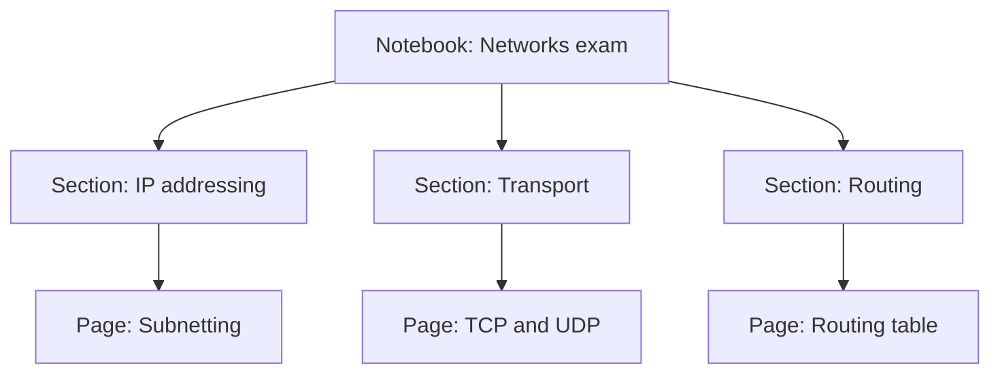

## Fourteen tidy pages

Four weeks into her exam preparation, Lina opens her notes folder to review routing. She has fourteen pages, one for each topic. Every page is tidy, well organised and correct. Every page is a summary a chat assistant wrote, which she pasted in.

She opens the routing page and reads it. It reads smoothly, and she feels she knows it. Then she remembers chapter 3.2 and closes it. What can she test herself with? Nothing on the page asks her anything. Nothing shows which parts she found hard, which claim from the audio was wrong, or what she did in the lab. The page is correct, and almost none of it is hers.

A notes page has two jobs. It must help you find what you learned, months later. And it must help you test yourself on it. A pasted summary does the first job badly and the second not at all. This chapter shows you how to build pages that do both.

## What makes a note yours

The most important rule is simple: write the note in your own words, with the source closed. That turns note-taking into recall. Whatever you cannot write without looking is a gap, and you find it on the day you write the note, not on the day of the exam.

People often ask whether to write by hand or type. An influential 2014 study found that students who typed notes did worse on questions about ideas, because they copied lectures word for word. But when other researchers repeated the study with 145 students, the typists wrote more and copied more, and still did not do worse. A small review of similar studies agreed. Pen or keyboard matters less than what you write. Write the idea in your own words, and leave a question to test yourself later.

Writing summaries is not enough either. The large review of study methods you met in 3.2 rated summarising low. The main reason was that it only helps people who are already trained to summarise well. So the page this chapter teaches is not a summary. It has your explanation, a picture you checked, an example you worked, what breaks, and questions to recall.

That is why an AI summary is not your note. It is the AI's recall of the topic, not yours. Pasting it gives you a tidy page that reads smoothly, which is the fluency trap living inside your own notebook. Use AI around your notes instead. Ask it to quiz you from your page. Ask it what is missing from your explanation, then check what it says. Then write any change yourself.

## One notebook, sections, pages

Good notes have a shape you can find your way around. The course uses three levels. One notebook per project. One section per area. One page per topic.

For Lina, the project is her networks exam. Her notebook has sections for IP addressing, transport, routing and the other areas of her course. Each section has a page per topic: subnetting, TCP and UDP, the routing table. For Yara, the project is Qasir. Her notebook has one section for each of Qasir's areas, such as the database, caching and tests, and her caching page lives in the caching section.

Every page uses the same template. A fixed template means you never face a blank page wondering what to write. It also means every page asks you the same five questions from chapter 3.3, so a missing angle shows up as an empty heading.

## Files you own

Where the notebook lives matters too. You met the habit in module 2: keep your work in files you own and can export. Do not keep it only inside a tool that might change, close or stop opening for you. For notes there are two more needs. They must work without internet, and they must open on the device you actually use.

At the time of writing (checked 2026-10-24), OneNote, Obsidian and Joplin are free examples. OneNote keeps a copy on your device, so you can edit without internet, and syncs your changes when the connection returns. Obsidian keeps your notes as plain text files in a folder you own. Joplin is free and open source, works offline first, and has apps for Android and iPhone. Check that the app installs and opens for you before you rely on it, and check that you can export your notes.

The fallback needs no app at all: a folder of plain text files on your phone, or a paper notebook. The structure matters more than the app. A paper notebook with one page per topic and the five headings beats a perfect app full of pasted summaries.

## Worked example: Lina's subnetting page

Here is the page Lina writes for subnetting, after the recall work in chapter 3.2. Read it, then read why each part is there.

```text
SUBNETTING                 Notebook: Networks exam > IP addressing
Sources: lecture 5 slides; textbook chapter 6
Last reviewed: Friday

In my own words
Splitting one block of addresses into smaller, equal blocks.
Each extra bit in the mask doubles the number of blocks
and halves their size.

Picture (checked against lecture 5, slide 12)
[drawn: one /24 box split into four /26 boxes:
 .0, .64, .128, .192]

Worked example
192.168.10.0/24 into 4 parts: /26, 64 addresses each, 62 usable.
Third part: .128 to .191. Devices use .129 to .190.

What breaks
Give a device the first or last address of a part: it cannot use it.
A part that is too small: device number 63 gets no address.

Taught
Explained it to Odai on Thursday.
He asked: why do 4 parts need 2 extra bits?

Open questions
How do I split a network into parts of different sizes?

Recall questions
Split 10.0.0.0/24 into 8 equal parts: what mask, how many usable?
Why are 2 addresses in every part not usable?

Links: lab sheet 3 (two subnets and a router); quiz log, Wednesday
```

The header says where the page lives and where its facts came from. If Lina doubts a line in four months, she knows which slide and which chapter to open. The "last reviewed" line tells her when she last tested herself on it, which is how spaced review stays honest.

"In my own words" is two sentences, written with the sources closed. It is short on purpose. If she can only write two sentences from memory, the page shows that, instead of hiding it under a long summary. The picture says what it was checked against, because an unchecked AI drawing can be wrong, as you saw in chapter 3.3.

The worked example uses real numbers and is done by her, so she can redo it from memory. "What breaks" holds the two mistakes she made in chapter 3.2, written as failure cases. "Taught" records Odai's question, which showed her a gap she could not see alone.

The last three parts are what make this a working page and not a record. "Open questions" says honestly what she does not know yet. "Recall questions" are what she and her AI quiz partner will use on Wednesday, with no answers written next to them. And "Links" connect the page to the lab where she built two subnets and to the log of her quizzes. A page linked to something you did is easier to trust and to remember than a page that only says things.

## Where a page lives

The diagram shows the three levels in Lina's notebook. Follow any line from the top down.



What to notice: every page is exactly two steps from the top. Choose the area, then the topic. There is never a question of where a new note goes or where an old one is. The takeaway: structure is what makes notes findable months later, and it costs almost nothing to set up on day one.

## A page grows up

A page is not written once. It starts as a few rough lines and becomes useful over several weeks. Here is the life of Lina's routing page, from the week she listened to the audio and checked its claim in chapter 3.5.

```predict
prompt: "Lina has two pages on routing. One is an AI summary she pasted: long, tidy and correct. The other is short, in her own words, with two open questions. Which will help her more in her review six weeks from now?"
options:
  - id: pasted-summary
    label: "The AI summary, as it is longer and tidier"
  - id: own-page
    label: "Her own short page with two questions"
correctOptionId: own-page
explanation: "In six weeks, Lina needs something to test herself with and a record of what she found hard. Her own page has both: the gaps she could not fill and questions to recall. The summary is correct, but reading it only feels like knowing."
```

Step through the page's life, one state at a time.

<InteractiveCanvas slug="note-page-lifecycle" />

## What it showed

The page started as raw lines captured during the week: the claim she checked, the page number, a question from the lab. That was untidy, and it was fine. The move the lifecycle refused was the shortcut: pasting the chat assistant's summary as the page. It would have looked finished, and it would have left Lina where she started.

The real moves were all small. Rewriting with the sources closed turned rough lines into her own explanation, and showed her one more gap. Linking to her lab sheet tied the rule to a table she had actually read. The Friday review was where the page proved useful. She covered it, answered its recall questions, missed one, and fixed the page. By the end, the page was good enough to teach from.

## Where it goes wrong

The first mistake is a perfect template with nothing in it. Setting up headings feels like progress. A page with five headings and empty space under four of them is a plan, not a note. Fill one angle at a time, honestly, and leave an open question where you are stuck.

The second mistake is copying the AI with small changes. Swapping a few words in an AI summary is not your own words. The test is simple: was the source closed while you wrote?

The third mistake is notes you cannot reach. Notes that live only online fail when the connection does. Notes inside a tool you do not control can disappear when the tool changes. Keep them offline and exportable, or on paper.

The fourth mistake is never reviewing. A notebook that is only written and never tested is a store, not a study tool. Put a review day on every page, and use the recall questions on it.

<Callout type="tip" title="Try an export today">
Export one page from your notes app, or copy it into a plain text file. If you cannot get your notes out, find that out now, not when the app changes.
</Callout>

## Check your understanding

```quiz
type: mcq
question: "Samer, at a coding bootcamp, pasted a 900-word AI summary of JavaScript promises into his notes. It is correct and well organised. His test is in 10 days. What should he do with it?"
options:
  - "Keep it as his note, since it is correct and well organised"
  - "Close it, write the idea in his own words and add a question"
  - "Highlight the most important lines so the page is easier to use"
  - "Ask the AI to shorten it to 200 words so it is quicker to reread"
correct: 1
explanations:
  - "Correct is not the same as his. Reading a tidy summary is the fluency trap again, and it gives him nothing to test himself with."
  - "Right. Writing with the summary closed is recall, and it shows him what he cannot yet explain. The question gives him something to test himself with in a few days."
  - "Highlighting was rated a low-value study method. The words would still be the AI's, and the page would still have nothing for him to recall."
  - "A shorter summary is still the AI's recall, not his. Quicker rereading is still rereading."
```

```quiz
type: mcq
question: "Jana's bootcamp notes are one long page, about 40 screens on her phone. Before a test, she spends 15 minutes looking for her notes on API keys and does not find them. Which change fits this chapter?"
options:
  - "Ask a chat assistant to search the long page for her each time"
  - "Copy the whole page into a new app with better search tools"
  - "Make the long page shorter by deleting her older notes"
  - "Split it into a section per area and a page per topic"
correct: 3
explanations:
  - "Searching helps once, but it does not fix the shape of her notes. Pasting all of them into a chat also raises the before-you-paste question for anything private."
  - "A new app with the same single page keeps the same problem. The structure matters more than the app."
  - "Older notes may be exactly what her next project needs, and the page would still have no structure."
  - "Right. With a section per area and a page per topic, any note is two steps away: the area, then the topic. API keys would get their own page, with their own recall questions."
```

**Next:** Five short cases to check your learning habits.
