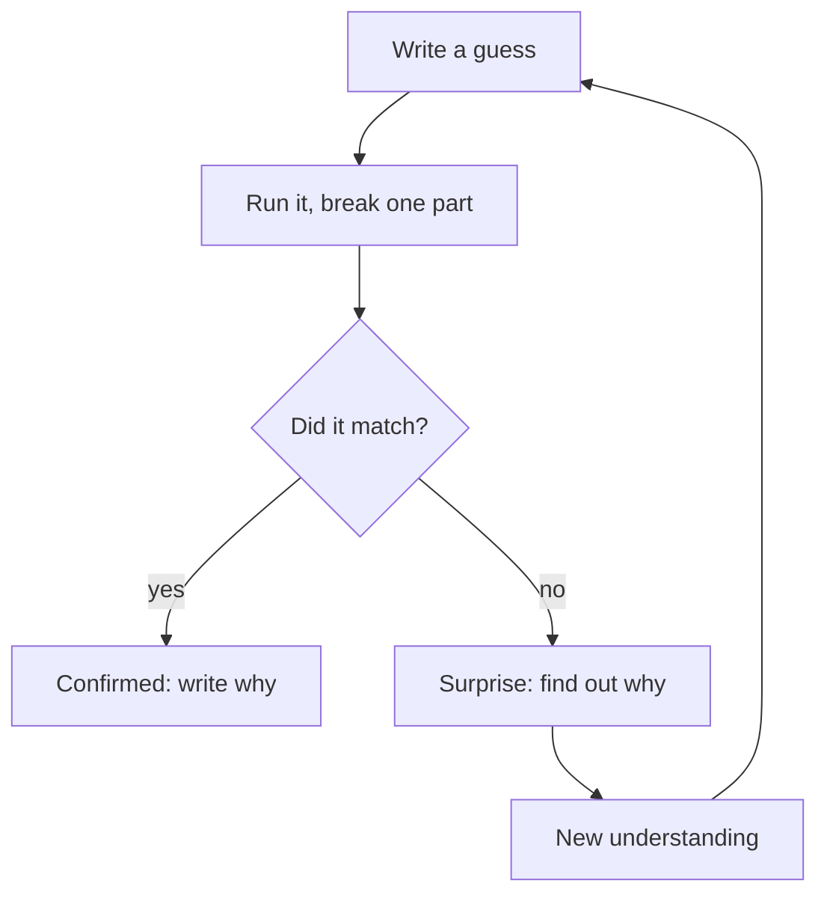

<BigWordAlert term="Lab" plainEnglish="A small, safe practice build that you run, change and break on purpose, to learn how something works." whyItMatters="Watching someone else build feels like learning. Running a thing yourself, and breaking one part of it, shows what you can really explain." />

## Thirty hours of videos

Fadi is a fellow who wants a job as a backend developer. He decided to learn system design: how the parts of a large app fit together and what happens when one of them fails. For one month he watched videos every evening. They showed how a video site stores files, how a chat app sends messages and how a shop survives a sale day. By the end of the month, he had watched about 30 hours. He kept a list of every video he finished, and the list was long.

The videos were good. The speakers drew clear boxes and arrows, and Fadi followed each one while he watched. When a speaker said "and here we add a cache", Fadi nodded. He had seen that box in almost every video. By the end of the month, he felt ready for an interview.

Then his study group met at a café with internet. Each person had to explain one idea in two minutes. Fadi chose the cache, the idea chapter 3.3 looked at from five angles. A friend asked him two questions. "What is the cache for, in an app you know?" And "what does the user see if it stops?" Fadi started, stopped and started again. He said it makes things faster. He could not say how, or what would happen without it.

Fadi was not lazy. He had spent more hours on system design than anyone else in the group. The trouble was the kind of hours. Watching showed him other people's decisions, and it never asked him to make one. He could recognise a cache in a picture. He had never run one, stopped one, or watched what happened next. This is the fluency trap from chapter 3.2 in a new form: a clear video feels like knowing.

## Yara's month

Yara, whom you met in module 1, spent the same month on her project, Qasir. Qasir is a link shortener with click counts, for small shops and NGOs that share links in group chats. Yara gives it about 8 hours a week, on top of this course. Her laptop is old, and she charges it in the evening. During the day she reads and listens on her phone.

In week 7 of her six-month plan, her new area was caching, and she started a lab log. Since week 5, when containers were her area, Qasir has run with <GlossaryTerm term="Docker" definition="A free tool that packs a program with everything it needs into a container, so it runs the same way on any computer." />. Her laptop is too weak for Docker Desktop, the usual way to run Docker on a laptop. So she uses GitHub Codespaces, a computer in the browser that includes Docker. She opens it from her laptop's browser for short sessions. She types her commands in a <GlossaryTerm term="terminal" definition="A window where you type commands as text, instead of clicking buttons." />. Most days, she ran one lab of about 30 to 45 minutes.

On lab day 1, she started Qasir in three containers: the app, a database and a cache. She opened a short link and watched it work. On lab day 4, she stopped the cache on purpose, and then the database. Before each break, she wrote down what she expected to happen. Then she watched, and wrote down what really happened. All of it went into a lab log on GitHub, in a repository called qasir-labs.

In 17 days, Yara ran 10 lab days of about 40 minutes each: under 7 hours of labs. That is far less time than Fadi's 30 hours of videos. One lab ended early when the power went out, so she wrote what she had on her phone and added it to her log the next day. When her study group asked her what a cache is for, she answered with what she had seen. "Qasir looks there first. When I stopped the database, new links could not be saved, so the database is where links really live. Ask me what happened when I stopped the cache, and I can show you the log."

## Fadi tries to change

After that evening, Fadi decides to stop only watching. His first plan is ambitious. Every day for two hours, he will build a full copy of a video site, with uploads, users and a search box, following the videos step by step.

```predict
prompt: "Fadi's new plan: two hours every day, building a full copy of a large video site. Do you expect him to keep it up for a month?"
options:
  - id: probably-not
    label: "Probably not, each day is too big to finish"
  - id: probably-yes
    label: "Probably yes, if he really wants that job"
correctOptionId: probably-not
explanation: "Wanting the job is real, but two hours of building with no end in sight is hard to fit into most days, and a day that never finishes teaches little. Fadi will miss a day, then two, and the plan will feel lost. A lab works because it is small: one question, one run, one thing broken on purpose, one short note, in about 30 to 45 minutes. Chapter 4.2 shows that shape."
```

Fadi's new plan has the right idea and the wrong size. Building is better than only watching. But a full copy of a large site is hundreds of questions, and he would meet them in a random order. He would finish each evening tired, with nothing finished and nothing written down. After a week, the plan would quietly stop.

## Why watching is not enough

Videos and reading are useful. They show you what exists, the words people use, and the shape of a good answer. Yara watches videos too: they are often the study part of her lab. The difference is what she does next. A video only asks you to follow. A lab asks you to do four things that a video cannot.

First, a lab makes you predict. Before Yara stopped the cache, she had to write a guess, and a guess shows you what you really believe. Second, a lab makes you run something real, with real error messages that no speaker planned. Third, you break one part on purpose and watch what changes. Fourth, you write it down in your own words, which is the explaining that chapter 3.3 asked for.

Each of these makes you produce an answer instead of recognising one. That is why Yara could answer her friend's question and Fadi could not. Yara had fewer hours, but every one of them asked her to decide something and then check it.

The diagram shows where a lab's learning comes from. Follow both arrows out of the question box.



A video gives you the right answer without the guess, so the box "Did it match?" never comes up. In a lab, a wrong guess sends you down the right-hand path, to a surprise you have to explain, and that is where most of the learning happens. Yara's notes from her ten lab days have more "no" arrows than "yes" arrows, and those are the days she remembers best.

## Where AI fits in a lab

AI tools make labs much easier to start. A chat assistant can draft a lab plan in a minute, explain an error message in plain words, or suggest a good part to break. Yara uses one in exactly these ways. Without it, planning a lab on a topic she barely knows could take her longer than the lab itself.

But the AI does not know her old laptop, her 40 minutes or the code of her app. Its plan may be too long, or contain a command that has since changed. So the lab stays hers. She cuts the plan to her time, checks each command against the official documentation, runs it, breaks it and explains it. This is the enabler from module 1: the AI makes the work faster, and Yara stays in charge of what she runs and what she claims to understand.

## Why this matters for your career

In this course's view, one kind of question tells a reviewer or an interviewer a lot. It is "what happens if this part fails?" A person who has only watched answers with words they remember. A person who has run labs answers with what they saw. "When I stopped the database, the app could not save new links. Links people had opened recently still worked." That answer is short and specific, and it is hard to give without having done it.

A lab log on GitHub also shows your work over time. A mentor, a client or an employer can open it and see a date on every entry, what you tried and what went wrong. The course's view is that ten small honest entries show more than one big project that nobody can see inside. The capstone in module 6 asks for at least ten lab days over at least two weeks, and they start at the gate of this module.

## What this module covers

This module teaches the daily lab, one habit at a time. Chapter 4.2 gives a lab its shape: study, build, break and write, in about 30 to 45 minutes, and what to do when you get stuck or the power goes. Chapter 4.3 shows how to ask an AI chat for a lab plan, cut it to your time, and check every command and package before you run or install anything.

Chapter 4.4 is Yara's lab day 4. You predict what happens when one part of Qasir stops, then watch it happen. Chapter 4.5 turns a lab into a log on GitHub: one entry a day, clear messages, and a check before every push so no password or key goes public. Chapter 4.6 is a short quiz, and chapter 4.7 is the gate: your own lab day 1, or a review of a provided lab log.

From this module on, the examples give you less step-by-step help, on purpose. Modules 1 to 3 walked through every step. You now have the habits, so the chapters show the important steps in full and leave more of the planning to you. That is how support should work: it comes off as you become able to start alone.

You do not need a strong laptop. At the time of writing (checked 2026-10-24), GitHub Codespaces gives you a computer in the browser that includes Docker, with limited free hours each month; check your usage page. If you only have a phone, every chapter tells the lab as a story with its output, so you can predict first and then read what happened. The gate includes a provided log for you to review.

<LearningObjectives items={["Plan a lab in four parts that fits about 30 to 45 minutes: study, build, break and write", "Ask an AI chat for a lab plan, cut it to your time, and check every command and package before you run or install it", "Predict what happens when one part of a small app stops, then stop it and explain the result", "Keep a lab log on GitHub with clear entries and commit messages, and check for secrets before every push"]} />

## Key words

| Word | Plain English |
|---|---|
| **Container** | A packaged program with everything it needs to run, started and stopped with Docker |
| **Break on purpose** | Stopping or changing one part of a working build to see what that part is for |
| **Lab log** | Short notes on each lab: the goal, what you did, what broke, what you learned and what AI helped with |
| **Commit** | One saved change in a repository, with a short message saying what changed |
| **Push** | Sending your saved commits from your computer to GitHub |

## What is in this module

| Chapter | You will practice |
|---|---|
| 4.2 | Shaping a lab: study, build, break, write, in about 30 to 45 minutes |
| 4.3 | Asking an AI chat for a lab plan, then cutting and checking it |
| 4.4 | Predicting, then stopping one part of a small link shortener |
| 4.5 | Keeping a lab log on GitHub, with a check before every push |
| 4.6 | A graded quiz with five short cases |
| 4.7 | Your lab day 1 on GitHub, or a review of a provided lab log |

**Next:** The shape of a daily lab, and how to keep one small enough to finish.
