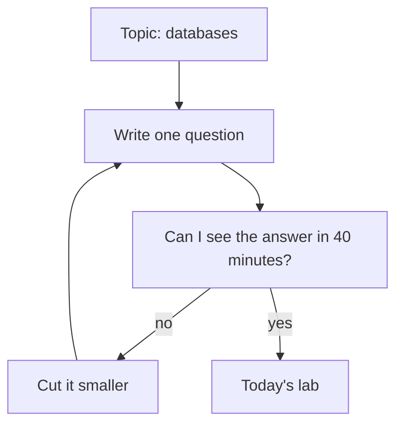

## A lab that never ended

Yara's lab day 2 did not go well. Her plan, written on the bus, said only "learn databases". She opened her codespace at 21:00 and started reading. Then she started changing Qasir's code to try an idea. Then she read some more. At 22:30 her laptop battery was low, two of her changes did not work, and she had written nothing down.

The next evening, she could not remember what she had changed or why. She spent that whole evening undoing her own work. Ninety minutes of effort had left her with less than she started with.

Nothing was wrong with Yara's effort. What was missing was a shape. "Learn databases" is a topic, not a lab. It has no end, so the evening ended when the battery did. This chapter gives a lab four parts and a size, so that each one ends on purpose, with something written down.

## Four parts, one question

A daily lab answers one question, in four parts. The minutes are the course's guide, not a law. Adjust them to your day, but keep all four parts.

**Study, about 10 minutes.** Read or watch just enough to answer today's question: a notes page, one page of documentation, part of a video. You are not trying to learn the whole topic. You are loading what you need for the next half hour.

**Build, about 15 to 20 minutes.** Make one small change, or run one thing, that answers the question. This is the part that grows if you let it, so it gets a firm end time.

**Break one thing on purpose, about 5 to 10 minutes.** Stop, remove or change one part, and watch what happens. Write your guess first. A guess you wrote down before you looked is what turns a surprise into a lesson.

**Write, about 5 to 10 minutes.** A short entry with five parts: the goal, what you did, what broke, what you learned, and what AI helped with. End with the next step. Chapter 4.5 turns these entries into a log on GitHub.

Add the smallest numbers and you get 35 minutes; add the largest and you get 50. In practice one part is often shorter, so most of Yara's lab days take about 30 to 45 minutes. When a day is short, she cuts the build first and never the write. A build with no note is the lab day 2 problem again.

## Small enough to finish

The hardest part of the shape is the size. A lab is small enough when you can write its question in one sentence, and say what you will see if the answer is yes. "Learn databases" fails both tests. "Where does Qasir keep a short link after I create it?" passes both: she can create a link and look for it.

The diagram shows how Yara turns a topic into today's lab. It is a loop, because the first question you write is often still too big.



What to notice: the topic never enters the lab directly. It always passes through one question and a time check. If the answer to the check is no, you cut the question, not the write-up. The takeaway: a lab is sized by its question, and the question is sized by the time you really have.

## Worked example: planning lab day 3

After lab day 2, Yara plans lab day 3 before she opens her laptop. She has about 40 minutes after charging it in the evening. Here is her reasoning, step by step.

**The question.** Chapter 3.3 taught her that Qasir looks in the cache first and asks the database only when the cache does not hold a link. She has never seen this happen. So her question is: "For each lookup, did the answer come from the cache or from the database?" She can see the answer if each lookup writes its source in Qasir's log, the lines the app prints as it works.

**Study, 10 minutes.** She rereads her notes page on caching and the 20 lines of Qasir's code that look up a short link. She does not watch a new video. She already has what she needs.

**Build, 15 minutes.** She plans to add two things to the log line for each lookup: where the answer came from, and how many milliseconds it took. That gives her the answer and a number to compare. Her build ends at minute 25, whatever happens.

**Break, 5 minutes.** She needs one thing to break. She decides to type a short code in capital letters, /K7QA instead of /k7Qa, and see what Qasir does. Before she tries it, she will write her guess.

**Write, 10 minutes.** She keeps a full 10 minutes, because lab day 2 taught her what happens without them. Her total is 10 + 15 + 5 + 10 = 40 minutes.

Notice what she left out: no new topic, no second change, no "while I am here". Every minute points at one question. That is what makes the lab small enough to finish on a tired evening.

## When the build gets stuck

Plans meet real code. On lab day 3, something goes wrong in the middle of the build.

```predict
prompt: "It is minute 18 of Yara's lab day 3. After her change, the app will not start, and her build time ends at minute 25. What should she do with the next 7 minutes?"
options:
  - id: keep-going
    label: "Keep fixing it until it runs, however long"
  - id: smaller
    label: "Make the change smaller, then run it"
correctOptionId: smaller
explanation: "Seven minutes is not much, and a long fight with one error is how lab day 2 ended with nothing written. Making the step smaller usually gets something running inside the time. Here she can drop the timing and log only where the answer came from. The timing becomes tomorrow's next step, and the break and write parts still happen tonight."
```

Step through Yara's lab day 3 below, including the evening when the power went.

<InteractiveCanvas slug="daily-lab-loop" />

The canvas showed the loop the four parts make, and the two ways a day can leave it. When the build got stuck, Yara did not leave the shape. She went back into the build with a smaller step: one word, cache or db, instead of a word and a time. A chat assistant explained the error message, and she made the fix herself. The app ran at minute 24, and the break and write parts still happened.

The break taught her something she had not planned to learn. /K7QA came from the database and returned "not found". Short codes care about capital letters, and a code the cache does not hold always goes to the database. That is a fact about Qasir she can now explain, because she saw it.

The power cut on lab day 6 left the shape at a different point. Yara could not finish the build, so she did the one part that needs only a phone: she wrote. Three lines in her phone notes gave the goal, where she stopped and the next step. She added them to her log the next day. A short write-up still counts as a lab day, because it keeps the thread. The next lab starts from those three lines instead of from memory.

## What "stuck" means, and the smaller step

A useful guide from this course: if you have made no progress for about five minutes, stop pushing and make the step smaller. Smaller can mean one part of the change instead of all of it. It can mean running the last version that worked and adding one line. It can also mean copying the exact error message into your log and asking a chat assistant to explain what it means.

Asking the AI to explain an error is a good use of it. Asking it to write the whole fix while you watch is the weaker use, because you leave the lab without knowing what was wrong. Yara asked for an explanation, then typed the fix herself.

Some problems cannot be made smaller tonight: a tool that will not install, or a service that is down. Then the smaller step is writing down what you tried, the exact error, and one question to bring to a mentor or to tomorrow's study part. That is still progress. It turns a lost evening into a clear starting point.

## Where the habit goes wrong

The first mistake is a lab with no build. Forty minutes of reading with notes is study, which is useful, but it is not a lab. If nothing ran, nothing broke and nothing surprised you, call it a study session and plan the lab for tomorrow.

The second mistake is breaking without a guess. If you stop a part and then say "I knew that would happen", you have no way to know whether you did. Write the guess first, even one line. A wrong guess is the most useful thing a lab can give you.

The third mistake is a lab that grows every day. Day 1 is 40 minutes, day 5 is 90, and by day 8 there is no lab. When a lab is too big, split it into two days with two questions.

The fourth mistake is treating a missed day as failure. "Daily" means most days, not every day without fail. A daily habit can take weeks to months to feel automatic, and people differ a lot. Yara ran 10 lab days in her first 17 days, not 17. When you miss a day, the next lab is just the next lab, with no double session to make up for it.

## Check your understanding

```quiz
type: mcq
question: "Ruba teaches at a school and is learning to build a small quiz page for her class. She has 35 minutes on Tuesday evenings. Her plan for tonight: study for 10 minutes, build for 25 minutes, then close the laptop. Which change fits the shape of a daily lab best?"
options:
  - "Add 30 more minutes tonight, so the build part has room to grow"
  - "Drop the study part tonight, and build for the full 35 minutes"
  - "Study 10, build 15, break 5, write 5: 35 minutes in all"
  - "Keep her plan, and write one log entry at the end of the month"
correct: 2
explanations:
  - "A longer build is how labs stop ending. She has 35 minutes on Tuesdays; the lab should fit the time she really has."
  - "Without the study part she builds with nothing loaded, and the plan still has no break and no write. Two parts would be missing instead of one."
  - "Right. All four parts fit in her 35 minutes: 10 + 15 + 5 + 5 = 35. The build is shorter, and she gains a break with a guess and a short note."
  - "A month-end entry loses the details of each day. The write part belongs to the lab itself, while what happened is still fresh."
```

```quiz
type: mcq
question: "Mo'men is a freelancer who finds clients on a freelance marketplace. He is 20 minutes into a 40-minute lab on a small web server when the power goes out. His laptop battery shows 8%. What is his best next step?"
options:
  - "Write the goal, where he stopped and his next step, on his phone"
  - "Keep building on the battery until the laptop switches itself off"
  - "Write nothing tonight, because the lab did not reach the end"
  - "Plan a double lab tomorrow to make up for the minutes he lost"
correct: 0
explanations:
  - "Right. Writing needs only a phone and a few minutes. It keeps the thread, so tomorrow's lab starts from his notes instead of from memory."
  - "At 8% the laptop may switch off in the middle of a change, and he would finish with nothing written. The write part matters more than five more minutes of building."
  - "A lab that ends early still taught him something. Without a note he is likely to repeat the same steps tomorrow."
  - "A double lab is the kind of plan that is hard to keep. Tomorrow's lab is just the next lab, starting from tonight's note."
```

**Next:** How to ask an AI chat for a lab plan, and what to check before you run it.
