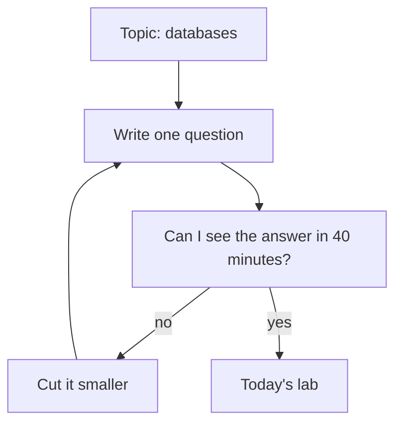

## A lab that never ended

Yara's first try at lab day 2 did not go well. Her plan, written on the bus, said only "learn databases". She opened her codespace at 21:00 and started reading. Then she started changing Qasir's code to try an idea. Then she read some more. At 22:30 her laptop battery was low, two of her changes did not work, and she had written nothing down.

The next evening, she could not remember what she had changed or why. She spent 20 minutes undoing her own work before she could start again. Ninety minutes of effort the night before had left her with less than she started with.

Nothing was wrong with Yara's effort. What was missing was a shape. "Learn databases" is a topic, not a lab. It has no end, so the evening ended when the battery did. This chapter gives a lab four parts and a size, so that each one ends on purpose, with something written down.

## Four parts, one question

A daily lab answers one question, in four parts. The minutes are the course's guide, not a law. Adjust them to your day, but keep all four parts.

**Study, about 10 minutes.** Read or watch just enough to answer today's question: a notes page, one page of documentation, part of a video. You are not trying to learn the whole topic. You are loading what you need for the next half hour.

**Build, about 15 to 20 minutes.** Make one small change, or run one thing, that answers the question. This is the part that grows if you let it, so it gets a firm end time.

**Break one thing on purpose, about 5 to 10 minutes.** Stop, remove or change one part, and watch what happens. Write your guess first. A guess you wrote down before you looked is what turns a surprise into a lesson.

**Write, about 5 to 10 minutes.** A short entry with five parts: the goal, what you did, what broke, what you learned, and what AI helped with. End with the next step. Chapter 4.5 turns these entries into a log on GitHub.

Add the smallest numbers and you get 35 minutes; add the largest and you get 50. In practice one part is often shorter, so most of Yara's lab days take about 30 to 45 minutes. When a day is short, she cuts the build first and never the write. A build with no note is the failed first try at lab day 2 again.

## Small enough to finish

The hardest part of the shape is the size. A lab is small enough when you can write its question in one sentence, and say what you will see if the answer is yes. "Learn databases" fails both tests. "Can Qasir save one short link and read it back?" passes both: she can save a link and look for it.

The diagram shows how Yara turns a topic into today's lab. It is a loop, because the first question you write is often still too big.



Notice that the topic never enters the lab directly. It always passes through a question and a time check, and the loop can turn more than once. "How does Qasir use its database?" fails the check; "Can Qasir save one short link and read it back?" passes it. When the check says no, you cut the question, never the write-up.

## Worked example: planning lab day 3

That second evening, after undoing her changes, Yara tried lab day 2 again with that one small question. It took 35 minutes and ended with a short entry in her phone notes. Then she planned lab day 3 before she opened her laptop. She has about 40 minutes after charging it in the evening. Here is her reasoning, step by step.

**The question.** She read Qasir's lookup code on lab day 1. It looks in the cache first, and asks the database only when the cache does not hold a link. She has never seen this happen. So her question is: "For each lookup, did the answer come from the cache or from the database?" She can see the answer if each lookup writes its source in Qasir's log, the lines the app prints as it works.

**Study, 10 minutes.** She rereads the 20 lines of Qasir's code that look up a short link, and one page of documentation on how a cache answers. She does not watch a new video. She already has what she needs.

**Build, 15 minutes.** She plans to add two things to the log line for each lookup: where the answer came from, and how many milliseconds it took. That gives her the answer and a number to compare. Her build ends at minute 25, whatever happens.

**Break, 5 minutes.** She needs one thing to break. She decides to type a short code in capital letters, /K7QA instead of /k7Qa, and see what Qasir does. Before she tries it, she will write her guess.

**Write, 10 minutes.** She keeps a full 10 minutes, because her first try at lab day 2 showed her what happens without them. Her total is 10 + 15 + 5 + 10 = 40 minutes.

Notice what she left out: no new topic, no second change, no "while I am here". Every minute points at one question. That is what makes the lab small enough to finish on a tired evening.

## The evening itself

Plans meet real code. At minute 18 of lab day 3, after her change, the app will not start, and her build time ends at minute 25. Before you step through, decide which you would do first, and why: keep fixing the whole change, or make the change smaller. The canvas shows what Yara did.

First, though, a prediction about her break step. Her short link /k7Qa works. She is about to type /K7QA, the same letters in capitals.

```predict
prompt: "Yara types /K7QA instead of /k7Qa. Qasir's code looks in the cache first and asks the database when the cache does not hold a code. What will the log line and the page show?"
options:
  - id: database
    label: "The database answers, and the page says not found"
  - id: cache
    label: "The cache answers, and the link opens as usual"
correctOptionId: database
explanation: "To a computer, K and k are different letters, so /K7QA is a different code from /k7Qa. The cache only holds codes that were looked up before, so it does not have /K7QA. The app asks the database, which has no such code either, and the page says not found. It is easy to expect short codes to ignore capital letters. Qasir's do not."
```

Step through Yara's lab day 3 below, including the evening when the power went.

<InteractiveCanvas slug="daily-lab-loop" />

When the build got stuck, Yara did not leave the shape. She went back into the build with a smaller step: one word, cache or db, instead of a word and a time. A chat assistant explained the error message, and she made the fix herself. The app ran at minute 24, so the break and the write still happened. The timing became the next step in her entry.

The break taught her something she had not planned to learn. Short codes care about capital letters, and a code the cache does not hold always goes to the database. She can now explain that fact about Qasir, because she saw it.

The power cut on lab day 6 came after the study part, at minute 20. Yara could not finish the build, so she did the one part that needs only a phone: she wrote. Three lines in her phone notes gave the goal, where she stopped and the next step. She added them to her log the next day. A short write-up still counts as a lab day, because the next lab can start from those three lines instead of from memory.

## What "stuck" means, and the smaller step

A useful guide from this course: if you have made no progress for about five minutes, stop pushing and make the step smaller. Smaller can mean one part of the change instead of all of it. It can mean running the last version that worked and adding one line. It can also mean copying the exact error message into your log and asking a chat assistant to explain what it means.

Asking the AI to explain an error is a good use of it. Asking it to write the whole fix while you watch is the weaker use, because you leave the lab without knowing what was wrong. Yara asked for an explanation, then typed the fix herself.

Some problems cannot be made smaller tonight: a tool that will not install, or a service that is down. Then the smaller step is writing down what you tried, the exact error, and one question to bring to a mentor or to tomorrow's study part. That turns a lost evening into a clear starting point.

## Where the habit goes wrong

A lab with no build is the first trap. Forty minutes of reading with notes is study, which is useful, but nothing ran, nothing broke and nothing surprised you. Call it a study session and plan the lab for tomorrow.

Breaking without a guess is the second. If you stop a part and then say "I knew that would happen", you have no way to know whether you did. Write the guess first, even one line. A wrong guess often teaches you more than a right one.

The third is treating a missed day as failure. "Daily" means most days, not every day without fail. A daily habit can take weeks to months to feel automatic, and people differ a lot. Yara ran 10 lab days in 17 days. When you miss a day, the next lab is just the next lab, with no double session to make up for it.

## Check your understanding

```quiz
type: mcq
question: "Ruba teaches at a school and is learning to build a small quiz page for her class. She has 35 minutes on Tuesday evenings. Her plan for tonight: study for 10 minutes, build for 25, then close the laptop. Which change fits the shape of a daily lab best?"
options:
  - "Add 30 minutes to the build, because a bigger build teaches more"
  - "Drop the study part, because building is where the learning happens"
  - "Study 10, build 15, break 5, write 5, because all four parts must fit"
  - "Write one entry at the end of the month, because notes take time"
correct: 2
explanations:
  - "She has 35 minutes on Tuesdays. A longer build is how labs stop ending; the lab should fit the time she really has."
  - "Building teaches a lot, but without the study part she builds with nothing loaded. Her plan would still have no break and no write."
  - "Right. All four parts fit in her 35 minutes: 10 + 15 + 5 + 5 = 35. The build is shorter, and she gains a break with a guess and a short note."
  - "Notes do take time, but a month-end entry loses the details of each day. The write part belongs to the lab, while it is fresh."
```

```quiz
type: mcq
question: "Mo'men is a freelancer who builds small web servers for clients. Three facts about tonight: 1) He has 40 minutes. 2) His web server already runs. 3) He wants an answer he can see on screen before he stops. Which question should tonight's lab answer?"
options:
  - "Does a missing page return 'not found', since he can test that"
  - "How do I build a full login system, since clients often ask for one"
  - "How do web servers work in general, as he needs the big picture first"
  - "Can I set the server up again from nothing, since repeating builds skill"
correct: 0
explanations:
  - "Right. It is one question, his running server can answer it, and he will see the answer on screen within 40 minutes."
  - "Clients may want logins, but a full login system is many questions, and it will not finish in 40 minutes."
  - "The big picture helps, but it is a topic, not a question with an answer he can see tonight. It belongs in a study part."
  - "Repeating a build has some value, but fact 2 says the server already runs. Tonight would go on something he has already done."
```

**Next:** How to ask an AI chat for a lab plan, and what to check before you run it.
