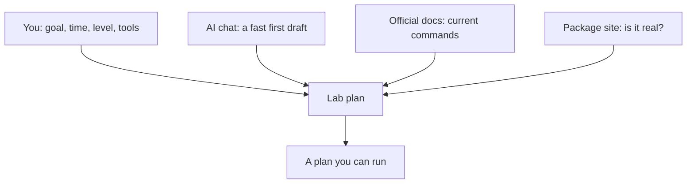

## A plan for someone else

Before lab day 1, Yara typed one line into a chat assistant: "Give me a Docker lab." The answer came back in seconds, and it looked excellent. It had headings, numbered steps and a lot of commands. It built a to-do app, added a load balancer, ran tests and set up monitoring. At the bottom it said: "Estimated time: 3 hours."

None of it was about Qasir. None of it fitted her 40 minutes. She did not know half the words, and the plan did not say which commands mattered. It was a good plan for someone, but not for Yara. The AI had done its best with the one line it was given, and one line told it almost nothing.

This chapter shows a better way. Give the AI the facts only you know, ask for the shape from chapter 4.2, then cut and check what comes back. Used this way, a chat assistant saves you real time. Used the first way, it hands you someone else's evening.

## What to tell the AI

At the time of writing (checked 2026-10-24), a chat assistant such as Gemini, ChatGPT or Claude can draft a lab plan on its free plan. Claude is for people aged 18 or over, so younger fellows can use one of the others. If none opens for you, write the plan by hand from the same five headings. The prompt matters more than the tool.

Module 1 showed that an AI does not know your context. A lab plan needs five facts from you.

**Your goal**, as one question with a result you can see. **Your time**, in minutes, including the write part. **Your level**, honestly: "new to containers" gets you a different plan from "I have used Docker before". **Your tools**: your laptop or a codespace, what is installed, and the app you are working on. **What you want to break**, or ask the AI to suggest one part to break and to say what you should see.

Then ask for a structure you can check: the four parts with minutes, and each command with one plain line on what it does. Ask for a list of anything you must install. Here is Yara's second prompt, saved in her notes so she can reuse it.

```text
Plan a 40-minute lab for me. Split it into study, build, break and write, with minutes for each.
Goal: run my link shortener, Qasir, with its app, database and cache in containers, and open one short link.
Level: beginner, new to caching. Tools: GitHub Codespaces with Docker, and my Qasir code.
Suggest one thing to break on purpose, and what I should see when I do.
For each command, add one plain line on what it does. List anything I need to install.
```

## Worked example: reading the plan that came back

The answer was far better than the first one. It was about Qasir, and it had four parts. It was also 75 minutes long, with a study part of 15 minutes, a build of 40, a break of 10 and a write of 10. Yara read it with three questions, in this order.

**Does it fit my time?** No. 15 + 40 + 10 + 10 = 75 minutes, and she has 40. This check comes first because it is the cheapest, and cutting may remove commands she would otherwise have to check. Starting Qasir and opening one link is today's question. The load balancer is not, and neither is a package the plan wants her to install, called shortlink-cache-helper (a name invented for this example). She moves both to a list for later days. Her plan becomes study 10, build 15, break 5 and write 10: 40 minutes.

While cutting, she meets a choice you can make too. The plan's break step was the AI's idea, not hers: ask Qasir for a short code that does not exist, and see what it returns. Would you keep it or drop it, and why? Yara keeps it. A user typing a wrong code is a real failure that Qasir must handle, and it takes five minutes to test. A good idea does not need to be her own. What must be hers is the guess she writes first and the check of what really happens.

**Is each command current?** The build step starts Qasir with `docker-compose up -d`. Yara has seen this command in older videos too. She will check it in Docker's own documentation, and you can predict what she finds below.

**Is every package real?** The package she moved to a later day still goes on her list of things to check, so that the list holds only real things. Chapter 4.4 does not need it.

Look at the order of the three questions. Time first, because it is the cheapest and it shrinks the rest. Commands second, because a wrong command wastes the evening. Packages third, because installing a package can run a stranger's code. The AI did the slow part, drafting a structure. Yara did the parts only she, or an official source, could do.

The diagram shows where each part of a good plan comes from.



Which box could you remove and still get a plan you can run? None of them. The AI cannot know your time, and you cannot remember every current command. The docs and the package site cannot draft anything. The AI is the quickest of the four to produce something, and its draft is worth using because the other three check it.

## What the docs say

The command in the build step is the one Yara is least sure of.

```predict
prompt: "The AI's plan starts Qasir with docker-compose up -d, with a hyphen. Yara has seen the same command in many older videos. What will Docker's own documentation say about it?"
options:
  - id: old
    label: "It is an old form; newer versions use a space"
  - id: current
    label: "It is the current form, as the videos show"
correctOptionId: old
explanation: "Docker's documentation (checked 2026-10-24) says docker-compose, with a hyphen, is Compose v1, first released in 2014. Newer versions use docker compose, with a space. Videos and AI plans often repeat what was common when they were made, so how often you have seen a command tells you little about whether it is current."
```

Step through how Yara turned the AI's plan into one she could run.

<InteractiveCanvas slug="plan-a-lab-with-ai" />

Two official sources changed the plan. Docker's docs, checked on 2026-10-24, call `docker-compose` the old Compose v1, first released in 2014, and show `docker compose` for the newer versions. They also say that a `version:` line at the top of a compose file, which the AI's plan had, is obsolete and only produces a warning. Yara noted both. Then she went back to the AI with facts instead of a vague request, and asked it to rewrite the build part with the current command. The AI was still in the loop at the end, but it was never the last word.

Notice also what the AI got right. The four-part structure, most of the commands and the break idea were all useful. Checking a plan does not mean throwing it away. Yara kept most of it, and she now knows which parts she checked and why.

## Check before you install

The package site gave the second answer. Yara searched it for shortlink-cache-helper, and nothing by that name exists. The AI invented the name.

Code-writing AI tools sometimes suggest packages that do not exist. A package is ready-made code that other people publish for anyone to install. In one large study, code-writing models suggested made-up package names many times. Anyone can publish a real package under such a name, and then everyone who installs what the AI said gets that person's code. A made-up name can become a trap.

So the course habit is short. Before you install a package an AI suggested, find it on the official package site for your app's language, and check three things. It is real: the exact name exists. It is used: other projects depend on it, or it has many downloads. It is maintained: recent releases, a link to its source code, and documentation that matches what the AI said it does. If any of the three fails, do not install it. Ask the AI for the well-known way to do the job, and check that answer too.

## Where the habit goes wrong

The commonest mistake is cutting the wrong part. When a plan is too long, people often drop the break and the write, because they look optional. They are the parts that turn the evening into a lab. Cut the build first.

The other is checking a command against the AI itself. "Is this command current?", asked in the same chat, often gets a confident yes: that is the agreeing habit from chapter 2.2. Check against the tool's own documentation, and note the date you checked.

## Check your understanding

```quiz
type: mcq
question: "Hala works at a pharmacy and is learning how an order queue works for its delivery orders. An AI plan for her lab says: install quick-order-queue-pro. The package names in this question are made up. On the official package site she finds three things. 1) A package with that exact name, first published 6 days ago. 2) Its account has no other packages and no link to source code. 3) A package called order-queue has years of releases and a busy source repository. What should she do?"
options:
  - "Install the new one, because its name matches the AI's plan exactly"
  - "Install the new one in a codespace, since that keeps her laptop safe"
  - "Ask the AI again and install whatever name it gives, as it knows packages"
  - "Read the docs of order-queue instead, because it passes all three checks"
correct: 3
explanations:
  - "A matching name is exactly what a trap would have. A brand new package from an unknown account fails the 'used' and 'maintained' checks."
  - "A codespace does protect her laptop, but it still holds her code and her access to GitHub. Code from an unknown account can do harm there too."
  - "The AI may name well-known packages, but a second AI answer is not a check. Whatever name it gives still has to pass the package site."
  - "Right. The new package fails two of the three checks. order-queue is real, used and maintained, and its own docs will show whether it does the job."
```

```quiz
type: mcq
question: "Raghad studies software at a university. She can give each lab 30 minutes in the library, using GitHub Codespaces. Her draft prompt says: 'Plan a lab on databases for a beginner. I want to see what my app does when its database stops.' What should she add before she sends it?"
options:
  - "Her name and university, since the AI plans better for real students"
  - "Her 30 minutes and Codespaces, because the AI cannot guess either of these"
  - "A request for the most detail possible, since detail saves time later"
  - "Nothing more, because a beginner's plan will fit any short evening"
correct: 1
explanations:
  - "Personal details do not change the plan, and they are better kept out of a chat. What changes the plan is her time and her tools."
  - "Right. Her goal, level and break are already there. Without her time and her tools, the AI fills those gaps with a guess, often a long one."
  - "Detail sounds helpful, but it makes a plan longer, not better sized. She needs a plan that fits 30 minutes."
  - "Plans for beginners are not short by default. The first plan Yara got for a beginner was 75 minutes."
```

**Next:** Yara's lab day 4: watch Qasir run, then stop one part on purpose.
