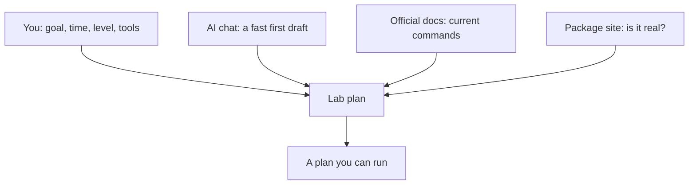

## A plan for someone else

Before lab day 1, Yara typed one line into a chat assistant: "Give me a Docker lab." The answer came back in seconds, and it looked excellent. It had headings, numbered steps and a lot of commands. It built a to-do app, added a load balancer, ran tests and set up monitoring. At the bottom it said: "Estimated time: 3 hours."

None of it was about Qasir. None of it fitted her 40 minutes. She did not know half the words, and the plan did not say which commands mattered. It was a good plan for someone, but not for Yara. The AI had done its best with the one line it was given, and one line told it almost nothing.

This chapter shows a better way. Give the AI the facts only you know, ask for the shape from chapter 4.2, then cut and check what comes back. Used this way, a chat assistant saves you real time. Used the first way, it hands you someone else's evening.

## What to tell the AI

At the time of writing (checked 2026-10-24), a chat assistant such as Gemini, ChatGPT or Claude can draft a lab plan on its free plan. Claude is for people aged 18 or over, so younger fellows can use one of the others. If none opens for you, write the plan by hand from the same five headings. The prompt matters more than the tool.

Module 1 showed that an AI does not know your context. A lab plan needs five facts from you.

**Your goal**, as one question with a result you can see. **Your time**, in minutes, including the write part. **Your level**, honestly: "new to containers" gets you a different plan from "I have used Docker before". **Your tools**: your laptop or a codespace, what is installed, and the app you are working on. **What you want to break**, or ask the AI to suggest one part to break and to say what you should see.

Then ask for a structure you can check: the four parts with minutes, and each command with one plain line on what it does. Ask for a list of anything you must install. Here is Yara's second prompt, saved in her notes so she can reuse it.

```text
Plan a 40-minute lab for me. Split it into study, build, break and write, with minutes for each.
Goal: run my link shortener, Qasir, with its app, database and cache in containers, and open one short link.
Level: beginner, new to containers. Tools: GitHub Codespaces with Docker, and my Qasir code.
Suggest one thing to break on purpose, and what I should see when I do.
For each command, add one plain line on what it does. List anything I need to install.
```

## Worked example: reading the plan that came back

The answer was far better than the first one. It was about Qasir, and it had four parts. It also suggested a break step Yara had not thought of: ask for a short code that does not exist, and see what Qasir returns. It was also 75 minutes long, with a study part of 15 minutes, a build of 40, a break of 10 and a write of 10. Yara read it with three questions, in this order.

**Does it fit my time?** No. 15 + 40 + 10 + 10 = 75 minutes, and she has 40. The cheapest check comes first, because cutting may remove the commands she would otherwise have to check. She looks at the build. Starting Qasir and opening one link is today's question. The load balancer and the extra package are not. She moves both to a list of later days. Her plan becomes study 10, build 15, break 5 and write 10: 40 minutes.

**Is each command current?** The build step starts Qasir with `docker-compose up -d`. Yara has seen this in old videos too, which is not proof of anything. She opens Docker's own documentation. Checked on 2026-10-24, it calls `docker-compose`, with a hyphen, Compose v1: the old version, first released in 2014. The supported versions use `docker compose`, with a space. The docs also say the `version:` line at the top of the plan's compose file is obsolete and only produces a warning. She notes both.

**Is every package real?** The plan says to install a package called shortlink-cache-helper "for faster lookups". She has already moved it to a later day, but she checks it now, so that her list of later days holds only real things. The next section shows how.

Look at the order of the three questions. Time first, because it is the cheapest and it shrinks the rest. Commands second, because a wrong command wastes the evening. Packages third, because installing one is the step with the most risk. The AI did the slow part, drafting a structure. Yara did the parts only she, or an official source, could do.

## Check before you install

Code-writing AI tools sometimes suggest packages that do not exist. A package is ready-made code that other people publish for anyone to install. In one large study, code-writing models suggested made-up package names many times. Anyone can publish a real package under such a name, and then everyone who installs what the AI said gets that person's code. A made-up name can become a trap.

So the course habit is short. Before you install a package an AI suggested, find it on the official package site for your app's language, and check three things. It is real: the exact name exists. It is used: other projects depend on it, or it has many downloads. It is maintained: recent releases, a link to its source code, and documentation that matches what the AI said it does. If any of the three fails, do not install it. Ask the AI for the well-known way to do the job, and check that answer too.

Yara searched the official package site for shortlink-cache-helper. Nothing by that name exists. The AI invented it. Had she installed it a month later, and had a stranger published something under that name by then, she would have run a stranger's code inside her project.

The diagram shows where each part of a good plan comes from. The AI is one of four sources, and it is the fastest one.



What to notice: no single box can make the plan alone. The AI cannot know your time. You cannot remember every current command. The docs and the package site cannot draft anything. The takeaway: the AI's draft is worth using because the other three boxes check it.

## The break idea

One part of the AI's plan was better than anything Yara had written herself: the idea of breaking Qasir with a short code that does not exist.

```predict
prompt: "The AI's plan suggests a break step Yara had not thought of: ask Qasir for a short code that does not exist. When she cuts the plan to 40 minutes, should she keep it?"
options:
  - id: keep
    label: "Keep it, it tests a real failure"
  - id: drop
    label: "Drop it, the break should be her own idea"
correctOptionId: keep
explanation: "Using the AI is the right call here. A user typing a wrong code is a real failure that Qasir must handle, and it takes five minutes to test. A good idea does not need to be her own idea. What must be hers is the check: she writes her guess first and reads what Qasir really does."
```

Step through how Yara turned the AI's plan into one she could run.

<InteractiveCanvas slug="plan-a-lab-with-ai" />

The canvas showed the plan passing through three filters. The cut kept the AI's best idea and removed what did not fit 40 minutes. Docker's docs caught one command in an old form. The package site showed that one name was made up. Then Yara went back to the AI with facts instead of a vague request, and asked it to rewrite the build part with the current command. The AI is still in the loop at the end. It was never the last word.

Notice also what the AI got right. The four-part structure, most of the commands and the break idea were all useful. Checking a plan does not mean throwing it away. Yara kept most of it, and she now knows which parts she checked and why.

## Where the habit goes wrong

The first mistake is the one-line prompt. "Give me a Docker lab" gets a plan for an imaginary person with three hours. Every fact you leave out, the AI fills with a guess.

The second mistake is cutting the wrong part. When a plan is too long, people often drop the break and the write, because they look optional. They are the parts that turn the evening into a lab. Cut the build first.

The third mistake is checking a command against the AI itself. "Is this command current?" asked to the same chat often gets a confident yes. Chat assistants tend to agree with the person asking. Check against the tool's own documentation, and note the date you checked.

The fourth mistake is trusting a plan because it looks tidy. Headings and numbered steps make a plan easy to read, not correct. The tidiest plan Yara got was the three-hour one.

## Check your understanding

```quiz
type: mcq
question: "Hala works at a print and copy shop and is learning how a print queue works. An AI plan for her lab says: install quick-print-queue-pro. On the official package site, she finds that name. It was first published 6 days ago by an account with no other packages, and it has no link to its source code. A package called print-queue has years of releases and a busy source repository. What should she do?"
options:
  - "Install the new one, because its name matches the AI's plan exactly"
  - "Install the new one, but only inside a codespace and not on her laptop"
  - "Ask the AI chat again, and install whichever name it gives this time"
  - "Leave the new one, and read the docs of the older, well-used package"
correct: 3
explanations:
  - "A matching name is exactly what a trap would have. A brand new package from an unknown account, with no source code to read, fails the 'used' and 'maintained' checks."
  - "A codespace still holds her code and her access to GitHub. Code from an unknown account can do harm there too."
  - "A second AI answer is not a check. Whatever name it gives still has to pass the official package site."
  - "Right. The new package fails two of the three checks. The older one is real, used and maintained, and its own docs will show whether it does the job her lab needs."
```

```quiz
type: mcq
question: "Raghad studies software at a university and can give each lab 30 minutes in the library, using GitHub Codespaces. She is about to ask a chat assistant for a plan for her first lab on databases. Which request will give her the most useful plan?"
options:
  - "Ask for 'a good database lab', and let the AI choose all the rest"
  - "Give her goal, 30 minutes, her level, Codespaces and what to break"
  - "Ask for 'the most detailed database lab possible', to save her time"
  - "Ask it to write all of the code for her app, so she can run it today"
correct: 1
explanations:
  - "With no goal, time or tools, the AI fills every gap with a guess, and the plan is likely to be too long and about something else."
  - "Right. These are the facts only she knows. With them, the AI can draft a plan she can cut, check and finish in 30 minutes."
  - "More detail makes a plan longer, not more useful. A 30-minute lab needs a plan sized to 30 minutes."
  - "Code she did not write and cannot explain leaves the lab without a lesson. A plan she runs and checks herself teaches her the database."
```

**Next:** Yara's lab day 4: watch Qasir run, then stop one part on purpose.
