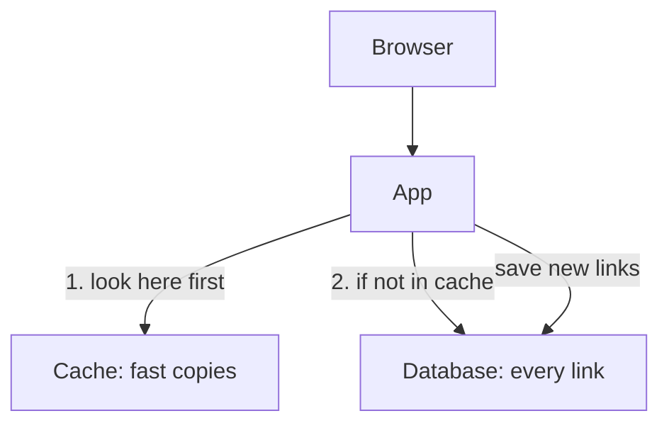

## One command too many

Lab day 4 was the day Yara would stop Qasir's cache on purpose. She had read about it, planned it and written her guess. Then, in a hurry, she typed `docker compose stop` and pressed Enter, without the name of the part she wanted to stop.

Docker did exactly what she asked. With no name, the command stops every part. The app, the cache and the database all shut down, and her browser showed an error page instead of Qasir. That told her one thing: the app was off. It told her nothing about the cache, which was the whole point of the evening.

She started everything again with `docker compose start` and, this time, typed the name: `docker compose stop cache`. The mistake cost her three minutes and taught her the first rule of breaking things on purpose. Stop one part at a time, so that whatever happens next has only one cause.

## Qasir's three parts

Qasir runs as three containers. Each one is a separate program, and each has one job.

The **app** is Qasir's own code. It receives a request such as /k7Qa, finds the long address that the short code stands for, and sends the browser on to it. The **database** keeps every short link Qasir has ever made, safely, on disk. It is the true record. The **cache** keeps copies of links people opened recently, in memory, where they can be read very fast.

When a request arrives, the app looks in the cache first. If the cache holds the link, the app is done. If not, it asks the database, and then stores a copy in the cache for next time. New links are different: they must be saved in the database, because a copy in memory alone could be lost.

The diagram shows which part the app needs for which job. Read the arrows as "the app asks this part".



What to notice: two arrows go to the database and only one goes to the cache. Opening a link can use either part, but saving a new link uses only the database. The takeaway: from this picture alone you can already guess that losing the database will hurt more than losing the cache. The lab is how you find out whether the guess is right.

One setting matters for the lab. Yara's compose.yaml, the file that tells Docker which containers to run, gives each part `restart: unless-stopped`. That means a part she stops herself stays stopped until she starts it again, so she is really watching Qasir without that part.

## Watch it run first

At the time of writing (checked 2026-10-24), Yara runs all this in GitHub Codespaces, a computer in the browser that includes Docker. The free hours are limited each month, so she checks her usage page and keeps each session short. One command starts every part, in the background, and gives her the terminal back:

```bash
docker compose up -d
```

She opens a short link, /k7Qa, and the browser lands on the long address. Then she reads the line Qasir wrote in its log for that request. On lab day 3 she taught Qasir to say where each answer came from, and today's build part added the time it took. The log lines and timings in this chapter are invented for this example, not measured. Your own lab will print its own.

```text
GET /k7Qa  source=cache  4ms
```

A browser asked for /k7Qa. The answer came from the cache, in about 4 milliseconds. That is the normal case, and it is worth seeing before you break anything: without it, you would have nothing to compare.

## Worked example: writing the prediction

Before she breaks anything, Yara writes her prediction in her lab notes. A good prediction has three parts: what you will do, what you expect to see, and why.

**What I will do:** stop the cache with `docker compose stop cache`, then open /k7Qa again.

**What I expect, and why:** she is not sure, so she writes both outcomes and what each would mean. If the link fails, Qasir cannot work without its cache, and that is a weakness to fix. If the link still opens, the app must be asking the database instead, and the log should say so.

**What would surprise me:** a link that opens with source=cache while the cache is stopped. That would mean she stopped the wrong thing.

Writing both outcomes forces her to decide in advance what each result would prove. Afterwards, she cannot explain any result away. Now it is your turn to guess.

```predict
prompt: "The cache is stopped and stays stopped. Yara opens /k7Qa, a link that worked a minute ago. What happens?"
options:
  - id: fails
    label: "It fails until the cache is back"
  - id: slower
    label: "It still opens, but more slowly"
correctOptionId: slower
explanation: "Qasir's code treats a cache that does not answer like a cache that does not hold the link: it asks the database. So the link opens, and the log says source=db. Each lookup takes longer, because the database reads from disk. If Qasir's code did not have that rule, the first option would be right, and finding that out would be just as useful."
```

Step through lab day 4. Stop the cache, watch, start it again, then stop the database.

<InteractiveCanvas slug="url-shortener-stop-a-part" />

## What the two breaks showed

With the cache stopped, nothing broke for the user except speed. So the cache is for speed: it saves the database from answering the same question again and again. Yara can now say that in an interview, and say how she knows.

The database break taught her the other half. The database is the only place a new link can be saved, so saving one failed with an error. Links the cache still held kept working for a while. A cache can hide a missing database only for the links people opened recently. She wrote her prediction, both results and the reasons in her log.

Suppose the link had failed when the cache stopped. The lab would still have worked, because it would have shown a real weakness: one stopped part taking the whole of Qasir down with it. Her next lab would then be to add the rule that asks the database when the cache does not answer, and to run the same break again. A break is useful whichever way it goes, as long as you wrote the guess first and can say why the result happened.

Here are the commands from the lab, with one line each.

```bash
docker compose up -d        # start every part, in the background
docker compose stop cache   # stop only the cache
docker compose start cache  # start the cache again
docker compose stop db      # stop only the database
docker compose start db     # start the database again
```

Stopping asks a program to shut down, and forces it after a short wait if it does not. It does not delete the container, which is why `docker compose start` can bring the same part back. This module does not teach Docker in depth. These five commands are all the lab needs.

## If you have no strong laptop, or only a phone

Docker Desktop is free for personal use, but it needs a fairly strong laptop: 8 GB of memory, and virtualisation turned on if you use Windows. If yours is older, GitHub Codespaces runs the same commands in a browser. If Codespaces does not open for you, or your free hours are used up, run the lab on another day, or use the phone path below.

If you only have a phone, this chapter is your lab. Go back to the predict and the canvas and do them in order: guess first, then read what happened. Write your prediction and the result in your notes, in your own words, as if it were your own log. The gate in chapter 4.7 also gives phone-only fellows a provided log to review.

## Where the habit goes wrong

Here is one failure, worked through. Imagine Yara had stopped the database first and then, without starting it again, stopped the cache to "see more". Every page would fail, and her log would say "everything broke". She would not know which part caused which error, and she would have learned less than from either break alone.

Two habits prevent it. Stop one part at a time, and start it again before you stop the next one. Then check that one link opens before you move on, so each break begins from a Qasir that works.

A second, smaller mistake is reading too much into one run. Two numbers from one run on one evening show the direction of a change, not its size in a real service under real load. Say what you saw, and where.

## Check your understanding

```quiz
type: mcq
question: "Yousef studies at a coding bootcamp. His lab app is a to-do list with an app, a cache and a database, each with restart: unless-stopped. He stops only the database. Three results: 1) The list he opened a minute ago still shows. 2) Adding a new to-do returns an error. 3) After he starts the database again, adding works. What do the results show?"
options:
  - "The cache is faulty, because it should have saved the new to-do"
  - "New items need the database, as the cache only keeps copies"
  - "The restart setting failed, since the database stayed stopped"
  - "The app has a bug, because a list app should not need a database"
correct: 1
explanations:
  - "A cache keeps fast copies of things already read. Saving new items is the database's job, so the cache did what it is for."
  - "Right. The old list came from copies in the cache, and the new item needed the database. Result 3 confirms the cause."
  - "The database did stay stopped, but that is what a part you stop yourself is meant to do. He had to start it again himself."
  - "Keeping data needs somewhere lasting. Needing the database is the design, not a bug."
```

```quiz
type: mcq
question: "Karim runs a small online shop for his family's sewing workshop. His lab app has four containers: the app, a cache, a database and a store for product photos. Tonight's question: 'Where is a customer's order saved?' He can stop one container. Which one should he stop, before placing a test order?"
options:
  - "The app, because every order passes through the app first"
  - "The cache, since it answers most requests in his shop"
  - "The database, because saved orders should live there"
  - "The photo store, as every order shows product photos"
correct: 2
explanations:
  - "Every order does pass through the app, which is why stopping it breaks everything. Every page would fail, and he would learn nothing about where orders are kept."
  - "The cache may answer most page views, but it keeps copies for speed. Stopping it tests speed, not where orders are saved."
  - "Right. If the test order fails with the database stopped, and works when it is started again, he has seen where orders are saved."
  - "Orders may show photos, but a missing photo would only change how the order looks, not whether it is saved."
```

**Next:** Turn a lab like this into a log entry on GitHub, with a check before every push.
