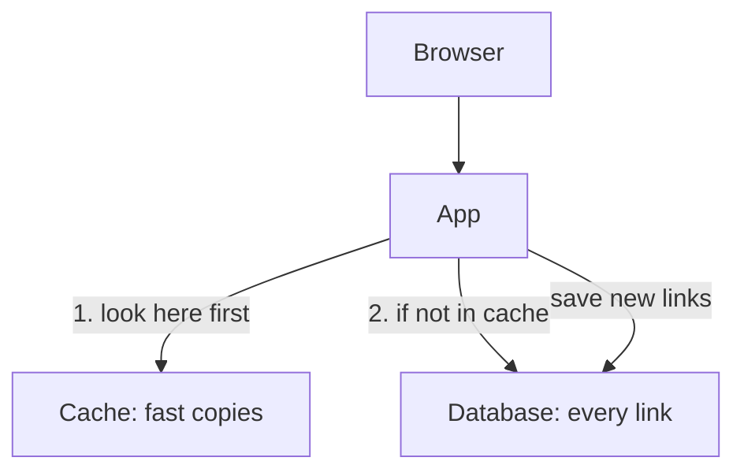

## One command too many

Lab day 4 was the day Yara would stop Qasir's cache on purpose. She had read about it, planned it and written her guess. Then, in a hurry, she typed `docker compose stop` and pressed Enter, without the name of the part she wanted to stop.

Docker did exactly what she asked. With no name, the command stops every part. The app, the cache and the database all shut down. Her browser showed an error page instead of Qasir. That told her one thing: the app was off. It told her nothing about the cache, which was the whole point of the evening.

She started everything again with `docker compose start` and, this time, typed the name: `docker compose stop cache`. The mistake cost her three minutes and taught her the first rule of breaking things on purpose. Stop one part at a time, so that whatever happens next has only one cause.

## Qasir's three parts

Qasir runs as three containers. Each one is a separate program, and each has one job.

The **app** is Qasir's own code. It receives a request such as /k7Qa, finds the long address that the short code stands for, and sends the browser on to it. The **database** keeps every short link Qasir has ever made, safely, on disk. It is the true record. The **cache** keeps copies of links people opened recently, in memory, where they can be read very fast.

When a request arrives, the app looks in the cache first. If the cache holds the link, the app is done. If not, it asks the database, and then stores a copy in the cache for next time. New links are different: they must be saved in the database, because a copy in memory alone could be lost.

The diagram shows which part the app needs for which job. Read the arrows as "the app asks this part".



What to notice: two arrows go to the database and only one goes to the cache. Opening a link can use either part, but saving a new link uses only the database. The takeaway: from this picture alone you can already guess that losing the database will hurt more than losing the cache. The lab is how you find out whether the guess is right.

## The setting that decides what "stop" means

Yara's Qasir is described in a file called compose.yaml, which tells Docker which containers to run and how. Here is the only part of it that matters today.

```yaml
# Part of Yara's compose.yaml, not the whole file.
# Images, ports and other settings are left out.
services:
  app:
    restart: unless-stopped
  cache:
    restart: unless-stopped
  db:
    restart: unless-stopped
```

The line `restart: unless-stopped` is a restart policy: a rule for when Docker starts a container again by itself. With `unless-stopped`, Docker restarts a part that crashes, but a part you stop yourself stays stopped until you start it, even if Docker itself restarts. This matters for the lab. Without that setting, or with a different one, a part you stop might come back on its own, and you would be watching the wrong thing.

## Watch it run first

At the time of writing (checked 2026-10-24), Yara runs all this in GitHub Codespaces, a computer in the browser that includes Docker. The free hours are limited each month, so she checks her usage page and keeps each session short. One command starts everything:

```bash
docker compose up -d
```

It starts every part listed in compose.yaml and gives her the terminal back, with the containers running in the background. She opens a short link, /k7Qa, and the browser lands on the long address. Then she reads the log line Qasir wrote for that request. On lab day 3 she taught Qasir to say where each answer came from, and today's build part added the time it took.

```text
GET /k7Qa  302  source=cache  4ms
```

Read it left to right. A browser asked for /k7Qa. The app answered 302, which means "go to this other address". The answer came from the cache, in about 4 milliseconds. All the timings in this chapter are this lab's own example numbers, from one codespace on one evening. They are not a measure of any real service, and your numbers will differ.

## Worked example: writing the prediction

Before she breaks anything, Yara writes her prediction in her lab notes. A good prediction has three parts: what you will do, what you expect to see, and why. Here is her reasoning.

**What I will do:** stop the cache with `docker compose stop cache`, then open /k7Qa again. The restart policy means the cache will stay stopped, so whatever she sees is the app without a cache.

**What I expect, and why:** she is not sure, so she writes both outcomes and what each would mean. If the link fails, Qasir cannot work without its cache, and that is a weakness to fix. If the link still opens, the app must be asking the database instead, and the log should say so. She also asks herself what to measure: the log line will show the source and the time.

**What would surprise me:** a link that opens with source=cache while the cache is stopped. That would mean she stopped the wrong thing.

Writing both outcomes is not cheating. It forces her to decide in advance what each result would prove, so that she cannot explain any result away afterwards. Now it is your turn to guess.

```predict
prompt: "The cache is stopped and stays stopped, because of restart: unless-stopped. Yara opens /k7Qa, a link that worked a minute ago. What happens?"
options:
  - id: fails
    label: "It fails until the cache is back"
  - id: slower
    label: "It still opens, but more slowly"
correctOptionId: slower
explanation: "Qasir's code treats a cache that does not answer like a cache that does not hold the link: it asks the database. So the link opens, and the log says source=db. Each lookup takes longer, because the database reads from disk. If Qasir's code did not have that rule, the first option would be right, and finding that out would be just as useful."
```

Step through lab day 4. Stop one part, watch, start it again, then stop the other.

<InteractiveCanvas slug="url-shortener-stop-a-part" />

## What the lab showed

With the cache stopped, every lookup went to the database. The link still opened, and the log line changed from source=cache in about 4 ms to source=db in about 38 ms. Nothing broke for the user except speed. So the cache is for speed: it saves the database from answering the same question again and again. Yara can now say that in an interview, and say how she knows.

She started the cache again with `docker compose start cache`. Within a lookup or two, the log said source=cache again. Then she stopped the database. The link she had just opened still worked, because the cache held a copy. But when she tried to make a new short link, the app returned an error, 500, and the log said the database was unavailable. Any link the cache did not hold failed too.

That second break taught her the other half. The database is not only where links are stored; it is the only place a new link can be saved. A cache can hide a missing database for a while, for the links people opened recently, and no longer. She started the database again with `docker compose start db` and wrote all of it in her log: the prediction, what happened, and why.

Here are the commands from today, with one line each.

```bash
docker compose up -d        # start every part, in the background
docker compose stop cache   # stop only the cache; it stays stopped
docker compose start cache  # start the cache again
docker compose stop db      # stop only the database
docker compose start db     # start the database again
```

`docker compose stop` asks a program to shut down, and forces it after a short wait if it does not. It does not delete the container. That is why `docker compose start` can bring the same part back. This module does not teach Docker in depth. These five commands are all the lab needs.

## If you have no strong laptop, or only a phone

Docker Desktop is free for personal use, but it needs a fairly strong laptop: 8 GB of memory, and virtualisation turned on if you use Windows. If yours is older, GitHub Codespaces runs the same commands in a browser. If GitHub Codespaces does not open for you, or your free hours are used up, run the same lab on another day, or use the phone path below.

If you only have a phone, this chapter is your lab. Go back to the predict and the canvas and do them in order: guess first, then read what happened. Write your prediction and the result in your notes, in your own words, as if it were your own log. The gate in chapter 4.7 also gives phone-only fellows a provided log to review.

## Where the habit goes wrong

The first mistake is the one Yara made: stopping more than one part. If two things are off and the app fails, you cannot tell which one caused it.

The second mistake is breaking without writing the guess. "I knew it would still work" is easy to say afterwards. Your written prediction is what shows whether you understood.

The third mistake is reading too much into one run. 38 ms against 4 ms in one codespace on one evening shows the direction of the change, not its size in a real service under real load. Say what you saw, and where.

The fourth mistake is forgetting to start the part again. A stopped database left behind will confuse tomorrow's lab, which will start with an error you caused yourself. End every break step with everything running, and check that one link opens.

## Check your understanding

```quiz
type: mcq
question: "Yousef studies at a coding bootcamp. His lab app is a to-do list with an app, a cache and a database, each with restart: unless-stopped. He stops only the database. The list he opened a minute ago still shows. Adding a new to-do returns an error. After he starts the database again, adding works. What does this show?"
options:
  - "The cache is faulty, because it should have saved the new to-do"
  - "New items are saved only in the database; the cache holds copies"
  - "The restart policy failed, since the database did not come back"
  - "The app has a bug, because a to-do app should not need a database"
correct: 1
explanations:
  - "A cache keeps fast copies of things already read. Saving new items is the database's job, so the cache did what it is for."
  - "Right. The old list came from copies in the cache, and the new item needed the database. Starting the database again fixed it, which confirms the cause."
  - "With unless-stopped, a database he stopped himself is meant to stay stopped until he starts it. The policy did what it says."
  - "An app that saves new items needs somewhere lasting to keep them. Needing the database is the design, not a bug."
```

```quiz
type: mcq
question: "Karim does his labs at a café with internet, where his session is 40 minutes long. To save time on the break step, he stops his app's cache and its database together, with one command. Every page now returns an error. What is wrong with this break step?"
options:
  - "Nothing; stopping more parts at once teaches more in less time"
  - "He should have deleted the containers instead of stopping them"
  - "Two parts stopped together hide which one caused each result"
  - "He should have written his prediction after seeing the result"
correct: 2
explanations:
  - "It saves a few minutes, but it loses the lesson. With two parts off, the errors could come from either one, or from both."
  - "Deleting containers is a bigger change, not a smaller one. Stopping, then starting again, keeps the lab safe and repeatable."
  - "Right. With one part stopped at a time, each result has one cause. Stopping both at once leaves him guessing which part each page needs."
  - "A prediction written after the result cannot show what he expected. Writing it first is what makes the result useful."
```

**Next:** Turn a lab like this into a log entry on GitHub, with a check before every push.
