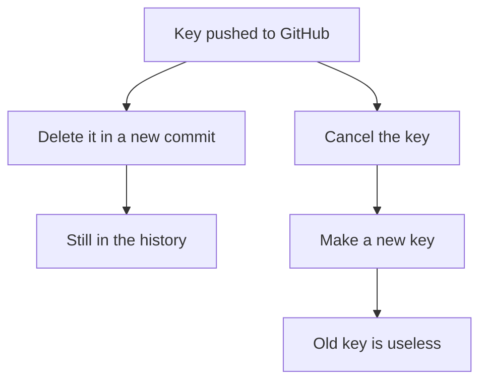

## Notes nobody could read

For her first three lab days, Yara kept her notes in her phone. They were quick to write and easy to lose track of. "Day 1: it runs." "Day 3: fixed it, cache thing works now." Day 2 had no note at all. When her mentor asked what she had learned so far, she scrolled through them and could not answer from them. Neither could her mentor.

Each note had made sense on the evening she wrote it. A week later, "fixed it" meant nothing: fixed what, how, and what was wrong? The notes also lived in one app on one phone. If the phone broke or the app changed, her evidence would go with it. So she rewrote those three days as proper entries, and from lab day 4 she wrote each one straight into her repository.

This chapter turns lab notes into a lab log on GitHub. Each entry has the same five parts, sits in a file you own, carries a date, and can be read by a mentor from any phone. It also adds the one habit that keeps a public log safe: a check for secrets before every push.

## Why a repository

At the time of writing (checked 2026-10-24), a free GitHub account gives you unlimited public repositories, and private ones with fewer features. You must be 13 or older to use it. A repository keeps every version of every file, with the date each change was made. That history is what makes a lab log believable: anyone can see that you wrote day 4 on the evening of day 4, not all at once before a deadline.

A log in a repository is also a set of plain files you own. Module 2 made this point about notes: files you own survive when a tool changes. If GitHub does not open for you one day, keep writing the entry as a Markdown file in your notes app, and add it to the repository later.

Yara's lab repository is called qasir-labs. It holds Qasir's code in a folder called app, one file per lab day in a folder called labs, and two small files at the top.

```text
qasir-labs/
  README.md        what this log is, and how to read it
  .gitignore       files Git must never add, such as .env
  app/             Qasir's code and compose.yaml
  labs/
    day-01-run-qasir.md
    day-02-databases.md
    day-03-cache-or-db.md
    day-04-stop-the-cache.md
```

The names start with the day number, so the files sort in order. They end with a few words on the topic, so a reader can find the cache lab without opening every file.

## Worked example: one entry, five parts

After lab day 4, Yara writes her entry with the same five headings she uses every day. Here is her reasoning for each part.

**Goal.** One sentence, the question from her plan: "What does Qasir do when its cache stops, and when its database stops?" Writing the goal first lets a reader judge the rest. Did she answer it?

**What I did.** The steps in order, with the commands. She started all three parts, opened /k7Qa and wrote her prediction. Then she stopped the cache, opened the link again and started it, and did the same for the database. Commands go in exactly as typed, so she can repeat the lab next month.

**What broke.** Both breaks, with the evidence. With the cache stopped, the log line went from source=cache in about 4 ms to source=db in about 38 ms, in her codespace. With the database stopped, saving a new link returned an error 500. She also writes her own mistake: `docker compose stop` without a name stopped everything. Mistakes belong in the log. They are often the most useful part a month later.

**What I learned.** In her own words, not copied: "The cache is for speed. The database is the only place a new link can be saved. Qasir keeps working without the cache only because its code asks the database when the cache does not answer." Writing this part is the explaining that chapter 3.3 asked for.

**What AI helped with.** One honest line: which tool, what it did, and what she checked. "A chat assistant explained what docker compose stop does. I checked it in Docker's documentation." Module 6 builds on this line when you share your work.

She ends with the next step: "Lab day 5: count clicks for each link."

## Commit messages that say what changed

A commit is one saved change, and its message is the first thing anyone reads. A list of messages like "update", "fix" and "stuff" tells a reader nothing. A list like this tells the story of a week before anyone opens a file:

```text
Day 3: log whether each lookup came from the cache or the database
Day 4: stop the cache, links still work but slower
Day 4: add .env to .gitignore
```

The rule is short: say what changed, in words a stranger would understand. Start with the lab day, so the list reads in order. Keep it to one line. If you need more, the entry has room for it.

## Four commands

Yara works in her codespace, in a repository she copied from GitHub, so it already knows where to push. These four commands are all a daily entry needs.

```bash
git status
git add labs/day-04-stop-the-cache.md .gitignore
git commit -m "Day 4: stop the cache, links still work but slower"
git push
```

`git status` lists the files that changed since the last commit, so you can see exactly what you are about to save. `git add` chooses which of those files go into the next commit, by name. `git commit -m` saves the chosen files as one commit, with the message in quotes. `git push` sends your new commits to GitHub.

If you only have a phone, GitHub's website lets you create or edit a file in the browser and commit it there. The habits are the same: one entry, five parts, a clear message, and the check below.

## A near miss

On lab day 4, Yara ran `git status` and saw two changed files: her entry, and a file called .env. A .env file holds settings for an app, and hers held the password Qasir uses to reach its database in her codespace. Her repository is public.

```predict
prompt: "Nobody has visited qasir-labs yet. Yara thinks committing .env with her entry is harmless for now, because she can delete .env next week. Is she right?"
options:
  - id: no
    label: "No, the password stays in the history"
  - id: yes
    label: "Yes, if she deletes it before anyone visits"
correctOptionId: no
explanation: "Deleting a file in a later commit removes it from the newest version only. Every earlier commit, with the password in it, stays in the history of a public repository, where anyone can read it at any time. The safe move is to keep .env out of every commit from the start."
```

Step through how her lab day 4 entry reached GitHub.

<InteractiveCanvas slug="lab-log-commit-push" />

The canvas showed the check doing its job before the commit, where a mistake is still free to fix. Adding .env was refused. Yara added one line, .env, to her .gitignore file, which tells Git never to add that file. Then `git status` showed only the entry and .gitignore. Only after that did she commit and push. The order matters: once a secret is in a commit, removing it is much harder than never adding it.

## The check before every push

Yara's check is four questions, asked every time, in the same order. It takes about a minute.

- No passwords, keys or tokens in any file I am adding.
- No .env file: it is listed in .gitignore.
- No one else's personal data: no names, phone numbers or messages from clients, users or friends.
- The entry says what AI helped with, and what I checked.

The .gitignore line only works for files Git is not already saving, so add it before your first commit. GitHub's push protection (checked 2026-10-24) tries to block some kinds of secrets from reaching public repositories. It does not catch everything, and millions of secrets still leak on GitHub each year. Treat it as a second net, never as the check itself.

## If a key ever gets pushed

Mistakes happen, even with a checklist. The diagram shows the two ways people react when a key reaches a public repository, and where each one ends.



What to notice: deleting the key from the newest version changes what the page shows, but not what was published. Anyone who copied it, by hand or with an automatic scanner, still has a working key. Cancelling it at the service that issued it is the only step that makes the copy useless. This course's advice: treat any pushed key as stolen. Cancel it and make a new one, then clean up the repository.

## Public or private

A public repository lets anyone read your log, and lets other people copy it into their own account to look at, which GitHub calls a fork. That does not give them permission to reuse your work; module 5 covers licences. Public is what makes a log useful to mentors and employers, and it is the default this course suggests.

You can choose private, for example while your project has a client's details in it. A private log still teaches you. But a log nobody can see cannot show anyone your work, so if you keep yours private, share it with your mentor.

## Where the habit goes wrong

The first mistake is the entry with no "what I learned". A list of commands shows what you typed, not what you understood. If you cannot write the learned part, the lab is not finished.

The second mistake is the batch commit: a week of labs pushed in one evening with one message. The dates in the history then say nothing, and a reader cannot see your days. Commit each lab on its own day.

The third mistake is pasting AI text into the entry. An entry the AI wrote from your commands reads smoothly and teaches you nothing. Write it yourself. Ask the AI to point out what is unclear, if you like.

The fourth mistake is skipping the check "just this once", on the night you are tired. That is the night it matters. Keep the four questions where you will see them, at the top of your README.

## Check your understanding

```quiz
type: mcq
question: "Mo'men, a freelancer, finishes lab day 6 on a small web server. git status shows three changed files: labs/day-06-web-server.md, .env (it holds the server's admin password) and server.log (3,000 lines the server wrote while running). His repository is public. What should he add and commit?"
options:
  - "Only the entry, after he lists .env in his .gitignore file"
  - "All three files, because the repository and the server are his"
  - "The entry and .env, because the password is only a test value"
  - "Nothing tonight; he should commit the whole week on Sunday"
correct: 0
explanations:
  - "Right. The entry is the lab. The password must never be committed, and the .gitignore line keeps it out from now on. The long log file is not needed either; a few lines copied into the entry are enough."
  - "Owning the repository does not make a password safe in it. Anyone can read a public repository's history."
  - "Test passwords often get reused, and a public history keeps them for good. Keep every .env file out, whatever it holds."
  - "A week in one commit hides which day each lab was done. Commit each lab on its own day, after the check."
```

```quiz
type: mcq
question: "Ruba, the teacher building a quiz page for her class of 28, wants to put tonight's lab entry in her public repository. The entry includes a table of real test data: her students' first names and their quiz scores. What should she do before the commit?"
options:
  - "Commit it, because the repository is hers and the class is small"
  - "Keep the first names, and remove the scores as the private part"
  - "Commit it, and say in the commit message that it has class data"
  - "Swap the names and scores for made-up test data, then commit"
correct: 3
explanations:
  - "A small class is still 28 real children, and none of them agreed to have their scores in a public repository."
  - "First names in a school context can still point to real children. Removing half the personal data still leaves the other half."
  - "A clear message is good practice, but it does not make it fine to publish the students' data."
  - "Right. Made-up data shows the lab just as well, and nobody else's personal data goes public. This is one of the four questions in the check."
```

**Next:** Five short cases to check your daily lab habits.
