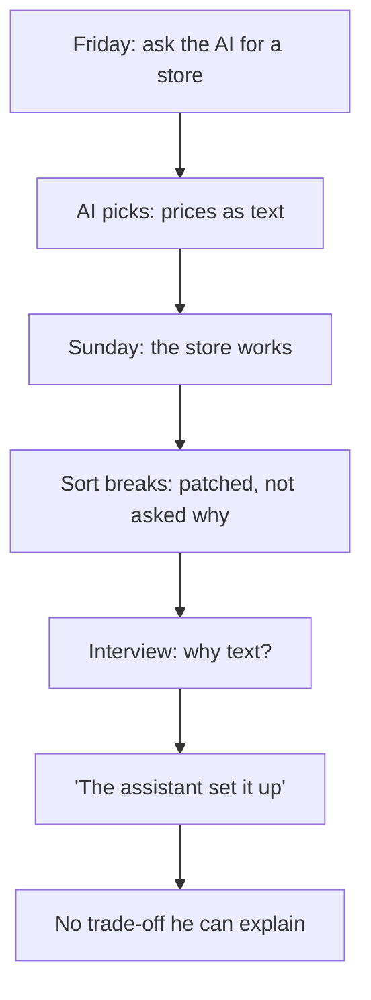

<BigWordAlert term="Trade-off" plainEnglish="What you gain and what you give up when you choose one option over another." whyItMatters="Interviewers, mentors and clients ask why you built something the way you did. If you can name what you gained and what you gave up, they can see that you understand your own project." />

## One question in an interview

You met Khaled in module 1. He is quick, curious and not afraid of new tools. One weekend he asked an AI coding assistant for an online store with product pages, a cart, discount codes and a page for the owner. By Sunday night it ran. In chapter 1.1 you saw the first problem: sorted by price, a product at 100 shekels came before one at 20, because every price was stored as text. Khaled fixed the order with one more instruction to the assistant. In chapter 1.5 a mentor asked him why prices were text in the first place, and he did not know. He meant to find out. He never did.

Three months later, Khaled had a job interview at a small software company that builds websites for shops. The interviewer was a senior developer. She asked him to share his screen and open the store's repository. She scrolled through the files for a minute, and then she stopped at the part that saves products.

"Your prices are stored as text," she said. "Why did you choose that?"

"The assistant set it up that way," Khaled said. "There was a problem with sorting, but I fixed it."

"How did you fix it?" she asked. Khaled opened the sorting code. The assistant had added a line that turns each price back into a number just before sorting. He could see that it worked. He could not say why the prices were not numbers in the first place, or where else the same problem might be.

Then she asked a third question. "In some languages, adding two prices stored as text joins them instead of adding them. A price of 10 plus a price of 5 becomes 105. How does your cart avoid that? And if you changed prices to numbers, what would the change cost you?" Khaled tried to answer, but he was guessing, and they both knew it. The interview ended a few minutes later.

A week later the company sent a short message. It said the store worked and looked good, but that they "could not see how he thinks about his own code". They chose someone else.

## What the interviewer was really asking

The interviewer did not ask how many pages the store had, or how fast he built it. She asked about one choice. Then she asked what that choice gave and what it cost. That is a question about a trade-off.

Storing prices as text has some uses. Text is easy to show on a page, and it can keep a currency sign next to the number. But text sorts badly and adds badly. Storing prices as numbers sorts and adds correctly. Many shops store a price as a whole number in the smallest unit of money, such as agorot or cents, so rounding never adds or loses a little money. Each option gains something and gives something up. A developer who understands the store can say which one they chose, and why it fits this shop.

Khaled could not, because he never made the choice. The AI made it for him, and nobody weighed it. That is the centre of this case. A trade-off is always made. If you do not make it, a tool makes it for you by default, and you cannot explain a decision you never saw.

Khaled also did several things well. He finished something. He used a tool that saved him days of typing. He put his work where others could see it. None of that was a mistake. The mistake was keeping parts of a project he could not explain, and then presenting the whole project as his own understanding.

## Why this matters for your career

Khaled's store ran by Sunday, and the tools that helped him are open to every fellow in this course. So, in this course's view, a working app on its own tells an interviewer little about the person who made it. What it cannot show is whether that person can explain every part. Can they say why it is built this way? Can they say what breaks when one part stops, and what they would change with more time?

Mentors, clients and interviewers test this in the same way the interviewer tested Khaled. They pick one part and ask "why?". Then they ask "what if?". A fellow who built less, but understands all of it, answers both questions calmly. This is why chapter 1.5 gave you the explain-back rule: keep a part of your project only if you can explain it without notes. This module turns that rule into a plan you can follow for months.

## Yara's slower path

Yara, the fellow you have followed since module 1, is building Qasir, a link shortener for small shops and NGOs that share links in group chats. Qasir turns a long link into a short one and counts how many people click it. On its own, that sounds like a weekend project too. An AI assistant could produce a first version in a few hours.

Yara chose a different plan, and she wrote it in her first week, before she had built anything. She listed the areas Qasir needs, in the order she plans to learn them. First come an API, a database, containers, caching, short codes and click counts. Then come tests, a simple web page, <GlossaryTerm term="rate limits" definition="Rules that stop one person or program from sending too many requests in a short time, for example no more than 30 new short links a minute." />, logs, safety against harmful links, and finally <GlossaryTerm term="deploy" definition="To put your app on a computer on the internet, so other people can use it, not only you." />. That is 12 areas. She has about 8 hours a week for her project, on top of her course time. Her plan gives Qasir about six months, so she can learn each area well before she builds it into the project.

Be clear about where "six months" comes from. It is this course's planning rule, set by the course sponsor. No study shows that a strong project takes six months. The rule exists because learning takes time, and a plan that leaves no time for learning ends like Khaled's interview. In chapter 5.2 you will check the rule against Yara's own numbers, and see why a much shorter plan cannot fit.

## What a slower plan looks like

A six-month plan still uses AI tools every week. Yara asks a chat assistant what to read and watch, and to explain ideas she finds hard. She uses it to draft code, which she then reads line by line. She runs small daily labs, as in module 4. The difference is in what she keeps. Every part that goes into Qasir is a part she can explain, and every big choice is one she made on purpose.

The module follows her through four habits. First, she works out how many hours her plan really has, and how many of them go to learning. Second, she plans one new area at a time, and checks that every resource an AI suggests really exists. Third, she slows down at big decisions, compares two options with her own facts, and refuses to keep code she cannot explain. Fourth, she studies open-source projects to learn how others solved the same problems. She reuses their code only when the licence allows it.

If Khaled had followed even the third habit, his interview would have gone differently. He would have read the line that stored prices as text. He would have asked why. He might have kept text, or changed it to numbers, but either way he would have had an answer.

<LearningObjectives items={["Work out how many hours a plan really gives, and what share of them you will spend learning", "Plan one new area at a time, with resources an AI suggested and you checked exist", "Compare two options for a real project decision using your own facts, and explain any AI-written part before you keep it", "Find an open-source project worth studying, read it in a set order, and reuse code only within its licence and with credit"]} />

## The case in one picture

The diagram shows Khaled's weekend and his interview as one chain. Read it from the top, and look for the step where a decision should have been made.



What to notice: the choice happened at the second box, on the first evening, and nobody looked at it. Every later box depends on it. The store working on Sunday did not fix the gap; it hid it. The broken sort was a second chance to look, and a patch used it up. The takeaway is that the moment to understand a choice is when it enters your project, not when someone asks about it months later.

```openquestion
prompt: "Think of one choice inside something you built or used, such as a form, a spreadsheet or an app. If nothing comes to mind, use Khaled's prices stored as text. In two or three sentences: what was chosen, what did it gain, and what did it give up?"
required: false
minWords: 25
allowSpeechInput: true
modelAnswer: "For Khaled's prices: the store keeps prices as text. It gains an easy way to show the price with its currency sign. It gives up correct sorting and correct adding: '100' sorts before '20', and two prices can be joined instead of added. A stronger answer also says which option fits the shop and why, for example whole numbers in agorot, so sorting and totals are always right. Answers about your own work are good when they name one specific choice, one thing it gained and one thing it gave up."
```

## Key words

| Word | Plain English |
|---|---|
| **Area** | One part of a project you learn and build, such as a database or caching |
| **Learning share** | The part of your project hours you spend learning, not building |
| **Hours log** | One line per lab with the time you spent learning and the time you spent building |
| **Resource check** | Finding a book, video or article yourself before it goes into your plan |
| **Licence** | The terms that say what others may do with a piece of code |

## What is in this module

| Chapter | You will practice |
|---|---|
| 5.2 | Working out the hours in a plan, and the share that goes to learning |
| 5.3 | Planning one new area at a time, with AI-suggested resources you checked exist |
| 5.4 | Comparing two options with your own facts, and explaining AI code before you keep it |
| 5.5 | Finding an open-source project, reading it in order, and reusing code within its licence |
| 5.6 | A graded quiz with five short cases |
| 5.7 | The first month of your own six-month plan, week by week |

**Next:** Why strong projects still take months, worked out in hours.
