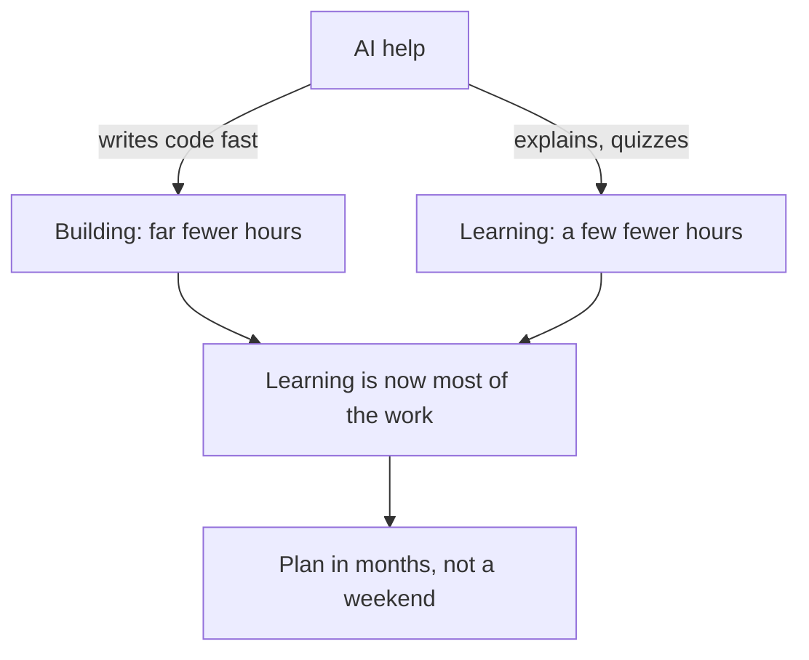

## A weekend, according to the chat

Before Yara wrote her plan for Qasir, she asked a chat assistant, such as Gemini or ChatGPT, a simple question: "How long does it take to build a link shortener?" The answer came back in a few seconds. "With modern AI tools, a basic link shortener can be built in a weekend."

The answer was not false. A first version that turns a long link into a short one can be built in a weekend, and Khaled showed in chapter 5.1 that a whole store can too. But the answer was about one thing only: how long it takes to make the code run. It said nothing about how long it takes to understand the code well enough to explain it, change it and fix it when it breaks. The chat could not know that Yara wanted a project she could defend in an interview. She had not told it.

So Yara did what this chapter teaches. She stopped asking how fast the project could be built, and started counting how many hours she really had and what they had to cover.

## Hours, not feelings

A plan starts with one multiplication: hours a week times weeks. Yara has about 8 hours a week for her project, on top of her course time. This course counts 4 weeks in a month, to keep the arithmetic simple. So one month gives her 8 times 4, which is 32 hours. Six months give her 32 times 6, which is 192 hours.

Those 192 hours are the whole budget. Everything Qasir needs has to fit inside them: reading, watching, labs, building, testing, fixing, notes and write-ups. A weekend of focused work might be 16 hours. That is enough to make something run, and far too little to learn 12 areas.

## Most of the time is learning

Yara listed the 12 areas Qasir needs in chapter 5.1. For each one, her plan makes two guesses. Learning an area well takes her about 8 hours: studying it from several angles, running small labs, breaking things on purpose and writing notes. Building that area into Qasir with AI help takes her about 4 hours. These are her own planning numbers, not a measured rule. Your areas will need more or less.

Why is learning twice as long as building? Because AI speeds up the two jobs very differently. A coding assistant can type a database function in seconds. It cannot put the understanding of that function into your head. A chat assistant can explain caching clearly, and you met the problem with that in chapter 3.2: a clear explanation feels like knowing, but you only know it when you can recall it and use it. AI helps learning too, for example by quizzing you, but the slow part happens in your own head, and it takes the same hours it always did.

So AI shortens building a lot and learning only a little. The diagram below shows what that does to a plan. Read it from the top.



What to notice: AI touches both jobs, but the two arrows do not save the same amount. Building shrinks a lot and learning shrinks a little, so learning ends up as the biggest share of every area. The takeaway is that a plan which counts only building hours, like the chat's weekend answer, leaves out most of the work.

## Worked example: does six months fit?

Here is Yara's arithmetic, step by step, so you can repeat it with your own numbers.

First, the learning. Twelve areas at 8 hours each is 96 hours. Second, the building. Twelve areas at 4 hours each is 48 hours. Together, the areas need 144 hours. Learning is 96 of those 144 hours, which is two thirds of the work on the areas.

Third, compare with the budget. Six months give her 192 hours. That is 48 hours more than the areas need. Those 48 hours are not spare in the sense of free. They pay for things the area estimates leave out: reviewing earlier areas so she does not forget them, joining the parts together, writing her weekly progress notes, and the weeks that go wrong because of exams, work or a power cut. A plan with no spare hours breaks the first time a week goes badly.

Now try the opposite. What if she squeezed Qasir into one month? One month gives 32 hours. Suppose she spends 60% of them learning, as her plan does. That is about 19 hours of learning and 13 of building. Nineteen hours covers 2 areas at 8 hours each, with 3 hours left over. Thirteen hours of building would cover 3 areas. But an area only counts as ready when it is both learned and built. So 2 of the 12 areas would be ready. The other 10 would be code she had not learned, which is exactly Khaled's store.

This is where "about six months" comes from in this course. It is the course sponsor's planning rule, not a research finding: no study we know of measures how long a strong project takes. The rule exists because the arithmetic of learning comes out in months for most fellows. If your own numbers give a very different answer, such as four months or nine, show your mentor the arithmetic and plan with it.

```predict
prompt: "Yara has about 8 hours a week. Suppose she squeezed all 12 areas of Qasir into one month instead of six, still spending 60% of the time learning. Using her numbers, how many areas would be both learned and built?"
options:
  - id: two
    label: "Only about 2 of the 12 areas"
  - id: most
    label: "Most of them, because AI builds fast"
correctOptionId: two
explanation: "One month is 8 times 4, which is 32 hours. At 60% learning, that is about 19 hours of learning and 13 of building. Learning one area takes her about 8 hours, so only 2 areas are learned. AI could help build 3 areas in 13 hours, but an area she has not learned is not ready: it is code she cannot explain."
```

Now check your prediction. Move the months, the hours a week and the share spent learning, and watch how many of Yara's 12 areas are ready.

<InteractiveCanvas slug="six-month-hours-split" />

The canvas started at Yara's plan: 8 hours a week for 6 months, with 60% of the time spent learning. That gives 192 hours and all 12 areas ready. When you set the months to 1, the total dropped to 32 hours and only 2 areas were ready, because learning time ran out first. At 6 months with only 20% spent learning, building got 154 hours, about three times what it needs, yet only 4 areas were ready. At 80% learning, learning had plenty, but building got only 38 hours, and 9 areas were ready. The lesson is a large share for learning, not all of it. Knowledge that never reaches the project is never tested.

## Feeling faster is not being faster

Plans fail in a second way, even with good arithmetic. People guess their own speed badly, and AI tools can make the guess worse. In one careful study, experienced developers felt faster with AI but were slower. Later tools may be better. The lesson is to measure, not to trust the feeling.

Yara measures with one line. At the end of every lab log entry, the log you met in module 4, she writes the time she spent learning and the time she spent building. It takes ten seconds. After four weeks, she adds the lines up and compares them with her plan. In this example, her first area, the API, took her 10 hours of learning instead of 8. One area is not a pattern, so she does not change the plan yet. If the next two areas also run over, she will choose between two honest fixes: more months, or fewer areas. Both are better than pretending.

<Callout type="info" title="Your numbers, not Yara's">
Yara's 8 learning hours and 4 building hours are her guesses for her areas. Make your own guesses, write them in your plan, then let your hours log correct them after a few weeks.
</Callout>

## A habit takes time too

A plan of 8 hours a week only works if the hours really happen, week after week, around study, work and family. That is easier when the hours become a habit: the same short lab at the same time of day. A daily habit can take weeks to months to feel automatic, and people differ a lot. So expect the first weeks of daily labs to feel like effort. That feeling is normal, and it is not a sign that the plan is wrong.

## Where it goes wrong

The first mistake is the chat's mistake: counting only building time. Any plan that says "two hours an area, because AI writes the code" has quietly dropped the learning. Ask of every plan, including one an AI writes for you: where are the learning hours?

The second mistake is planning with your best week. If you wrote 8 hours a week because you managed 8 hours once, the plan will fall behind in the first month. Plan with an ordinary week, and keep spare hours, as Yara's 48 hours do.

The third mistake is the opposite of the first: learning without building. A fellow who spends 80% of their time watching and reading feels busy and prepared, but has nothing to show and nothing to test their understanding against. The labs from module 4 count as learning because they make you build small things and break them.

The fourth mistake is trusting the feeling of speed over the log. If your log and your feeling disagree, believe the log, and change the plan.

## Check your understanding

```quiz
type: mcq
question: "Duaa is in a coding bootcamp and has 5 hours a week for her project: an order page for a print and copy shop. It has 9 areas. Her own plan says each area needs about 7 hours to learn and 3 to build. Using 4 weeks in a month, which plan fits her numbers?"
options:
  - "3 months for all 9 areas, since AI will build them faster"
  - "4 months for all 9 areas, about 80 hours in total"
  - "5 months for all 9 areas, about 100 hours in total"
  - "3 months, with learning cut to 1 hour for each area"
correct: 2
explanations:
  - "Three months give 5 times 4 times 3, which is 60 hours. The areas need 9 times 10, which is 90 hours. AI already shortened her building estimate; it does not cover the missing 30 hours."
  - "Four months give 80 hours, but the 9 areas need 90. The plan is 10 hours short before a single bad week."
  - "Right. Five months give 100 hours. The areas need 9 times 10, which is 90 hours, and the 10 hours left over pay for review and weeks that go wrong."
  - "This fits the hours, but only by cutting learning from 7 hours to 1. She would build 9 areas she cannot explain, which is the weekend store again."
```

```quiz
type: mcq
question: "Nizar is a freelance developer on a freelance marketplace. His project plan gives each area 4 hours of building. He feels the AI assistant makes him much faster. His lab log for the first three areas says building took 5, 6 and 5 hours. What should he do with his plan?"
options:
  - "Keep 4 hours an area, because he feels faster each week"
  - "Use about 5 or 6 hours an area, then recheck the months"
  - "Cut learning hours in each area to make room for building"
  - "Stop logging, since the log and his feeling disagree"
correct: 1
explanations:
  - "The feeling is the thing the log is there to check. Three areas in a row ran over, so the plan is already behind."
  - "Right. Three measured areas average a little over 5 hours, so the plan should use that. Then he recalculates whether his months still fit, and adds months or removes areas if not."
  - "This hides the problem by taking hours from learning, the part AI shortens least. The plan would look on time and he would understand less."
  - "When the log and the feeling disagree, the log is the useful one. Stopping it removes the only measure he has."
```

**Next:** How Yara turns six months into weeks, one new area at a time, and checks every resource an AI suggests.
