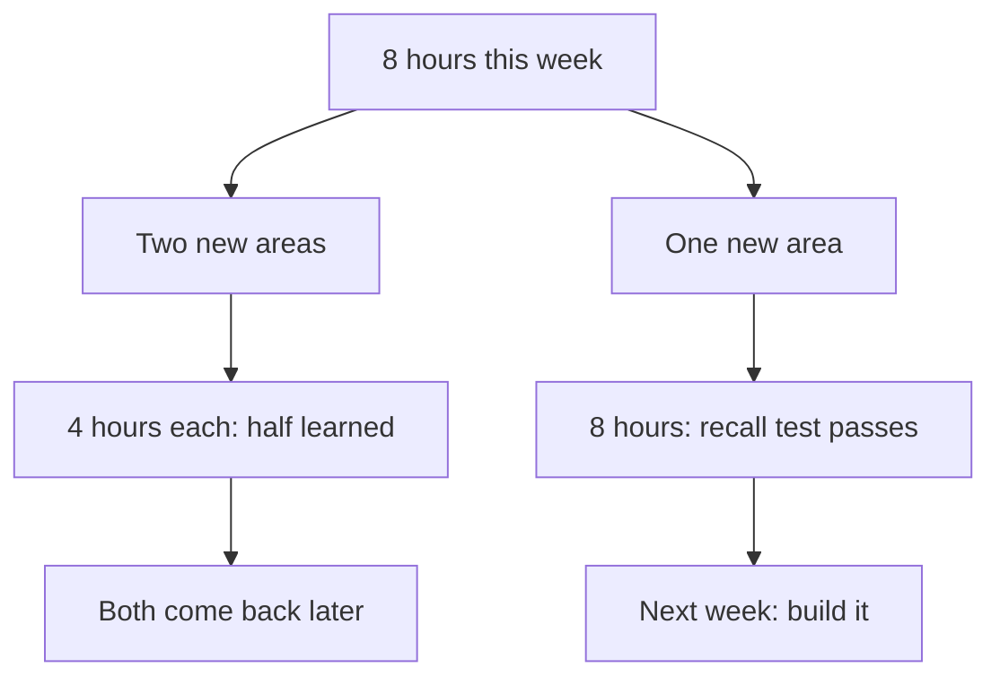

## A book that was never written

Yara asked a chat assistant for help with her caching week. It suggested three videos, two articles and one book chapter. The book had a title, an author, a publisher, a year and a chapter number, with one sentence on why that chapter suited a beginner. It looked like the most serious item on the list.

She almost planned three evenings of her week around that chapter. Then she remembered that a chat assistant writes what a good answer usually looks like, whether or not the thing it names is real. So that evening, at a café with internet, she set out to find the book before she planned anything around it. You will see what she found in this chapter's canvas.

This chapter shows how Yara builds a weekly plan, and why her plan has a column that most study plans do not: "I checked it exists, and how".

## Six months, one area at a time

A six-month plan is too big to follow day by day. Yara breaks it down twice: first into months, then into weeks, each with one clear job. She wrote this table in her first week, before any lab.

| Month | Weeks | New areas (and their week) |
|---|---|---|
| 1 | 1 to 4 | An API (week 1), a database (week 3) |
| 2 | 5 to 8 | Containers (week 5), caching (week 7) |
| 3 | 9 to 12 | Short codes (week 9), click counts (week 11) |
| 4 | 13 to 16 | Tests (week 13), a simple web page (week 15) |
| 5 | 17 to 20 | Rate limits (week 17), logs (week 19) |
| 6 | 21 to 24 | Safety against harmful links (week 21), deploy (week 23) |

The order follows what Qasir needs. The API and the database come first, because nothing works without them. Containers come next, because her daily labs will run Qasir in containers. Caching only makes sense once there is a database to protect. Deploy comes last, because she wants to deploy something she understands.

This course's planning rule is one new area at a time. Like "about six months", it comes from the course sponsor, not from research. Its point is focus: one new thing at a time, never two, so each area gets your full attention and a lab of its own. The sponsor's wish is a new area every week. At 8 hours a week, Yara's numbers turn that into a new area every second week. In chapter 5.2, each area needed about 8 hours of learning and 4 of building, which is 12 hours, and her week has 8. So her plan puts one new area in a week, then gives the following week to building it into Qasir and reviewing older areas. A fellow with more hours, say 12 or more a week, can learn and build one area in a single week.

Why not squeeze two new areas into one week instead? The diagram follows the same 8 hours down both roads.



Which road costs more in the end? The left one looks faster for one week. But neither area gets its 8 hours, so the recall test fails on both, and both return to the plan later. The right road finishes one area properly and moves on.

## A week, step by step

Here is how Yara plans one new-area week. It is her week 7: caching, in month 2. The first two steps are shown in full. For the rest, you get the outline and what a good answer contains, because by now you know the habits from modules 3 and 4.

**Step 1: say what "done" means.** By the end of the week she wants four things. She can explain caching aloud without notes. One lab ran, and she broke one part on purpose. She has one notes page in her own words. She has written one short paragraph for her weekly write-up. A week without a "done" line just ends; a week with one can be checked.

**Step 2: ask the AI what to learn, then check every item.** A chat assistant is a fast way to find starting points, if you tell it what it cannot guess. Yara writes:

> I am a beginner learning caching for a small link shortener. I have about 8 hours this week, I read on a phone and have little mobile data. Suggest three short videos, one book chapter and two articles. For each, give the title, the author or channel, the year, and why it suits me. If you are not sure something exists, say so.

The last sentence of her request helps a little, and it costs nothing. The real protection is the check. For a book, find it in a library catalogue or a bookshop listing, with the same title, author and year. A <GlossaryTerm term="library catalogue" definition="A library's searchable list of the books and other items it holds, usually open to anyone on the web." /> is often free to search even if you cannot borrow from that library. For a video, open it and check the title, the channel, the date and the length. For an article, open it, check the site, the author and the date, and read the first part to see that it is about what the AI said. Then check that it is current. An old video can explain the idea well and still show commands that have changed, so check its commands against the official documentation, as in module 4.

Why every item? AI tools can state false things confidently, including books and studies that do not exist. In one study of reference lists that AI chat tools wrote for research reviews, many references did not exist, and many real ones had errors. A newer model made up far fewer, but still some. Newer tools may be better again. The habit stays the same: nothing goes into the plan unchecked.

The remaining steps, in outline:

| Step | What a good answer contains |
|---|---|
| 3. Spread the five angles over the days | One angle from chapter 3.3 per day, each with a named resource from the checked list |
| 4. Add a short lab each day | A lab from module 4 with one part to break, sized to the day's time |
| 5. End with recall and plan the reviews | A recall test with notes closed, then review dates a few days and a week or two later |

The outline is shorter on purpose. In modules 3 and 4 you saw each of these habits worked out in full: the five angles with Yara's caching, the daily lab, the recall test with notes closed. Here the help steps back, so the plan you write in the gate is your own work and not a copy of hers. If a row is unclear, go back to the chapter it names before you fill it in.

Yara's version of steps 3 to 5 fits the same shape. She reads articles on days with weak data and watches videos on evenings with a good connection. She checks a video's size before she downloads it.

## Check before you plan

On the evening she searched for the book, Yara searched for its author first. She found a real writer who has published other books about web development. Make a call before you step through her checks.

```predict
prompt: "Yara searched the name of the book's author and found a real writer with other books about web development. Does that show the book the AI named exists?"
options:
  - id: author
    label: "Yes: a real author means a real book"
  - id: title
    label: "No: the title itself must be found"
correctOptionId: title
explanation: "An invented reference can attach a made-up title to a real person. The author search only shows that the writer exists. At step 4 of the canvas, the title search in a library catalogue, on the publisher's website and in two bookshops found nothing, so the book does not exist."
```

Step through Yara's week below, one check at a time.

<InteractiveCanvas slug="week-plan-check-resources" />

The author search was the trap. It returned a real person, which felt like proof, but only the title search could settle it, and it found nothing. The chat assistant had invented the book. Notice also what replaced it. Yara did not ask the AI for another book and hope. She used the official documentation of the cache in her lab, which she found herself, so there was nothing to doubt.

Here is her resource list after the checks. The third column is required in every weekly plan in this course.

| Resource (from the AI) | Type | I checked it exists (how) | Keep? |
|---|---|---|---|
| Short introduction to caches | Video, 12 min | Opened it; posted last year | Yes |
| Caching in a web app | Video, 25 min | Opened it; nine years old, old commands | Ideas only |
| Common caching mistakes | Video, 18 min | Opened it; posted this year | Yes |
| A book chapter for beginners (made up by the AI) | Book | Library, publisher, two bookshops: no such book | No |
| What a cache is for | Article | Opened it; known site, dated this year | Yes |
| When not to cache | Article | Opened it; dated two years ago | Yes |
| Caching page of the cache's own docs | Docs | Found it myself on the official site | Yes (added) |

## Where it goes wrong

The first mistake is checking only the first item. If the first two suggestions are real, the rest feel safe. They are not linked: each item is written separately, and a made-up one can sit anywhere in the list.

The second mistake is asking with no context. "Suggest resources on caching" gets a general list: long videos, a thick book, articles for a different level. Yara's request named her level, her hours, her phone and her data. That is why most of her list fitted her week before she checked a single item.

The third mistake is confusing "exists" with "correct". A real article can be out of date, or wrong. Checking that it exists only earns it a place in your plan. You still read it with your own judgement, and compare it with the official documentation when it gives commands.

## Check your understanding

```quiz
type: mcq
question: "Hamza, a university student, asks a chat assistant for resources for his week on database indexes. His checks so far: 1) Book 1 is in his university library catalogue with the same title, author and year. 2) Video 1 opens: 15 minutes, posted last year. 3) The article has a title and a date from the AI, but he has not opened it. 4) The link for video 2 opens a video on a different subject with a similar title. Which resources can go into his plan as checked?"
options:
  - "All four, since the AI gave a title and a date for each one"
  - "Book 1 and video 1, since he found or opened each of them"
  - "Book 1 and both videos, since each video link opened a page"
  - "Only video 1, since books are what AI chat tools tend to invent"
correct: 1
explanations:
  - "A title and a date are what the AI writes for real and made-up items alike. They are the claim, not the check."
  - "Right. Book 1 was found in a listing with matching details and video 1 was opened, so both are checked. The article may be real, but its 'how' column is empty until he opens it, and video 2 is not the video the AI described."
  - "Video 2's link worked, but the video is about a different subject. A check confirms the item the AI described, not just any page."
  - "Book 1 was found in a real catalogue with matching details, so it is checked. Any kind of item can be invented, and any kind can be real."
```

**Next:** How to slow down at a big project decision, compare two options with your own facts, and keep only AI code you can explain.
