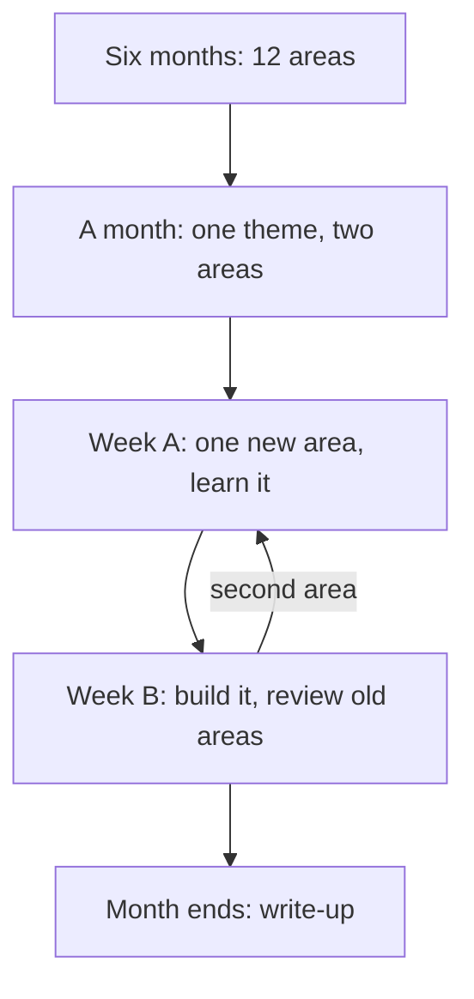

## A book that was never written

Yara asked a chat assistant for help with her caching week. It suggested three videos, two articles and one book chapter. The book had a title, an author, a publisher, a year and a chapter number, with one sentence on why that chapter suited a beginner. It looked like the most serious item on the list.

That evening, at a café with internet, Yara searched for the book. She could not find it in a large public library catalogue. She could not find it on the publisher's website. Two bookshop listings had nothing with that title. The book did not exist. The chat assistant had produced it the way it produces any sentence: by writing what a good answer usually looks like.

Yara lost part of one evening, not a week, because she checked before she planned her days around it. This chapter shows how she builds a weekly plan, and why her plan has a column that most study plans do not: "I checked it exists, and how".

## Six months, one area at a time

A six-month plan is too big to follow day by day. Yara breaks it down twice. First into months, each with a theme. Then into weeks, each with one clear job.

Her months follow the order in which Qasir needs its areas. The API and the database come first, because nothing works without them. Caching only makes sense once there is a database to protect. Deploy comes last, because she wants to deploy something she understands.

| Month | Theme | New areas |
|---|---|---|
| 1 | A link that works | API, database |
| 2 | Short and fast | short codes, caching |
| 3 | Runs anywhere, tested | containers, tests |
| 4 | Counting fairly | click counts, rate limits |
| 5 | Safe to use | simple web page, safety against harmful links |
| 6 | Live and watched | logs, deploy |

The weekly rule in this course is one new area a week. Like "about six months", it is the course sponsor's planning rule, not a research finding. Its point is focus: one new thing at a time, never two, so each area gets your full attention and a lab of its own.

Yara's own numbers add a detail. In chapter 5.2, each area needed about 8 hours of learning and 4 of building, which is 12 hours. Her week has 8. So a new area cannot be both learned and built in one week. Her plan puts one new area in a week, then gives the following week to building that area into Qasir and reviewing older ones. No week ever has two new areas. That gives 12 new-area weeks and 12 building weeks: 24 weeks, which is six months at 4 weeks a month.

The diagram shows that rhythm. Read it from the top and follow the loop.



What to notice: no box ever holds two new areas, and every new-area week is followed by a week that builds and reviews. The loop runs twice a month. The takeaway is that the plan protects learning time from building time, and the review time protects older areas from being forgotten.

## A week, step by step

Here is how Yara plans one new-area week. It is her week 7: caching, in month 2.

**Step 1: say what "done" means.** By the end of the week she wants four things. She can explain caching aloud without notes. One lab ran, and she broke one part on purpose. She has one notes page in her own words. She has written one short paragraph for her weekly write-up. A week without a "done" line just ends; a week with one can be checked.

**Step 2: ask the AI what to learn, with context.** A chat assistant is a fast way to find starting points, if you tell it what it cannot guess. Yara writes:

> I am a beginner learning caching for a small link shortener. I have about 8 hours this week, I read on a phone and have little mobile data. Suggest three short videos, one book chapter and two articles. For each, give the title, the author or channel, the year, and why it suits me. If you are not sure something exists, say so.

The last sentence does not make the list safe. It helps a little, and it costs nothing. The real protection is the next step.

**Step 3: check that each one exists and is current.** This is the step most people skip. For a book, find it in a library catalogue or a bookshop listing, with the same title, author and year. A <GlossaryTerm term="library catalogue" definition="A library's searchable list of the books and other items it holds, usually open to anyone on the web." /> is often free to search even if you cannot borrow from that library. For a video, open it and check the title, the channel, the date and the length. For an article, open it, check the site, the author and the date, and read the first part to see that it is about what the AI said. Then check that it is current. A nine-year-old video can explain the idea well and still show commands that have changed, so check its commands against the official documentation, as in module 4.

Why every item? AI tools can state false things confidently, including books and studies that do not exist. In one study of reference lists that AI chat tools wrote for research reviews, many references did not exist, and many real ones had errors. A newer model made up far fewer, but still some. Newer tools may be better again. The habit stays the same: nothing goes into the plan unchecked.

**Step 4: spread the angles over the days.** Yara uses the five angles from chapter 3.3: a plain explanation, a picture, a worked example, a failure case, and building or teaching it. Each day has one angle and a short lab from module 4. On days with weak data she reads the articles; she saves the videos for the café. She checks a video's size before she downloads it.

**Step 5: end with recall, and plan the reviews.** On the last day she closes everything and explains caching aloud, then checks her notes for gaps. She adds caching to her review list for a few days later and again a week or two later, the spacing rule of thumb from chapter 3.4.

Here is what her resource list looked like after the checks. The third column is required in every weekly plan in this course.

| Resource (from the AI) | Type | I checked it exists (how) | Keep? |
|---|---|---|---|
| Short introduction to caches | Video, 12 min | Opened it; posted last year | Yes |
| Caching in a web app | Video, 25 min | Opened it; nine years old, old commands | Ideas only |
| Common caching mistakes | Video, 18 min | Opened it; posted this year | Yes |
| A book chapter for beginners | Book | Library, publisher, two bookshops: no such book | No |
| What a cache is for | Article | Opened it; known site, dated this year | Yes |
| When not to cache | Article | Opened it; dated two years ago | Yes |
| Caching page of the cache's own docs | Docs | Found it myself on the official site | Yes (added) |

## Check before you plan

Before you step through Yara's checks, make a call about the AI itself.

```predict
prompt: "Yara knows a chat assistant sometimes invents books. She could ask it for caching resources anyway, or search on her own from the start. Is asking the AI still worth her time?"
options:
  - id: search
    label: "No: search on her own from the start"
  - id: ask
    label: "Yes: ask it, then check each one"
correctOptionId: ask
explanation: "In this example the AI gave six suggestions in seconds, and five were real and useful. Checking all six took Yara about 20 minutes. One made-up book is a reason to check, not a reason to stop asking. Without the check the list is a risk; with it, the AI saved her time."
```

Step through Yara's week below, one check at a time.

<InteractiveCanvas slug="week-plan-check-resources" />

The canvas showed both halves of the habit. The AI was useful: in seconds it gave six starting points, and five of them were real. The check was necessary: one of the six was invented, and it looked as real as the others. Notice also what replaced the fake book. Yara did not ask the AI for another book and hope. She used the official documentation of the cache in her lab, which she found herself, so there was nothing to doubt. The week plan at the end was built only from checked items.

## Where it goes wrong

The first mistake is checking only the first item. If the first two suggestions are real, the rest feel safe. They are not linked: each item is written separately, and a made-up one can sit anywhere in the list.

The second mistake is a weak check. "The title sounds right" is not a check. Neither is "the AI gave a year". Searching for the author alone is weak too, because a made-up title is often given to a real author. The check is finding the item itself: the book in a listing, the video playing, the article open on your screen.

The third mistake is confusing "exists" with "correct". A real article can be out of date, or wrong. Checking that it exists only earns it a place in your plan. You still read it with your own judgement, and compare it with the official documentation when it gives commands.

The fourth mistake is a week with two new areas. It feels faster, but each area gets half the attention, and the recall test at the end shows it. If a week goes badly, move the new area to next week. Do not double up.

## Check your understanding

```quiz
type: mcq
question: "Hamza, a university student, asks a chat assistant for resources for his week on database indexes. His checks so far: book 1 is in his university library catalogue with the same title, author and year. The video opens: 15 minutes, posted last year. The article has a title and a date from the AI, but he has not opened it. For book 2 he found the author, but none of the author's books has that title. Which resources can go into his plan as checked?"
options:
  - "All four, since the AI gave a title, an author and a date for each"
  - "Only the video, since books are the items AI tends to invent"
  - "Book 1, the video and book 2, since that author is a real person"
  - "Book 1 and the video; the article still needs to be opened"
correct: 3
explanations:
  - "A title, an author and a date are what the AI writes for real and made-up items alike. They are the claim, not the check."
  - "Book 1 was found in a real catalogue with matching details, so it is checked. Any kind of item can be invented, and any kind can be real."
  - "A real author with a made-up title is a common pattern in invented references. Book 2 failed the check, because the book itself was not found."
  - "Right. Book 1 was found in a listing and the video was opened, so both are checked. The article may well be real, but until he opens it, the 'how' column for it is empty."
```

**Next:** How to slow down at a big project decision, compare two options with your own facts, and keep only AI code you can explain.
