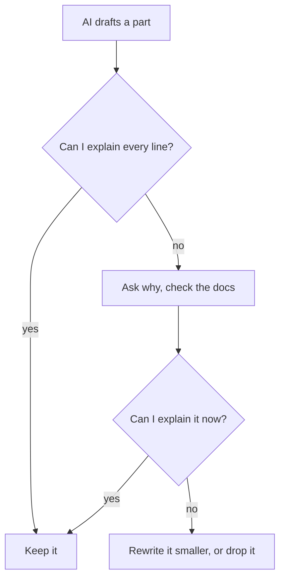

## An answer for someone else's project

Yara's first slice of Qasir, from chapter 1.5, kept a click count the simplest way: a number saved in the database. In week 7, tracing two clicks on paper showed her its limit (chapter 3.3). Once the cache answers a repeat click, that click never reaches the database, so it is never counted. The simple counter from her first slice will not be enough when many people click. In week 11, her click counts week, she had to decide where Qasir counts clicks. She asked a chat assistant. The answer was confident and detailed:

> Keep a counter for each link in the cache, and add one on every click. Every minute, save the counts to the database and reset the counters. This is the standard approach for high-traffic link shorteners, because it keeps the database free for other work.

Below it were 30 lines of code, ready to paste. Yara almost pasted them. Then she thought of Khaled's interview in chapter 5.1. His prices were stored as text because a tool chose it on the first evening and nobody looked. This was the same moment: a choice about to enter her project without her making it.

The AI's answer fits a project with a great many clicks every second. Qasir is for small shops and NGOs that share links in group chats. In her plan's example numbers, a busy link gets a few hundred clicks a day. Yara works alone and wants to explain every part. The AI knew none of this, because, as you saw in module 1, it does not know your context unless you give it. So she slowed down.

## Two options, named plainly

The first step is to name the options in your own words, not the AI's.

**Option A: count in the database on every click.** Each click adds one to that link's count in the database, even when the link itself came from the cache. It is one simple step. Every click reaches the database, so the count is never more than one click behind.

**Option B: count in the cache, save every minute.** Each click adds one to a counter in the cache, which is fast memory. Once a minute, a small timed job copies the counts into the database and resets the counters. The database gets one write per link per minute instead of one per click, which matters when clicks arrive by the thousand. The cost is more moving parts, and a risk. In her lab setup, the cache keeps its data only in memory. If the cache stops before a save, the clicks since the last save are lost.

Neither option is right for every project. Each gains something and gives something up. That is the trade-off, and only Yara's facts can decide it.

## Five questions about a decision

One way to slow down is to ask the same decision several questions. Yara uses five. Each one can change her mind on its own.

**What do my numbers say?** A few hundred clicks a day is a light load for the database in her lab. Option B's speed protects against a problem Qasir does not have yet.

**What breaks when a part stops?** In module 4 she stopped the cache on purpose. She replays that lab in her head for each option. With option A, the counts are safe in the database. With option B, up to a minute of counts would disappear. For a shop owner checking how many people opened a sale link, a count that is quietly wrong is worse than a slower page.

**Can I explain it?** Could she explain each option to her mentor in two minutes, without notes? Option A, yes. Option B needs the timer, the reset, and what happens if a save fails halfway. She could learn all that, but it would cost her learning hours from another area.

**Can I change it later?** If Qasir grows, could she move to option B? Yes, if counting lives in one place in her code. A decision you can change later is cheaper to get wrong, so she does not need to prepare for traffic she does not have.

**What is the case for the other side?** She asks the AI to argue against its own suggestion. How she asks matters, because of the agreeing habit from chapter 2.2. If she asks "Isn't counting in the database better?", she may only get her own opinion back. So she asks neutrally: "For a link shortener with these facts, list what each option gains and gives up." Then she checks each point against her lab, not against how sure the answer sounds.

## Worked example: weighing the two options

Now Yara puts the five questions into numbers, so she can see her own reasoning. She scores each option from 1 to 5 on four tests. Then she gives each test a weight from 1 to 3 for how much it matters to Qasir.

| Test | Database on every click | Cache, saved each minute | Yara's weight |
|---|---|---|---|
| Simple to build | 5 | 2 | 3: she works alone |
| Fast under many clicks | 2 | 5 | 1: a few hundred a day |
| No clicks lost if a part stops | 5 | 2 | 3: shops need true counts |
| Easy to explain | 4 | 2 | 2: she must defend it |

For each option, she multiplies each score by its weight and adds the results. Option A: 3 times 5, plus 1 times 2, plus 3 times 5, plus 2 times 4. That is 15 plus 2 plus 15 plus 8, which is 40. Option B: 3 times 2, plus 1 times 5, plus 3 times 2, plus 2 times 2. That is 6 plus 5 plus 6 plus 4, which is 21. With her weights, counting in the database wins clearly.

The scores are her judgement, not measurements, and the table does not decide for her. Its value is that it shows where the decision comes from. If someone disagrees, they can point at one weight or one score, and she can explain it.

She then writes the decision down in two lines in her plan: "Qasir counts clicks in the database on every click. It gains a simple design, no lost clicks and a part I can explain; it gives up speed under very heavy traffic. Move to a cache counter if a link ever gets many clicks every second."

```predict
prompt: "At Yara's weights, the AI's cache counter loses, 21 to 40. Each of the four tests can matter a little, matter, or matter a lot, which gives 81 possible settings of the weights. At how many of them does the cache counter come out ahead?"
options:
  - id: one
    label: "At only one of the 81 settings"
  - id: third
    label: "At about a third of the 81 settings"
correctOptionId: one
explanation: "Only one setting lets the cache counter win: 'Fast under many clicks' at 'Matters a lot' and the other three at 'Matters a little', where it leads 21 to 20. That setting describes a project with very heavy traffic, which is the project the AI was answering for. The cache counter scores higher on only one of the four tests, so the other three outweigh it almost everywhere."
```

Change how much each test matters below, and watch which option comes out ahead.

<InteractiveCanvas slug="two-options-trade-off" />

The cache counter wins at exactly one setting: "Fast under many clicks" at "Matters a lot" and the other three at "Matters a little", where it leads 21 to 20. With every weight at "Matters", counting in the database leads, 32 to 22. So the AI's suggestion is a sensible answer to the weights of a busy commercial service. The real question is which facts are true for this project. Yara's facts give different weights, and different weights pick a different option.

## The explain-back rule, line by line

Choosing the option is half the work. Next, Yara asked the AI to draft the code for option A. It wrote about 15 lines. Before she kept any of them, she applied the explain-back rule from chapter 1.5: do not keep any AI-written part you cannot explain line by line.

The diagram shows the loop she follows for every AI-written part. Read it from the top.



What to notice: there is no arrow from "no" straight to "Keep it". Code that works but cannot be explained never enters the project. The takeaway: the rule welcomes AI code and refuses only code you have not understood.

Yara could explain 14 of the 15 lines. The fifteenth built the database command by joining the short code from the web address straight into the command's text. She asked the AI why it was written that way, then checked the documentation of her database library. She rewrote the line to pass the short code as a <GlossaryTerm term="parameter" definition="A value passed to a database command separately from the command's text, so it can never change what the command does." />, and now she could explain it.

<Callout type="warning" title="Why that one line mattered">
Joining text that a visitor sent into a database command lets someone send a short code crafted to change the command itself. Passing the value as a parameter keeps the command fixed. If you see text glued into a command in your own project, look up parameters in your database library's documentation.
</Callout>

This was not bad luck. AI coding assistants can write code with security weaknesses, and in one study, people using an AI coding assistant wrote less secure code and felt more sure it was secure. AI code can also be out of date, for example a function the current version of a library has replaced. Reading line by line, and checking the documentation for your version as in module 4, catches both.

## Where it goes wrong

Whose project is a confident answer written for? "The standard approach" means standard for someone, so treating it as a fact about your project is a mistake. Ask whose facts the answer assumes, and give it yours.

A second mistake is reading AI code for the general idea instead of line by line. Khaled's store worked, and so would Yara's first draft of the counter. In both cases the problem was one line nobody had read.

## Check your understanding

```quiz
type: mcq
question: "Lama is building a book search page for her school's library. Her facts: 1) There are about 300 searches a day. 2) Each search already answers in well under a second. 3) Librarians add new books every day. 4) She looks after the page alone. A chat assistant suggests adding a cache in front of the database. Which test would have to matter most for the cache to come out ahead?"
options:
  - "Speed under heavy use, which 300 searches a day do not need yet"
  - "New books shown at once, which a cache helps by saving work"
  - "Few parts to look after, which a cache meets as one small part"
  - "Low running cost, which a cache meets by doing less database work"
correct: 0
explanations:
  - "Right. A cache pays off when many people ask for the same thing at once. Her 300 searches a day already answer in well under a second, so for Lama the page without a cache fits her weights better."
  - "A cache keeps copies, so a new book can be missing from the results until the copy expires, as in chapter 3.3's failure case. Fresh results point against the cache."
  - "A cache is one more part to run, watch and restart. One person looking after the page is a reason against it."
  - "A cache does take some work off the database, but it needs memory and upkeep of its own. Her database is not struggling, so this does not favour the cache."
```

```quiz
type: mcq
question: "Rasha volunteers at an NGO office and is building a volunteer sign-up form. An AI assistant wrote 40 lines for it. She can explain 37 of them. Three lines check email addresses with a long pattern she cannot read. The form works in her tests. By the explain-back rule, what should she do?"
options:
  - "Keep all 40 lines and rely on the tests she has already run"
  - "Learn the three lines, or swap in a check she can explain"
  - "Delete all 40 lines and write the whole form again by hand"
  - "Keep the lines and add a comment saying an AI wrote them"
correct: 1
explanations:
  - "Passing tests shows the lines work today, not that she understands them. If a volunteer's address is wrongly refused, she will not know where to look."
  - "Right. She asks why the pattern is written that way and checks the documentation until she can explain it, or she replaces it with a simpler check she understands. Either way, every kept line is one she can explain."
  - "The rule does not forbid AI code. She already understands 37 lines; throwing them away costs hours and teaches nothing new."
  - "A comment is honest about who wrote it, but she still cannot explain or fix it. Saying who wrote a line does not replace understanding it."
```

**Next:** How to learn from open-source projects, and reuse their code only within the licence.
