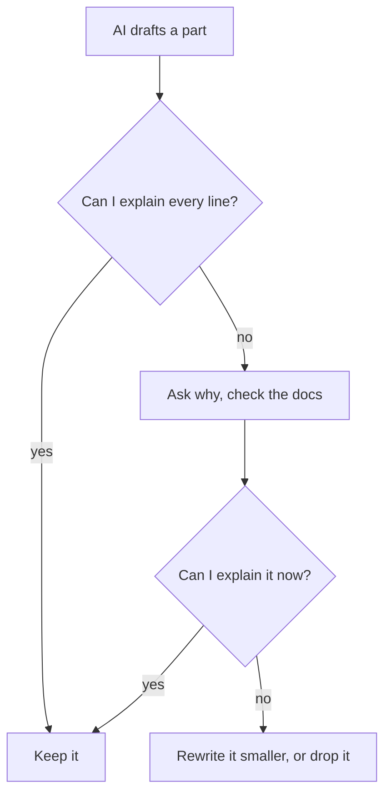

## An answer for someone else's project

In chapter 3.3, tracing two clicks on paper showed Yara a problem. Qasir counted a click when the app read a link from the database. Once the cache was added, the second click on a link came from the cache and never reached the database, so it was never counted. Click counts are a month 4 area in her plan, but the cache forced one decision early: where should Qasir count clicks? She asked a chat assistant. The answer was confident and detailed:

> Keep a counter for each link in the cache, and add one on every click. Every minute, save the counts to the database and reset the counters. This is the standard approach for high-traffic link shorteners, because it keeps the database free for other work.

Below it were 30 lines of code, ready to paste. Yara almost pasted them. Then she thought of Khaled's interview in chapter 5.1. His prices were stored as text because a tool chose it on the first evening and nobody looked. This was the same moment: a choice about to enter her project without her making it.

The AI's answer was not wrong. It was an answer for a project with a great many clicks every second. Qasir is for small shops and NGOs that share links in group chats. In her plan's example numbers, a busy link gets a few hundred clicks a day. Yara works alone and wants to explain every part. The AI knew none of this, because, as you saw in module 1, it does not know your context unless you give it. So she slowed down.

## Two options, named plainly

The first step is to name the options in your own words, not the AI's.

**Option A: count in the database on every click.** Each click adds one to that link's count in the database, even when the link itself came from the cache. It is one simple step. Every click reaches the database, so the count is never more than one click behind.

**Option B: count in the cache, save every minute.** Each click adds one to a counter in the cache, which is fast memory. Once a minute, a small timed job copies the counts into the database and resets the counters. The database gets one write per link per minute instead of one per click, which matters when clicks arrive by the thousand. The cost is more moving parts, and a risk. In her lab setup, the cache keeps its data only in memory. If the cache stops before a save, the clicks since the last save are lost.

Neither option is the right one in general. Each gains something and gives something up. That is the trade-off, and only Yara's facts can decide it.

## Look at the decision from several angles

One way to slow down is to ask the same question from different sides. Yara uses five angles. Each one can change her mind on its own.

**Her numbers.** A few hundred clicks a day is a light load for the database in her lab. Option B's speed protects against a problem Qasir does not have yet.

**Failure.** In module 4 she stopped the cache on purpose. She replays that lab in her head for each option. With option A, the counts are safe in the database. With option B, up to a minute of counts would disappear. For a shop owner checking how many people opened a sale link, a count that is quietly wrong is worse than a slower page.

**Explaining it.** Could she explain each option to her mentor in two minutes, without notes? Option A, yes. Option B needs the timer, the reset, and what happens if a save fails halfway. She could learn all that, but it would cost her learning hours from another area.

**Changing it later.** If Qasir grows, could she move to option B? Yes, if counting lives in one place in her code. A decision you can change later is cheaper to get wrong, so she does not need to prepare for traffic she does not have.

**The other side.** She asks the AI for the case against its own suggestion. How she asks matters. AI assistants tend to agree with the user, even when the user is wrong. If she asks "Isn't counting in the database better?", she may only get her own opinion back. So she asks neutrally: "For a link shortener with these facts, list what each option gains and gives up." Then she checks each point against her lab, not against how sure the answer sounds.

<Callout type="warning" title="A leading question gets an agreeing answer">
Ask the AI to compare options, not to approve your favourite. Give it your facts, ask what each option gives up, and check its points against your own lab.
</Callout>

## Worked example: weighing the two options

Now Yara puts the angles into numbers, so she can see her own reasoning. She scores each option from 1 to 5 on four tests. Then she gives each test a weight from 1 to 3 for how much it matters to Qasir.

| Test | Database on every click | Cache, saved each minute | Yara's weight |
|---|---|---|---|
| Simple to build | 5 | 2 | 3: she works alone |
| Fast under many clicks | 2 | 5 | 1: a few hundred a day |
| No clicks lost if a part stops | 5 | 2 | 3: shops need true counts |
| Easy to explain | 4 | 2 | 2: she must defend it |

For each option, she multiplies each score by its weight and adds the results. Option A: 3 times 5, plus 1 times 2, plus 3 times 5, plus 2 times 4. That is 15 plus 2 plus 15 plus 8, which is 40. Option B: 3 times 2, plus 1 times 5, plus 3 times 2, plus 2 times 2. That is 6 plus 5 plus 6 plus 4, which is 21. With her weights, counting in the database wins clearly.

The scores are her judgement, not measurements, and the table does not decide for her. Its value is that it shows where the decision comes from. If someone disagrees, they can point at one weight or one score, and she can explain it.

She then writes the decision down in two lines in her plan: "Qasir counts clicks in the database on every click. It gains a simple design, no lost clicks and a part I can explain; it gives up speed under very heavy traffic. Move to a cache counter if a link ever gets many clicks every second."

```predict
prompt: "At Yara's weights, the AI's cache counter loses, 21 to 40. Suppose you make one test matter a lot and the other three matter only a little. Which test, put first, would let the cache counter win?"
options:
  - id: fast
    label: "Fast under many clicks"
  - id: no-loss
    label: "No clicks lost if a part stops"
correctOptionId: fast
explanation: "Speed under heavy traffic is the one test where the cache counter scores higher. With 'Fast under many clicks' at 'Matters a lot' and the rest at 'Matters a little', it wins, 21 to 20, and that is the only setting where it wins. That setting describes a project with very heavy traffic, which is the project the AI was answering for. Putting 'No clicks lost' first does the opposite: the database wins, 26 to 15."
```

Step through the weights below. Change how much each test matters and watch which option comes out ahead.

<InteractiveCanvas slug="two-options-trade-off" />

The canvas showed that the AI's suggestion is not foolish. Set "Fast under many clicks" to "Matters a lot" and the other three to "Matters a little", and the cache counter wins, 21 to 20. It is the only setting of the weights where it does. With every weight at "Matters", counting in the database leads, 32 to 22. So the question was never "which option is better?". It was "which facts are true for this project?". The AI answered with the weights of a busy commercial service. Yara's facts give different weights, and different weights pick a different option.

## The explain-back rule, line by line

Choosing the option is half the work. Next, Yara asked the AI to draft the code for option A. It wrote about 15 lines. Before she kept any of them, she applied the explain-back rule from module 1: do not keep any AI-written part you cannot explain line by line.

The diagram shows the loop she follows for every AI-written part. Read it from the top.



What to notice: there is no arrow from "no" straight to "Keep it". Code that works but cannot be explained never enters the project. The takeaway is that the rule does not forbid AI code. It forbids keeping code you have not understood.

Yara could explain 14 of the 15 lines. The fifteenth built the database command by joining the short code from the web address straight into the command's text. She asked the AI why, then checked the documentation of her database library. She learned that joining text a visitor sent into a command lets someone send a short code crafted to change the command itself. The safe way is a <GlossaryTerm term="parameter" definition="A value passed to a database command separately from the command's text, so it can never change what the command does." />. She rewrote the line, and now she could explain it.

This was not bad luck. AI coding assistants can write code with security weaknesses, and in one study, people using an AI coding assistant wrote less secure code and felt more sure it was secure. AI code can also be out of date: a function the current version of a library has replaced. Reading line by line, and checking the documentation for your version as in module 4, catches both.

## Where it goes wrong

The first mistake is treating a confident answer as a fact about your project. "The standard approach" means standard for someone. Ask whose facts the answer assumes.

The second mistake is the leading question. "Isn't my option better?" invites agreement. Ask for what each option gives up.

The third mistake is weighing without writing anything down. A decision you cannot explain in two lines is not yet made. Write what you chose, what you gave up, and what would make you change.

The fourth mistake is reading AI code for the general idea instead of line by line. Khaled's store worked. The problem was one line nobody read.

## Check your understanding

```quiz
type: mcq
question: "Lama is building a booking app for a sports club with 60 members, about 30 bookings a week and no budget. She will look after it alone, about 2 hours a week. A chat assistant suggests splitting the app into three separate services 'so each part can grow on its own'. When would that suggestion come out ahead?"
options:
  - "When growth to many users matters most; her facts do not show that"
  - "When low running cost matters most, which fits her club with no budget"
  - "When easy upkeep by one person matters most, which fits her 2 hours"
  - "When a quick first version matters most, which fits a small club"
correct: 0
explanations:
  - "Right. Separate services help when each part must grow on its own under heavy use. Sixty members and 30 bookings a week do not show that, so for Lama the simpler single app fits her weights better."
  - "Three services usually cost more to run than one app, not less. Low cost is a reason against the suggestion."
  - "More separate parts mean more to update and watch. One person with 2 hours a week is a reason to keep it simple."
  - "Three services take longer to build and connect than one app. A quick first version points the other way."
```

```quiz
type: mcq
question: "Rasha volunteers at an NGO office and is building a volunteer sign-up form. An AI assistant wrote 40 lines for it. She can explain 37 of them. Three lines check email addresses with a long pattern she cannot read. The form works in her tests. By the explain-back rule, what should she do?"
options:
  - "Keep all 40 lines, since the form passes every one of her tests"
  - "Learn the three lines, or swap in a check she can explain"
  - "Delete all 40 lines and write the whole form by hand"
  - "Keep them, with a comment saying an AI wrote those lines"
correct: 1
explanations:
  - "Passing tests shows the lines work today, not that she understands them. If a volunteer's address is wrongly refused, she will not know where to look."
  - "Right. She asks why the pattern is written that way and checks the documentation until she can explain it, or she replaces it with a simpler check she understands. Either way, every kept line is one she can explain."
  - "The rule does not forbid AI code. She already understands 37 lines; throwing them away costs hours and teaches nothing new."
  - "A comment is honest about who wrote it, but she still cannot explain or fix it. Disclosure does not replace understanding."
```

**Next:** How to learn from open-source projects, and reuse their code only within the licence.
