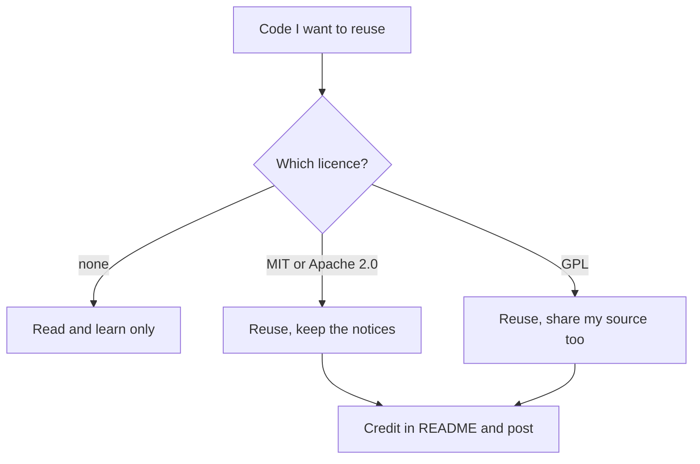

## Copied, credited, and still not allowed

Adam is building a small online shop for a sewing workshop in his neighbourhood. He found a public repository on GitHub with a neat search function, exactly what the shop needed. He copied the function, about 40 lines, into his project. Above it he wrote a comment with the author's username: "Search code by this author, thank you." He felt he had done the honest thing.

At his next mentor meeting, the mentor read the comment and asked one question: "What licence is that repository under?" Adam did not know. They opened it together. There was no licence file anywhere. The mentor explained that this changes everything. Without a licence, the author keeps all the rights to the code, and nobody may copy it into their own project, with or without thanks.

Adam removed the 40 lines. He kept what he had learned from reading them and wrote his own search, which took him two evenings. He also asked the author, politely and in public on the repository, whether they would add a licence. This chapter is about avoiding Adam's mistake while still getting what he wanted: learning from code that other people have already written.

## Why read other people's code

<GlossaryTerm term="Open source" definition="Code shared under a licence that lets others read, use, change and share it, on the conditions the licence sets." /> projects are a good free teacher. A real project shows things a tutorial leaves out: how the files are organised, what the tests check, how errors are handled, and which problems users reported. Yara wanted to see a short-code maker that real people use and maintain before her short codes week, week 9. So on lab day 9, in week 7, she gave her lab to reading one.

Reading is always allowed. Copying depends on the licence. Keep those two apart and most of the risk disappears.

## Finding a project worth studying

At the time of writing (checked 2026-10-24), GitHub offers several ways to find projects. You can search by keyword. You can open topic pages, which group projects that their owners tagged with the same topic, such as link shorteners. Explore and Trending show projects that are active or popular. Many projects mark easy tasks for newcomers with labels such as "good first issue" and "help wanted". A good place to start is a project you already use.

Yara opened GitHub's topic page for link shorteners and read the first two pages of results. She chose two candidates. The first she calls shortlane in her notes, a made-up name for this example. It makes short codes in the way she wanted to learn. The second had far more stars, which are a way GitHub users bookmark a project, so it looked more popular.

## Signs of a healthy project

Popular is not the same as healthy. A guide that GitHub publishes on open source lists signs worth checking before you spend time on a project. It has a licence. It has recent commits. Several people contribute, not just one. The maintainers respond to <GlossaryTerm term="issues" definition="On GitHub, a project's list of reported problems and requests. Anyone can open one, and the maintainers answer and close them." /> and <GlossaryTerm term="pull requests" definition="On GitHub, a proposed change to a project's code that its maintainers can review, discuss and then accept or refuse." />. Issues get closed. Pull requests get reviewed and merged. People are friendly in the discussions.

Yara checked shortlane against that list. It had an MIT licence. The last commit was three weeks old. Nine people had contributed. Most issues had an answer within a few days, and recent pull requests had been reviewed and merged. The popular project was different: its last commit was four years old, and it had no licence at all. She could still read it, but she would not reuse any of it, and she would not expect answers if she asked a question.

## Worked example: Yara reads shortlane in order

A whole project is too much to read at once. This course suggests an order. It is the course's advice, not a tested method, but it keeps you moving from the big picture to the details.

First, read the README, the file that explains what the project does and how to run it. Second, run it. If your laptop is not strong enough, GitHub Codespaces gives you a computer in the browser. At the time of writing it has limited free hours each month, so check your usage page. Third, find the entry point, the file where the program starts. Fourth, follow one feature from start to end, inside one folder. Fifth, read that feature's tests, which show what the authors thought could go wrong. Last, ask an AI to explain one file, and check its explanation against the code.

Yara followed this order on lab day 9. The README told her how to start shortlane, and she ran it in Codespaces. Then she read only the folder that makes short codes. Its tests surprised her: one checked what happens when two links get the same code by chance. She had not thought of that, and she wrote it in her notes as a question for week 9.

Then she asked a chat assistant to explain the main file in that folder. The explanation was clear and mostly right, but it said the file "calls a function that checks the code is not already taken". Yara searched the file. There was no such function. The check happened somewhere else, in a rule in the database that refuses a code that already exists. An AI can explain a file to you. It can also invent a function that is not there. Check against the code.

## May she reuse it?

In week 9, Yara wanted to adapt shortlane's short-code function, about 20 lines, for Qasir. Shortlane has an MIT licence. Before you step through what she did, make a call.

```predict
prompt: "Shortlane has an MIT licence. Yara wants to adapt its 20-line short-code function for Qasir. On what condition may she do it?"
options:
  - id: notice
    label: "Yes, if she keeps the licence notice with it"
  - id: thanks
    label: "Yes, if she thanks its author in the README"
correctOptionId: notice
explanation: "MIT lets her reuse, change and share the code, on one condition: she keeps the copyright and licence notice with it. A thank-you in the README is a good habit on top, but it does not replace the notice. The canvas shows both moves at steps 6 and 7."
```

Step through Yara's path from finding shortlane to crediting it, including two moves the licence does not allow.

<InteractiveCanvas slug="reuse-open-source-safely" />

The licence check came first because it decides what the rest of the work can lead to. The two refusals sat exactly where people try them. Copying from the popular project with no licence was refused. Deleting the MIT notice was refused too, even with a thank-you in the README, because the notice is the licence's one condition.

## Licences in four cases

Licence law is large, and this course is not legal advice. For your own projects, four cases cover most of what you will meet. The table puts each one in a line.

| Licence | You may | You must |
|---|---|---|
| MIT | Reuse, change and share the code | Keep the copyright and licence notice |
| Apache 2.0 | Reuse, change and share; it includes a patent grant | Keep the notices and state your changes |
| GPL (version 3) | Reuse, change and share | If you distribute your work, share its full source under the GPL |
| No licence | Read it and learn from it | Not copy it; ask the author to add a licence |

The same four cases, as the decision you make before you copy anything:



Only one branch ends without reuse, and it is the one people expect least: the public repository with no licence. Every other branch allows reuse with a condition, and credit comes after the licence, never instead of it.

One more rule sits under the table. Public is not the same as open source. GitHub's terms let other users view and fork a public repository, but that is not a licence to reuse the code elsewhere. Adam's search function was public, and it had no licence.

## Credit, every time

Every licence in the table asks you to keep its notice. This course adds a habit on top: name the project you learned from in your README and in your write-up, even when you copied nothing. Credit costs one line, and it tells a reader you know where your ideas came from. Yara's README now says: "Short codes adapted from shortlane (MIT licence). The licence notice is in the licences folder."

## Where it goes wrong

The first mistake is Adam's: treating public as permission. Look for the licence file before you copy a single line.

The second mistake is treating credit as permission. A thank-you comment is good manners. It does not replace a licence, and it does not replace keeping a licence's notice.

The third mistake is trusting the AI's tour of the code. Use it to find your way, then check every claim it makes against the file.

## Check your understanding

```quiz
type: mcq
question: "Saleh is building an ordering app for a pharmacy, and he plans to sell it to two other pharmacies. On GitHub he found three projects with a stock-list function he likes. Project A has an MIT licence. Project B has no licence file but over 2,000 stars. Project C uses GPL version 3. Which reuse is allowed?"
options:
  - "Copy B's function and credit its author in a comment"
  - "Copy A's function and delete the notice after changing it"
  - "Copy A's function and keep its copyright and licence notice"
  - "Copy C's function into the app he sells and keep his code closed"
correct: 2
explanations:
  - "Stars and credit do not give permission. With no licence, nobody may copy the code into their own project."
  - "MIT's one condition is keeping the notice, and it still applies after he changes the code."
  - "Right. MIT allows reuse, changes and selling, as long as the copyright and licence notice stay with the code."
  - "Selling the app to other pharmacies is distributing it. GPL version 3 then asks him to share his full source under the same licence, so keeping it closed breaks the licence."
```

```quiz
type: mcq
question: "Malak is building a timetable app for a school and wants one open-source project to study closely. Project P: MIT licence, last commit two weeks ago, 6 contributors, most issues answered within a week. Project Q: MIT licence, 3,000 stars, last commit four years ago, 1 contributor, 40 open issues with no reply. Which should she study?"
options:
  - "P: recent commits, several people, answered issues"
  - "Q: its 3,000 stars show it is the better project to learn from"
  - "Q: with one contributor, the code will be easier to follow"
  - "Neither: two projects under MIT cannot be told apart"
correct: 0
explanations:
  - "Right. Recent commits, several contributors and answered issues are signs of a healthy project. Her questions are likely to get answers, and the code is likely to match current tools."
  - "Stars show that people once bookmarked it. They are not signs of health; four years without a commit and 40 unanswered issues are."
  - "One person can write clear code. But no commits in four years and no replies to 40 issues mean the code may be out of date, and nobody will answer her."
  - "The licence is the same, but the health signs are very different. The licence decides what she may copy; health decides what is worth her time."
```

**Next:** Five graded cases on hours, weekly areas, trade-offs and licences, plus one review case from module 4.
