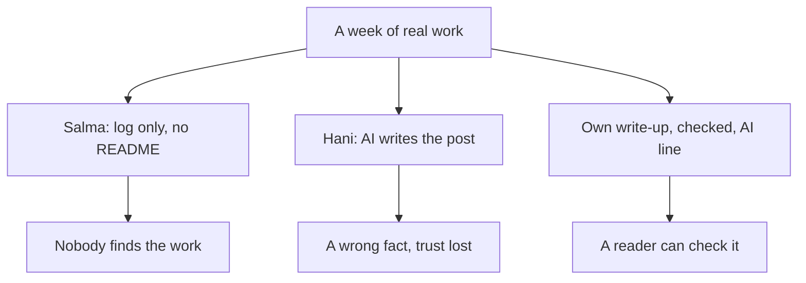

<BigWordAlert term="Building in public" plainEnglish="Sharing your work and what you learn as you go, week by week, not only the finished result." whyItMatters="A reviewer, a client or a mentor can only trust what they can see and check. Weekly sharing gives them something real to check, long before the project is finished." />

## Forty lab days that nobody saw

Salma is a fellow learning backend development, the part of an app that runs on a server. For two months she ran a small lab almost every evening, about five evenings a week. Her project was a shuttle bus timetable for her university. Staff enter the trips, and students check when the next bus leaves each stop.

She did everything module 4 asked. Each lab had a goal, a part she broke on purpose, and a short entry in her log. By the end of the two months, her GitHub repository held 40 entries. Her best one was lab 27. Two staff members edited the 8:00 trip at the same second, and one of the two changes was lost without any warning. She found out why, fixed it, wrote a test, and explained it in plain words in her log.

Then she applied for a paid remote internship. The repository had been public the whole time, and the reviewer had her name and her CV. Her CV said "backend practice".

```predict
prompt: "A reviewer at the internship spent about two minutes looking for Salma's work. Her repository was public, with 40 dated lab entries. Would the reviewer have found lab 27, her best lab?"
options:
  - id: probably-yes
    label: "Yes, the reviewer found lab 27 quickly"
  - id: probably-not
    label: "No, the reviewer did not find it"
correctOptionId: probably-not
explanation: "A public repository means a person is allowed to look, but public is not the same as easy to find. It does not lead anyone to the work. Read on to see what the reviewer actually found in those two minutes."
```

A week later the reply came. It was polite and short: "Thank you. We could not find any examples of your work."

Salma was confused at first. Then she opened her own profile and looked at it as a stranger would. The repository was called `practice-2`. It had no README, so a visitor saw a list of 40 files named by date and nothing else. Her GitHub profile did not point to it. Her CV gave no link. Not one of her friends had seen it, and she had never sent the link to her mentor. The work was real and good, and nothing pointed to it.

## A post that said too much

Hani made the opposite mistake. He works part time at a print and copy shop, and he built a small stock app for it. It tracks paper and ink, and when paper runs low, that row on the page turns red. It works, and the shop's owner uses it every day. Hani was proud of it and wanted to share it.

He opened a chat assistant and typed one line: "Write a LinkedIn post about my print shop stock app." The answer was smooth and confident. He changed two words and posted it. The post said the app "sends a text message to the owner the moment paper runs low". It does not. It has never sent a text message. The red row was the only alert, and the AI had no way to know that.

The post did well. About 40 people liked it. Then the owner of a print shop in another town left a comment. She asked how to set up the text messages, because that was exactly what her shop needed. Hani had to reply in public that the app could not do it. He felt worse than if he had posted nothing.

Hani's problem was not that he used AI. Using a chat assistant to help with a post can be a good choice, and you will do it yourself in this module. His problem was that the post was not his. He did not write it, he did not read it closely, and he did not check it against the app. The AI filled the gaps in his one-line request with things that sounded right for a stock app. One of them was false, and Hani's name was on it.

## Two mistakes, one path between them

Salma and Hani made opposite mistakes. Salma did the work and shared nothing about it, so nobody could see it. Hani shared, but the words were not his, and one fact in them was wrong. Both lost the same thing: a chance for someone to trust their work.

The diagram shows the two mistakes and the path between them. All three start from the same place: a week of real work.



Salma's branch and Hani's branch start differently and end in the same place for a reviewer: nothing they can trust. The middle branch has three parts, and each one fixes one of the mistakes. Writing it yourself fixes Hani's empty post. Checking every fact against your log fixes his wrong claim. Sharing it at all, with a link to the work, fixes Salma's silence.

## Why this matters for your career

When you apply for a job, a client project or a place on a programme, someone has a few minutes to decide whether to trust you. They cannot watch you work for two months. They can only look at what you show them. A CV line like "backend practice" asks them to believe you. A short write-up with a link to lab 27 lets them check.

There is a little research on this, and it is old. One interview study from 2013 found that employers and job seekers saw a person's GitHub activity as a more reliable sign of skill than a CV. The employers also said they looked at things that were quick to check. The study asked people what they thought, not who was hired, so it cannot promise that sharing gets you a job. We know of no study that shows that. This course recommends building in public for a plainer reason: sharing your work gives people something to check.

Honest sharing also protects you. Some writing platforms now have rules about posts that AI helped to write. You will see them in chapter 6.3. A post that says clearly what AI did, and what you checked, stays within those rules even when they change. It also keeps your public record true. Hani's post will stay under his name for years, and the wrong sentence stays with it unless he corrects it.

## What building in public looks like here

Building in public in this course is small and regular. Once a week, you turn your lab log into a short write-up of about 300 to 800 words: what you built, what broke, what you learned and what comes next. You write it first as a file in your own GitHub repository, so it belongs to you. Then you adapt it for one or two other places where people will read it, such as LinkedIn, DEV or Hashnode. Each version says honestly what AI helped with.

Yara, whom you have followed since module 1, has done this every week since her labs began, for Qasir, her link shortener. Her write-ups are not long and not polished. One week she wrote about stopping Qasir's cache on purpose and what she saw. Another week a power cut ended her lab early, and she wrote about the half she finished. A reader who follows her for a month can see what she learned, in her own words, with links to the labs behind each claim.

You decide how public to be. Posting on a public platform is your choice in this course. A private draft that only your mentor sees is accepted for every task, including the capstone. You never need to share anything about your private life to do this well. The write-up is about the work: the lab, the bug, the idea that finally made sense.

## What this module asks of you

This module is the last one. Its first three chapters are about sharing. Chapter 6.2 shows how a week of lab logs becomes a short article in your own voice, with AI as an editor that asks questions, not as the author. Chapter 6.3 is about honesty. You write a short line that says which tool helped, what it did and what you checked, and you learn the rules of the places where you post and work. Chapter 6.4 is a mixed review of five new cases from across the course. The cases come in mixed order, so you practise choosing the right habit when nobody tells you which module it belongs to.

Then comes the capstone in chapter 6.5. It brings the whole course together as the real start of a strong project. You hand in a six-month plan and a weekly learning plan. You add a GitHub lab log with at least ten lab days, a page of notes in your own words, and one honest write-up. You can use your own project or a provided case. Early modules showed you full worked examples. The capstone shows only part of one in full and gives the rest as an outline, on purpose. By now you have the habits, and the work has to be yours. Finally, chapter 6.6 is the course gate, where you keep a short toolkit of every habit and look back at your first gate.

<LearningObjectives items={["Explain why good work that nobody can find, and a post you did not write, both fail to earn trust", "Turn a week of lab logs into a short write-up in your own voice, with AI as an editor", "Check every fact in a write-up against your repository before you share it", "Write an honest AI-use line and follow the rules of the places where you post and work", "Hand in the five-part capstone and walk a mentor through it in five minutes"]} />

## Key words

| Word | Plain English |
|---|---|
| **Write-up** | A short article about a week of your work: what you built, what broke, what you learned, what is next |
| **AI-use line** | One or two honest sentences in a post: which AI tool helped, what it did, and what you checked |
| **Adapt** | Change the length and format of the same write-up so it fits another place, without changing the facts |
| **Label** | A mark some platforms let you or ask you to add to a post, saying AI helped with it |

## What is in this module

| Chapter | You will practice |
|---|---|
| 6.2 | Turning a week of lab logs into a write-up, then adapting it for two platforms |
| 6.3 | Writing an honest AI-use line and checking the rules where you post |
| 6.4 | A mixed review: five new cases from across the course, in mixed order |
| 6.5 | The capstone: the start of a strong project, or the provided case |
| 6.6 | The course checklist, your toolkit of habits, and a look back at gate 1 |

**Next:** Salma turns one week of her quiet log into a short article in her own words, and puts it where people can find it.
