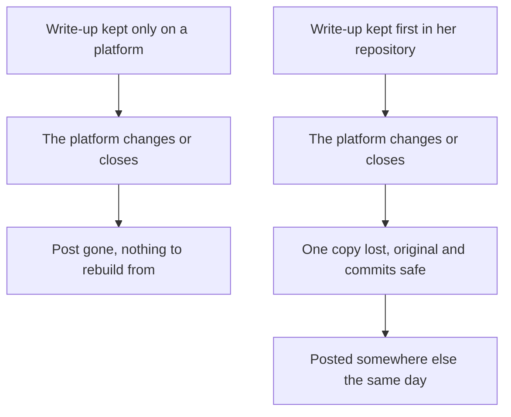

## A log is written for you

After the internship reply, Salma opened her repository and tried to read it as a stranger would. Her entries made perfect sense to her. "Lab 27: lost update, 8:00 trip. Version check. Test OK." To anyone else, they were a puzzle. A log is written for the person who did the work. It saves time for you, and it skips everything you already know.

So Salma made a plan. Every week she would write one short article about that week's labs. She would start with week 6, the week of lab 27, because it held her best work. The log would stay as it was. The article would be a new file, written for a reader who has never seen her project.

This chapter follows her through that first write-up. You will see how a week of log entries becomes a short story with a beginning and an end. You will see where an AI chat assistant helps, and what Salma checks before she accepts its edits. Then you will see how the same write-up becomes two posts for two different places, without a single fact changing.

## From log to write-up

A write-up answers four questions a reader has. What did you build this week? What broke? What did you learn? What comes next? These are the same parts your lab log already has, so you are not starting from nothing. The difference is the reader. In the log, you write "version check". In the write-up, you explain what that check does and why you needed it, in a sentence or two.

The second difference is choice. A week of labs holds five or more small stories, and a reader will not follow all of them. Pick one, usually the lab where something broke and you found out why. The other labs can appear in one line each, or not at all. A write-up about one real problem is easier to read than five short summaries, and it shows more of how you think.

The third difference is where it lives. Write the article first as a Markdown file in your own GitHub repository, for example `posts/week-06.md`, next to the labs it describes. That file is the original. You own it, it has a date, and it can link to the exact commits and lab entries behind each claim. If a platform changes its rules, or you cannot reach it one day, the original is still there.

Write it in your <GlossaryTerm term="own voice" definition="The way you naturally explain things: your words, your examples and your level of detail, even if your English is simple." />. Simple English is fine. Short sentences are fine. A reader who later meets you, in an interview or a call, should recognise the person who wrote the post.

## Worked example: Salma's week 6

Salma's log for week 6 has five entries. Lab 26 added the second bus route to the timetable. Lab 27 was the big one. On purpose, she sent two edits to the 8:00 trip at the same second: one moved it to 8:10, the other changed its stop. Only the second change survived, and nothing warned anyone. Lab 28 ended after 15 minutes because of a power cut, so she wrote down what she had: a few notes on why her fix should work. Lab 29 added a test that sends 20 edits to the same trip at once. Lab 30 made the error message clearer: "This trip changed while you were editing. Reload and try again."

**Step 1: choose the story.** Lab 27 is the story. It has a problem a reader can picture: students waiting at a stop for a bus that now leaves from somewhere else. It has a cause, a fix and a test. Labs 26, 29 and 30 support it, and lab 28 shows something honest about how real weeks go.

**Step 2: write the four parts.** What she built: the timetable now handles two routes. What broke: when two staff members edited the same trip at the same moment, one edit silently wrote over the other. Each edit read the old trip, changed it and saved it, so the second save wiped out the first. What she learned: give each trip a version number, and accept a save only if the version is still the one the editor read. What is next: showing students when a trip was last changed.

**Step 3: put a number on every claim, from the log.** Salma did not write "many requests" or "it is fast now". She wrote what her test does: 20 edits to the same trip at once, and exactly 1 is saved. The other 19 get the new error message. Every number in the draft can be checked against a file in her repository.

**Step 4: link the evidence.** Under the story she linked the commit "Add version check to trip edits" and the test file from lab 29. A reviewer who doubts the post can click once and see the code. Her draft came to about 650 words, written in about 40 minutes on a Saturday.

Why does it matter where the first copy lives? The diagram follows the same write-up down two paths when a platform changes.



The event in the middle is the same on both paths. Only the starting point differs, and it decides whether a platform change costs you one copy or the whole week's write-up.

## AI as an editor, not the author

Salma's English is good, but it is her second language, and her draft had many small grammar mistakes. This is a fair place to use AI. The danger is the request Hani made in chapter 6.1: "write a post about my project". That hands the whole job to a tool that knows nothing about your project except what you typed. Salma's request was different. She gave the AI her finished draft and three rules.

<Callout type="tip" title="A request for an AI editor">
"Here is my draft. Fix grammar and unclear sentences. Keep my words where you can. Do not add any facts, numbers or claims. Then ask me three questions about places where a reader who has never seen my project would be lost."
</Callout>

The three questions are a very useful part. They show you where your draft assumes knowledge the reader does not have. You answer them in your own words and add the answers to the draft. The AI points to the gaps, and you fill them.

```predict
prompt: "Salma's request says plainly: add no facts, numbers or claims. Her draft has five numbers in it. When the edit comes back, will all five numbers be exactly as she wrote them?"
options:
  - id: unchanged
    label: "Yes, because she told it to add no facts"
  - id: maybe-changed
    label: "Not for sure, so she checks each number"
correctOptionId: maybe-changed
explanation: "An instruction makes a change less likely, not impossible. A tool that rewrites sentences for style can also rewrite what they claim. Step through the canvas to see what came back."
```

Step through what happens to Salma's draft from her log to two platforms.

<InteractiveCanvas slug="commits-to-article" />

Look at what changed between steps 3 and 5. A sentence that read better in step 4 carried a claim her test file could not support. Only the check in step 5 brought her own number back.

## Adapt for two platforms

The original is ready. Now Salma shares it in two places, and each place has its own reader. On LinkedIn, people scroll quickly through a feed, often on a phone. Her LinkedIn version is about 120 words: the lost edit in two sentences, what she learned in one, and a link to the full write-up. On DEV, developers come to read full technical posts. Her DEV version is the whole 650 words, with headings and the test code.

Only the length and format change. The facts stay exactly the same in every version: two routes, two edits at the same second, 20 edits, 1 saved. If a fact changes, it changes first in the original, and then in each copy.

Each place has its own rules, so check them before you post. At the time of writing (checked 2026-10-24), DEV lets authors mark a post as Hand Written, AI-Assisted or Fully Autonomous. Salma marks hers AI-Assisted, because AI edited it. LinkedIn is for people aged 16 or over and has no label rule we found, but it says you must review and edit AI-generated text before you share it. Hashnode, another developer blog site, is open from age 13, with a parent's or guardian's permission under 18. Rules change, so read each platform's own help page. Chapter 6.3 looks at them more closely.

If a platform does not open for you, or you are under its age, you still have a place to share. The Markdown file in your public GitHub repository can be read and linked by anyone. If GitHub itself is unreachable for a day, keep the write-up in your notes app and add it to the repository later.

The same habits work for other formats. What follows is the course's advice, not a platform rule. If you want to make a short video about your week, an AI chat assistant can suggest a script from your write-up. You still check every fact in the script against your repository, and say in the video's description that AI helped. If your week was about a book chapter, a source notebook can help you find your way around the chapter. Your write-up still says what you learned, in your words.

## Where it goes wrong

The most common mistake is asking the AI to write the post from your log. It feels efficient, because the log already has the facts. But the AI fills every gap with whatever sounds normal for that kind of project, and the result reads like everyone else's post. You also lose the part that shows your thinking: why you chose this story and what surprised you.

The second mistake is reading only the AI's new version. Edits are hard to check that way, because the new text reads smoothly. Put the two versions side by side, or ask the AI to list every sentence it changed. Then check each changed sentence for numbers, claims and words like "always", "never" or "fast".

The third mistake is waiting for a week worth writing about. Lab 28 lasted 15 minutes before the power went, and Salma still wrote two honest lines about it. Most weeks are ordinary. An ordinary week, told clearly, still shows a reviewer how you work.

## Check your understanding

```quiz
type: mcq
question: "Jamil keeps a lab log for a small online shop's order tracker. He asked a chat assistant to fix the grammar in his week 3 write-up. The edited version says: 'This week I added tests for every endpoint and made the order page twice as fast.' His log says he added tests for 3 of his 7 endpoints. He never timed the order page. What should he do before posting?"
options:
  - "Post the edited version, since he only asked for grammar fixes"
  - "Ask the assistant to recheck its edit, since it made the change"
  - "Match it to his log, since he tested 3 of 7 and never timed it"
  - "Add 'about' before 'twice', since a softer claim is more honest"
correct: 2
explanations:
  - "An edit for grammar can still change facts, as this one did. The post would claim tests he did not write and a speed he never measured."
  - "The chat assistant cannot see his repository, so it cannot know which endpoints have tests. The check has to be against his own log and commits."
  - "Right. Every fact in a write-up must match the repository. His log shows tests for 3 of 7 endpoints and no timing, so the post says exactly that."
  - "A softer word is a good instinct, but 'about twice as fast' is still a number he never measured. The claim has to go, not shrink."
```

```quiz
type: mcq
question: "Sara studies at a coding bootcamp. She made three versions of her week 5 write-up about a quiz app. 1) The original in her repository says the tests pass for 5 of her 6 pages. 2) Her DEV version is the same 900 words, with the AI-Assisted mark. 3) Her LinkedIn version, which a chat assistant cut to 110 words, says 'every page is now tested'. 4) The LinkedIn version links to the original. Which version must she fix before she posts?"
options:
  - "The LinkedIn one, because its claim no longer matches the original"
  - "The DEV one, because 900 words is too long for any platform"
  - "The original, because it should say all 6 pages, like LinkedIn"
  - "None of them, because the LinkedIn post links to the original"
correct: 0
explanations:
  - "Right. Shortening may change the length, never the facts. 'Every page' is 6 of 6, and her tests pass for 5 of 6, so the short version must say what the original says."
  - "DEV readers come for full technical posts, so 900 words with code fits there. Length is the one thing each version may change."
  - "The original is the one checked against her tests, which pass for 5 of 6 pages. A copy must follow the original, not the other way round."
  - "A link back is good practice, but a reader may read only the short post. The short version itself must be true."
```

**Next:** Hani rewrites his post about the print shop app, and adds one honest line about what AI did.
