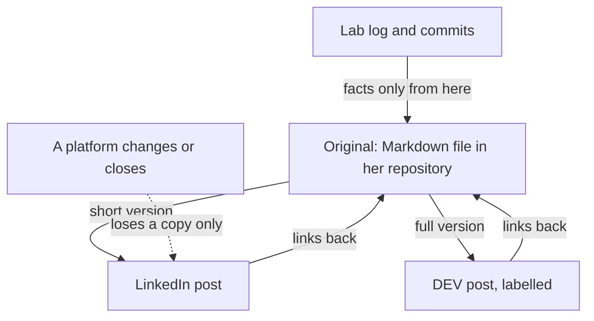

## A log is written for you

After the internship reply, Salma opened her repository and tried to read it as a stranger would. Her entries made perfect sense to her. "Lab 27: race on pitch 1, 18:00. Unique rule. Test OK." To anyone else, they were a puzzle. A log is written for the person who did the work. It saves time for you, and it skips everything you already know.

So Salma made a plan. Every week she would write one short article about that week's labs. She would start with week 6, the week of lab 27, because it held her best work. The log would stay as it was. The article would be a new file, written for a reader who has never seen her project.

This chapter follows her through that first write-up. You will see how a week of log entries becomes a short story with a beginning and an end. You will see where an AI chat assistant helps, and the one place where it nearly made her post untrue. Then you will see how the same write-up becomes two posts for two different places, without a single fact changing.

## From log to write-up

A write-up answers four questions a reader has. What did you build this week? What broke? What did you learn? What comes next? These are the same parts your lab log already has, so you are not starting from nothing. The difference is the reader. In the log, you write "unique rule". In the write-up, you explain what that rule does and why you needed it, in a sentence or two.

The second difference is choice. A week of labs holds five or more small stories, and a reader will not follow all of them. Pick one, usually the lab where something broke and you found out why. The other labs can appear in one line each, or not at all. A write-up about one real problem is easier to read than five short summaries, and it shows more of how you think.

The third difference is where it lives. Write the article first as a Markdown file in your own GitHub repository, for example `posts/week-06.md`, next to the labs it describes. That file is the original. You own it, it has a date, and it can link to the exact commits and lab entries behind each claim. If a platform changes its rules, or you cannot reach it one day, the original is still there.

Write it in your <GlossaryTerm term="own voice" definition="The way you naturally explain things: your words, your examples and your level of detail, even if your English is simple." />. Simple English is fine. Short sentences are fine. A reader who later meets you, in an interview or a call, should recognise the person who wrote the post.

## Worked example: Salma's week 6

Salma's log for week 6 has five entries. Lab 26 added the second pitch to the booking table. Lab 27 was the big one. She sent two booking requests for pitch 1 at 18:00 at the same second, on purpose, and both were accepted. Lab 28 ended after 15 minutes because of a power cut, so she wrote down what she had: a few notes on why her fix should work. Lab 29 added a test that sends 20 booking requests for the same hour at once. Lab 30 made the error message clearer: "Pitch 1 is already booked at 18:00."

**Step 1: choose the story.** Lab 27 is the story. It has a problem a reader can picture, two people turning up for the same pitch. It has a cause, a fix and a test. Labs 26, 29 and 30 support it, and lab 28 shows something honest about how real weeks go.

**Step 2: write the four parts.** What she built: the booking API now handles two pitches. What broke: two members could book the same hour if they pressed the button at the same moment. The API first asked "is this hour free?" and then saved the booking, and in the tiny gap between the two, a second request got the same answer. What she learned: the safest place for the rule "one booking per pitch per hour" is the database itself, which refuses a second copy. What is next: letting members cancel a booking.

**Step 3: put a number on every claim, from the log.** Salma did not write "many requests" or "it is fast now". She wrote what her test does: 20 requests for the same hour at once, and exactly 1 is accepted. The other 19 get the new error message. Every number in the draft can be checked against a file in her repository.

**Step 4: link the evidence.** Under the story she linked the commit "Add unique rule for pitch and hour" and the test file from lab 29. A reviewer who doubts the post can click once and see the code. Her draft came to about 650 words, written in about 40 minutes on a Saturday.

The diagram shows how the original file sits between the log and the places where people will read it. Look at the direction of the arrows.



What to notice: facts flow in one direction only, from the log into the original. The platform posts are copies in different shapes, and each one links back to the original. When a platform changes its rules or closes, you lose a copy, not the work. The takeaway: write once in a file you own, then share outwards, never the other way round.

## AI as an editor, not the author

Salma's English is good, but it is her second language, and her draft had many small grammar mistakes. This is a fair place to use AI. The danger is the request Hani made in chapter 6.1: "write a post about my project". That hands the whole job to a tool that knows nothing about your project except what you typed. Salma's request was different. She gave the AI her finished draft and three rules.

<Callout type="tip" title="A request for an AI editor">
"Here is my draft. Fix grammar and unclear sentences. Keep my words where you can. Do not add any facts, numbers or claims. Then ask me three questions about places where a reader who has never seen my project would be lost."
</Callout>

The three questions are the most useful part. They show you where your draft assumes knowledge the reader does not have. You answer them in your own words and add the answers to the draft. The AI points to the gaps, and you fill them.

```predict
prompt: "Salma's draft is 650 words in her second language, with many small grammar mistakes. Should she ask a chat assistant to edit it before she posts?"
options:
  - id: post-as-is
    label: "No, post it as it is, so every word stays hers"
  - id: ask-edit
    label: "Yes, ask for edits, then check every change"
correctOptionId: ask-edit
explanation: "Editing for grammar and clarity is a good use of AI, and some platforms say plainly that AI help with a second language is fine. The draft stays hers because she wrote it and decides on every change. The part that matters is the second half: check every change, because an edit can quietly change a fact."
```

Step through what happens to Salma's draft from her log to two platforms.

<InteractiveCanvas slug="commits-to-article" />

The canvas showed both sides of the AI edit. The grammar was better, and the three questions found real gaps. One asked what "the same second" means to someone who has never built an API. But one sentence had changed. Salma wrote "I tested it with 20 requests at once". The edit said "it handles hundreds of bookings a second". That sounds like a small improvement in style. It is a new claim, and nothing in her repository supports it. She found it only because she checked every number against her test file, and her own sentence went back in.

## Adapt for two platforms

The original is ready. Now Salma shares it in two places, and each place has its own reader. On LinkedIn, people scroll quickly through a feed, often on a phone. Her LinkedIn version is about 120 words: the double booking in two sentences, what she learned in one, and a link to the full write-up. On DEV, developers come to read full technical posts. Her DEV version is the whole 650 words, with headings and the test code.

Only the length and format change. The facts stay exactly the same in every version: two pitches, two bookings at the same second, 20 requests, 1 accepted. If a fact changes, it changes first in the original, and then in each copy.

Each place has its own rules, so check them before you post. At the time of writing (checked 2026-10-24), DEV lets authors mark a post as Hand Written, AI-Assisted or Fully Autonomous. Salma marks hers AI-Assisted, because AI edited it. LinkedIn is for people aged 16 or over and has no label rule we found, but it says you must review and edit AI-generated text before you share it. Hashnode, another developer blog site, is open from age 13, with a parent's or guardian's permission under 18. Rules change, so read each platform's own help page. Chapter 6.3 looks at them more closely.

If a platform does not open for you, or you are under its age, you still have a place to share. The Markdown file in your public GitHub repository can be read and linked by anyone. If GitHub itself is unreachable for a day, keep the write-up in your notes app and add it to the repository later.

The same habits work for other formats. If you want to make a short video about your week, an AI chat assistant can suggest a script from your write-up. You still check every fact in the script against your repository, and say in the video's description that AI helped. If your week was about a book chapter, a source notebook can help you find your way around the chapter. Your write-up still says what you learned, in your words.

## Where it goes wrong

The most common mistake is asking the AI to write the post from your log. It feels efficient, because the log already has the facts. But the AI fills every gap with whatever sounds normal for that kind of project, and the result reads like everyone else's post. You also lose the part that shows your thinking: why you chose this story and what surprised you.

The second mistake is reading only the AI's new version. Edits are hard to check that way, because the new text reads smoothly. Put the two versions side by side, or ask the AI to list every sentence it changed. Then check each changed sentence for numbers, claims and words like "always", "never" or "fast".

The third mistake is waiting for a week worth writing about. Lab 28 lasted 15 minutes before the power went, and Salma still wrote two honest lines about it. Most weeks are ordinary. An ordinary week, told clearly, still shows a reviewer how you work.

## Check your understanding

```quiz
type: mcq
question: "Jamil keeps a lab log for a small online shop's order tracker. He asked a chat assistant to fix the grammar in his week 3 write-up. The edited version says: 'This week I added tests for every endpoint and made the order page twice as fast.' His log says he added tests for 3 of his 7 endpoints, and he never timed the order page. What should he do before posting?"
options:
  - "Post the edited version, since he only asked for grammar fixes"
  - "Ask the chat assistant to check its own edit for any mistakes"
  - "Match it to his log: three of seven tested, and no speed claim"
  - "Keep the speed claim, but add the word 'about' before 'twice'"
correct: 2
explanations:
  - "An edit for grammar can still change facts, as this one did. The post would claim tests he did not write and a speed he never measured."
  - "The chat assistant cannot see his repository, so it cannot know which endpoints have tests. The check has to be against his own log and commits."
  - "Right. Every fact in a write-up must match the repository. His log shows tests for 3 of 7 endpoints and no timing, so the post says exactly that."
  - "'About twice as fast' is still a number he never measured. A softer word does not make an unmeasured claim true."
```

```quiz
type: mcq
question: "Sara is learning web development at a coding bootcamp. Her week 5 write-up is a 900-word Markdown file in her GitHub repository, with code and three headings. She wants to share it on LinkedIn and on DEV. A chat assistant fixed her grammar. Which plan fits the habits in this chapter?"
options:
  - "Short LinkedIn post linking to the file; full post on DEV, labelled"
  - "The same 900 words on both, so the two versions always stay the same"
  - "One long LinkedIn post only, since a DEV copy would repeat her work"
  - "Two new posts that the AI writes from her title and three headings"
correct: 0
explanations:
  - "Right. Each place gets the length and format that fits its readers, and both point back to the original file. The facts stay the same, and the label on DEV says that AI helped."
  - "Keeping the facts the same is right, but keeping the length the same is not. 900 words with code is hard to read in a LinkedIn feed; a short version with a link fits better."
  - "A long post in a feed loses most readers, and DEV is a place where developers read full technical posts. Adapting is not repeating: it is the same facts in another shape."
  - "Posts written from a title alone would be the AI's words, not hers, and could add facts that are not in her log. That is what went wrong for Hani in chapter 6.1."
```

**Next:** Hani rewrites his post about the print shop app, and adds one honest line about what AI did.
