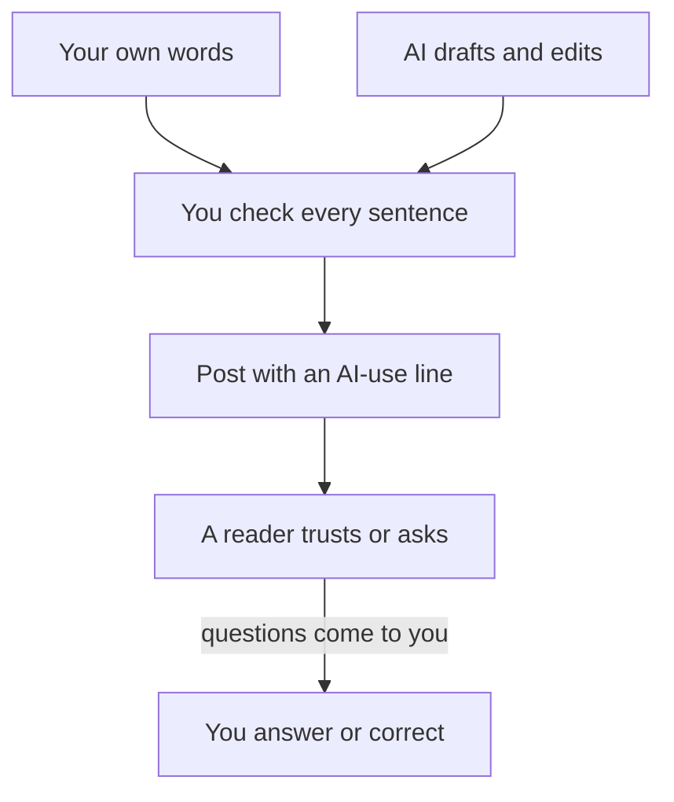

## The comment Hani could not answer

When the print shop owner asked how to set up the text messages, Hani's first idea was to delete his post and say nothing. He was embarrassed, and deleting felt like the quickest way out. Then he looked at the comment again. Another person had already replied to it, saying they wanted the same feature. Deleting the post would leave both of them confused, and it would not change what he had done.

So he did two things. First, he edited the old post and added one line at the top: "Correction: the app does not send text messages. An earlier version of this post said it did." He left the rest, so the comments still made sense. Second, he wrote a new post about the app as it really is, this time himself.

When the new post was ready, Hani stopped before publishing. He had written every word. But AI had helped with the app and with the post in smaller ways. Did he need to say so? And if he did, what exactly should he say? Make your guess on the first question before you read on.

```predict
prompt: "Hani wrote every word of his new post. Months ago, AI wrote the first version of one part of the app. This week it explained one error and suggested the title. Does the post need an AI-use line?"
options:
  - id: yes-line
    label: "Yes, because AI still helped with the app and the title"
  - id: no-line
    label: "No, because he wrote every word of this post himself"
correctOptionId: yes-line
explanation: "The post describes the app, and AI wrote the first version of part of it. AI also suggested the title. A short line tells a reader exactly what was AI and what was checked. Saying nothing would let readers believe more of the work was his alone than really was. The rest of the chapter shows why, and how to write the line."
```

## Why say it at all

A reader uses your post to decide how much to trust you. If they know AI drafted a part, they know which part to read more carefully, and which part shows your own thinking. If they find out later that AI wrote a post you presented as yours, they stop trusting everything else you wrote, including the true parts.

The second reason is rules. More places now ask you to <GlossaryTerm term="disclose" definition="To say openly something that other people would want to know, such as how a piece of work was made." /> AI help. Medical journal editors say that an AI tool cannot be listed as an author. Authors must say when and how they used AI, and the humans are responsible for every claim. Some writing platforms ask for a label on posts that AI helped with, as you will see below. Rules differ from place to place, and they change.

This course asks you to say it every time, in every place, even where no rule asks. It is honest. It also protects you: when a platform or an employer tightens its rules, your old posts already follow them. And it keeps one idea in front of you, the one Hani learned from his first post. You are responsible for every sentence you publish, whoever drafted it.

## The AI-use line

An AI-use line has three parts. **Which tool** helped. **What it did**, in plain words. **What you checked**, and how. One or two sentences are enough. It usually goes at the end of the post, where a reader looks for notes.

Here are two lines that work:

- "I used a chat assistant to explain how caching works and to suggest a structure for this post. I wrote the post, ran every command, and checked the facts against my lab log."
- "AI helped with: the first draft of the summary, and a diagram. I checked and rewrote both."

And three that do not. "AI was used." This says nothing a reader can act on. "All my own work." This is false if AI helped at all, and a reader who later finds out stops trusting the rest. "Any mistakes are the AI's." This tries to hand your responsibility to a tool, and it does not work: the post has your name on it.

## Worked example: Hani's line

Hani started with a list, not a sentence. He went through the whole week and wrote down every task AI did, for the post and for the app the post describes. Writing the list first matters. If you start with the sentence, you remember the last thing AI did and forget the rest.

His list had three items. Months ago, Gemini wrote the first version of the low-stock check, the code that turns a row red. Hani later rewrote it, and he can now explain each line of it, as the explain-back rule from module 5 asks. This week, Gemini explained one error message when the red row stopped updating. And it suggested the post's title, which he kept. Nothing else: he wrote the post, chose what to show, and tested the app himself.

Then he turned the list into a line: "AI use: Gemini wrote the first version of the low-stock check, which I rewrote and tested. It also explained one error and suggested the title. I wrote this post and checked every feature it mentions against the running app."

Read it against the three parts. The tool is named. What it did is specific: one piece of code, one error, one title. What he checked is specific too: every feature in the post, against the app itself. A reader now knows that the post is Hani's, that one part of the code began as AI output, and that the claims were checked. That is far more useful than "AI was used", and it took him two minutes.

The diagram shows why the line has a "what I checked" part. Look at the box in the middle, where every sentence passes.



What to notice: words reach the post from two places, you and the AI, but they all pass through one check, and that check is yours. When a reader has a question, it comes back to you, not to the tool. The takeaway: the AI-use line tells the reader where the words came from, and your name tells them who answers for them.

Step through what Hani does between a finished draft and a published post.

<InteractiveCanvas slug="disclose-ai-help" />

Notice the step people forget: step 5, checking the rules of the place where you post, comes after the line is written, and it changed what Hani did on DEV and in his screenshot.

## The rules where you post

Each platform sets its own rules about AI, so read them before you post there. At the time of writing (checked 2026-10-24), Medium asks for a clear label on any story written with AI help, and shows undisclosed AI writing to fewer readers. It also says that using AI to help you express yourself in a second language is fine. DEV lets authors mark a post as Hand Written, AI-Assisted or Fully Autonomous, and it calls hiding a fully AI-written post deceptive, which can lead to suspension. Hashnode and LinkedIn put the responsibility on you: you must review AI-generated text before you publish it, and we found no label rule.

Hani posts his new version in two places: on LinkedIn, where his first post was, and on DEV, where he marks it AI-Assisted. On both, his AI-use line sits at the end.

These rules will change. Medium, DEV and the others may add rules, drop them or move them. Do not learn today's rules by heart. Learn the habit: before you post somewhere new, find its help page about AI and read it. Your own line is a good start, but Medium and DEV also ask you to use their label, so read each help page.

## The rules where you study and work

Platforms are not the only places with rules. A university course may have its own rules about AI in assignments. A client may say in the contract that their code must not go into outside tools without their written permission. Another may want to know when AI wrote part of the work. An employer may have a policy about which AI tools staff may use. If you do not know the rule, ask before you start, not after you deliver. A two-line message is enough: "I sometimes use AI tools to explain errors and edit my writing. Is that fine for this work, and do you want me to mark it?"

## Other people in your posts

Building in public means showing your work, and your work often involves other people. Hani's app holds the shop's stock levels and suppliers. A screenshot of the real page would show business details the owner never agreed to share. So Hani asked the owner first. She agreed that the shop's name could appear, but not its numbers. The screenshot in the post shows made-up stock.

Use the question from module 2 before every post: would I be fine if a stranger read this? For a post, the stranger is anyone on the internet, for years. Leave out clients' names unless they agreed, other people's phone numbers and messages, and any data from a real customer list. Replace them with made-up examples. Check screenshots twice, because names hide in corners: a chat window, a file path, a browser tab.

## Where it goes wrong

The first mistake is a line so vague it protects nobody: "AI tools were used". The fix is the three parts. If you cannot say what the tool did, you do not yet know which parts of your work to check.

The second mistake is using the line as a shield. "If anything here is wrong, blame the AI" tells the reader you did not check. It also changes nothing: several platforms say plainly that the author is responsible, and so will any interviewer who reads the post.

The third mistake is the opposite worry: feeling that any AI help makes the work not yours. Salma's edited post in chapter 6.2 is still her post. She wrote it, chose every fact and checked every change. Saying that AI edited it makes the post believable, and takes nothing away from her work.

## Check your understanding

```quiz
type: mcq
question: "Heba is a fellow building an attendance app for a school. During one week, Gemini helped her twice. When a page crashed, it told her what the error meant. It also wrote a first version of her post's closing paragraph. She replaced most of that paragraph with her own words, and she ran every piece of code herself. Which AI-use line is honest and complete?"
options:
  - "AI tools were used at several points while I made this post and all its code."
  - "I wrote every part of this post and its code myself, from the start to the end."
  - "Written with help from AI; if any detail is wrong, the AI made that mistake, not me."
  - "Gemini explained an error and drafted my closing paragraph; I rewrote it and ran the code."
correct: 3
explanations:
  - "This is true but empty. It does not say which tool, which parts it did, or what Heba checked, so a reader cannot tell which parts to trust."
  - "This is false. AI explained an error and wrote the first version of a paragraph, even though Heba rewrote most of it."
  - "It does admit AI help, which is a start, but then it tries to pass the responsibility to the tool. The post has Heba's name on it, and she answers for every sentence."
  - "Right. It names the tool, says exactly what it did, and says what Heba did herself: she rewrote the paragraph and ran the code."
```

```quiz
type: mcq
question: "Tamer is a freelancer. He plans a Medium post about a week of work on an order page for a water delivery round. 1) A chat assistant wrote most of his first draft, which he then edited. 2) At the time of writing, Medium asks for a clear label on stories with AI help. 3) One screenshot shows customers' names and phone numbers. 4) The owner agreed he may write about the project if no customer data appears. What should he do before he publishes?"
options:
  - "Publish now, since Medium adds any AI label a post needs"
  - "Label it, add his line and hide the data, as all three apply"
  - "Remove the screenshot, since his edits made the draft his own"
  - "Ask the owner again, since a post on client work needs consent"
correct: 1
explanations:
  - "On Medium the author adds the label, not the platform. Posting without it breaks the rule in fact 2, and readers cannot tell which parts are Tamer's."
  - "Right. AI wrote most of the first draft, so the post needs the label and a line on what AI did and what he checked. Hiding the names and numbers protects the customers and keeps the owner's condition."
  - "Removing the screenshot does protect the customers, but editing an AI draft does not make it all his own. The label and the line are still needed."
  - "Consent matters, and the owner has already given it, on one condition. Asking again does nothing about the AI label or the customer data in the screenshot."
```

**Next:** A mixed review with five fresh cases, one from each earlier module, so you practise choosing which habit comes first.
