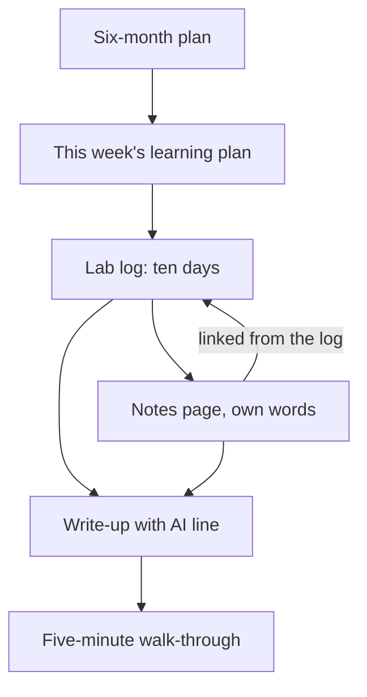

## Your turn

This is the capstone of the course. It is not a test you finish and forget. It is the first few weeks of a project you will keep building for about six months, with every habit from the course in place. When you are done, you will have a plan, a log, notes and a write-up that a mentor, a reviewer or a future employer can open and check.

You can do it for your own project, or for a provided case: Ibrahim, a fellow who wants to build a queue app for a community clinic. The provided case is always open to you. It needs no laptop, no project of your own and no public profile. It is not an easier path. Ibrahim's plan, reading list, log and post each hide a mistake from the course, and finding and fixing them takes real work.

Plan for about 120 minutes of writing, on top of the daily labs you have run since gate 4. You do not need to finish in one sitting. Read the worked example first, then choose your route, then write the five parts one at a time. At the end, you will walk a mentor through your work in about five minutes.

## The five parts

1. **A six-month plan:** the project in one sentence, the areas month by month, your hours a week, and the share of time for learning, with the reason.
2. **This week's learning plan:** the area, the resources an AI suggested that you checked exist (and how), the five angles, and a recall test with its result.
3. **A GitHub lab log with at least ten lab days**, over at least two weeks, begun at gate 4, with one lab where you broke a part on purpose and explained what happened.
4. **One page of structured notes** in your own words, linked from the log.
5. **One write-up** of a week of progress, adapted for a second platform, with an honest AI-use line. Posting in public is your choice; a private draft is accepted.

Each part comes from a module. The plan is module 5. This week's plan uses the checked resources from module 5 and the five angles and recall from module 3. The lab log is module 4, the notes page is module 3, and the write-up is this module. The habits from modules 1 and 2 run through all of them: you decide, you check, and you keep the work in files you own.

The parts are not five separate homework tasks. Each one is evidence for the next. The diagram shows how they connect.



What to notice: the plan decides the week, the week decides the labs, and the labs feed both the notes and the write-up. Nothing in the write-up should be missing from the log or the notes. The takeaway: a write-up with no log behind it is Hani's post from chapter 6.1, and a log with no write-up is Salma's quiet repository. The capstone asks for both, joined together.

## Worked example: Yara's Qasir

You have followed Yara and Qasir, her link shortener, since module 1. Here are her five parts, in the order she handed them in. Read them for their shape, not their topic. Your project can be about anything.

**Part 1: the six-month plan.** Her sentence: "Qasir is a link shortener with click counts for small shops and NGOs that share links in group chats." She has about 8 hours a week for the project. Over six months of about four weeks each, that is about 24 weeks and 192 hours. Qasir has 12 areas. Her own estimate, from module 5, is about 8 hours to learn an area well and about 4 hours to build it with AI help. So the 12 areas need about 96 hours of learning and 48 of building: 144 hours. The other 48 hours pay for review, joining the parts together, writing and the weeks that go wrong.

| Month | Theme | New areas |
|---|---|---|
| 1 | A link that works | The API, the database |
| 2 | Short and fast | Short codes, caching |
| 3 | Runs anywhere, tested | Containers, tests |
| 4 | Counting fairly | Click counts, rate limits |
| 5 | Safe to use | The simple web page, safety against harmful links |
| 6 | Live and watched | Logs, deploy |

She gives learning about 60 percent of her time, about 115 hours. Her reason is in the plan: "I have never built most of these parts. AI makes the building faster, but it does not make the learning much faster." The order follows what Qasir needs. The API and the database come first, because nothing works without them. Caching comes once there is a database to protect, and deploy comes last. Each new area gets a week of its own, never two in one week, and the following week builds it into Qasir and reviews older areas.

**Part 2: this week's learning plan.** Her area this week is caching, her week 7, which you watched her plan in chapter 5.3. She asked a chat assistant for three videos, one book chapter and two articles. Then she checked each one exists and is current, and wrote how in a column of her plan. She opened all three videos. Two were recent, and one was nine years old with old commands, so she kept it for ideas only. She opened both articles and kept them. The book had a title, an author and a chapter number, but no library catalogue, publisher or bookshop listed it. It did not exist, so it came out. She added the caching page of the cache's own official documentation, which she found herself.

She learned caching from five angles, as in chapter 3.3. She wrote a plain explanation in her own words. She asked the AI to draw a picture, checked it against her book, and found a missing arrow. She worked an example of one short link asked for twice. Her failure case became lab day 4. And she taught it in a two-minute voice note to a friend. On the last day of the week she closed everything and explained caching aloud. Then she checked her notes for gaps. She had missed how long a short link stays in the cache. She studied only that part again, and put caching on her review list for a few days later.

**Part 3: the lab log.** Her repository `qasir-labs` holds Qasir's code in a folder called `app` and one file per lab day in a folder called `labs`. It has ten lab days over 17 days. Each entry has the same five parts: the goal, what she did, what broke, what she learned and what AI helped with.

| Day | Lab |
|---|---|
| 1 | Run Qasir with the app, a database and a cache in containers |
| 2 | Save and read short links in the database |
| 3 | Make the log say where each answer came from: the cache or the database |
| 4 | Stop the cache on purpose, then the database |
| 5 | Count clicks for each link |
| 6 | Power cut after the study part; wrote what she had |
| 7 | Compare two ways to count clicks (reading and notes only) |
| 8 | A first test for short codes |
| 9 | Read one open-source link shortener in order: README, run it, one folder |
| 10 | Review the week; update the notes page; draft the write-up |

Day 4 is the lab where she broke a part on purpose. Before she ran anything, she wrote her prediction. Her first try went wrong: she typed `docker compose stop` without a name, and every part stopped. She wrote that mistake in the log too. Then she ran `docker compose stop cache`. Her short link still opened, but the log line changed from source=cache in about 4 ms to source=db in about 38 ms, in her codespace. Those are her lab's own numbers, not a measure of any real service. The cache stayed stopped because the lab sets `restart: unless-stopped`, until she ran `docker compose start cache`. Then she stopped the database. The link she had just opened still worked, because the cache held a copy. Saving a new short link returned an error 500. Her entry says what she learned: the cache is for speed, and the database is the only place a new link can be saved.

**Part 4: the notes page.** Her notes are Markdown files, so she copied her caching page into the repository as `notes/caching.md` and linked it from the entries for days 3 and 4. It follows her template from module 3. It has a plain explanation in her own words and her own sketch of a request going to the cache and then the database. It has the short link example and the failure case from day 4. It ends with an open question: "What if two people shorten the same address at once?" Nothing on the page is pasted from an AI answer.

**Part 5: the write-up.** Her write-up for that week, `posts/week-07.md`, is called "What happens when Qasir's cache stops". It is about 500 words, built from days 3 and 4, with a link to each day's entry. She adapted it twice: about 100 words on LinkedIn with a link back to the file, and the full post on DEV, marked as AI-assisted. Every version ends with the same line: "AI use: I asked Gemini to explain what docker compose stop does and to point out unclear sentences in this post. I wrote the post, ran every command, and checked each fact against my lab log and Docker's documentation." She chose to post in public. A private draft would have counted just as much.

## Choosing your route

If you use your own project, you need the log you began at gate 4, with at least ten lab days over at least two weeks. If you have fewer, keep running short labs until you reach ten before you hand in; a lab day can be 30 minutes. Your plan, notes and write-up can be about any project that will take you months, not only software.

Keep other people out of your work. If your project serves real people, such as a clinic, a shop or a school, use made-up names and numbers in your log, notes and write-up. Never put a password or key in the repository, and run your pre-push check from module 4 before each push. If you cannot reach GitHub one day, keep the log as Markdown files in your notes app and push them later.

If you have only a phone, or no project yet, choose Ibrahim's case. It gives you everything you need on this page. If you use your own project but want practice first, you can read the case and check yourself against it before you write.

## Provided case: Ibrahim's clinic queue app

Ibrahim is a fellow who volunteers at the desk of a community clinic. On busy mornings, the waiting room is crowded, and the nurse calls names over the noise. His idea is a small queue app. A patient gets a number at the desk, a screen in the waiting room shows the next number, and staff call the next patient with one tap. He has about 6 hours a week for it. Here is his plan.

| Week | Areas | Learning time |
|---|---|---|
| 1 | The API and the database | None |
| 2 | The queue logic and the waiting screen | None |
| 3 | Text messages to patients and a staff login | None |
| 4 | Tests and deploy | None |

Under the table he wrote: "Hours: as many as I can. I will learn while I build."

For week 1, he asked a chat assistant what to read to learn APIs and databases. Here is its list, with Ibrahim's own note beside each item.

| # | What the AI suggested | Ibrahim's note |
|---|---|---|
| 1 | Video: "APIs explained for beginners", a 20-minute talk on a university's public channel | Watched, good |
| 2 | Book: *Building Queue Apps for Small Clinics*, by Martin Keller (2022), chapter 3 | Read chapter 3 this week |
| 3 | Article: the official tutorial of the web framework he chose, the part on routes | Not opened yet |
| 4 | Article: a blog post on database tables for beginners, from 2016 | Not opened yet |

If you cannot search today, here is what a quick search finds. The video plays and was posted two years ago. No library catalogue or bookshop listing has the book, and the author's name appears with no other books. The official tutorial exists and was updated this year. The blog post exists, but it is ten years old, and its screens and commands no longer match the current versions.

Ibrahim ran ten lab days over two weeks and logged them in a public GitHub repository. Here is his log.

| Day | What he did | Commit message | Notes in the log |
|---|---|---|---|
| 1 | Set up the repository and a starter app | first commit | Started. The app runs. |
| 2 | Made a database table for the queue | db | Table works. |
| 3 | Asked a chat assistant to write the queue code, and pasted it in | queue | AI wrote the queue. It works! |
| 4 | Built the waiting screen page | screen | The screen shows the next number. |
| 5 | Joined the screen to the queue | update | Numbers move on the screen. |
| 6 | Added a settings file so the app can reach the database | config | Put the database password in the settings file so it runs. |
| 7 | Staff login | login | (empty) |
| 8 | Text messages to patients | sms | (empty) |
| 9 | Fixed a bug | fix | (empty) |
| 10 | Tried to deploy | deploy | (empty) |

At the end of the two weeks, he wrote a draft post for LinkedIn.

> Two weeks ago I started a queue app for a community clinic. I built this all myself, from the database to the waiting screen. It already sends text messages to patients and is ready for the clinic to use.

For Ibrahim's case, you write the same five parts, as his mentor would want them:

1. An improved six-month plan for his app, with his 6 hours a week, the areas month by month and a learning share with a reason.
2. His week 1 learning plan, with each resource kept, dropped or replaced, how it was checked, the five angles and a recall test.
3. A review of his lab log: each problem you find, a fix for each, and one lab day he could run where he breaks a part on purpose.
4. One notes page for one of his labs, in your own words, as if you were Ibrahim.
5. An honest version of his post, with an AI-use line. Do not publish it.

## How your mentor will read it

Your mentor uses the table below, one row for each part. They are not looking for perfect English, or for a big project. They are looking for evidence that you used each habit. For Ibrahim's case, part 3 is your review of his log, not a log of your own.

| Part | Met | Partly | Not yet |
|---|---|---|---|
| 1. Plan | One sentence, areas by month, hours a week, a learning share with a reason | Areas and hours, but no learning share or no reason | Features only, with no months or hours |
| 2. This week | Every resource checked, with how; five angles; a recall test and its result | Resources checked, but no recall test, or no "how" | A resource kept that was never checked |
| 3. Lab log | Ten days over two weeks, one break explained, no secrets (Ibrahim: every problem fixed) | Fewer days or no break (Ibrahim: one problem missed) | No log, or a secret left in it |
| 4. Notes page | Own words, most of the five angles, an open question, linked to a lab | Own words, but thin or not linked | A pasted AI summary |
| 5. Write-up | Facts match the log, a second version, a three-part AI-use line | Honest, but not adapted, or a part of the line missing | A claim the log does not support, or AI help hidden |

**Pass rule:** your capstone passes when no part is "Not yet" and at least three parts are "Met", one of them part 3.

For your own project, your mentor will open your repository if you give the link. They will look at a few lab days, the break-on-purpose lab and the notes page, and check one fact from your write-up against the log. If you cannot share the link, paste a short summary of each lab day in your answer.

If your capstone does not pass yet, your mentor replies with one or two short questions about the weakest part. You answer them in writing or in a voice note, and your mentor reads that part again. One round of questions is normal. It is part of the work, not a failure.

## Your five-minute walk-through

After your mentor reads your answer, you talk them through it in about five minutes. Spend about one minute on the plan and this week, and two on the log and the lab you broke on purpose. Spend one minute each on the notes page and the write-up. Then your mentor asks some of these questions. Prepare a short answer to each before you meet.

| Defence question | A good answer |
|---|---|
| Why does learning get that share of your hours? | Gives the hours per area, and names areas you have never built |
| Which resource did you drop, and how did you check it? | Names it, says where you searched, and what you found |
| What did your break-on-purpose lab show? | Your prediction, what happened, and what that part is for |
| Show me one fact from your write-up in the log. | Opens the lab entry or commit that proves it |

Last, your mentor picks one part of your project, or of Ibrahim's, and asks you to explain it without notes. It might be the cache, a database table, the queue, or one line of AI-written code. This is the explain-back rule from module 5. If you cannot explain a part yet, say so honestly and say what you will study next. That answer is better than a smooth guess, and your mentor will treat it that way.

## Submit your capstone

Write the five parts in order, with a number or a short heading for each. Short sentences and lists are fine. If writing is hard today, you can add a voice note link and keep the written part shorter, as long as it still covers all five parts.

```openquestion
prompt: "Hand in the five parts for your own project, or for Ibrahim's clinic queue app (say which). 1. A six-month plan: the project in one sentence, the areas month by month, hours a week, and the learning share with your reason. 2. This week's learning plan: the area, each resource an AI suggested with how you checked it exists (or why you dropped it), the five angles, and a recall test with its result. 3. The lab log: your repository link and one line for each of at least ten lab days, with the lab where you broke a part on purpose explained; for Ibrahim, a review of his log with each problem and its fix, and one break-on-purpose lab he could run. 4. One notes page in your own words, linked from a lab. 5. Your write-up and the version for a second platform, each with a three-part AI-use line; for Ibrahim, an honest version of his post."
required: true
minWords: 250
allowSpeechInput: true
allowUrl: true
urlRequired: false
urlLabel: "GitHub repository link (optional)"
urlHint: "Your lab log repository, where your notes page and write-up also live. Not needed for Ibrahim's case."
modelAnswer: "Mentor key for Ibrahim's case. Part 1, plan: one sentence such as 'A queue app for a clinic desk: patients get a number, a screen shows who is next, staff call the next patient.' At 6 hours a week, six months is about 144 hours (6 x 24 weeks). With an estimate like Yara's (8 hours to learn and 4 to build per area), his 8 areas need about 96 hours, so they fit with room for review; accept other estimates if the arithmetic is shown. Areas spread over the months, one new area at a time, with the API and database first. Learning share above half, because he has never built these parts and AI speeds building more than learning. Credit moving text messages later or dropping them, and any note that patient names and phone numbers need care: ask the clinic, keep only what is needed, and keep them out of the public log and AI chats. Not yet: keeping one month, or no learning time. Part 2, week 1: drop the Keller book, because no library or bookshop lists it, and replace it with a checked resource; keep the video and the official tutorial, each with how it was checked; drop or flag the 2016 post as out of date. Five angles for APIs and a recall test with a result. Common wrong answer: keeping the book because the AI gave a chapter number. Part 3, log review: three problems. No lab breaks anything: add a lab such as stopping the database and recording what the waiting screen shows. Day 6 put the database password in a public repository: treat it as stolen, change it, move it to a file that is never committed, such as an .env file listed in .gitignore, and know that deleting the commit is not enough. Days 7 to 10 have no notes: write what he remembers, mark it as written later, and write before each commit from now on. Credit also: the day 3 AI code must be explained line by line before he keeps it, and commit messages should say what changed. Not yet: missing the password. Part 4: a notes page in his own words for one lab, for example day 5, how the screen gets the next number: a plain explanation, a sketch described in words, an example with three patients, a failure case such as the screen losing its connection, an open question, and a link to day 5. A pasted AI summary is Not yet. Part 5: an honest post that says the queue and screen work on his laptop; that the text messages are untested, nothing is deployed and the clinic does not use it yet; that a chat assistant wrote the first queue code on day 3; with a three-part AI-use line and no patient data. Not published. Common wrong answer: keeping 'ready for the clinic' or 'all myself'. Model answer for a different case. Jamil, own project: an order tracker for a small online shop. 1. 'An order tracker that shows a small shop's owner every order from paid to delivered.' 7 hours a week for six months is 168 hours; 10 areas at about 9 hours to learn and 4 to build need 130 hours; learning gets about 60 percent because I have never built a login or tests. Month 1: database and orders API; month 2: order status and the owner's page; month 3: tests and logs; month 4: login and roles; month 5: containers and deploy; month 6: a review month, explaining every part without notes. 2. This week: tests. A chat assistant suggested two videos, a book and an article. I opened both videos and the article; I searched my university library and two bookshops for the book, found nothing, and replaced it with the testing guide of my framework's official documentation. Angles: own explanation, a diagram of one test I checked against the guide, a worked example, a failure case (a test that passes when it should fail), and teaching it to my cousin. Recall test on day 4: two of three right; the gap was what a test fixture is. 3. Repository order-tracker-labs, 11 lab days over 15 days. Day 6: I broke the order status on purpose by sending 'delivered' before 'paid'; the API accepted it, so I added a rule and a test. No secrets: my pre-push check found a settings file once, and I moved it out before pushing. 4. notes/testing.md, own words, linked from days 5 to 7, with the open question 'how many tests are enough?'. 5. posts/week-03.md, 450 words: tests for 3 of my 7 endpoints, the status bug, what is next. A LinkedIn version of 90 words with a link. AI use: Gemini fixed my grammar and asked me three questions; I wrote the post and checked every number against my log and tests."
```

**Next:** The course checklist, your toolkit of habits, and a look back at your first gate.
