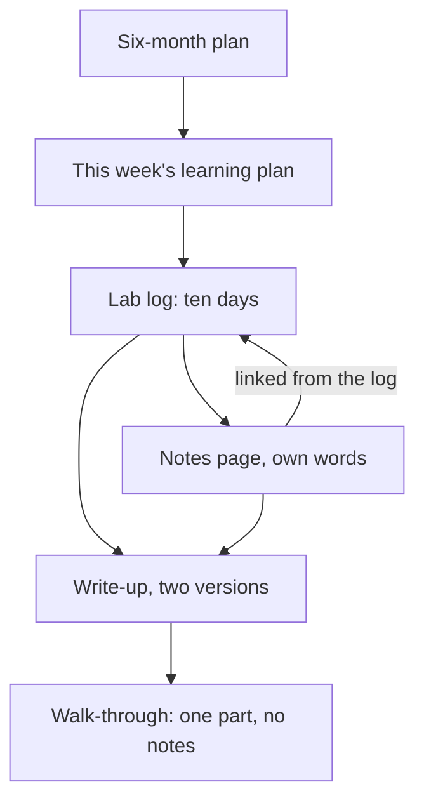

## Your turn

This is the capstone of the course. It is the first few weeks of a project you will keep building for about six months, with every habit from the course in place. When you are done, you will have a plan, a log, notes and a write-up that a mentor, a reviewer or a future employer can open and check.

You can do it for your own project, or for a provided case: Ibrahim, a fellow who wants to build a queue app for a community clinic. The provided case is always open to you. It needs no laptop, no project of your own and no public profile. Ibrahim's plan, reading list, log and post each hide mistakes from the course, and finding and fixing them takes real work.

Plan for about 120 minutes of writing, on top of the daily labs you have run since gate 4. Most fellows will need two or three sittings, and that is expected. Read the worked example first, then choose your route, then write the five parts one at a time. At the end, you will walk a mentor through your work and explain one part without notes.

## The five parts

1. **A six-month plan:** the project in one sentence, the areas month by month, your hours a week, and the share of time for learning, with the sum and the reason.
2. **This week's learning plan:** the area, the resources an AI suggested that you checked exist (and how), the five angles, and a recall test.
3. **A GitHub lab log with at least ten lab days** over at least two weeks, begun at gate 4. One lab must break a part on purpose and explain what happened.
4. **One page of structured notes** in your own words, linked from the log.
5. **One write-up** of a week of progress, plus a shorter version for a second platform, each with an honest AI-use line. Posting in public is your choice; a private draft is accepted.

Each part comes from a module. The plan is module 5. This week's plan uses the checked resources from module 5 and the five angles and recall from module 3. The lab log is module 4, the notes page is module 3, and the write-up is this module. The habits from modules 1 and 2 run through all of them: you decide, you check, and you keep the work in files you own.

The parts are not five separate homework tasks. Each one is evidence for the next. The diagram shows how they connect, and where the walk-through tests them.



What to notice: the plan decides the week, the week decides the labs, and the labs feed both the notes and the write-up. Nothing in the write-up should be missing from the log or the notes. The takeaway: a write-up with no log behind it is Hani's post from chapter 6.1, and a log with no write-up is Salma's quiet repository. The capstone asks for both, joined together, and the walk-through checks that you understand what you joined.

## Worked example: Yara's Qasir, in part

You have followed Yara and Qasir, her link shortener, since module 1. This time the example shows only parts 1 and 3 in full. Parts 2, 4 and 5 are outlines that say what a good answer contains. That is on purpose: you have practised each part already, and your capstone has to be your own work, not a copy of hers.

**Part 1: the six-month plan, in full.** Her sentence: "Qasir is a link shortener with click counts for small shops and NGOs that share links in group chats." She wrote this plan in her first week, before her first lab. She has about 8 hours a week for the project. Six months of four weeks is 24 weeks, which gives 192 hours. Qasir has 12 areas. Her own estimate is about 8 hours to learn an area and about 4 hours to build it with AI help.

That estimate rests on an assumption, and her plan says so. Yara expects AI to shorten building more than learning. That is why her plan gives building 4 hours an area and learning 8. Her hours log will test it. In one careful study, experienced developers felt faster with AI but were slower, so she measures instead of trusting the feeling.

| Month | Weeks | New areas |
|---|---|---|
| 1 | 1 to 4 | An API (week 1), a database (week 3) |
| 2 | 5 to 8 | Containers (week 5), caching (week 7) |
| 3 | 9 to 12 | Short codes (week 9), click counts (week 11) |
| 4 | 13 to 16 | Tests (week 13), a simple web page (week 15) |
| 5 | 17 to 20 | Rate limits (week 17), logs (week 19) |
| 6 | 21 to 24 | Safety against harmful links (week 21), deploy (week 23) |

She takes one new area at a time. A new-area week is followed by a week that builds that area into Qasir and reviews older areas. Her learning share is 60 percent, about 115 of her 192 hours, and her plan shows the sum. Learning the 12 areas takes 96 hours. Spaced review and reading open-source projects, which are also learning, take 19 more: 96 plus 19 is 115. Building the areas takes 48 hours. Joining the parts, writing up and bad weeks take 29 more: 48 plus 29 is 77. And 115 plus 77 is 192. Her reason is short: she has never built most of these parts, and her own estimates give learning twice the hours of building.

**Part 2: this week's learning plan, as an outline.** Her area this week is caching, in her week 7, which you watched her plan in chapter 5.3. A good answer names the area and its week. It lists each resource an AI suggested, with how it was checked and whether it was kept, used for ideas only or dropped. Yara dropped a book that no library catalogue or bookshop listed. A good answer gives one line for each of the five angles and the day it happens. It ends with the recall test, the gap it found, and the date of the next review.

**Part 3: the lab log, in full.** Her log began in week 7, her caching week, and runs over 17 days in weeks 7 to 9. Qasir already ran in containers, her week 5 area. Days 1 to 3 began as notes on her phone; day 2's failed first try had no note at all. On day 4 she moved them into her repository, `qasir-labs`, and from then on wrote each entry straight into it. Each entry has the same five parts: the goal, what she did, what broke, what she learned and what AI helped with.

| Day | Lab |
|---|---|
| 1 | Run Qasir with the app, a database and a cache in containers (week 7) |
| 2 | Save and read short links in the database (first try failed with no shape; redone the next evening) |
| 3 | Make the log say where each answer came from: the cache or the database |
| 4 | Stop the cache on purpose, then the database |
| 5 | Give cached links an expiry time and watch an old link load from the database again |
| 6 | Power cut after the study part; wrote what she had |
| 7 | Compare two expiry times (reading and notes only) |
| 8 | Restart all parts and check that links survive: the database keeps them, the cache starts empty |
| 9 | Read one open-source link shortener in order: README, run it, one folder |
| 10 | Review the weeks; update the notes page; draft the write-up |

Day 4 is the lab where she broke a part on purpose. Before she ran anything, she wrote her prediction. Her first try went wrong: she typed `docker compose stop` without a name, and every part stopped. She wrote that mistake in the log too. Then she ran `docker compose stop cache`. Her short link still opened, but the log line changed from source=cache in about 4 ms to source=db in about 38 ms. Those log lines and timings are invented for this example, not measured. The cache stayed stopped until she ran `docker compose start cache`, because the lab sets `restart: unless-stopped`.

Then she stopped the database. The link she had just opened still worked, because the cache held a copy. Saving a new short link returned an error. Her entry says what she learned in her own words: the cache is for speed, and the database is the only place a new link can be saved. Day 8 checked the other side of that lesson. After a restart of every part, the links were still there, because the database keeps them, while the cache started empty.

**Part 4: the notes page, as an outline.** Her caching page lives in the repository as `notes/caching.md`, linked from the entries for days 3 to 5. A good answer is written in your own words, with nothing pasted from an AI answer. It has a plain explanation, your own picture, a worked example, a failure case that points to a lab day, and how you built or taught the idea. It ends with at least one open question and links to the lab entries.

**Part 5: the write-up, as an outline.** Her week 7 write-up, `posts/week-07.md`, tells one story from days 3 to 5. A good answer tells one story from the log, and every number in it can be traced to a lab entry. It has the four parts from chapter 6.2. It has a second, shorter version for another platform that links back to the original. Yara's short version went on LinkedIn, and her full post went on DEV with the AI-assisted label DEV offers at the time of writing. Each version ends with an AI-use line that has all three parts.

## Choosing your route

If you use your own project, you need the log you began at gate 4, with at least ten lab days over at least two weeks. If you have fewer, keep running short labs until you reach ten before you hand in; a lab day can be 30 minutes. Your plan, notes and write-up can be about any project that will take you months, not only software.

Keep other people out of your work. If your project serves real people, such as a clinic, a shop or a school, use made-up names and numbers in your log, notes and write-up. Never put a password or key in the repository, and run your pre-push check from module 4 before each push. If you cannot reach GitHub one day, keep the log as Markdown files in your notes app and push them later.

If you have only a phone, or no project yet, choose Ibrahim's case. It gives you everything you need on this page. If you use your own project but want practice first, you can read the case and check yourself against it before you write.

## Provided case: Ibrahim's clinic queue app

Ibrahim is a fellow who volunteers at the desk of a community clinic. On busy mornings, the waiting room is crowded, and the nurse calls names over the noise. His idea is a small queue app. He has about 6 hours a week for it. His README explains how it should work. The desk adds a patient, who gets the next number. The waiting screen asks the app for the current number every 5 seconds and shows it. When staff tap "Next", the current number goes up by one. Here is his plan.

| Week | Areas | Learning time |
|---|---|---|
| 1 | The API and the database | None |
| 2 | The queue logic and the waiting screen | None |
| 3 | Text messages to patients and a staff login | None |
| 4 | Tests and deploy | None |

Under the table he wrote: "Hours: as many as I can. I will learn while I build."

For week 1, he asked a chat assistant what to read to learn APIs and databases. Here is its list, with Ibrahim's own note beside each item. The titles and the author are made up for this example.

| # | What the AI suggested | Ibrahim's note |
|---|---|---|
| 1 | Video: "APIs explained for beginners", a 20-minute talk on a university's public channel | Watched, good |
| 2 | Book: *Building Queue Apps for Small Clinics*, by A. Example (2022), chapter 3 | Read chapter 3 this week |
| 3 | Article: the official tutorial of the web framework he chose, the part on routes | Not opened yet |
| 4 | Article: a blog post on database tables for beginners, from 2016 | Not opened yet |

You do not need to search for these. Here is what a quick search found. The video plays and was posted two years ago. No library catalogue or bookshop listing has the book. The official tutorial exists and was updated this year. The blog post exists, but it is ten years old, and its screens and commands no longer match the current versions.

Ibrahim ran ten lab days over two weeks and logged them in a public GitHub repository. Here is his log.

| Day | What he did | Commit message | Notes in the log |
|---|---|---|---|
| 1 | Set up the repository and a starter app | first commit | Started. The app runs. |
| 2 | Made a database table for the queue | db | Table works. |
| 3 | Asked a chat assistant to write the queue code, and pasted it in | queue | AI wrote the queue. It works! |
| 4 | Built the waiting screen page | screen | The screen shows the next number. |
| 5 | Joined the screen to the queue | update | Numbers move on the screen. |
| 6 | Added a settings file so the app can reach the database | config | Put the database password (example-password) in the settings file so it runs. |
| 7 | Staff login | login | (empty) |
| 8 | Text messages to patients | sms | (empty) |
| 9 | Fixed a bug | fix | (empty) |
| 10 | Tried to deploy | deploy | (empty) |

At the end of the two weeks, he wrote a draft post for LinkedIn.

> Two weeks ago I started a queue app for a community clinic. I built this all myself, from the database to the waiting screen. It already sends text messages to patients and is ready for the clinic to use.

## What you produce for Ibrahim's case

You write the same five parts, as his mentor would want them. Nothing here needs outside reading or a laptop. Here is exactly what each part contains on this route:

1. An improved six-month plan for his app: one sentence, the areas month by month, his 6 hours a week, and a learning share with the sum and a reason.
2. His week 1 learning plan: each resource kept, dropped or replaced, with how it was checked; a plan for the five angles on APIs (what he would do, not done); and three recall questions he would answer with his notes closed (no result needed).
3. A review of his lab log: each problem you find and a fix for each, plus one lab day where he breaks a part on purpose.
4. One notes page for his day 5 lab, how the waiting screen gets the next number, written in your own words from the information on this page.
5. An honest version of his post with an AI-use line, plus a version of about 100 words for a second platform. Do not publish either.

Plan for about two hours over two or three sittings. Parts 1 and 3 usually take longest.

## How your mentor will read it

Your mentor uses the table below, one row for each part and one for the walk-through. They are not looking for perfect English, or for a big project. They are looking for evidence that you used each habit. For Ibrahim's case, row 3 is your review of his log, not a log of your own.

| Part | Met | Partly | Not yet |
|---|---|---|---|
| 1. Plan | All four: one sentence, six months of areas, hours a week, a learning share with a sum and a reason | Three of the four | Two or fewer |
| 2. This week | Every resource checked, with how; all five angles planned; three recall questions (own route: with the result) | One of those three is missing | A resource kept that was never checked |
| 3. Lab log | Own: ten or more days over two weeks, one break explained, no secrets. Ibrahim: all three log problems fixed | Own: eight or nine days, or the break not explained. Ibrahim: two of three, the password one included | Own: under eight days, or a secret in it. Ibrahim: the password missed |
| 4. Notes page | Own words, at least four of the five angles, an open question, a link to a lab | Own words, two or three angles, or no link | A pasted AI summary, or one angle or none |
| 5. Write-up | All three: facts match the log, a second version of about 100 words, a three-part AI-use line | Two of the three | A claim the log does not support, or AI help hidden |
| 6. Walk-through | Explains the part the mentor picks, its trade-off and one failure, without notes | Explains it, but only with prompts | Cannot say what the part does |

**Pass rule:** your capstone passes when no row is "Not yet" and at least four rows are "Met", including rows 3 and 6. Your reply to the mentor's follow-up question must also answer it with evidence.

For your own project, your mentor will open your repository if you give the link. They will look at a few lab days, the break-on-purpose lab and the notes page, and check one fact from your write-up against the log. If you cannot share the link, paste a short summary of each lab day in your answer.

If your capstone does not pass yet, your mentor replies with one or two short questions about the weakest part. You answer them in writing, and your mentor reads that part again. One round of questions is normal, and it is part of the work.

## Your five-minute walk-through

After your mentor reads your answer, you talk them through it in about five minutes. Spend about one minute on the plan and this week, and two on the log and the lab you broke on purpose. Spend one minute each on the notes page and the write-up. Then your mentor asks a few of these questions:

- Why does learning get that share of your hours, and what is your sum?
- Which resource did you drop, and how did you check it?
- What did your break-on-purpose lab show about the part you stopped?
- Where in the log is one fact from your write-up?

Last, your mentor picks one part and asks you to explain it without notes: what it does, the trade-off behind it, and one way it can fail. This is the explain-back rule from module 5, and row 6 of the table. On your own project, the mentor picks a part of your project, such as a database table or one line of AI-written code. On Ibrahim's case, the mentor asks about your own work, not his code. For example: "Defend the learning share in your plan, and one resource you dropped", or "Explain the failure case on your notes page".

If you cannot explain a part yet, say so honestly and say what you will study next. That answer is better than a smooth guess, and your mentor will treat it that way. If a power cut or weak data makes a live call hard, your mentor can send the chosen question in writing. You answer it in a short voice note.

## Submit your capstone

Write the five parts in order, with a number or a short heading for each. Short sentences and lists are fine. You can dictate your answer with your phone's microphone, and you may add a voice note link as well.

```openquestion
prompt: "Hand in the five parts for your own project, or for Ibrahim's clinic queue app. Say which. 1. A six-month plan: the project in one sentence, the areas by month, hours a week, and the learning share with its sum and reason. 2. This week's learning plan: each resource and how you checked it, the five angles, and three recall questions. On your own route, add the recall result. 3. Your lab log: the repository link and one line for each of at least ten lab days, with the break-on-purpose lab explained. For Ibrahim, review his log: each problem, its fix, and one break-on-purpose lab. 4. One notes page in your own words, linked from a lab (for Ibrahim, his day 5). 5. Your write-up and a version of about 100 words for a second platform, each with a three-part AI-use line. For Ibrahim, honest versions of his post."
required: true
minWords: 250
allowSpeechInput: true
allowUrl: true
urlRequired: false
urlLabel: "GitHub repository link (optional)"
urlHint: "Your lab log repository, where your notes page and write-up also live. You may also add a voice note link. Not needed for Ibrahim's case."
modelAnswer: "Mentor key for Ibrahim's case. Required problems, each of which must be found: (a) the fake book: no library or bookshop lists it, so it is dropped (part 2); (b) no lab breaks anything (part 3); (c) day 6 commits the database password to a public repository (part 3); (d) days 7 to 10 have no notes (part 3); (e) the post says 'I built this all myself' although day 3 shows a chat assistant wrote the queue code (part 5). Credited extras, any of which earn credit but none is required: the day 3 AI code must be explained line by line before he keeps it; commit messages such as 'update' and 'fix' say nothing; the 2016 post is out of date; the post claims text messages and 'ready for the clinic' with nothing in the log to support them; patient names and phone numbers need care. Part 1: one sentence, such as 'A queue app for a clinic desk: patients get a number, a screen shows who is next, staff call the next patient.' At 6 hours a week, six months is about 144 hours (6 x 24 weeks). With an estimate like Yara's (8 hours to learn and 4 to build an area), his 8 areas need about 96 hours, so they fit with room for review. Accept other estimates if the sum is shown. Areas spread over six months, one new area at a time, with the API and the database first. Accept any learning share and any reason that uses his own estimates, with the sum shown; text messages can move later or be dropped. Not yet: keeping one month, or no learning time. Part 2: keep the video and the official tutorial, each with how it was checked; drop the book; drop or flag the 2016 post. One planned line per angle, and three recall questions about APIs. Part 3: add a lab such as stopping the database and recording what the waiting screen shows. For the password: treat it as stolen and change it. Move it to a file that is never committed, such as an .env file listed in .gitignore. Deleting the commit is not enough. For days 7 to 10: write what he remembers, mark it as written later, and write before each commit from now on. Part 4: day 5 in own words: the screen asks for the current number every 5 seconds, and 'Next' adds one. A failure case, such as the screen losing its connection and showing an old number. An open question and a link to day 5. A pasted AI summary is Not yet. Part 5: an honest post saying the queue and screen work on his laptop; the text messages are untested; nothing is deployed and the clinic does not use it yet; a chat assistant wrote the first queue code. It has a three-part AI-use line and no patient data. Plus a version of about 100 words for a second platform with the same facts. Common wrong answer: keeping 'all myself' or 'ready for the clinic'. Walk-through on this route: the fellow defends their own learning share and sum, or one dropped resource, or the failure case on their notes page. Model answer for a different case. Jamil, own project: an order tracker for a small online shop. 1. 'An order tracker that shows a small shop's owner every order from paid to delivered.' 7 hours a week for six months is 168 hours. 10 areas at about 9 hours to learn and 4 to build need 130 hours. Learning gets about 60 percent: 90 hours for the areas plus 11 hours of review, which is 101; building gets 40 plus 27 for joining and bad weeks, which is 67; 101 plus 67 is 168. Month 1: database and orders API; month 2: order status and the owner's page; month 3: tests and logs; month 4: login and roles; month 5: containers and deploy; month 6: a review month, explaining every part without notes. 2. This week: tests. A chat assistant suggested two videos, a book and an article. I opened both videos and the article. I searched my university library and two bookshops for the book, found nothing, and replaced it with the testing guide in my framework's official documentation. Angles: own explanation, a diagram I checked against the guide, a worked example, a failure case (a test that passes when it should fail), and teaching it to my cousin. Recall test on day 4: two of three right; the gap was what a test fixture is. 3. Repository order-tracker-labs, 11 lab days over 15 days. Day 6: I broke the order status on purpose by sending 'delivered' before 'paid'; the API accepted it, so I added a rule and a test. My pre-push check once found a settings file, and I moved it out before pushing. 4. notes/testing.md, own words, linked from days 5 to 7, with the open question 'how many tests are enough?'. 5. posts/week-03.md, 450 words: tests for 3 of my 7 endpoints, the status bug, what is next. A LinkedIn version of 90 words with a link back. AI use: Gemini fixed my grammar and asked me three questions; I wrote the post and checked every number against my log and tests."
```

**Next:** The course checklist, your toolkit of habits, and a look back at your first gate.
