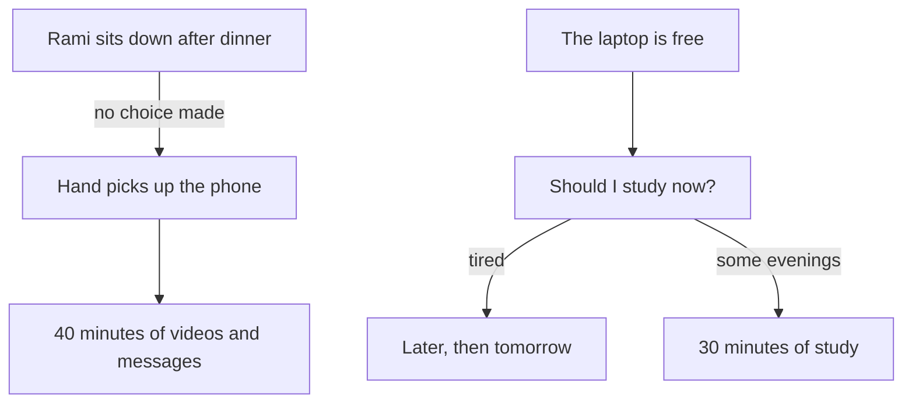

<BigWordAlert term="Habit" plainEnglish="Something you do because a familiar situation starts it for you, with little thought. You learn it by doing the same thing in the same situation again and again." whyItMatters="If you know what starts your habits, you can build the ones you want and weaken the ones you do not, without a fight with yourself every day." />

## Two habits in one evening

Rami is 24. He lives with his parents and his two younger brothers. Six months ago he started a free online course in web development. He wants a remote job building websites, and he knows the course can help him get there. He studies on his phone and on the family laptop, which he shares with his brothers. They use it for school work in the afternoon. In the evening it is usually free. Rami, his family and everyone else in this course are fictional, but their days may look familiar.

Rami has a simple plan: 30 minutes of the course every day. He believes in the plan, and he likes the course once he is inside a lesson. But when he looks back at the last month, he studied on two or three days a week. On the other days, the evening passed and the course stayed closed. He is not sure why. He is not lazy. He helps his father in the mornings, he cooks for the family twice a week, and he finished every school year he started.

The strange part is that Rami does many other things every day with no trouble at all. He drinks tea after dinner. He checks the water tank on the roof each morning. And he picks up his phone every time he sits down. He does not decide to do it. His hand is on the phone before he has thought about it. Some days he notices that he has opened his messages and cannot remember choosing to.

## A Tuesday evening

Here is one of Rami's evenings, as it happened. Dinner ends at about 20:30. His brothers close the laptop and go out to see a friend. The power will stay on until 23:00 tonight, so there is time. Rami tells himself, "Tonight I study."

He carries his tea to the room he shares with his brothers and sits down on the mattress by the wall. Before the tea is cool, his phone is in his hand. A friend has sent a video in a group chat. Someone has replied to it. He watches it, then another one. He answers a message from his cousin. When he looks at the clock, it is 21:15.

At 21:15 Rami thinks about the course. He thinks about which lesson he is on. It is lesson 3 of the unit on page layout, and it has a long exercise at the end. He thinks the exercise will take more than 30 minutes, and he is already a little tired. He decides to watch one more video first. At 22:10 he opens the laptop, looks at the lesson, and closes it again. "Tomorrow," he says. "Tomorrow I will start early."

Nothing dramatic happened on Tuesday. Rami did not refuse to study. He did not decide to scroll. One thing ran by itself, and the other waited for a decision that kept moving later. By 23:00, when the power went off, the decision had been made for him.

## The evenings that worked

On Thursday Rami did study, for 40 minutes. What was different? His cousin had asked him a question about a website the day before, so Rami had left the laptop open at the right lesson to check the answer. After dinner he sat down at the small table by the window instead of the mattress, because the laptop was already there. The lesson was on the screen. He started before he had time to weigh it up.

On Saturday he studied again. That morning his father had gone out early, so Rami had a quiet room after breakfast. Again, the situation did part of the work. He did not have to win an argument with himself, because the start was already in front of him.

Rami has tried to fix the other evenings before. He wrote "STUDY 30 MIN" on a piece of paper and stuck it to the wall. For the first few days he saw it and felt guilty. After a week he stopped seeing it at all. He also promised himself that he would study before touching his phone. That promise lasted until the next time he sat down, because by the time he remembered it, the phone was already in his hand.

So Rami's problem is not that he cannot study. On some evenings he studies well. His problem is that nothing in his evening starts the study. The phone, on the other hand, is started every single time he sits down. One behaviour has a habit behind it. The other has only a good intention.

```predict
prompt: "Rami's phone habit runs every evening, and his study runs on two or three. Before you read on, what do you think is the main difference between them?"
options:
  - id: started
    label: "One starts by itself; one waits for a choice"
  - id: enjoys
    label: "He enjoys his phone much more than his web course"
correctOptionId: started
explanation: "Rami likes the course once he is inside a lesson, so enjoyment is not the main difference. The phone is started by a situation, sitting down, with no choice needed. The study has no such start. It waits for a decision every evening, and on a tired evening the decision is often 'later'. This module is about that difference."
```

## What the evening looks like as a picture

The diagram below shows Rami's Tuesday as two paths. Read the left path first, then the right one.



What to notice: the phone path has no question in it. Sitting down leads straight to the phone. The study path goes through a question, "Should I study now?", and the question has two exits. On a tired evening the exit marked "later" is easy to take, and "later" often becomes "tomorrow". Every evening, the study has to win the question again. The phone never has to win anything.

This is the pattern this module explains. It is not a pattern about weak people. It is how everyone's habits work. The good news is that the same thing that makes the phone so easy can be used to make study easier too.

## Why this matters for study and work

Most fellows are building something that takes months: a skill, a portfolio, a new language, a client base. None of these is built in one big effort. They are built from small actions repeated on ordinary days, including tired days and days when the plan for the evening changes. A plan that needs a fresh decision every day is fragile on exactly those days.

Habits are how people save effort. Psychologists who study habits, such as Wendy Wood, describe a habit as something you do because a familiar situation starts it, with little thought. When an action becomes a habit, you no longer have to argue with yourself about it. That matters even more when your days are full: when the power comes at different hours, when the internet is weak in the evening, when you share a room and a laptop, or when family needs come first. On those days, the actions that start by themselves still happen. The ones that wait for a free hour and a good mood often do not.

For remote work and freelancing, this is very practical. A freelancer who opens her work at the same moment every day does not lose an hour each morning deciding. A student who reviews the day's lesson right after the evening meal does it on busy days too. A tester who writes tomorrow's first step before closing the laptop starts faster the next day. None of these people are stronger than you. They have arranged for the situation to start the action.

## What this module covers

This module is about how habits really work, so the rest of the course stands on solid ground. Much popular advice about habits is half true or overstated, and you will meet some of it, especially the idea that a habit takes exactly 21 days. You will learn what research actually found, in plain words, and who found it.

Chapter 1.2 explains what a habit is, and how it differs from a decision and from a goal. Chapter 1.3 breaks a habit into three parts: the cue that starts it, the routine itself, and the reward that makes you want to repeat it. You will see why the reward matters most while a habit is forming. Chapter 1.4 looks at how long habits really take to form, why the answer is different for different people, and why one missed day does not wipe out your progress. In the gate, chapter 1.5, you will describe the three parts of one habit you already have, or of a habit from a provided case.

You will follow Rami through the module. You will see his phone habit taken apart, and you will see what would have to change for his study to start as easily as his phone does. Module 2 then shows how to start a new habit on purpose.

<LearningObjectives items={["Tell a habit from a decision and from a goal", "Find the cue, the routine and the reward in a real habit", "Explain why a reward matters most while a habit is forming", "Describe what research says about how long a habit takes, and why '21 days' is a myth", "Explain why one missed day does not erase the progress of a habit"]} />

## Key words

| Word | Plain English |
|---|---|
| **Cue** | The thing that starts a habit: a place, a time, a person, a feeling, or the action you just finished |
| **Routine** | The action itself, the thing you do when the cue comes |
| **Reward** | What you get from the routine that makes you want to do it again |
| **Automatic** | It starts by itself; you do not have to decide |
| **Repetition** | Doing the same thing again, in the same situation |

## What is in this module

| Chapter | You will practise |
|---|---|
| 1.2 | Telling a habit from a decision and a goal |
| 1.3 | Finding the cue, the routine and the reward in a real habit |
| 1.4 | Reading what research says about how long habits take |
| 1.5 | Describing one habit you already have, or a provided one |

**Next:** What a habit is, and why Rami's phone never has to win a decision.
