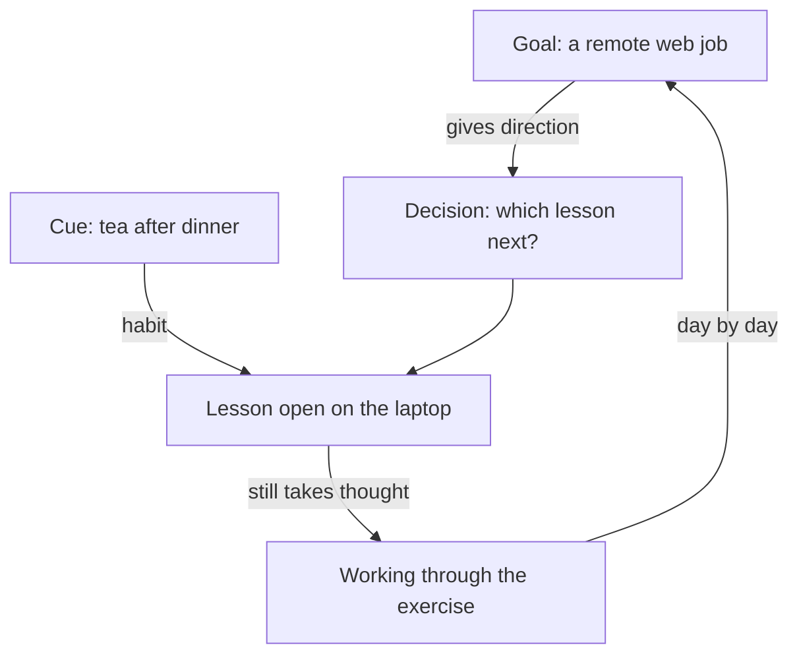

## Twenty-three marks on a page

On Wednesday Rami tries an experiment. He folds a piece of paper into his pocket, and every time he picks up his phone, he makes a small mark on it. He does not try to stop. He only wants to count. By the time the power goes off at 23:00, the paper has 23 marks.

Then he asks himself a harder question: how many of those 23 times did he decide to pick up the phone? He remembers three clear choices. He called his uncle about a delivery, he checked the time of a lesson for his brother, and he looked up a word. The other 20 times, he cannot remember choosing at all. Most of them happened the moment he sat down: on the mattress after dinner, on the step outside in the afternoon, on the chair in the kitchen while the tea boiled.

On the same day, he thought about studying four separate times. Each time, he weighed it up. Each time, he found a reason to wait. The phone was picked up 20 times without a single decision. The study was considered four times and started zero times. This chapter explains why.

## The idea in plain words

A habit, the big word from chapter 1.1, is something you do because a familiar situation starts it for you, with little thought. You learn it by doing the same thing in the same situation again and again. Psychologists who study habits, such as Wendy Wood, describe habits this way. Over time, the situation itself starts the behaviour. You do not have to want it or plan it at that moment.

That gives you three tests for a habit. First, is it started by a situation: a place, a time, other people, or the action you just finished? Second, does it run with little thought, so you could be thinking about something else while it happens? Third, was it learned by repeating it in that same situation? Rami's phone passes all three. Sitting down starts it. He does not think about it. And he has done it on that mattress after dinner on hundreds of evenings.

It helps to put three words side by side, because people often mix them up. A goal is what you want. A decision is a choice you make now. A habit is what the situation makes you do without choosing. Rami's goal is a remote job building websites. "Should I study tonight?" is a decision. Picking up the phone when he sits down is a habit. His study, right now, is not a habit at all. It is a decision he has to make again every evening.

Habits often form without anyone meaning to. You do something that works, again and again, and the link to the situation is learned along the way. Rami never set out to build a phone habit. He picked up the phone after dinner because there was usually something new there, and after many evenings, sitting down began to start it by itself.

## What the research found

How much of an ordinary day runs this way? In one study, students wrote down every hour what they were doing. About a third to a half of their actions were done almost every day, in the same place. Those are the actions that were likely to be habits. You may have read that 95 percent of what people do is unconscious. The researchers behind the diary studies pointed out that their estimate was far lower than that earlier guess. So habits are a large part of daily life, but not all of it.

The same diary studies found two more things that matter for Rami. While people were doing their habits, they were often thinking about something else. And habits came with less stress than new actions. That is why habits are useful. They are how everyone saves effort. A habit is not a sign of weak character or laziness. It is the mind doing a familiar job without bothering you about it.

Here is a third finding that changes how you should think about study. A habit mostly starts an action. It does not have to carry out every step. One study separated a habit that starts a behaviour from a habit that carries out each part of it. The starting part was what predicted how often people did the behaviour. For Rami, this means a study habit could get him to the table with the lesson open. The thinking inside the lesson would still be work. That is normal, and it is enough.

```predict
prompt: "In the stepper below, Rami picks up his phone and later thinks about the course. Before you step through, which of the two goes through a deciding step?"
options:
  - id: both
    label: "Both of them; he chooses each one every time"
  - id: study
    label: "Only the course; the phone skips it"
correctOptionId: study
explanation: "Sitting down leads straight to the phone, with no step where Rami weighs it up. The course is different. Every evening it goes to a deciding step first, and on a tired evening that step often says 'later'. Even on Thursday, when he studied, the study still went through the deciding step."
```

Step through two moments of Rami's evening, one arrow at a time. Watch which path has a stop in the middle.

<InteractiveCanvas slug="rami-decide-or-cue" />

**What this shows:** two moments in one evening. The phone goes from a situation (sitting down) straight to the action. The study goes from Rami to a deciding step, and only then, sometimes, to the lesson. **Try this:** before step 5, say what the deciding step will answer on a tired Tuesday. Then compare it with step 6, Thursday. **What changed:** on Thursday the lesson was already open, so the decision was quick and the answer was yes. But it was still a decision. The phone never needed one. **Limits of the model:** real evenings are messier than seven arrows. Some phone use is a real choice, like Rami's call to his uncle, and some studying can feel easy on a good day. The stepper shows the usual pattern, not every evening.

## What the stepper showed

The phone path had two arrows: Rami sits down, his hand moves. There was nothing in between. The study path had a stop in the middle, and the stop was a question. Every question can be answered "later". On a tired evening, after a long day, "later" is the easy answer, and it does not feel like giving up. It feels reasonable.

That is the main difference between a new behaviour and a habit. A new behaviour goes through deciding every time. A habit goes from the cue to the action and skips the deciding. Rami does not need more willpower to win the question every night. He needs his study to stop depending on the question. Module 2 shows how to do that with a clear moment and a small first step. For now, notice that the problem is in the shape of the path, not in Rami.

## A worked example: sorting Rami's day

Let us use the three tests on six things from Rami's Wednesday, one at a time, and show the reasoning.

**Drinking tea after dinner.** Is it started by a situation? Yes: the end of dinner. Does it run with little thought? Yes: he makes the tea while talking to his mother. Was it learned by repetition in the same place? Yes, for years. This is a habit.

**Checking the water tank each morning.** The situation is getting up and going to the roof for the morning air. He does it while thinking about the day. He has done it every morning since the family moved to this building. This is a habit too, and a useful one.

**Getting a remote web job.** This is not something he does at a moment. It is something he wants. It is a goal. It gives direction to many decisions, but it starts nothing by itself.

**Choosing which lesson to do next.** Each time, he looks at the course page and thinks. The answer depends on what he finished last time. This is a decision, and it should stay one. Some choices need thought, and that is fine.

**Cooking for the family twice a week.** This one is tricky. He does it often. But the days change, the meals change, and each time he plans what to make. Frequency alone does not make a habit. Without a stable situation that starts it, cooking is a planned decision he makes well.

**Studying the course.** Situation: none that is the same each day. Thought: a lot, before he even starts. Repetition in the same place: no, he has studied at the table, on the mattress and on the roof. Today, study is a decision.

The result of the sorting is useful. Rami already has strong habits, so he is not "bad at habits". His study simply has no fixed situation to start it, while his phone has many.

The diagram below shows how a goal, a decision and a habit could work together for Rami if he built a study habit. It argues one thing: the habit gets him started, and the work after the start still takes thought.



Read it from the top. The goal gives direction to his decisions, such as which lesson comes next. The habit does a different job: it takes him from the cue, finishing his tea, to an open lesson, without a debate. After that, the arrow says "still takes thought". The exercise will never become as easy as picking up a phone, and it does not need to. The habit has done its part once the lesson is open. Day by day, those worked lessons move him toward the goal.

## Where people go wrong

**"A habit is anything you do often."** Frequency is not enough. Rami cooks twice a week and it is not a habit, because each time is planned. What makes a habit is a stable situation that starts the action, again and again.

**"Habits are for weak people. Strong people decide well every time."** Most repeated behaviour is not decided each time, for anyone. People who seem disciplined often have more good habits, not more arguments with themselves. Module 4 comes back to this.

**"Once study is a habit, it will feel easy."** The start can become easy. The thinking stays thinking. If you expect a study habit to make difficult lessons feel effortless, you may decide the habit "is not working" when it is doing exactly its job.

**"I will just decide better."** Deciding better can help on one evening. But a behaviour that waits for a decision every day will lose on some days, because some days are tired, busy or full of other people's needs.

## Try it today

Choose one ordinary moment today, for example the moment you sit down after a meal. Watch what your hands do in the first minute. Did you decide, or did the situation start it? Write one line: "When I (situation), I (action), without deciding." Do this for one habit you want to keep and, if you like, one you would like to weaken. You do not have to change anything yet. Noticing what starts an action is the first skill in this course, and it works the same on a day with power and a day without it.

## Check your understanding

```quiz
type: mcq
question: "Salma runs the canteen at a girls' school and opens it at 7:00. Each morning she unlocks the door and switches on the water boiler before taking off her coat. Last week the boiler was broken, and she pressed its switch anyway on two mornings. She also wants to write the stock list each morning. She does it some days, after asking herself 'now, or after the rush?'. Which of these is a habit?"
options:
  - "The stock list, because she knows it matters to the school"
  - "Both actions, because she does each one on most mornings"
  - "The boiler switch, because unlocking the door starts it"
  - "Neither, because a habit has to be something done at home"
correct: 2
explanations:
  - "Wanting to do something, and knowing it matters, makes it a goal. The stock list still waits for a decision each morning, 'now or after the rush?', so it is not a habit yet."
  - "Doing something often is not enough. The stock list happens only some days and only after she weighs it up, so it goes through a deciding step every time."
  - "Right. Unlocking the door starts the switch with no choice, so strongly that she pressed it on a broken boiler. A situation starting the action with little thought is what makes a habit."
  - "Habits form wherever a situation repeats: at work, at home, on the way. Her canteen door is a very stable situation."
```

```quiz
type: mcq
question: "Asma works at the desk of a small clinic and is studying for a medical English test. For six weeks she has opened her workbook every day right after the clinic closes at 16:00, without having to talk herself into it. But the reading exercises still feel hard, and she tells a friend, 'my study habit is not working'. What is the better reading of her situation?"
options:
  - "The habit has failed, since a real habit would make study feel easy"
  - "She needs a new habit, because six weeks shows this one is wrong"
  - "She should stop and wait until she feels more motivated to read"
  - "The habit works: it starts her study; the exercises stay hard"
correct: 3
explanations:
  - "A habit mostly starts an action. It does not make hard thinking feel easy. Expecting that would make her drop a habit that is doing its job."
  - "Nothing in her six weeks shows the habit is wrong. She starts every day without arguing with herself, which is exactly what a habit is for."
  - "Waiting for motivation would put her study back behind a decision. The habit is what gets her started on days when motivation is low."
  - "Right. She opens the workbook at 16:00 every day without a debate. That is the habit working. The reading exercises are thinking work, and thinking stays effortful even when the start is automatic."
```

**Next:** The three parts of a habit, the cue, the routine and the reward, and why the reward matters most at the start.
