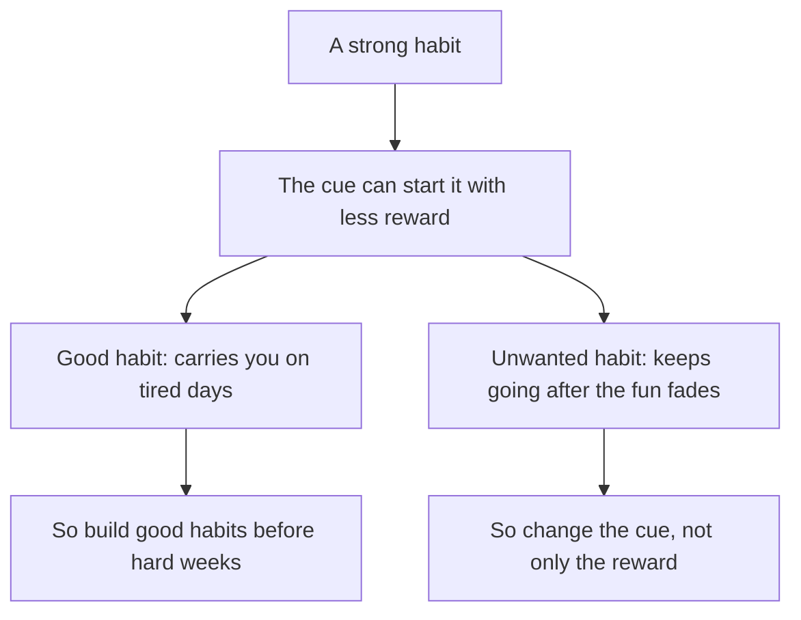

## A quiet night, and the hand still moves

It is a Friday night and the power is on late. Rami's friends have gone to a wedding in another town, and their group chat has been silent since the afternoon. Rami knows this. He even says to his brother, "Nobody will write tonight." Then he sits down on the mattress with his tea, and his hand picks up the phone.

There is nothing new. No messages, no videos he has not seen. He scrolls for a minute, puts the phone down, and five minutes later picks it up again. He is not enjoying it. He is a little annoyed with himself. But the hand keeps moving.

Rami's younger brother laughs at him. "Why do you keep checking? You just said nobody will write." Rami does not have an answer. He thought he picked up the phone to see what was new. Tonight there is nothing new, and he picks it up anyway. To understand why, you need to take a habit apart.

## The idea in plain words

A habit has three parts, which you met in the key words of chapter 1.1. The cue is what starts it. The routine is the action itself. The reward is what you get from the routine that makes you want to do it again. The writer Charles Duhigg made this idea famous as the "habit loop": a cue, a routine and a reward. In this course we will mostly use plainer words: the situation, the action, and what you get from it.

A cue can be a place (the mattress), a time (after dinner), other people (his brothers going out), a feeling (a little bored), or the action you just finished (putting down the tea glass). Often several of these come together. For Rami, the clearest cue is sitting down. Wherever he sits, on the mattress, on the step outside, on a kitchen chair, the hand moves.

The routine is the behaviour you could film: the hand takes the phone, the thumb opens messages, then videos. The reward is what Rami gets: something new, a laugh, a feeling of being with his friends, a small break from the day. When the cue, the routine and the reward happen together, in the same situation, again and again, the link from the cue to the routine grows stronger. That is how a habit forms.

## What the research found

Research supports two parts of this picture clearly, and it adds a twist that matters.

First, a reward matters while a habit forms. Actions that are rewarded tend to be repeated, and the reward strengthens the link between the situation and the action. When Rami first started picking up his phone after dinner, there was usually something new. That reward helped the link grow, evening after evening.

Second, once a habit is strong, the situation can start it even when you no longer want the reward much. Habit researchers describe strong habits as started by the cue more than by the reward. This was shown clearly in animals trained for a long time. In people the picture is more mixed, so the careful word is "can": a strong habit can run with less need for the reward. That is what happened on Friday night. The reward was gone, and sitting down still started the routine.

This works in both directions. It is why bad habits keep going after they stop being fun. And it is why good habits can carry you on tired days, when the reward feels small and you do not feel like it. A study habit, once strong, could start on an evening when Rami is tired and the lesson looks long.

There is one more finding worth knowing. Enjoying the habit itself seems to help it form more than knowing it is good for you. In one study of flossing and vitamins, people's enjoyment of the action strengthened the link between repetition and habit, while believing the action was useful did not. It was a single exploratory study, so treat it as a hint, not a rule. But it is a useful hint for Rami: "this will get me a job one day" may be true, and still not be the reward that builds the habit.

```predict
prompt: "Rami has picked up his phone after dinner for months. On Friday night nobody will write, and he knows it. When he sits down, what will his hand most likely do?"
options:
  - id: reach
    label: "Reach for the phone; sitting down starts it"
  - id: rest
    label: "Stay still, since there is no reward tonight"
correctOptionId: reach
explanation: "After months of the same cue, routine and reward, the link from sitting down to the phone is strong. A strong habit can start from the cue even when the reward is missing. It may weaken if the reward stays gone for a long time, but tonight the hand will most likely move."
```

Step through how Rami's phone habit was built, one turn of the loop at a time, and watch what happens after many weeks.

<InteractiveCanvas slug="habit-loop-repeats" />

**What this shows:** the cue, the routine and the reward, repeated in the same situation, and the link between them growing stronger with each turn. **Try this:** before step 7, predict whether the routine can still start on a night with no reward. Then cover the reward box and ask what is left to start the habit. **What changed:** in the early turns the reward was part of every round. After many weeks, the cue alone could start the routine, so the reward mattered less. **Limits of the model:** real habits have many cues at once, and rewards are not all or nothing. In people, the evidence that strong habits ignore the reward is mixed, so the canvas says "can", not "will".

## What the stepper showed

In the first rounds, all three parts were needed. Sitting down started the routine, and the reward, something new on the phone, made Rami want to do it again tomorrow. Each repeat in the same place made the link a little stronger. After many weeks, the stepper reached a different state: the cue could start the routine by itself, and the reward mattered less.

That last state is the reason Rami cannot simply "stop wanting it". He does not pick up the phone because he wants something at that moment. He picks it up because sitting down has been linked to the phone hundreds of times. So when he later tries to change this habit, removing the reward alone will not be enough. Module 4 shows tools that work on the cue as well.

## A worked example: two loops for Rami

Let us take Rami's phone habit apart properly, one part at a time, and then use the same three parts to design the study habit he wants.

**The phone loop.** Start with the routine, because it is the easiest part to see: he picks up the phone and opens messages, then videos. Next, the cue. When does it happen? Rami looks back at his 23 marks from chapter 1.2. Most came the moment he sat down. So the cue is sitting down, especially after dinner on the mattress. Last, the reward. What does he get? On most evenings, something new and a feeling of being close to his friends. On Friday night, almost nothing, and the routine ran anyway. That tells him this habit is strong.

**The study loop he wants.** Now Rami builds the same three parts on purpose. The cue must be a situation that happens every evening. He chooses finishing his tea after dinner, because it happens every day, at about the same time, in the same room. The routine must be small and clear: open the laptop at the current lesson and do one exercise. The reward is the tricky part. "A job in two years" is a goal, not a reward. It is too far away to make him want to repeat tonight's exercise.

So Rami looks for a reward that comes right away and that he enjoys. He likes the moment when his code works and the page appears in the browser exactly as he planned. He decides to end every session on a small exercise he can finish, so he sees a working page before he closes the laptop. He also keeps a paper card and draws a tick for each evening. The tick is small, but it is his, and it comes at once.

Notice the reasoning. He chose a cue that repeats in the same situation, a routine small enough to start on a tired night, and a reward he enjoys, not one he only believes in. While the habit is forming, that reward does real work. If the habit grows strong, finishing his tea may start the lesson even on an evening when the working page feels like a small prize.

The diagram below shows what happens after a habit becomes strong. It argues that the same fact helps good habits and keeps bad habits going.



Follow both branches from the middle box. On the left, the strength of a habit is a gift: Rami's study habit, once strong, could start on the nights he least feels like studying. That is a reason to build good habits early, on ordinary weeks, before a week of exams or long power cuts. On the right, the same strength is a problem: the phone keeps being picked up after the fun has gone. That is a reason to work on the cue, not only to wait for the reward to disappear.

## Where people go wrong

**"Find the reward and you control the habit."** The reward matters most while a habit forms. Once a habit is strong, the cue does much of the work. A plan that only removes the reward often fails, because the cue still starts the routine.

**"The reward does not matter at all."** That is the opposite mistake. A new habit with no reward that you notice is hard to repeat. Rami's tick and his working page are small, but they give the new habit a reason to come back tomorrow.

**A vague cue.** "In the evening" is not a cue. An evening is several hours long and nothing in it starts the action. "When I finish my tea after dinner" is a cue, because it is a clear moment in a clear place.

**A future goal used as a reward.** "This will help me later" is true for many good habits, and it is worth remembering. But a reward that builds a habit comes soon after the routine and feels good now. Enjoyment seems to do more than usefulness.

## Try it today

Pick one habit you already have, good or unwanted. Write it as three short lines: "Cue: ... Routine: ... Reward: ...". Make the cue a situation you could point to, not a time of day. Then ask one honest question: would the routine still start if the reward were missing for a day? If yes, the habit is strong. You can do this on paper by candlelight as easily as on a phone, and it takes two minutes.

## Check your understanding

```quiz
type: mcq
question: "Tareq runs a small tailor's shop. For three years, each time he finishes a hem he checks his phone for new orders, because orders used to arrive by message. Since spring his customers phone him or come in, and order messages almost never arrive. He still checks after every hem, around 30 times a day. What explains this best?"
options:
  - "He must still be getting new order messages most of the time"
  - "Years of the same cue let it start the check with little reward"
  - "He decides each time that a check is worth the few seconds"
  - "This cannot be a habit, because a habit needs a reward each time"
correct: 1
explanations:
  - "The facts say order messages almost never arrive now. The check runs without the reward it used to bring."
  - "Right. Finishing a hem was followed by a check, and often by a new order, for three years. Now the cue can start the routine with little need for the reward, which is how a strong habit can behave."
  - "Thirty checks a day with almost nothing to find does not sound like 30 decisions. Finishing a hem starts the check, the way sitting down starts Rami's phone."
  - "A reward helps a habit form, but a strong habit can run on with little reward. That is exactly what Tareq's checking shows."
```

```quiz
type: mcq
question: "Fadi works at a bakery and finishes his shift at 13:00. He wants a habit: study English for 10 minutes each afternoon after work. Plan A: say to himself 'this will help my career in two years'. Plan B: read a short, funny English story he enjoys, then tick a paper card. Which plan is more likely to help the habit form?"
options:
  - "Plan A, because a large future reward beats a small one now"
  - "Neither, because a reward only matters once a habit is strong"
  - "Plan A, because knowing why a habit helps is what makes it last"
  - "Plan B, because it brings a reward he enjoys right after study"
correct: 3
explanations:
  - "A career in two years is a goal. It is too far away to make tomorrow's 10 minutes feel rewarding."
  - "It is the other way round. The reward matters most while a habit is forming, which is where Fadi is now."
  - "In one exploratory study, believing an action was useful did not help habits form, while enjoying it did. Knowing why still matters, but it is not the reward."
  - "Right. Plan B gives him enjoyment and a tick right after the routine. Enjoying the action seems to help a habit form more than knowing it is useful, although that comes from a single study."
```

**Next:** How long a habit really takes to form, and why the famous '21 days' is a myth.
