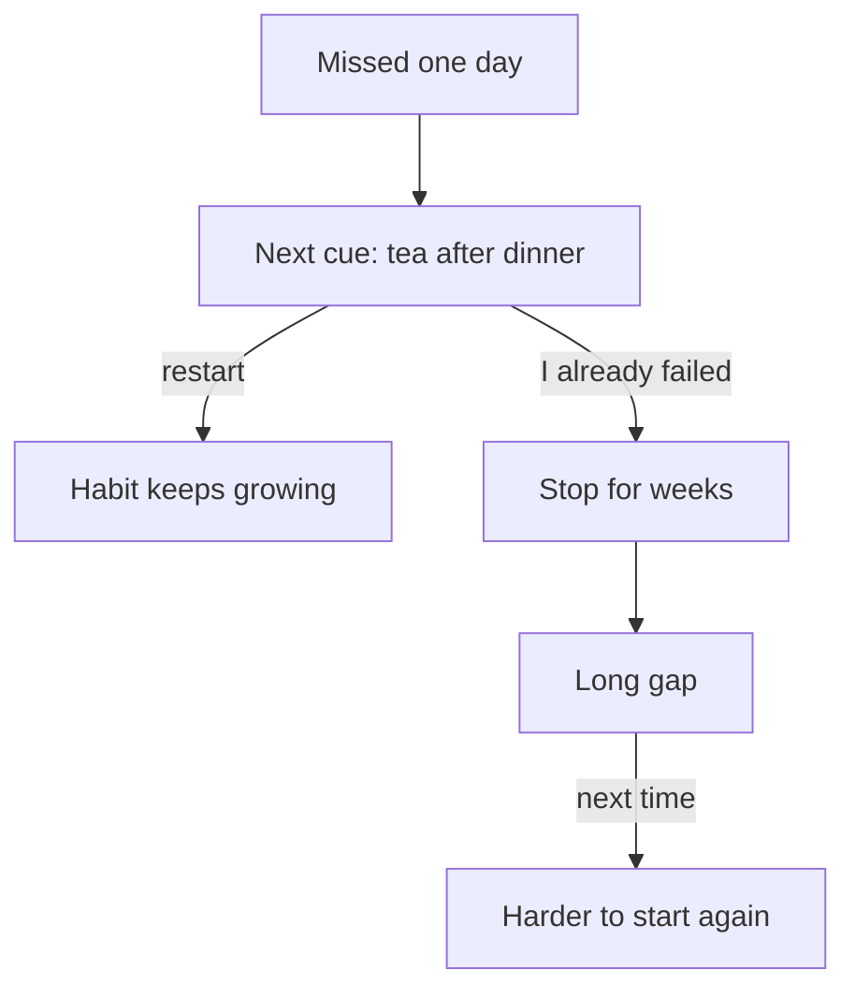

## "Twenty-one days, and it is automatic"

Rami's cousin is a confident man. When Rami tells him about the study plan, he says, "Easy. Do it for 21 days and it becomes automatic. Everybody knows that." He shows Rami a video on his phone. A smiling man in a gym says the same thing: 21 days to a new you.

Rami is not sure. Last spring he tried to read for 15 minutes before sleeping. He did it for nine nights in a row. On the tenth night, relatives came to stay, the room was full until late, and he did not read. The next day he thought, "Now I am back on day one. I have to do 21 more days." The number felt so far away that he stopped. He never started again.

So Rami has three questions. How does a habit grow from day to day? Is 21 days true? And if he misses a day, does he really go back to day one? All three have answers from research, and the answers are kinder than the video.

```predict
prompt: "Before you read on: when someone repeats a small habit every day in the same place, how does it grow?"
options:
  - id: fast-first
    label: "Fast at first, then slowly"
  - id: slow-first
    label: "Slowly at first, then fast"
correctOptionId: fast-first
explanation: "Research on habits found the opposite of a late breakthrough. Habit strength grows fastest in the first weeks, then more slowly, and then it levels off. The canvas below shows this as week-by-week gains that get smaller."
```

The canvas below draws a toy model of habit strength. A toy model is a very simple made-up example, not real data. Its shape comes from research; its formula does not. Move the sliders and watch how much each week adds.

<InteractiveCanvas slug="habit-strength-curve" />

**What this shows:** habit strength as a percent of the habit's own top level, day by day. Each curve reaches 95 percent at a different speed: about 18, 66 or 254 days done, the range and the middle value in one study.

**Try this:** check your prediction in the bars. For a typical habit, week 1 adds 27 points, week 4 adds 10, week 8 adds 3 and week 12 adds 1. Then switch the speed to slow and look again.

**What changed:** at every speed, each week added less than the week before. A slower habit grew more slowly, but its curve had the same shape.

**Limits of the model:** the formula is a simple illustration, not a research finding. Only the shape and the wide range between people come from research. Real habits do not follow a smooth curve.

## The shape, and what it means

The main idea of this chapter is the shape. When you repeat a behaviour in the same situation, the habit does not grow by the same amount every day. It grows fastest in the first weeks, then more slowly, and then it levels off. On the toy curve, a typical habit is at about 27% after one week, 47% after two and 61% after three. The first week adds 27 points; by week 12 a week adds about 1.

This shape has two consequences. First, the early days are when the most happens, so the start is worth protecting. Second, there is no single day when a habit "switches on". It does not jump from "not a habit" to "habit" on day 21 or any other day. It gets easier bit by bit, until starting the action needs almost no effort.

The level where the curve flattens is the habit's own top level, its <GlossaryTerm term="plateau" definition="The level where something stops growing much. For a habit, the point where it is about as automatic as it will get." />. Different habits, and different people, reach their plateau at very different speeds. At day 21 on the toy curves, a fast habit is near the top, a typical one is at 61%, and a slow one is at only 22%. If you compare yourself with a friend whose habit "took three weeks", you may be comparing a slow habit with a fast one. Neither of you is doing it wrong.

## Where this comes from

Researchers led by Phillippa Lally in London followed people who were building one small daily habit. Each volunteer chose one eating, drinking or activity behaviour, such as a walk after dinner, and did it in the same situation every day for 84 days. Every day they reported whether they did it and how automatic it felt. For the typical person it took about two months before the habit felt automatic. But people were very different: some took under three weeks, and the model predicted that others would need most of a year.

Later work points the same way. A review of studies on health habits in 2024 concluded that habits typically take about two to five months, with wide differences between people. A large study of gym members and hospital workers found that going to the gym took months to become a habit, while handwashing at work took about two weeks. Its authors concluded that there is no magic number of days. Think in months, not days. Easy habits, like a glass of water, can come faster; harder ones, like exercise, seem to take longer.

So where did 21 days come from? It appears to come from stories about patients getting used to a new face after plastic surgery, not from studies of habits. Somewhere along the way, a story about surgery became a rule about habits.

<Callout type="info" title="The number behind 'about two months'">
In Lally's study, the middle value was 66 days, among the people whose data fitted the curve well. Half took less, half took more. The full range was 18 to 254 days, and many of those times were predictions from the curve, because the study lasted 84 days. So 66 is one study's middle value, not a rule.
</Callout>

## Missing one day

What about Rami's missed night? In Lally's study, missing one day did not undo the progress. People's habit strength carried on growing soon after a single miss. That is the only kind of break the study tested.

Missing many days is a different matter. People who missed many days ended up with habits that were less automatic. And in the gym study, the longer the gap since a person's last visit, the less likely they were to go again. A longer gap makes the next start harder. The days you practised are not wasted, and the way to protect them is to restart at the next cue.

So Rami's old fear, "now I am back on day one", was not true for one missed night. The real danger came the next day, when he decided to stop. One night became a gap of months.

## A worked example: what Rami should expect

Let us use the shape to plan what Rami can expect from a study habit, week by week, using the canvas's toy numbers as a guide, not a promise.

**Week 1.** On the toy curve, a typical habit is at about 27% after seven days. Rami will still have to remind himself, and some evenings starting will feel like work. That is normal for week one. It does not mean the habit is failing. It means it is new. The worst thing he could do is judge the habit now.

**Weeks 2 and 3.** The toy curve reaches about 47% at day 14 and 61% at day 21. Each week adds a little less than the week before, but each week is real progress. Somewhere here, Rami may notice that finishing his tea and opening the laptop feel connected, even on a tired night.

**Day 10: relatives visit.** Rami misses an evening. The old Rami would have said, "Back to day one." The new Rami reasons differently. One miss did not undo the progress in Lally's study. So the plan is simple: open the lesson the next evening after tea, as usual.

**Weeks 6 to 10.** The curve flattens: about 85% at day 42 and 95% at day 66. Starting is now easy on most evenings. The lessons themselves still take thought, as chapter 1.2 explained. If his habit is a slow one, all of this may take longer, and that is also normal.

The diagram below shows what happens after a missed day. It argues that the next step matters more than the miss.



Follow the two exits from the next cue. If Rami restarts at the next cue, the habit keeps growing, as it did for people in the study after a single miss. If he tells himself "I already failed" and stops, the miss turns into a long gap. In the gym study, a longer gap made the next visit less likely. The miss itself did little damage; the story he told himself about it would have done the rest. Module 5 comes back to restarting in detail.

<Callout type="warning" title="No magic number">
If someone gives you an exact number of days, ask where it comes from. Habits take weeks to months, and people differ a lot. Judge a habit by how easy it is to start, not by a date.
</Callout>

## Common myths

**"It takes 21 days."** The idea came from stories about surgery patients, not from habit studies. Reviews find months, not days, with a wide range.

**"It takes exactly 66 days."** That is one study's middle value, from a small group, with a range of 18 to 254. Your habit could take much less or much more.

**"Miss one day and you start from zero."** One miss did not undo progress in the study. The danger is giving up after the miss, not the miss.

**"Missing days does not matter."** That is the opposite mistake. Many misses lowered the level people reached, and long gaps made the next time less likely. Restart at the next cue.

**"Once it is a habit, it lasts forever."** Habits can weaken when your situation changes, such as a new home or a new schedule. Module 3 shows how to protect them.

## Try it today

Look at the habit you wrote down in chapter 1.3, or think of Rami's study habit. Write one sentence about what you would expect in its first week, and one about what you will do the day after a miss. For example: "In week one, starting will still feel like work. If I miss a day, I start again at the next cue." Keep the sentence somewhere you will see it, on paper or on your phone. On a day with no power or no internet, the sentence still works.

## Check your understanding

```quiz
type: mcq
question: "Reem coaches a girls' team at a sports club. Three weeks ago she started stretching for 5 minutes right after each evening session. Today is day 21, and starting still takes a little effort. A friend says, 'Twenty-one days have passed and it is not automatic, so it has not worked.' Which reply fits the research best?"
options:
  - "Her friend is right, since 21 days should have made it automatic"
  - "It is normal, since habits often take two months or longer"
  - "She should switch to an easier habit that forms in three weeks"
  - "She should start her count again from day 1 to see it clearly"
correct: 1
explanations:
  - "The 21-day idea came from stories about surgery patients, not habit studies. Some effort at day 21 is normal."
  - "That matches the research. Habits grow fast at first and then level off over weeks to months, very differently between people. At day 21 she is well on the way, not finished."
  - "People differ a lot in how fast a habit forms, and nobody can promise three weeks. Her habit is still growing, which is ordinary."
  - "Starting the count again would throw away three weeks of real growth. Nothing in the facts calls for a restart."
```

```quiz
type: mcq
question: "Bilal runs a vegetable stall and has written his day's sales in a notebook after closing for six weeks. In week 3 he missed one evening when he was ill, and wrote again the next evening. Since a family trip 12 days ago, he has not written at all. Which is the bigger risk to the habit?"
options:
  - "The 12-day gap, because a long gap makes restarting harder"
  - "The ill evening, because one miss resets the count to zero"
  - "Neither, because six weeks of practice keeps the habit safe"
  - "Both equally, because each missed day counts the same way"
correct: 0
explanations:
  - "Yes. One missed day did not undo progress in Lally's study, and Bilal restarted the next day. A long gap is different: in a large gym study, the longer the gap, the less likely the next visit. His six weeks are not wasted, and the way to protect them is to restart at the next closing time."
  - "A single miss did not reset habits in the research, and he restarted the next evening."
  - "Six weeks of practice help, but research found that long gaps made the next start less likely. The habit needs a restart now."
  - "A single miss followed by a restart is not the same as 12 days in a row without the habit. The length of the gap is what makes restarting harder."
```

**Next:** The gate for module 1: describe the cue, the routine and the reward of one habit you already have.
