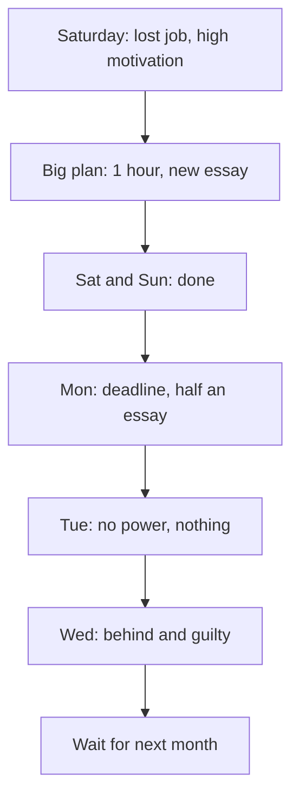

<BigWordAlert term="Smallest version" plainEnglish="The least you can do that still counts as doing the habit, small enough to do on your hardest day." whyItMatters="A habit forms only if it happens again and again. A version small enough for your worst day keeps the repetitions going when motivation is low." />

## A big plan on a Saturday

Lina is 29 and works as a freelance translator between Arabic and English. She works from home, mostly on documents for small businesses and a few organisations abroad. Her clients like her careful work. But the clients who pay best want more than translation. They want reports and letters written directly in English, and Lina's English writing is slower and less sure than her translation. Lina, her family and everyone else in this module are fictional.

On a Saturday in autumn, Lina loses a job she wanted. The client chose another translator, whose English writing sample was "more natural", the client said politely. Lina is upset for an hour. Then she makes a plan. From today, she will practise writing in English every day. One hour every evening. A new essay every day, on a new topic, with every new word looked up and written in a list.

She writes the plan on a page and puts it on the wall above her desk. She feels better already. That evening she writes for 70 minutes, an essay about the market near her home. It is hard, but she finishes, and she is proud of it.

## Sunday to Wednesday

On Sunday she does it again: one hour, an essay about her favourite teacher. She goes to bed late, but happy.

On Monday a client sends an urgent file in the afternoon. Lina works on it until 21:00. Then she sits down for her essay. She writes half of it in 35 minutes, then stops, because her eyes are tired and the topic, "technology in schools", needs research she has no energy for. She tells herself she will finish it tomorrow, along with tomorrow's essay.

On Tuesday the power is off in the evening. Lina's laptop battery is needed for client work the next morning, so she does not want to use it. She thinks about writing by hand, but the plan says "an essay", and an essay feels too big for a notebook by candlelight. She writes nothing. Now she owes one and a half essays.

On Wednesday she looks at the page on the wall. It makes her feel guilty. One hour a day now feels impossible, and she is already behind. "I will start properly next month," she tells her sister. "This month is too busy." The page stays on the wall, but the plan is over.

```predict
prompt: "Lina had a strong reason to practise, and she worked hard on Saturday and Sunday. Before you read on, what do you think made her plan fade by Wednesday?"
options:
  - id: best-day
    label: "The plan was built for her best day, not ordinary days"
  - id: wanting
    label: "She did not really want better clients badly enough"
correctOptionId: best-day
explanation: "Lina wanted better clients very much, and she gave the plan two full evenings. But the plan needed a free hour, energy for a new topic and the laptop every day. Ordinary days brought a deadline and a power cut, and the plan had no version that fitted them. The rest of this chapter shows how."
```

## Lina's ordinary week

To see why the plan faded, it helps to look at an ordinary week in Lina's life, not the Saturday she made the plan. She lives with her parents and her younger sister. The power comes in blocks of a few hours, and the blocks move from week to week. This week it comes on at midday and goes off in the early evening; last week it was on in the mornings. Clients send files at short notice, often in the afternoon, and expect them the next morning. On two afternoons a week she helps her sister's children with their school work. The internet is usable in the mornings and slow in the evenings.

Almost nothing in that week stays in the same place from day to day. Almost. One part of Lina's day never moves. She wakes for Fajr, the dawn prayer, every morning. After she prays, she makes a glass of tea and drinks it at the kitchen window, before anyone else in the flat is up. She has done this for years, in every home she has lived in. She does not decide to do it. It simply happens, as steady as anything in her week. Lina does not think of it as important. By the end of this module, you will see why it is.

## What went wrong

Nothing in Lina's story is unusual. She is a capable, hardworking person. She did not lack a reason: losing a good client is a strong reason. She did not lack effort: on Saturday and Sunday she gave two hours to the plan. And yet, four days later, the plan was over. Many people have a story like this, about exercise, a language, saving money or a study plan.

Look at what the plan depended on. It needed a free hour every evening. It needed energy for a new topic every day. It needed the laptop, and so it needed power. And most of all, it needed Lina to feel as strongly on Tuesday as she felt on Saturday. On Saturday her motivation was at its highest, because of the lost job. That is exactly the day she made the plan. She planned for her best day, and then she had to live her ordinary days.

There is a second problem. The plan said "every evening", but it never said when in the evening, or what would start it. So each evening, the essay needed a fresh decision, made against everything else: client work, tiredness, the family, the power hours. You saw in module 1 that an action that waits for a decision every day is fragile. Lina's plan was a decision she had to make again every day, at the end of the day, when she was most tired.

The diagram shows Lina's week as a chain. Follow it from the top.



What to notice: the plan was made at the top of the chain, on the day motivation was highest. Each day after that, something ordinary happened: a deadline, a power cut. Each one was small. But the plan had no version that fitted an ordinary day, so each small thing became a missed day. By Wednesday the misses had become a debt ("one and a half essays"), and the debt became guilt. The last box, "wait for next month", feels like a fresh start. In fact it is a long gap, and module 1 showed that long gaps make the next start harder.

## Why this matters for study and work

Fellows who freelance, study and work remotely are building skills over months, not days. English writing, a programming language, a portfolio, a certificate: each one grows from small, repeated practice. A plan that works only on good days will fail many times a year, because many days are not good days. Clients send files at short notice. The power comes at different hours. The internet is weak in the evening. Family needs come first. None of this is a failure. It is the normal shape of a week, and a plan has to fit it.

The same pattern appears far from translation. A software tester decides to solve one hard coding exercise every night, and stops after a week of late shifts. A student plans to revise for two hours every evening before an exam, and loses the plan to a few days of family visits. In each case the reason was strong and the person was capable. The plan was simply built for a day that does not come often.

The good news is that starting a habit is a skill, and it can be learned. It does not need more willpower, more guilt, or a calmer month. It needs a different kind of plan: one that is small enough to survive a hard day, tied to a clear moment, and attached to something that already happens every day.

## What this module covers

This module teaches that kind of plan, in four steps. Chapter 2.2 explains why motivation goes up and down, and how to shrink a habit until it fits your hardest day: its smallest version. Chapter 2.3 shows how to turn a wish like "practise every evening" into an if-then plan that names the exact moment and the exact first step. Chapter 2.4 shows how to choose a strong anchor: something you already do every day, at which the new habit can start. Chapter 2.5 is a practice check with five short cases, including an answer from an AI chat tool to check. In the gate, chapter 2.6, you will design your own course habit and start tracking it, or work with a provided plan.

You will follow Lina through the module as she rebuilds her plan, one step at a time. Her goal stays the same: stronger English writing and better clients. What changes is the size of the plan, the moment that starts it, and the routine it is attached to. Her steady morning tea turns out to matter more than her strong Saturday feelings.

<LearningObjectives items={["Explain why motivation is not a reliable engine for a new habit", "Shrink a habit to its smallest version, one that fits your hardest day", "Turn a wish into an if-then plan that names the exact moment and the first step", "Choose a strong anchor that happens every day, in the right place, and ends at a clear moment, plus a second anchor for days without it", "Tell a reminder from a cue, and know why the cue is what builds the habit"]} />

## Key words

| Word | Plain English |
|---|---|
| **Motivation** | How much you want to do something right now; it goes up and down from day to day |
| **Intention** | What you plan or mean to do |
| **If-then plan** | A plan that names the moment and the first step: "If (moment), then I (first step)" |
| **First step** | The first small action you could see someone do, such as opening a notebook |
| **Reminder** | Something that tells you to remember, such as an alarm; it is not the same as a cue |

## What is in this module

| Chapter | You will practise |
|---|---|
| 2.2 | Shrinking a habit to its smallest version |
| 2.3 | Writing an if-then plan with a clear moment and first step |
| 2.4 | Choosing a strong anchor, and a second anchor for days without it |
| 2.5 | A practice check with five cases and an AI answer to check |
| 2.6 | Designing your course habit, or using a provided plan, and starting to track it |

**Next:** Why motivation goes up and down, and how to shrink a habit until it fits your hardest day.
