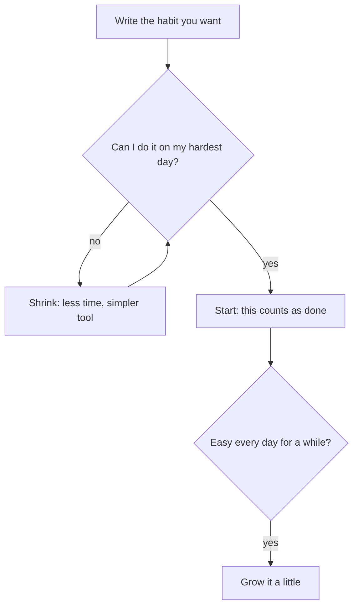

## Two Tuesdays

Lina remembers two Tuesdays very clearly. On the first, a month ago, a client sent her a kind message about a translation, the power was on all evening, and she felt she could do anything. She cleaned the kitchen, called her aunt and read for an hour. On the second, last Tuesday, the power was off, a deadline was close, and her head ached by 20:00. On that evening, even replying to a friend felt like a task.

Lina is the same person on both Tuesdays. She has the same goals, the same skills and the same reasons to practise English. What changed was how much she felt like doing things. Her big plan needed the first kind of Tuesday every day. It got the second kind on day four.

Here is an example of how her motivation moved over two weeks, as a number from 0 to 10 each day. Before you read on, make a guess about what it means for her plan.

```predict
prompt: "In this example, Lina's motivation over 14 days was 9, 8, 6, 5, 3, 4, 6, 7, 5, 4, 3, 2, 4, 5. Her one-hour essay plan happens only on a day when her motivation is 7 or more. On how many of the 14 days will it happen?"
options:
  - id: most
    label: "More than half the days"
  - id: few
    label: "Fewer than half the days"
correctOptionId: few
explanation: "Only three days reach 7 or more: days 1 and 2, right after she lost the job, and day 8. That is 3 of 14 days. On every other day the plan is too big for how she feels, however much she wants better clients."
```

The canvas below uses the same 14 days. Change how much effort the habit needs, and see on which days it still happens.

<InteractiveCanvas slug="motivation-wave-habit-size" />

**What this shows:** Lina's 14 days of motivation, and a toy rule, meaning a very simple made-up rule: the habit happens on days when motivation is at least the effort it needs.

**Try this:** leave the effort at 7. The plan happens on 3 of 14 days. Then lower the effort to 2, a smallest version, and it happens on all 14. Then make the second week harder by 2: the smallest version still happens on 12 days, and the big plan on only 2.

**What changed:** a smaller habit fitted the low days as well as the high ones, so the repetitions did not stop.

**Limits of the model:** real motivation is not a number, and the rule is a simple illustration, not a research finding. Real days also depend on time, power and other people, not only on how you feel.

## Why the size matters more than the mood

Motivation, from the key words in chapter 2.1, goes up and down. It rises after a lost job, a kind word or a new start, and it falls after a bad night, a long shift or a week of worry. Nobody's motivation stays high every day. A plan that runs only on high motivation will run only on some days. That is exactly what the canvas showed with an effort of 7. There were two done days at the start, while the lost job still hurt, and one more on day 8. Then came six days in a row with nothing.

A habit, as you saw in module 1, forms through repetition in the same situation. So the most important thing about a new habit is not how much you do on a good day. It is whether it happens again on a bad one. With an effort of 2, the habit happened on every one of the 14 days, including day 12, Lina's lowest day. A hard week hurts every plan, but it hurts a big plan far more.

That is why this course asks you to find the smallest version of a habit, the big word from chapter 2.1. "Write a new essay" is not a smallest version. "Write three sentences in English in my notebook" might be. On a good day you can always do more. But the smallest version is what counts as done, so the habit never has to wait for a good day.

Goals still matter. A goal says where you want to go. A habit is the daily step that gets you there, even on days you do not feel like it. Lina's goal, winning better clients with stronger English writing, gives her direction. The smallest version is how she keeps practising for it on a Tuesday with no power.

## What research says

Wanting to change is the start, not the plan. Research on intentions finds that people carry out what they intend only about half the time. The gap between intending and doing comes mostly from people who mean to act and then do not. The main reasons are ordinary: they forget, they miss the moment, they did not prepare, and old habits take over. None of these reasons is "they did not care enough".

The researcher BJ Fogg describes it simply: a behaviour happens when you want to do it enough, it is easy enough, and something reminds you, all at the same moment. When motivation is low, the only way the behaviour can still happen is if it is very easy. That is the reason to shrink a habit. You cannot control how motivated you will feel next Tuesday. You can control how big the habit is.

How small should you start? Habit researchers advise choosing simple actions you can do every day. There are few direct tests of starting very small, so think of it as sensible advice built on related research, not as a proven method on its own. This course uses its own name for the idea, the smallest version, and its own rule: shrink until the habit fits your hardest day.

## A worked example: shrinking Lina's plan

Let us shrink Lina's plan step by step, with a simple test at each step: could she do it on her hardest day? Her hardest day, she decides, is a day like last Tuesday: a deadline, no power in the evening, a headache by 20:00.

**Step 1: the plan as it is.** One hour every evening, a new essay on a new topic. On her hardest day? No. She has no hour, no laptop and no energy for research.

**Step 2: cut the time.** Twenty minutes, one paragraph on the laptop. On her hardest day? Still no. The laptop battery is saved for client work, and twenty minutes feels long at 22:00.

**Step 3: cut the tool.** Ten minutes of writing by hand in a notebook. Better: no power needed. But on her hardest day, ten minutes of writing with a headache still feels like a task she would put off.

**Step 4: cut to the first useful action.** Write three sentences in English in her notebook, about anything. About five minutes, by hand, by candlelight if needed. On her hardest day? Yes. Even on last Tuesday, she could have written three sentences.

**Step 5: decide what counts.** Three sentences count as done. On a good day, she is free to write a page, or an essay. That is a bonus, not the target. On a hard day, three sentences are a full success, not a failure.

**Step 6: plan the growth.** When three sentences have felt easy every day for a while, she can grow the habit a little: five sentences, then a short paragraph. Lina chooses about two weeks as her sign. That number is the course's rule of thumb, not a research finding. What matters is that she grows slowly, and only after the habit starts by itself.

Notice the reasoning. Lina did not shrink the habit because she is weak. She shrank it because a habit forms through repetition, and only a small habit repeats on every kind of day. Three sentences a day may look small. But it is three sentences more than the zero she wrote on Tuesday, and the habit it builds is the start that bigger practice will grow from.

The diagram below shows the test Lina used. It argues that the test is about your hardest day, not your average day.



Follow the loop between "shrink" and the question. Lina went round it three times before the answer was yes. The question is not "can I do it on a normal day?" or "can I do it if I try hard?". It is "can I do it on my hardest day?". Only after the answer is yes does the habit start. And growth comes later, after a second question: has it been easy every day? A habit grown before it is easy is just a new big plan.

## Traps to avoid

**"Get motivated first, then start."** Motivation rises and falls, and it is often lowest on the days that decide whether a habit survives. Start small now, and let the habit carry you on low days.

**"Three sentences is too small to matter."** It matters because it repeats. A habit that happens 14 days in a row is building something. A big plan that happens on 3 days out of 14 mostly builds guilt.

**"The small version is proven to work best."** It is sensible advice from habit researchers, with few direct tests. Use it because it fits your hardest day, not because it is a law.

**Growing too fast.** After a good week, it is tempting to jump back to the big plan. Grow only after the small habit has been easy every day for a while, and grow by a little.

**Calling the small version a failure.** If three sentences count as done, then three sentences are a success. If you secretly count only the long days, you are back to a big plan with a new name.

## Try it today

Write down one habit you want, or use Lina's. Then describe your hardest ordinary day in one line: for example, "a long shift, no power after 18:00, the family home all evening". Shrink the habit, one step at a time, until you could honestly do it on that day. Write the final version as one short line, and write "this counts as done" next to it. If your hardest day often has no power, make sure your smallest version needs none.

## Check your understanding

```quiz
type: mcq
question: "Reem coaches at a sports club. Her 5-minute stretch after each session felt easy for two months, so she grew it to 20 minutes plus a short run. In the next 12 sessions she did it 4 times. Her notes: 'too tired for all of it' 6 times, 'hall closed early' twice. What change fits?"
options:
  - "Keep the new size and push through the tired evenings"
  - "Go back to a smaller size, then grow it slowly"
  - "Keep the new size, but only on days the hall stays open"
  - "Stop the stretch for a month and start again at 20 minutes"
correct: 1
explanations:
  - "Her notes say 'too tired for all of it' on 6 of the 8 misses. Pushing harder asks for a high-motivation evening, which is what the smaller habit avoided."
  - "That matches her notes. Most misses came because the new size was too big for a tired evening. A size that fits, grown in small steps once each step is easy, keeps the repetitions going. How fast to grow is the course's advice, not a research finding."
  - "The hall closing explains only 2 of the 8 misses. The main cause, 'too tired for all of it', would stay."
  - "A month off is a long gap, and a long gap makes the next start harder. Restarting at 20 minutes also keeps the size that failed."
```

```quiz
type: mcq
question: "Asma's study habit works on most days, but not on Thursdays. On Thursdays the clinic stays open until 18:00, the power is off from 18:00 to 22:00, the internet is weak, and her phone battery is low by night. Which smallest version passes the hardest-day test?"
options:
  - "Watch one short video lesson in English before she sleeps"
  - "Do 30 minutes of the online course on her phone each night"
  - "Write a full page in English in her notebook every evening"
  - "Read one page of her printed word list by a candle at night"
correct: 3
explanations:
  - "A video needs a working internet connection, and hers is weak in the evening. On a Thursday the video will not load."
  - "Thirty minutes on her phone needs battery and internet, and her phone is low by night. It also needs more time than her hardest day leaves."
  - "This needs no power, but a full page is a lot after a long day at the clinic. A smallest version should be easy even when she is tired."
  - "Correct. A printed page needs no power, no internet and no battery, a candle gives her light after 18:00, and one page takes a few minutes. It fits every part of her Thursday."
```

**Next:** If-then plans: how to name the exact moment and the exact first step, so the moment itself starts the habit.
