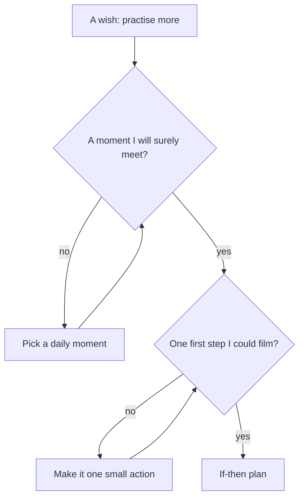

## "Sometime today"

On Monday morning Lina writes a new plan on a sticky note: "Practise English writing sometime today. Three sentences." She has learned from chapter 2.2. The habit is small now, small enough for a hard day. She puts the note next to her laptop and starts work.

At 22:30 she sees the note again, on her way to bed. She has not written a single sentence. The day was not even a hard one. A client call ran long, her sister needed help with a form, lunch was late, and the afternoon went to a translation. At no point did she decide not to practise. There was simply no moment when "sometime today" turned into "now".

Three sentences take five minutes. Lina had many free five minutes on Monday. But "sometime" is not a moment. It is the whole day, and a whole day never arrives at a single point where you have to act. This chapter is about turning "sometime" into a moment.

## The idea in plain words

An if-then plan, from the key words in chapter 2.1, names the moment and the first step: "If (moment), then I (first step)." For example: "If I finish my morning tea, then I open my writing notebook and write three sentences." The "if" part is a situation you will meet. The "then" part is an action you can see yourself doing.

The point of the plan is to do the deciding once, in advance, instead of every day. When the moment comes, there is nothing left to decide. Finishing the tea becomes the signal, like the cue you met in module 1. That is why an if-then plan is a good way to start a habit: it gives a new behaviour a cue from the very first day.

A strong if-then plan has two parts that are both clear. It names a moment you will surely meet: something that happens every day, at a point you will notice. And it names a first step you can see: not "practise" or "study", but "open the notebook" or "write three sentences". If you could film both parts, the plan is probably clear enough.

## What the research found

A researcher named Peter Gollwitzer studied plans that name the moment, which he called "implementation intentions". Across many studies, more than six hundred tests in a recent review, people who made plans like this reached their goals more often than people who only intended to. The plans helped people remember to act, notice the moment when it came, get started when they would otherwise put things off, and resist distractions.

Researchers explain the effect like this. Naming the situation in advance makes it easier to notice when it arrives, and links it to the action. So the action starts from the situation, in a cue-driven way, a little like a habit. Plans written in a real "if, then" form worked better than looser plans.

If-then plans have limits, and it is honest to name them. They work mainly when people actually want the goal: they help a wish become action, but they do not create the wish. And they help most for new habits. In one study of smokers, if-then plans helped people with weak or moderate habits, but not people with very strong ones. Against a very strong old habit, add other tools as well, such as changing the place or removing the cue. Module 3 and module 4 teach those tools.

```predict
prompt: "On Tuesday Lina's plan says: 'If I finish my morning tea, then I open my writing notebook and write three sentences.' On a busy client day, how much does she have to remember?"
options:
  - id: less
    label: "Less: finishing her tea is the reminder"
  - id: same
    label: "Just as much; she still has to remember it"
correctOptionId: less
explanation: "The plan ties the writing to a moment she meets every morning. When the glass is empty, the moment itself reminds her, so she does not have to carry the plan in her head all day. On Monday, 'sometime today' gave her no moment at all, so it depended entirely on memory."
```

Step through Lina's Monday and Tuesday. Watch for the moment where each day either passes by or turns into action.

<InteractiveCanvas slug="if-then-moment" />

**What this shows:** two days with the same small habit. On Monday the plan is "sometime today", and the moment never comes. On Tuesday the plan names a moment, finishing her morning tea, and a first step, opening the notebook. **Try this:** before step 6, predict what starts the writing on Tuesday. Then count how many times Lina had to remember the plan on each day. **What changed:** on Monday the plan lived only in her head, and the day filled up around it. On Tuesday the situation itself started the action, before the work day began. **Limits of the model:** a plan does not guarantee anything. Some mornings the tea will be late or a client will call at dawn. If-then plans make action more likely; they do not make it certain.

## What the stepper showed

On Monday, Lina drank her tea, started work, and moved through a busy day. The plan was with her the whole time, on a sticky note, but there was no step in the day where it belonged. By 22:30 it was too late and she was too tired, and the day's answer was "tomorrow". Nothing went wrong. That is what "sometime" usually looks like.

On Tuesday, the same tea had a new job. When the glass was empty, that was the "if". The notebook was the "then". The writing happened before the first client message, and the rest of the day could be as busy as it liked. The plan did not need more motivation than Monday's. It needed a moment.

## A worked example: rewriting weak plans

Here are four plans Lina tried before Tuesday's. Let us check each one against the two questions: is there a moment she will surely meet, and is there a first step she could film?

**Plan 1: "Practise English more."** Moment? None. First step? None: "practise more" is a wish. This is an intention, not a plan. Rewrite: it needs both parts from scratch.

**Plan 2: "When I have time, I will write in English."** Moment? "When I have time" sounds like a moment, but it is not one. On a busy day it never comes, and on a free day it is everywhere, so it starts nothing. First step? "Write in English" is close, but still vague: write what, where?

**Plan 3: "If the power comes on, then I will write an essay."** Moment? The power coming on is very clear, but this week it comes at 6:00 and next week at 14:00. A moment that moves around the day is weaker: the situation is different each time. First step? "Write an essay" is too big for a hard day, as chapter 2.2 showed.

**Plan 4: "If I finish my morning tea, then I will write three sentences and read an article."** Moment? Good: the tea after Fajr happens every morning. First step? Two actions at once. On a tired morning, the second one makes the whole plan feel heavy, and she might skip both.

**The plan she keeps:** "If I finish my morning tea, then I open my writing notebook and write three sentences." The moment happens every day, at a point she notices: the empty glass. The first step is one action she can see, and it is small enough for her hardest day.

Notice the method. Lina did not look for perfect words. She asked two questions about every plan and fixed what failed. The mistakes she found are common ones: no moment, a vague moment, a moment that moves, a first step that is vague or too big, and two actions joined together.

The diagram below shows the order of the questions. It argues that the moment comes first, because a good first step with no moment still waits for a decision.



Follow it from the wish at the top. The first question is about the moment. Until there is a moment that happens every day, nothing else matters, because the habit has no cue. Only then does the plan ask about the first step, and it asks for one action, small and visible. A plan that passes both questions has done the deciding in advance, which is the whole point.

## Reminders are not cues

Many people's first idea is a phone alarm: "At 7:00, the alarm says 'write'." A reminder helps you remember. It does not build the habit. The habit grows from the situation, the moment you meet in your day, not from a sound on a phone.

A study of habit apps on phones found exactly this. Reminders helped people repeat an action, but did not help it become a habit. Cues tied to an event in the day, like finishing breakfast, did. An alarm also has a practical problem for many fellows: when the phone is dead, or charging in another room during a power cut, the alarm does not ring. Finishing your tea happens anyway.

A reminder can still help in the first days, while the plan is new. Just let the moment, not the alarm, be the "if" in your plan. When the habit starts from the moment by itself, you can switch the alarm off.

## Where people go wrong

**A moment that is not a moment.** "When I have time", "in the evening", "after work" are periods, not points. Pick something that happens at one clear instant, such as finishing a meal or closing the laptop.

**A first step that is a wish.** "Study", "practise", "improve" cannot be filmed. "Open the notebook" can.

**Two actions in one plan.** Each extra action makes the plan heavier on a tired day. Start with one. You can add a second plan later.

**A moment that does not happen every day.** "If I go to the library" only works on library days. For a daily habit, choose a daily moment.

**Expecting the plan to beat a very strong habit alone.** If-then plans help most with new habits. For a strong old habit, add other tools as well.

## Try it today

Write one if-then plan for the habit you shrank in chapter 2.2, or for Lina's. Check it with the two questions: a moment you will surely meet, and one first step you could film. If you use a phone alarm, write the plan so that the moment, not the alarm, is the "if". Tomorrow, watch for your moment, and notice whether it starts the step.

## Check your understanding

```quiz
type: mcq
question: "Nadia runs the library corner in a community centre, open every day except Friday. Each morning she sorts the returns box, which takes about ten minutes. She wants to read two pages of an English novel every working day. Which plan is strongest?"
options:
  - "If I have a free moment at work, then I read my English novel"
  - "If it is a quiet afternoon, then I read two pages and take notes"
  - "If I finish the returns box, then I read two pages of my novel"
  - "Every working day from now on, I will read more of my novel"
correct: 2
explanations:
  - "'A free moment' is not a moment she will surely meet. On a busy day it never comes, so the plan waits for a decision."
  - "Quiet afternoons do not happen every day, and the plan joins two actions: reading and taking notes."
  - "Right. Finishing the returns box happens every working day, at a clear point, in the same place. Reading two pages is one small step she could film."
  - "This has no moment at all, and 'read more' is a wish, not a step. It is an intention, not an if-then plan."
```

```quiz
type: mcq
question: "Fadi works at a bakery that usually closes at 13:00. He set a phone alarm for 13:30 that says 'English: 10 minutes'. When the bakery runs late, the alarm rings while he is still serving, so he switches it off. Twice his phone battery was flat. In two weeks he studied on 5 days. What change fits this chapter best?"
options:
  - "Make the alarm louder, so he cannot miss it at the bakery"
  - "Set a second alarm at 14:00, in case he misses the first one"
  - "Drop the alarm and trust himself to remember every afternoon"
  - "Use hanging up his apron, the end of his shift, as the cue"
correct: 3
explanations:
  - "The alarm was not missed: he heard it and switched it off because he was still serving. A louder alarm rings at the same wrong moment."
  - "A second alarm still depends on a clock time that does not match his day, and on a phone that is sometimes flat."
  - "Memory alone is what if-then plans are meant to replace. Without a moment, the study waits for a decision every afternoon."
  - "Right. Hanging up his apron happens at the real end of every shift, late or not, and needs no battery. An event in his day is a cue; the alarm was only a reminder."
```

**Next:** How to choose a strong anchor: something you already do every day, at which a new habit can start.
