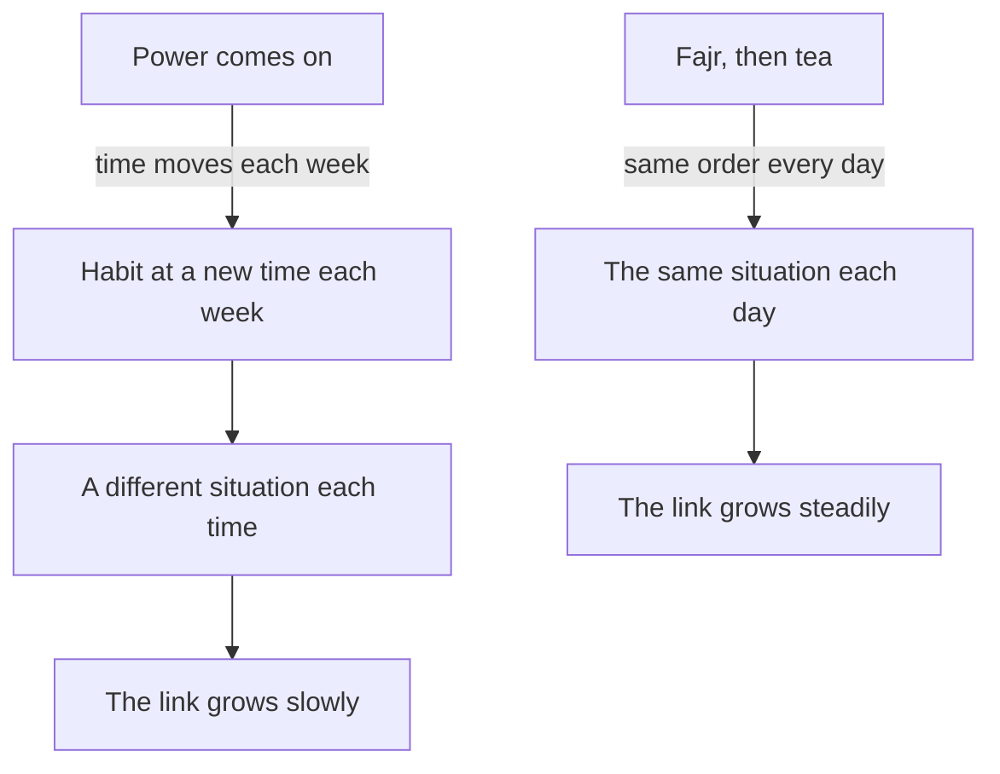

## Three possible moments

Lina's if-then plan has worked for eight mornings in a row. After Fajr she drinks her tea, and when the glass is empty she opens her notebook and writes three sentences. She is pleased, and a little surprised that something so small feels so solid.

Then a friend from university makes a suggestion on the phone. "Why in the morning? You are always rushing then. Do it when the power comes on. That is when you sit at your desk anyway, with light and the laptop." Her mother has another idea: "After dinner, when the day is over and you are calm."

Both ideas sound reasonable. All three moments happen in Lina's life. So which one should carry her new habit? This chapter gives you a way to choose, and it shows why the answer depends on what your week is really like.

## What an anchor is

Tie the new habit to something you already do every day: "After I finish my morning tea, I open my writing notebook." The existing routine is the anchor for the new habit. The researcher BJ Fogg, who came up with the idea, calls the existing routine an <GlossaryTerm term="anchor" definition="A routine you already do every day, which you use as the moment to start a new habit." />. The writer James Clear calls the same idea "habit stacking". In this course we will simply say "anchor it to".

An anchor is a special kind of if-then plan. The "if" is not a clock time or a vague moment. It is the end of something you already do without thinking. That is its strength. You do not have to remember to watch for the moment, because you are already doing the routine. Finishing it is the cue.

Not every routine makes a good anchor. A strong anchor passes four questions. Does it happen every day, at about the same point in the day? Does it happen in the right place, where you can do the new habit and the things you need are near? Does it end at a clear moment, so you know exactly when to start? And does it leave a few free minutes after it, so there is time for the new habit?

```predict
prompt: "You have read the four questions. Before you touch the weights below: Lina rates 'same time every day' as very important, because her power hours change every week. Which anchor will come out ahead?"
options:
  - id: power
    label: "When the power comes on"
  - id: fajr
    label: "After Fajr and her tea"
correctOptionId: fajr
explanation: "With 'same time every day' rated very important, the power anchor loses many points, because its time moves every week. After Fajr and tea scores well on that question and on having a clear end, so it leads with 37 points, against 31 and 30."
```

The canvas below scores Lina's three anchors on the four questions. Change how much each question matters, and watch which anchor comes out ahead.

<InteractiveCanvas slug="choose-an-anchor" />

**What this shows:** three anchors scored from 1 to 5 on the four questions, each score multiplied by how much that question matters to Lina.

**Try this:** with Lina's weights, After Fajr and tea leads, 37 to 31 and 30. Then set "Same time every day" to Nice to have: now the power anchor wins, 29 to 27.

**What changed:** lowering one weight removed most of the power anchor's weakness, so the winner changed. Which anchor wins depends on what matters most in your week.

**Limits of the model:** the scores are Lina's own judgment, and the model treats them as exact. It cannot see a problem she left off the list, and it does not know that a moving anchor makes the link grow more slowly.

## What the research found

Habit researchers give the same advice: pick a cue that happens every day, in the same place. They describe an existing routine as a convenient and stable starting point for a new habit. Some health programmes have used tooth brushing, which most people do every day, as the moment to floss.

How strong is the evidence for anchors in particular? In one small study, 50 people were learning to floss. Those told to floss after brushing their teeth built a stronger habit than those told to floss before. They still flossed more often eight months later. The researchers called their study exploratory and asked for stronger tests. A review in 2024 also found that, in the few studies that compared them, cues based on a time and cues based on a routine worked about equally well.

So be honest about what an anchor is. It builds on if-then plans, which have strong evidence from many studies. The idea of attaching a habit to a routine has been tested in only a few small studies, so treat it as good advice, not a proven law. Its real value is practical: a routine you already do every day is a moment you will surely meet.

There is one more piece of reasoning, and it matters a lot for fellows. Habits grow from repetition in a stable situation. An anchor that moves around the day, such as power hours that change every week, puts the new habit in a different situation each time. An anchor that stays in place, such as waking up, a meal or a prayer, puts it in the same situation every day. This is the course's advice, drawn from what research says about stable situations: a moving anchor is weaker than one that stays.

That is why the morning anchor won with Lina's weights: her week has one fact that outweighs almost everything else, the power hours move. When that weight was lowered, the power anchor won by 2 points. Its strengths are real. Lina is at her desk, there is light, and the moment the lights come on is very clear. For someone whose power came at the same hour every day, it could be a strong choice. No anchor wins for everyone. The right anchor depends on your week.

## A worked example: scoring Lina's anchors

Let us score the three anchors the way Lina did, one question at a time, with her reasons. The scores run from 1 (weak) to 5 (strong).

**Same time every day.** Fajr and tea: 5. The prayer time moves slowly through the year with the sun, but prayer then tea is always the first thing in her morning, so the order never changes. Power on: 1. This week it comes at 6:00, last week at 14:00, next week nobody knows. Evening meal: 4. The family eats at about the same time most days.

**Right place.** Fajr and tea: 3. She drinks her tea in the kitchen, and the notebook lives on her desk in her room, two steps away. Power on: 5. She is at her desk with light and everything she needs. Evening meal: 3. The meal is in the main room, and the notebook is not at hand.

**Clear end moment.** Fajr and tea: 5. The empty glass is a clear end. Power on: 5. The lights coming on could not be clearer. Evening meal: 2. The meal drifts into talking, then clearing up, with no single moment when it ends.

**Free minutes after.** Fajr and tea: 3. Client messages start soon after, but five minutes are there. Power on: 4. The laptop needs to charge before she can work, so she has a few minutes. Evening meal: 4. Evenings are freer, but she is tired.

Now the sums, with Lina's weights: 3 for same time, 2 for each of the others. Fajr and tea: 5 x 3 + 3 x 2 + 5 x 2 + 3 x 2 = 15 + 6 + 10 + 6 = 37. Power on: 1 x 3 + 5 x 2 + 5 x 2 + 4 x 2 = 3 + 10 + 10 + 8 = 31. Evening meal: 4 x 3 + 3 x 2 + 2 x 2 + 4 x 2 = 12 + 6 + 4 + 8 = 30. The morning anchor leads by 6.

Lina notices something else. The morning anchor's weakest score is the place: the notebook is two steps away. That is easy to fix. She keeps the notebook and a pen on the kitchen shelf. Now its place scores 5, and its total rises to 41. Choosing an anchor is not only picking the highest score. It is also improving the anchor you pick. Module 3 has much more on arranging your surroundings like this.

The diagram below shows why the moving anchor is weaker, even on days when it is available. It argues about the situation, not the score.



Read the two columns side by side. On the left, the power anchor moves the habit to a new hour each week: some weeks it is morning, some weeks afternoon, with different people around and different things already done. The cue is never quite the same, so the link from the cue to the habit has less to grow on. On the right, Fajr and tea happen in the same order every day, so the habit meets the same situation each morning. That steady repetition is what builds a habit. The difference is the course's reasoning from research on stable situations, not a measured result, but it is the reason Lina gave "same time every day" a weight of 3.

## When the anchor does not happen

Even a strong anchor can disappear on some days. Lina's tea after Fajr happens every morning at home. But twice a month she stays overnight at her aunt's house to help with her young cousins, and there the morning is different. She prays as usual, but there is no quiet window and no glass of tea on her own. Breakfast comes later, with everyone. On those mornings her habit has no "if".

The fix is a second anchor: a different routine, chosen in advance, for the days when the first one does not happen. It is not a new habit and not a reason to skip. It is the same small step, started by another moment. Lina asks the four questions about the mornings at her aunt's house. What happens there every time? She folds her bedding and puts it in the corner before anyone else wakes. That happens every morning she stays there, it ends at a clear moment, and she has a few minutes before the children wake. Her notebook travels in her bag, so the place works too.

So her plan now has two lines. "After I finish my morning tea, I open my writing notebook and write three sentences. On mornings at my aunt's house, after I fold my bedding, I write my three sentences." Both lines count as done. She writes the second line before her next visit, not on the morning itself, because a plan made in the moment is a decision again.

Use a second anchor when your notes show the same reason for misses again and again: no breakfast at home, a different shift on certain days, a weekly visit. Choose it with the same four questions, and keep the plan to one or two lines so it stays simple. This is the course's advice, built on if-then plans: a second anchor is simply a second if-then plan for a known kind of day.

## Anchor mistakes

**"Any routine will do."** A routine that does not happen every day, or that happens in the wrong place, gives the new habit a weak start. Ask the four questions before choosing.

**Choosing a routine with no clear end.** "After dinner" sounds like a moment, but dinner fades into talking and clearing up. Pick the exact end: "after I put my plate in the sink".

**Anchoring to something that moves.** Power hours, a client's call that comes at different times, a bus that comes when it comes: these are real parts of the week, but weak anchors. Prefer events that stay in place, such as waking, a meal or a prayer.


## Try it today

List three things you already do every day without fail, or use Lina's three. For each one, ask the four questions: every day, right place, clear end, free minutes. Choose the strongest, and write your plan in the form "After I (anchor), I (first step)." Then fix the anchor's weakest point if you can. For example, put what you need right where the anchor happens. If the power is part of your day, try to anchor to something that does not depend on it. If one kind of day often has no anchor, write a second anchor for it now.

## Check your understanding

```quiz
type: mcq
question: "Salma runs a school canteen. She tied a 5-minute vocabulary review to 'after the morning break'. In 10 school days she did it 4 times. Her notes: 'break ran into cleaning, never a clear moment' 4 times, and 'word list at home' twice. What change fits best?"
options:
  - "Keep the same anchor and set an alarm for 10:30 each day"
  - "Keep the same anchor and bring the list from home each day"
  - "Tie it to closing the till, and keep the list in the canteen"
  - "Move it to locking up at 14:00, and keep the list at home as now"
correct: 2
explanations:
  - "An alarm reminds her, but her notes show two other problems: no clear end to the break, and the list at home. A reminder fixes neither."
  - "This fixes the place, but the anchor still has no clear end. The break still runs into cleaning on most days."
  - "Both notes agree. Closing the till is a clear moment at the end of the break, and a list kept in the canteen is in the right place."
  - "Locking up is a clear moment, but the list would still be at home. Two of her misses came from that."
```

```quiz
type: mcq
question: "Adam drives his family's water delivery round from Saturday to Thursday. His habit: 'After I load the first crate of bottles, I read one page of my book.' He wants to read every day of the week, but on Fridays there is no round. What should he add to his plan?"
options:
  - "A second anchor for Fridays, such as after the family breakfast"
  - "Nothing, since six days a week is close enough to every day"
  - "A phone alarm for Fridays at the time he usually loads the truck"
  - "Two pages on Thursdays, to cover the page he will miss on Friday"
correct: 0
explanations:
  - "Right. His anchor disappears on Fridays, so he needs a second routine, chosen in advance, that does happen on Fridays. The family breakfast happens every morning, at a clear point."
  - "Six days may be fine for some habits, but Adam wants every day. Without a Friday anchor, Fridays will wait for a decision."
  - "An alarm is a reminder, not a routine he already does, and it does not give the step a situation to grow from."
  - "Reading more on Thursday does not give Friday a moment. The habit grows from doing the step in its situation, day by day."
```

**Next:** A practice check with five short cases on small steps, if-then plans and anchors, including an AI answer to check.
