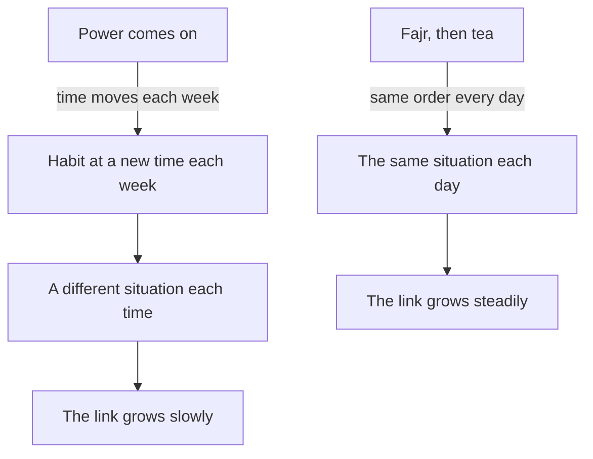

## Three possible moments

Lina's if-then plan has worked for eight mornings in a row. After Fajr she drinks her tea, and when the glass is empty she opens her notebook and writes three sentences. She is pleased, and a little surprised that something so small feels so solid.

Then a friend from university makes a suggestion on the phone. "Why in the morning? You are always rushing then. Do it when the power comes on. That is when you sit at your desk anyway, with light and the laptop." Her mother has another idea: "After dinner, when the day is over and you are calm."

Both ideas sound reasonable. All three moments happen in Lina's life. So which one should carry her new habit? This chapter gives you a way to choose, and it shows why the answer depends on what your week is really like.

## The idea in plain words

Tie the new habit to something you already do every day: "After I finish my morning tea, I open my writing notebook." The existing routine is the anchor for the new habit. The researcher BJ Fogg, who came up with the idea, calls the existing routine an <GlossaryTerm term="anchor" definition="A routine you already do every day, which you use as the moment to start a new habit." />. The writer James Clear calls the same idea "habit stacking". In this course we will simply say "anchor it to".

An anchor is a special kind of if-then plan. The "if" is not a clock time or a vague moment. It is the end of something you already do without thinking. That is its strength. You do not have to remember to watch for the moment, because you are already doing the routine. Finishing it is the cue.

Not every routine makes a good anchor. A strong anchor passes four questions. Does it happen every day, at about the same point in the day? Does it happen in the right place, where you can do the new habit and the things you need are near? Does it end at a clear moment, so you know exactly when to start? And does it leave a few free minutes after it, so there is time for the new habit?

## What the research found

Habit researchers give the same advice: pick a cue that happens every day, in the same place. They describe an existing routine as a convenient and stable starting point for a new habit. Some health programmes have used tooth brushing, which most people do every day, as the moment to floss.

How strong is the evidence for anchors in particular? In one small study of 50 people learning to floss, those told to floss after brushing their teeth built a stronger habit than those told to floss before, and they still flossed more often eight months later. The researchers called their study exploratory and asked for stronger tests. A review in 2024 also found that, in the few studies that compared them, cues based on a time and cues based on a routine worked about equally well.

So be honest about what an anchor is. It builds on if-then plans, which have strong evidence from many studies. The idea of attaching a habit to a routine has been tested in only a few small studies, so treat it as good advice, not a proven law. Its real value is practical: a routine you already do every day is a moment you will surely meet.

There is one more piece of reasoning, and it matters a lot for fellows. Habits grow from repetition in a stable situation. An anchor that moves around the day, such as power hours that change every week, puts the new habit in a different situation each time. An anchor that stays in place, such as waking up, a meal or a prayer, puts it in the same situation every day. This is the course's advice, drawn from what research says about stable situations: a moving anchor is weaker than one that stays.

```predict
prompt: "Before you touch the weights below: Lina rates 'same time every day' as very important, because her power hours change every week. Which anchor will come out ahead?"
options:
  - id: power
    label: "When the power comes on"
  - id: fajr
    label: "After Fajr and her tea"
correctOptionId: fajr
explanation: "With 'same time every day' rated very important, the power anchor loses many points, because its time moves every week. After Fajr and tea scores well on that question and on having a clear end, so it leads with 37 points, against 31 and 30."
```

The canvas below scores Lina's three anchors on the four questions. Change how much each question matters, and watch which anchor comes out ahead.

<InteractiveCanvas slug="choose-an-anchor" />

**What this shows:** three anchors scored from 1 to 5 on four questions about a good anchor, each score multiplied by how much that question matters to Lina. **Try this:** with Lina's weights, After Fajr and tea leads, 37 to 31 and 30. Then set "Same time every day" to Nice to have: now the power anchor wins, 29 to 27. **What changed:** lowering one weight removed most of the power anchor's weakness, so the winner changed. Which anchor wins depends on what matters most in your week. **Limits of the model:** the scores are Lina's own judgment, and the model treats them as exact. It cannot see a problem she left off the list, and it does not know that a moving anchor makes the link grow more slowly.

## What the canvas showed

With Lina's own weights, the morning anchor wins clearly. Her week has one fact that outweighs almost everything else: the power hours move. When "same time every day" matters a lot, an anchor that moves every week cannot win, however good it is on other questions.

When that weight was lowered, the power anchor won by 2 points. Its strengths are real: Lina is at her desk, there is light, and the moment the lights come on is very clear. For someone whose power came at the same hour every day, the power anchor could be a strong choice. That is the point of the canvas. No anchor wins for everyone. The right anchor depends on your week, and you find it by asking which questions matter most in your days.

## A worked example: scoring Lina's anchors

Let us score the three anchors the way Lina did, one question at a time, with her reasons. The scores run from 1 (weak) to 5 (strong).

**Same time every day.** Fajr and tea: 5. The prayer time moves slowly through the year with the sun, but prayer then tea is always the first thing in her morning, so the order never changes. Power on: 1. This week it comes at 6:00, last week at 14:00, next week nobody knows. Evening meal: 4. The family eats at about the same time most days.

**Right place.** Fajr and tea: 3. She drinks her tea in the kitchen, and the notebook lives on her desk in her room, two steps away. Power on: 5. She is at her desk with light and everything she needs. Evening meal: 3. The meal is in the main room, and the notebook is not at hand.

**Clear end moment.** Fajr and tea: 5. The empty glass is a clear end. Power on: 5. The lights coming on could not be clearer. Evening meal: 2. The meal drifts into talking, then clearing up, with no single moment when it ends.

**Free minutes after.** Fajr and tea: 3. Client messages start soon after, but five minutes are there. Power on: 4. The laptop needs to charge before she can work, so she has a few minutes. Evening meal: 4. Evenings are freer, but she is tired.

Now the sums, with Lina's weights: 3 for same time, 2 for each of the others. Fajr and tea: 5 × 3 + 3 × 2 + 5 × 2 + 3 × 2 = 15 + 6 + 10 + 6 = 37. Power on: 1 × 3 + 5 × 2 + 5 × 2 + 4 × 2 = 3 + 10 + 10 + 8 = 31. Evening meal: 4 × 3 + 3 × 2 + 2 × 2 + 4 × 2 = 12 + 6 + 4 + 8 = 30. The morning anchor leads by 6.

Lina notices something else. The morning anchor's weakest score is the place: the notebook is two steps away. That is easy to fix. She keeps the notebook and a pen on the kitchen shelf. Now its place scores 5, and its total rises to 41. Choosing an anchor is not only picking the highest score. It is also improving the anchor you pick. Module 3 has much more on arranging your surroundings like this.

The diagram below shows why the moving anchor is weaker, even on days when it is available. It argues about the situation, not the score.



Read the two columns side by side. On the left, the power anchor moves the habit to a new hour each week: some weeks it is morning, some weeks afternoon, with different people around and different things already done. The cue is never quite the same, so the link from the cue to the habit has less to grow on. On the right, Fajr and tea happen in the same order every day, so the habit meets the same situation each morning. That steady repetition is what builds a habit. The difference is the course's reasoning from research on stable situations, not a measured result, but it is the reason Lina gave "same time every day" a weight of 3.

## Where people go wrong

**"Any routine will do."** A routine that does not happen every day, or that happens in the wrong place, gives the new habit a weak start. Ask the four questions before choosing.

**Choosing a routine with no clear end.** "After dinner" sounds like a moment, but dinner fades into talking and clearing up. Pick the exact end: "after I put my plate in the sink".

**Anchoring to something that moves.** Power hours, a client's call that comes at different times, a bus that comes when it comes: these are real parts of the week, but weak anchors. Prefer events that stay in place, such as waking, a meal or a prayer.

**Treating anchors as a proven law.** Anchors are good advice built on strong research about if-then plans and stable cues. The anchor idea itself has only small studies. Use it because it fits your day, and watch your own results.

## Try it today

List three things you already do every day without fail, or use Lina's three. For each one, ask the four questions: every day, right place, clear end, free minutes. Choose the strongest, and write your plan in the form "After I (anchor), I (first step)." Then fix the anchor's weakest point if you can, for example by putting what you need right where the anchor happens. If the power is part of your day, try to anchor to something that does not depend on it.

## Check your understanding

```quiz
type: mcq
question: "Salma runs a school canteen. She anchored a 5-minute vocabulary review to 'when the bread delivery arrives'. In two weeks she did it on 6 of 10 school days. Her notes on the 4 misses: the bread came during the morning rush each time. The delivery arrives anywhere from 7:00 to 9:30. She switches on the water boiler at 7:00 every school day, and it takes 15 quiet minutes to heat. What change fits best?"
options:
  - "Keep the bread anchor, but try harder on rushed days"
  - "Move the review to after she switches on the boiler"
  - "Set an alarm for 8:00 to remind her about the review"
  - "Drop the review, since mornings at the canteen are busy"
correct: 1
explanations:
  - "The misses came from the anchor itself: it moves around the morning and often lands in the rush. Trying harder does not change when the bread comes."
  - "Right. Switching on the boiler happens at 7:00 every school day, in the same place, and leaves 15 quiet minutes. It fixes the very thing her notes show: a moving anchor."
  - "An alarm is a reminder, not a cue, and 8:00 can land in the middle of the rush. The boiler gives her a fixed moment with free minutes."
  - "Her mornings have a quiet part: the 15 minutes while the water heats. The habit needs a better anchor, not to be dropped."
```

```quiz
type: mcq
question: "Adam drives his family's water delivery round from Saturday to Thursday. On Fridays there is no round and no alarm. He wants to read one page of a book every day of the week, Fridays included. Which anchor fits that goal best?"
options:
  - "After he parks the truck at the end of the day's round"
  - "When his phone alarm rings at 6:30 in the morning"
  - "After the family breakfast, which happens every morning"
  - "Whenever he has a spare minute at some point in the day"
correct: 2
explanations:
  - "Parking the truck happens only on round days, so on Fridays the habit would have no anchor."
  - "The alarm does not ring on Fridays, and an alarm is a reminder, not a routine he already does."
  - "Right. The family breakfast happens every morning, Fridays included, at a clear point in the day. It passes the first question that a daily habit needs."
  - "'A spare minute' is not a moment he will surely meet, so the habit would wait for a decision every day."
```

**Next:** A graded quiz with five short cases on small steps, if-then plans and anchors, including an AI answer to check.
