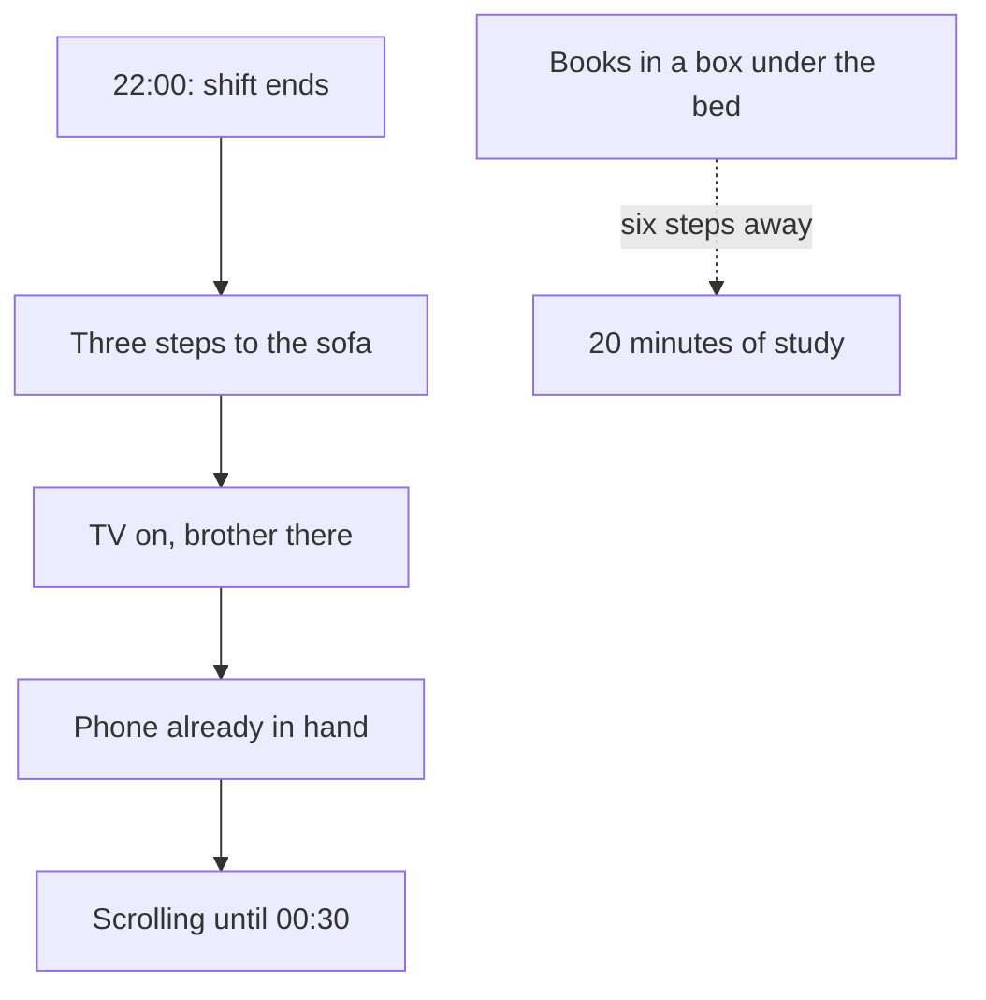

<BigWordAlert term="Arranging your surroundings" plainEnglish="Changing your place, your things and your timetable on purpose, so the habit you want is easy to start and the habit you do not want is harder to start." whyItMatters="Your surroundings start most of your habits. If you change them, you do not have to argue with yourself every evening." />

## An evening in Khaled's flat

Khaled is 26. He works in customer support for a small company abroad, answering customers' messages by chat and email. He works from home, in a shared family flat, and his shift runs from 16:00 to 22:00. That is morning and midday for the company's customers, and evening for him. His laptop sits on a small table in the corner of the main room. The sofa and the television are in the same room, three steps away. Khaled, his family and everyone else in this module are fictional.

The power comes in fixed hours, and the hours change from week to week. This week it is on from 14:00 to 22:00. Next week it may be on in the morning instead. On the weeks when the power is off during his shift, Khaled charges a battery pack in the power hours and runs his laptop and the router from it. The internet is weakest in the evenings, just when his shift is busiest. He has learned to type his replies offline and send them when the connection comes back. Nobody in the flat finds this strange. It is simply how the week works.

Khaled has a plan for his future. He wants to move from support into data work, so he is learning data analysis from two books and a free online course of short video lessons. His goal is 20 minutes of study a day. In the last four weeks, he studied on 5 days.

Here is one of his evenings. At 22:00 he closes the laptop. His back is stiff and his eyes are tired. He walks the three steps to the sofa, where his younger brother is watching a football match, and sits down. His phone is already in his hand, because he checked a work message a minute ago. He opens a video app "just for a minute". When he looks up, it is 00:30. His study books are still in a cardboard box under his bed, in the room he shares with his brother, who will soon want to sleep.

The next morning Khaled is annoyed with himself. "I am lazy," he tells a friend. "Tonight I will try harder."

```predict
prompt: "Khaled plans to 'try harder' next week, with the flat exactly as it is now. Before you read on, which change do you expect to help his study more?"
options:
  - id: book-on-table
    label: "Leave a book open on the table where he works"
  - id: firmer-promise
    label: "Make a firmer promise to study each night"
correctOptionId: book-on-table
explanation: "That fits what comes next. A firmer promise leaves every step in place: the phone stays in his hand and the books stay in the box. A book left open on his work table changes what he sees at 22:00 and cuts six steps to one. It does not guarantee anything, but it changes the question the room asks him every evening."
```

## The phone is always closer

Look at the evening again, as if you were drawing a map of it. The phone is in Khaled's hand. It needs no steps at all. The sofa is three steps from the table where his shift ends. The television is already on, and his brother is already there. Everything in the room points toward the phone and the sofa.

Now look at the study books. To start studying, Khaled has to walk to the bedroom and pull the box out from under the bed. Then he has to find the right book, find a pen and his notebook, clear a space on a table, and find enough light if the power is off. That is six steps before the first page, at the end of a long shift, next to a room where someone wants to sleep. Nothing in the flat points toward the books. He cannot see them, and he cannot reach them without getting up.

Khaled thinks his problem is his character. But every evening, the room asks him the same question: the phone in your hand, or six steps to a box under the bed? On a tired evening, the answer is easy to guess. This is not a story about a lazy man. It is a story about a flat that was arranged, without anyone meaning to, for scrolling and not for study.

## Why the room wins

The diagram shows Khaled's evening as a chain. Each solid arrow is a step that happens almost by itself. The dotted arrow is the study habit he wants, and it is far away from everything else.



What to notice: every solid arrow leads to the next one without a decision. The end of the shift leads to the sofa, the sofa leads to the phone, and the phone leads to scrolling. No step in that chain is hard. Each one is the easiest thing to do at that moment. The study box sits outside the chain, joined to it by nothing. So the evening ends at the phone, not because Khaled chose it, but because that is where the chain leads.

You met cues in module 1: the things in a situation that start a habit. Khaled's evening is full of them. The time is 22:00, the end of the shift. The place is the sofa. The people are his brother and the football match. The action he just finished is closing the laptop. All of them point the same way. When so many cues line up, "try harder" is a weak plan. He would have to beat all of them, every night, when he is most tired.

## A habit that lived somewhere else

There is one more fact about Khaled that matters. In his last year at university, he studied every evening for months. After his last lecture, he walked to the library corner, sat at the same desk by the window, and worked until the library closed. He did not need to push himself. The time, the desk and the quiet started the studying for him.

Then he finished university and started this job at home. The desk, the last lecture and the quiet were gone, and within a few weeks the study habit was gone too. Khaled did not suddenly become lazy. The cues that started his studying stayed behind in the library. His new home had different cues, and they started different habits.

This happens to everyone. A new home, a new shift, a new term or a different household can weaken good habits, because the situation that started them has changed. Chapter 3.2 shows what research found about this, and why the same change can also be a good moment to start something new.

## Why this matters for study and work

Many fellows study and work at home. The workplace, the family room and the bedroom may be the same few square metres. Every object in that space starts something. A phone on the table starts checking. A bed starts lying down. A television starts watching. If nothing in the room starts your study, everything else in the room starts first.

Power and internet add a second problem. A habit that only works with power and a fast connection will stop on the days they fail. If Khaled's only way to study is a video lesson, every evening with weak internet is an evening with no study. Planning for those days is part of designing your surroundings, and it is the subject of chapter 3.4.

Arranging your surroundings is the skill of noticing what they start, and changing it on purpose. It does not need money or special equipment. The tools of this module are small: a book left open on a table, a phone charging in another room, a lesson downloaded in the morning, a printed page by the window. It is also a kinder way to think. Instead of asking "what is wrong with me?", you ask "what in this room is starting this?" The second question has answers you can act on today.

## What this module covers

You will follow Khaled through three changes. First, you will learn to see the cues in a situation: the place, the time, the people and the action just before. You will also see why a change of situation is a chance to start a new habit. Second, you will learn to count the steps between you and an action, and to change them, so the good choice takes fewer steps and the unwanted one takes more. Third, you will give a habit three versions, so it keeps going when the power or the internet fails.

At the end, in the gate, you will redesign one place or routine for your own course habit and write its backup version. If you prefer not to use your own life, you can use Nada's vocabulary habit, which you met in module 2.

## Try it tonight

Before you go to bed tonight, look at the place where your evening usually ends: a sofa, a bed, a corner of a shared room. Write down what is within one step of your hand, and what you want to do that is many steps away. Do not change anything yet. Just see the map. If you prefer not to look at your own room, draw the map of Khaled's flat from this story instead.

<LearningObjectives items={["Find the place, time, people and earlier action that start a habit", "Use a change of situation as a chance to start a new habit", "Count the steps to start a behaviour, and make the good choice easier and the unwanted one harder", "Give a habit a full, a backup and a smallest version for days with no power or weak internet", "Redesign one place or routine for your course habit, or for a provided case"]} />

## Key words

| Word | Plain English |
|---|---|
| **Context cue** | A cue that comes from your surroundings: a place, a time, other people, or the action you just finished |
| **Chain of cues** | A row of small actions where each one starts the next, so one early cue can lead a whole evening |
| **Steps to start** | The number of small actions you must do before a behaviour can begin |
| **Window** | A time after a big change when old habits are weaker and a new habit is easier to start |
| **Backup version** | A shorter version of a habit that still works when the power or the internet is off |

## What is in this module

| Chapter | You will practise |
|---|---|
| 3.2 | Finding the cues in a place, a time, people and the action before, and using a change of situation |
| 3.3 | Counting the steps to start, and making the good choice easier and the unwanted one harder |
| 3.4 | Writing a full, a backup and a smallest version, and "if there is no power" plans |
| 3.5 | A practice check with five short cases |
| 3.6 | Redesigning one place or routine for your course habit, or for Nada's |

**Next:** Places, times and people as cues: what really starts Khaled's evening, and which link in the chain to change first.
