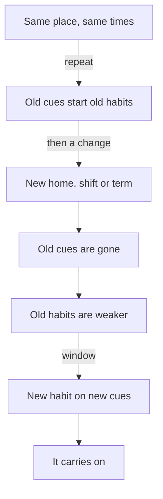

## Three evenings, written down

After the bad night that ended at 00:30, Khaled tries something different. He does not promise to try harder. For three evenings, he writes down exactly what happens in the ten minutes after his shift ends, as if he were watching someone else.

His notes are almost the same each night. "22:00, shut the laptop. Stood up, back hurts. Sat on the sofa. Brother watching football. Phone in my hand already. Opened videos." On the third night he adds one more line: "Did not decide anything. It just happened."

That last line is the most useful thing he has written. Khaled is not choosing to scroll each night. Something in the situation is starting it for him. This chapter is about finding that something, and changing it.

## The idea in plain words

You met the cue in module 1: the thing that starts a habit. Most cues are not inside your head. They are in the situation around you. Psychologists who study habits, such as Wendy Wood, list four kinds that come up again and again. A cue can be a **place** (the sofa, the desk, the bus stop), a **time** (22:00, the end of a shift, after lunch), **other people** (a brother watching football, a friend who always calls at 21:00), or **the action you just finished** (closing the laptop, washing a cup, finishing a prayer). This module calls these context cues: cues that come from your surroundings.

Cues rarely come alone. In a real evening they line up in a chain. Each small action becomes the cue for the next one. Closing the laptop starts standing up. Standing up near the sofa starts sitting down. Sitting down with the phone in hand starts opening an app. Nobody planned the chain. It grew because the same actions happened in the same order, in the same place, night after night.

This has a hopeful side. If a chain runs your evening, you do not have to fight every link. You can change one early link, and the rest of the chain changes with it, because the later cues never appear.

## What research found

Habit researchers have shown many times that habits live in places and times. In one study of regular exercisers, about 90 percent had a place or a time that started their exercise. The habits were tied to the situation, not only to the person.

That is why a change of situation shakes habits loose. In one study, students who moved to a new university found that their habits, such as exercising, were disrupted. The exception was students whose new setting kept similar cues. Researchers such as Wendy Wood and Bas Verplanken have shown this pattern again and again. When your place or your timetable changes, your habits are shaken, the good ones and the bad ones.

Researchers call this idea <GlossaryTerm term="habit discontinuity" definition="The research name for what happens when a big change in your situation removes old cues, so old habits are weaker for a while." />. It has a second half, and it is the more useful half. A change of situation is also a chance. When old cues disappear, it is easier to start a new habit. In a field experiment with 800 people in an English city, a programme that encouraged more environmentally friendly everyday habits worked better for people who had recently moved house. The window seemed to last about three months after the move.

A later study looked at people during a time when many people had to stay at home. Old exercise habits dropped, especially strong ones. But habits that people built in the new situation carried on to the end of that time. In plain words: a change weakened old habits, and new habits built in the new situation lasted.

One last finding is a warning. Old habits are not erased when the situation changes. If the old cues come back, the old habit can come back with them.

## Find the earliest link

Khaled's notes show a chain with four links: the shift ends, he sits on the sofa, the phone is in his hand, he scrolls. He wants to change one thing. Before you step through his evening, decide which change you expect to do more.

```predict
prompt: "Khaled will change one thing about his evening. Which single change do you expect to change more of what happens after 22:00?"
options:
  - id: stop-after-30
    label: "Put the phone down after 30 minutes of scrolling"
  - id: change-where-he-sits
    label: "Change where he sits when the shift ends"
correctOptionId: change-where-he-sits
explanation: "Putting the phone down after 30 minutes means fighting the last link, when the chain is already running and he is deep in the app. Changing where he sits changes the first link, so the later cues (the sofa, the match, the phone in hand) never line up. Both changes could help a little, but the early one changes the rest of the evening."
```

Step through Khaled's evening below. Notice which cue each step adds, and what happens to the rest of the chain when the first link moves.

<InteractiveCanvas slug="khaled-evening-cues" />

**What this shows:** a chain of context cues (the time, the action just finished, the place, the people, the phone in hand) that runs Khaled's evening, and a new chain that starts when he changes where he goes at 22:00. **Try this:** at step 4, before you go on, say which cues of the old chain will now never appear. **What changed:** when the first link moved from the sofa to the table, the sofa, the match and the phone in hand stopped being the first things he met, and the open book became the next cue. **Limits of the model:** a real evening has more cues than six boxes can show, and the new chain will not work every night; people cues, like a brother calling him to watch a match, can still pull him back.

## The worked example: Khaled's new chain

Here is how Khaled turned his notes into a plan, step by step.

**Step 1: list the cues in the old chain.** From his three evenings, he wrote down every cue he could find. Time: 22:00, the end of the shift. Action just finished: closing the laptop. Place: the sofa, three steps away. People: his brother and the football match. Object: the phone, already in his hand. Five cues, all pointing the same way.

**Step 2: find the earliest link he can change.** He cannot change when his shift ends, and he does not want to stop his brother watching football. But he can change where he goes in the first minute after 22:00. That is the earliest link in his control.

**Step 3: write the new chain.** He writes an if-then plan, the kind you met in module 2: "When I close the laptop at 22:00, I stay at the table and open the book I left there." The new first link is staying at the table. The cue for the next link is the open book, so before his shift starts, he leaves the book open at the right page beside the laptop.

**Step 4: check the plan against his real week.** The power hours change every week, and some weeks the power goes off at 20:00. So he keeps a small rechargeable lamp next to the laptop and charges it during the power hours. The football matches are on most evenings, but they will still be on in 20 minutes. He tells his brother, "I will join you at 22:20," so the people cue waits for him instead of pulling him.

**Step 5: test it, and count.** In the first week, in this example, Khaled studied on 4 of his 5 work evenings. On the fifth evening a customer problem ran late, he closed the laptop at 22:40, and the old chain took over. He does not count that as failure. It tells him something useful: his new chain depends on the shift ending on time. He adds one line to his plan: "If the shift runs late, I read one page, then stop."

## A change of situation is a window

The second half of this chapter's idea is about change. Fellows' homes, shifts and terms change often. A family moves to a relative's flat, a job changes its hours, a new term brings new lectures. Each change breaks some old cues. Good habits can be shaken loose, and that is normal. A habit that faded after a move was not fake. It was tied to the old place, and it needs rebuilding in the new one.

The same change opens a window. Think of Sara, a 23-year-old tailor's assistant, whose family moved to a flat across town. In the old flat, she always watched videos on the bus home. In the new flat, she walks home for 15 minutes instead, and the bus habit simply disappeared. In her first week, she chose a new habit for the new walk: she listens to one downloaded English lesson on the way. There was no old habit to fight on that walk. By the end of the month, putting on her earphones as she left the shop already felt easier than it did in the first week.

The diagram shows why a change works this way. Read it from the top.



A change removes the old cues, so old habits lose their starting signal for a while. That gap is the window. If you tie a new habit to a cue in the new situation in the first weeks, the research above suggests it can last. If you wait until life "feels settled", the window may close, and new unwanted habits may fill it instead. This is not a reason to welcome hard changes. It is a reason, when a change comes anyway, to use its first weeks on purpose.

## Where people go wrong

A common mistake is to see only one cue. Khaled first thought his problem was the phone. His notes showed five cues, and the phone was the last of them. If you list only the obvious cue, you will try to fight the strongest link instead of moving an easier, earlier one.

A second mistake is to change the last link with willpower: "I will scroll for only 30 minutes." By then the chain is already running. Change a link near the start, before the later cues line up.

A third mistake is to expect habits to survive a move or a new timetable without help. If a good habit fades after a change, treat it as information, not as proof that you cannot keep habits. Find what the old cue was, and choose a new cue in the new place. Remember the warning too: when an old cue returns, such as visiting the old flat or going back to an old shift, an old habit can return with it.

<Callout type="tip" title="Rebuilding is normal">
After a move or a new timetable, expect to rebuild good habits. Pick one, tie it to a cue that happens every day in the new place, and start small.
</Callout>

## Try it today

Choose one habit, wanted or unwanted. Tonight, watch the ten minutes before it starts, and write down four things: the place, the time, the people, and the action you just finished. Then circle the earliest link you can change. You do not need to change it yet. If you prefer not to watch your own evening, use Khaled's notes from the start of this chapter, and find a different early link from the one he chose.

## Check your understanding

```quiz
type: mcq
question: "Tamer drives a water delivery round. He wants to stretch his back for 5 minutes a day. His round always ends at 14:00 at the depot, where he parks, then eats lunch in the cab with two other drivers, then drives home and lies down. Stretching at home in the evening worked on 2 of 14 days. Which plan uses the cues in his day best?"
options:
  - "Stretch beside the truck as soon as he parks at 14:00"
  - "Stretch at home in the evening, with a phone alarm"
  - "Stretch whenever he remembers during the round"
  - "Stretch at home after his rest, once he feels ready for it"
correct: 0
explanations:
  - "Right. Parking at the depot at 14:00 is a place, a time and an action just finished, and it happens every working day. It is also the first link of his afternoon, before lunch and the drive home can start a different chain."
  - "This is the plan that already worked on only 2 of 14 days. An alarm helps him remember, but it does not give him a cue in the situation."
  - "'Whenever he remembers' is not a cue. Nothing in the situation starts it, so it will depend on memory on a busy round."
  - "'Once he feels ready' is a feeling, not a cue. After lying down at home, the easiest next step is to keep resting."
```

```quiz
type: mcq
question: "Lama is a nurse. Next month she starts at a new clinic. Her bus ride grows from 5 minutes to 30, and her shift starts at 7:00 instead of 9:00. She wants to start reading English every day. Her old plan was to read at 8:00 at the kitchen table. What does this chapter suggest?"
options:
  - "Wait until the new job feels settled, after a few months"
  - "Keep the old plan of reading at 8:00 at the kitchen table"
  - "Start in the first weeks, tied to the new bus ride"
  - "Start next year, when her life will be less busy"
correct: 2
explanations:
  - "The window after a change seemed to last about three months in one study. Waiting until things feel settled may let it close, and other habits may fill the new bus ride."
  - "From next month she will already be at work at 8:00, so the old plan's time cue disappears."
  - "Right. The change removes old cues and brings a new one: a 30-minute bus ride every working day. Starting in the first weeks uses the window while no old habit owns that ride."
  - "There is no reason to expect a calmer time next year, and waiting throws away the window that the change opens now."
```

**Next:** Friction: count the steps between Khaled and his book, and between Khaled and his phone, and see what happens when the numbers change.
