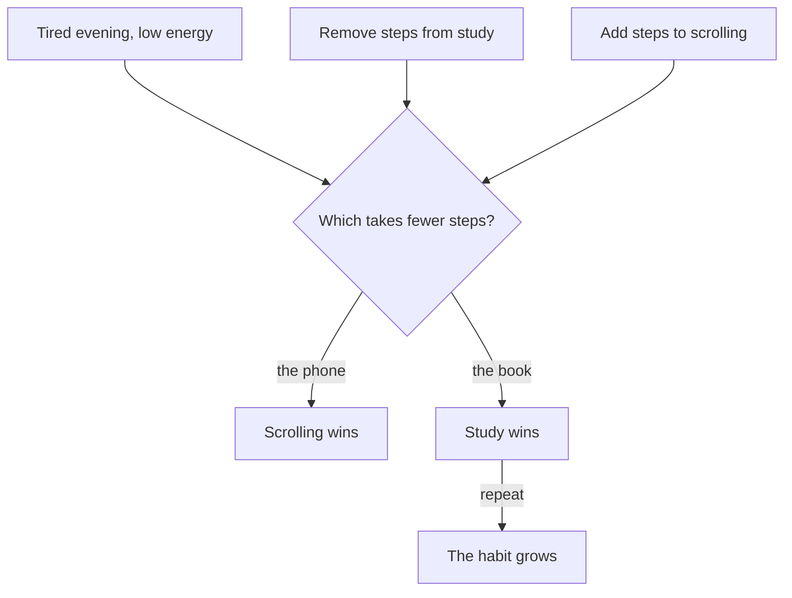

## Counting steps on a napkin

Khaled's first week with his new evening chain went well: he studied on 4 of his 5 work evenings. On Friday he meets an old friend from university at a bakery near the market and tells him about it. His friend is pleased, but he asks a strange question. "Before the change, how many things did you have to do before you could read the first page?"

Khaled counts on a napkin. Walk to the bedroom. Pull the box out from under the bed. Find the right book. Find a pen and the notebook. Clear a space on the table. Find light if the power is off. Six steps. "And the phone?" his friend asks. Khaled laughs. "Zero. It was already in my hand."

His friend turns the napkin over. "And now?" Khaled counts again. The book waits open on the table, with a pen inside it and the lamp beside it. He switches on the lamp and picks up the pen. Two steps. The phone is still in his hand at the end of his shift, so it still needs zero.

```predict
prompt: "Studying now takes Khaled 2 steps instead of 6. The phone still takes 0. Compared with before the change, what do you expect on his tired evenings?"
options:
  - id: more-tired
    label: "Study wins on more tired evenings than before"
  - id: same-tired
    label: "Study wins on about as many tired evenings as before"
correctOptionId: more-tired
explanation: "That is what the friction idea predicts. The phone still has fewer steps, so it will still win on some evenings. But studying used to need 6 more steps than scrolling and now needs only 2 more, so the gap a tired person has to push through is much smaller. Tired evenings are exactly where a few steps decide the choice."
```

## Steps against energy

Before his change, Khaled had kept a short note of his energy after each shift for 10 evenings, on a scale of 0 to 10. In this example, the numbers were 3, 5, 1, 4, 8, 3, 5, 2, 7 and 4. Six of those evenings were tired ones, with energy of 4 or less.

The canvas below uses a toy rule, which means a very simple made-up rule, not real data. The rule: on each evening, he studies when the extra steps that studying needs, compared with scrolling, are no more than his energy that evening. Start with the old flat (6 steps to study, 0 to scroll), then try your prediction.

<InteractiveCanvas slug="steps-to-start" />

**What this shows:** how the gap between the steps to study and the steps to scroll decides, in the toy rule, which option wins on each of 10 evenings with different energy.

**Try this:** lower the steps to study from 6 to 2 and watch the tired evenings; then put study back to 6 and raise the steps to scroll from 0 to 3.

**What changed:** making study easier and making scrolling harder both shrink the gap, and the tired evenings are where the result moves most.

**Limits of the model:** the toy rule is an illustration, not a research finding. Real evenings depend on much more than steps.

## The idea in plain words

Every behaviour has a cost before it starts: the walking, finding, opening, unlocking and setting up you must do first. This chapter calls that number the steps to start, from the key words in chapter 3.1. When you have energy, a few extra steps do not matter much. When you are tired, distracted or busy, they matter a lot. On those moments, the option with fewer steps tends to win, whatever you planned.

<BigWordAlert term="Friction" plainEnglish="The small extra effort, steps, time or distance between you and an action." whyItMatters="Adding or removing a little of it changes what you do on tired days, without arguing with yourself." />

Wendy Wood, a psychologist who studies habits, calls these small costs "friction". The idea gives you two ways to act, not one. You can make the good choice easier by removing steps: the book open on the table, the lesson already downloaded, the notebook and pen in one place. And you can make the unwanted choice harder by adding steps: the phone charging in another room, an app logged out, a video app moved off the home screen. This course uses the plain words "easier" and "harder" for these two ways.

Making something harder does not make it impossible. Khaled can still walk to the bedroom and get his phone. It only changes which option is easiest at the moment of choice. Because habits are started by the situation, with little thought, the easiest option is often the one that happens.

## What research found

Small changes in distance and effort change what people do, but usually by a modest amount, not by magic. Be careful with anyone who promises that one change to your room will transform your life.

One clear study comes from phones. Researchers gave 280 people an app that added a short pause, and a choice to close the app, before certain social media apps opened. Over six weeks, the people using it opened those apps less than half as often as before. A follow-up online experiment tested the parts separately. The pause and the easy way to close the app worked. A message that only asked people to think about what they were doing did not.

That result matters for this chapter. The parts that worked added a small cost: a few seconds of delay and an easy exit. The part that failed was a request to think harder. On tired evenings, thinking harder is exactly what is hard to do. Changing the steps helps on the days when good intentions do not.

## The worked example: two ways, step by step

Here is the reasoning behind Khaled's numbers, one step at a time.

**Step 1: count the steps to the good choice.** Before the change, studying took 6 steps. After the change, it takes 2: switch on the lamp, pick up the pen. He removed 4 steps by doing the setting up earlier in the day, when he had energy, instead of at 22:00, when he had none.

**Step 2: count the steps to the unwanted choice.** Scrolling took 0 steps, because the phone was in his hand. That is the hardest number to beat: nothing is easier than nothing.

**Step 3: find the gap.** Before the change, studying needed 6 more steps than scrolling. In the toy rule, he studies only when his energy is at least the gap. Only 2 of his 10 evenings had energy of 6 or more, so he studied on 2. None of those was a tired evening.

**Step 4: shrink the gap from the good side.** With the book open on the table, the gap is 2. Now every evening with energy of 2 or more is a study evening: 9 of 10, including 5 of the 6 tired ones. The only evening he misses is the one with energy of 1.

**Step 5: shrink the gap from the unwanted side.** Khaled tries a second change. He puts his phone on its charger on the bedroom shelf when his shift ends, and logs out of the video app. Getting back to it now takes 3 steps: walk to the bedroom, unplug the phone, log in again. With study back at 6 steps for a moment, the gap is 3, and he studies on 8 of 10 evenings. With both changes, studying takes fewer steps than scrolling, and the toy rule says he studies every evening.

**Step 6: check the result against reality.** The toy rule says 10 of 10. Khaled's real week will not look like that, and it does not need to. Remember that the research found modest effects. What the numbers show is the direction. Each step removed from the good choice, and each step added to the unwanted one, helps most on the tired evenings. Those were exactly the evenings he used to lose.

The diagram shows how the two ways work together.



Both changes feed the same question: on a tired evening, which option takes fewer steps? You do not have to choose one of them. Each study win is also one more repetition in the same place, and repetition is what builds the habit, as module 1 showed. So a change in steps does two jobs: it helps tonight, and it helps the habit grow for next week.

## Where this goes wrong

A common mistake is to add steps to the good habit by accident. In a shared flat, the table where Khaled works is also where the family eats. If someone tidies his book away before dinner, his 2 steps become 6 again. His answer is small: a shallow box at the corner of the table that holds the book open, the pen and the lamp, and that nobody needs to move. In a shared home, plan where your things can stay without getting in anyone's way.

A second mistake is a change that is too easy to undo. A phone on silent in your pocket is still 0 steps away. A change works when it really adds steps at the moment of choice: another room, a logged-out app, a charger on a high shelf.

A third mistake is expecting magic. Changing the steps shifts the odds; it does not decide for you. Some evenings you will still walk to the bedroom for the phone. That is normal, and it does not mean the change failed. Count over a week, not over one night.

A last point is about other people. In a shared home, make your own choices harder, not your family's. Logging out of your own video app is fair. Hiding the family's television remote only moves the problem onto someone else.

## Try it today

Choose one habit you want and the option that usually beats it. Tonight, count the steps to start each one, on paper. Then make one change in each direction: remove one step from the good choice (set it out now, while you have energy) and add one step to the unwanted choice. If you prefer not to look at your own evening, count the steps in Khaled's old flat, and find a different step he could have removed.

## Check your understanding

```quiz
type: mcq
question: "Iyad, a computer science student, wants 15 minutes of code practice after breakfast. His laptop lives in a bag under his bed: 4 steps to set up. His phone charges beside his pillow: 0 steps. On 9 of the last 10 mornings, he opened the phone first. Which change gives the code practice the best chance?"
options:
  - "Promise himself to open the laptop before the phone each morning"
  - "Set a phone alarm after breakfast with the words 'code first'"
  - "Charge the phone across the room and leave the laptop open on the desk"
  - "Move the laptop bag to the desk but keep the phone beside his pillow"
correct: 2
explanations:
  - "A promise changes no steps. The phone is still 0 steps away and the laptop still 4, and that choice already went to the phone on 9 of 10 mornings."
  - "The alarm rings on the phone itself, which puts the unwanted option straight into his hand. It reminds him, but it does not change the steps."
  - "Yes. This changes both sides: the laptop drops to about 1 step and the phone rises to several, so code practice now takes fewer steps than the phone."
  - "This helps a little, since the laptop is closer, but the phone stays at 0 steps beside his pillow, so it still wins on a tired morning."
```

```quiz
type: mcq
question: "Sara, the tailor's assistant, checks messages about 30 times during her four sewing hours, and her work is slow. Her phone lies on the sewing table. She wants fewer checks. Using what this chapter teaches about friction, which change is most likely to help?"
options:
  - "A lock screen message that asks her 'Do you really need this?'"
  - "Keep the phone on the table, and check it only once an hour"
  - "Keep the phone in a drawer in the back room while she is sewing"
  - "Turn the sound off but leave the phone face up on the table"
correct: 2
explanations:
  - "In the phone study, a message that asked people to think did not work. The parts that worked added a small cost: a delay and an easy exit."
  - "This is a promise with no change in steps. The phone stays 0 steps away for four hours, on the table in front of her."
  - "Right. A drawer in another room adds real steps and a short delay before every check, the same kind of small cost that worked in the phone study."
  - "With the screen face up, every new message still lights up in front of her. The phone is just as easy to pick up as before."
```

**Next:** When the power and the internet fail: give a habit a full, a backup and a smallest version, so a hard day does not break it.
