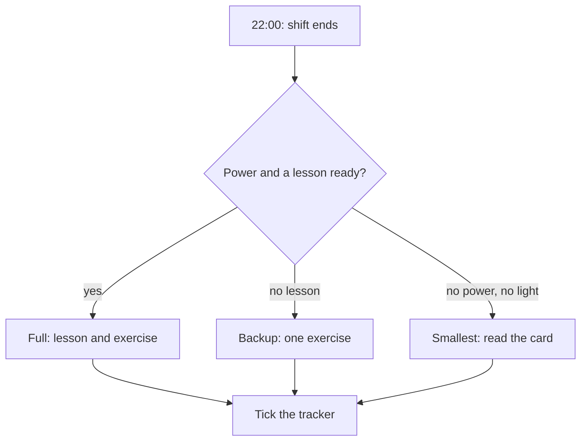

## The circle that kept spinning

Khaled's new evening chain worked for two weeks. The book waited open on the table, the phone charged in the bedroom, and most evenings he studied for 20 minutes. Each evening's study was the same: one short video lesson from his course, then the matching exercise in his workbook.

Then came a harder week. Monday was a normal evening, and he studied. On Tuesday the internet was weak. At 22:00 he opened the course page and pressed play, and the circle in the middle of the video spun and spun. After ten minutes he closed the laptop. "No study tonight," he thought. On Wednesday the new power schedule started, with power only from 06:00 to 14:00, so the evening was dark apart from his phone. Thursday was the same. By Friday he had not studied for three days, and he noticed that the old chain was creeping back: the sofa, the phone, 00:30.

Nothing was wrong with Khaled's plan on a normal evening. The problem was that his habit had only one version, and that version needed power and a good connection at the same moment. In his flat, that moment does not come every evening. Imagine the same four evenings again, but with three versions of his habit. One is the full lesson. One is shorter, from the workbook, and needs no internet. One is tiny and needs no power.

```predict
prompt: "Think of the same four evenings: one normal, one with weak internet, two with no power. Which habit do you expect to be easier to keep going into next week?"
options:
  - id: one-version
    label: "The one-version habit, after a few evenings of rest"
  - id: three-versions
    label: "The three-version habit, done in some form every evening"
correctOptionId: three-versions
explanation: "Yes. The one-version habit was done on 1 of 4 evenings and ends with a gap of three days, so next week starts with a restart. The three-version habit was done on all 4 evenings, even though two of them were small, so the cue was met every evening and there is nothing to restart. Rest is not the problem; the long gap is."
```

The canvas follows those four evenings twice: once with three versions, and once with only one. Watch which version Khaled picks each evening, and what the tracker says at the end of each row.

<InteractiveCanvas slug="power-cut-backup-plan" />

**What this shows:** one habit with three versions that keeps running through weak internet and no power, and goes back to the full version when conditions return, next to the same habit with only one version.

**Try this:** at step 3, ask what Khaled needed the day before to make the smallest version possible tonight.

**What changed:** with three versions, the tracker reads 4 of 4 evenings; with one version, it reads 1 of 4, with a gap of three days before he can start again.

**Limits of the model:** real weeks are messier, and some evenings even the smallest version will not happen. The versions keep most evenings going, not every evening.

## The idea in plain words

A habit with one version is fragile. If the version needs power, internet, a quiet room and 20 minutes, then any day that is missing one of those things is a day without the habit. A habit with three versions is sturdy. The **full version** is the habit on a normal day. The **backup version**, from the key words in chapter 3.1, is for days with no power or no internet. The **smallest version** is the floor for the hardest days.

In module 2, the smallest version was the size a new habit starts at. Once a habit has grown, as Khaled's has, its normal size becomes the full version. The smallest version stays below it as the floor, for days with no power, no light and no energy. It still counts.

All three versions start from the same cue. That is the important part. On a hard evening, Khaled does not skip his cue and wait for a better day. He meets the same cue at 22:00, and he chooses the version that fits the evening. The habit keeps running, even when it is small.

There is a second part: preparation. Most backup plans depend on something you do while the power is on. You download tomorrow's lesson. You charge the lamp. You write a summary card. Good backup versions are planned on good days for the bad ones.

## What research found

Habits depend on stable situations. When the situation changes, habits wobble. That is normal, not a personal failure.

In a study during a time when many people had to stay at home, strong exercise habits fell the most when daily life changed. Habits that people rebuilt in the new situation predicted how active they were later. The people who kept going were the ones who kept doing the behaviour, and who did it for their own reasons.

Research also shows that everyone falls back on habits when energy or motivation is low. That is why it helps to build good habits before hard days, and to have a very small version ready for them. On a tired, dark evening, you will do whatever is easiest. The smallest version makes the good habit easy enough.

Finally, if-then plans, which you met in module 2, can name obstacles as well as opportunities. "If there is no power at 22:00, then I read my summary card" is an if-then plan for a hard evening. You make the decision once, in advance, so you do not have to make it in the dark.

## The worked example: Khaled's three versions

Here is how Khaled built his plan, step by step.

**Step 1: write the full version and what it needs.** One video lesson and its exercise in the workbook, 20 minutes. It needs a charged laptop, a lesson that plays, light, and some energy.

**Step 2: write a backup version that needs less.** One exercise from the workbook, 10 minutes, by the rechargeable lamp. It needs no internet and no laptop. It only needs the lamp to be charged, and the workbook on the table.

**Step 3: write a smallest version that needs almost nothing.** Read yesterday's summary card, 2 minutes. At the end of every full or backup session, Khaled now writes three lines on a small paper card: what the lesson was about, one formula, one question he still has. Reading the card needs no power at all: the phone torch, or a candle, is enough. It is a paper backup of his own learning.

**Step 4: write the if-then lines for hard evenings.** "If the lesson will not load at 22:00, then I do one exercise from the workbook." "If there is no power and the lamp is flat, then I read yesterday's card." These lines decide in advance, so the hard evening only needs one choice: which line am I on tonight?

**Step 5: plan the preparation.** "When the power comes on, I download the next three lessons and charge the lamp." This one line makes the full version possible on many evenings with weak internet, because a downloaded lesson plays without a connection. It also keeps the backup version ready. Khaled ties it to a cue that happens every power period: plugging in his battery pack.

**Step 6: plan the return.** "On the first evening with power and a downloaded lesson, I go back to the full version." Without this line, the smallest version can quietly become the only version. The backup and smallest versions are there to carry the habit through a hard patch, not to replace it.

When Khaled checks the plan against the week that broke his habit, the numbers change. Monday was a normal evening: full version. Tuesday had weak internet, and he had not downloaded the lesson: backup version, 10 minutes. Wednesday had no power and a flat lamp: smallest version, 2 minutes. On Thursday he charged the lamp in the morning: backup version again. Four evenings done out of four, where the one-version habit had managed one.

The diagram shows the choice Khaled makes at his cue each evening.



Every road ends at the same box: a tick on the tracker. That is the point of the three versions. The cue is met every evening, and the habit gets its repetition, whatever the evening brings. The size of the action changes; the habit does not stop.

## Traps to watch for

A common mistake is a backup that needs the same thing as the full version. "If the video will not load, I will watch a shorter video" fails on exactly the evenings it is meant for. A backup must remove what the hard day takes away: no internet, no power, or no time.

A second mistake is a smallest version that is still too big. "Read ten pages by candlelight" is not small on a tired evening. If you would skip it on your worst day, shrink it until you would not.

A third mistake is waiting for good conditions. "I will study properly when the power schedule is better" can mean waiting for weeks. As module 1 showed, one missed day did not undo progress in the research. A longer gap makes the next start harder, and the smallest version keeps the gap from growing.

A fourth mistake is the opposite: staying small for a long time. When the power and the internet come back, go back to the full version at the very next cue. Do not wait for Monday or for a new month.

The last mistake is forgetting preparation. Most hard evenings are only hard because of something not done earlier: the lesson not downloaded, the lamp not charged, the card not written. Tie the preparation to a cue in the power hours, so it happens by itself.

<Callout type="tip" title="Small still counts">
On a hard evening, a very short version done at the usual cue keeps the habit going. Tick it on your tracker as done, with a note saying which version.
</Callout>

## Try it today

Take one habit you want to keep, or Khaled's study habit if you prefer. Write three lines: the full version, a backup version that needs no internet or no power, and a smallest version that takes a few minutes at most. Then write one preparation line that starts with "When the power comes on, I...". Check the backup and smallest versions against your hardest evening this month. If you would still skip them, make them smaller.

## Check your understanding

```quiz
type: mcq
question: "Lama, the nurse, listens to a 15-minute English lesson on her bus to the clinic. Half of the ride has no phone signal. This week the power at home is on from 18:00 to 02:00. She keeps paper notes from past lessons in her bag. Which set of versions fits these facts best?"
options:
  - "Full: a downloaded lesson. Backup: a streamed short lesson. Smallest: three words aloud."
  - "Full: a downloaded lesson. Backup: her paper notes. Smallest: three words aloud."
  - "Full: a downloaded lesson. Backup: her paper notes. Smallest: a full lesson on Friday."
  - "Full: a streamed lesson. Backup: her paper notes. Smallest: three words aloud."
correct: 1
explanations:
  - "The full and smallest versions fit, but a streamed backup needs a signal, and half of the ride has none. The backup would fail on exactly the days it is for."
  - "Right. The lesson can be downloaded at home in the power hours, the notes need nothing, and saying three new words aloud needs no light or signal. All three start from the same cue: the bus ride."
  - "A full lesson on Friday is not a smallest version. It is bigger, and it moves the habit away from its daily cue, the bus ride."
  - "A streamed full version stops when the signal drops, which happens on half of every ride. She can download the lesson at home in the evening power hours instead."
```

```quiz
type: mcq
question: "Hiba, a freelance graphic designer, draws after the evening meal. Full: a 30-minute lesson. Backup: 15 minutes by a battery lamp. Smallest: copy one full page of a drawing book. Last week: full on 3 evenings; skipped on 4 very tired evenings, each noted 'too tired for a whole page'. Which change fits her week?"
options:
  - "Move the habit to the morning, when she has more energy"
  - "Add a phone alarm after the meal to remind her to draw"
  - "Shrink the smallest version to one quick sketch of a cup"
  - "Make the backup longer, so she can catch up on good days"
correct: 2
explanations:
  - "Her cue after the evening meal worked on the other evenings. Moving it gives up a working cue, and her notes blame the size of the task, not the time."
  - "She did not forget: her notes say she was too tired for a whole page. A reminder does not make the task smaller."
  - "Yes. Every skipped evening has the same note: a whole page was too much. A smallest version that a very tired person would still do keeps the cue met on those evenings."
  - "A longer backup makes hard evenings harder, and catching up on good days does not keep the daily cue going."
```

**Next:** A practice check with five short cases on cues, friction and backup versions.
