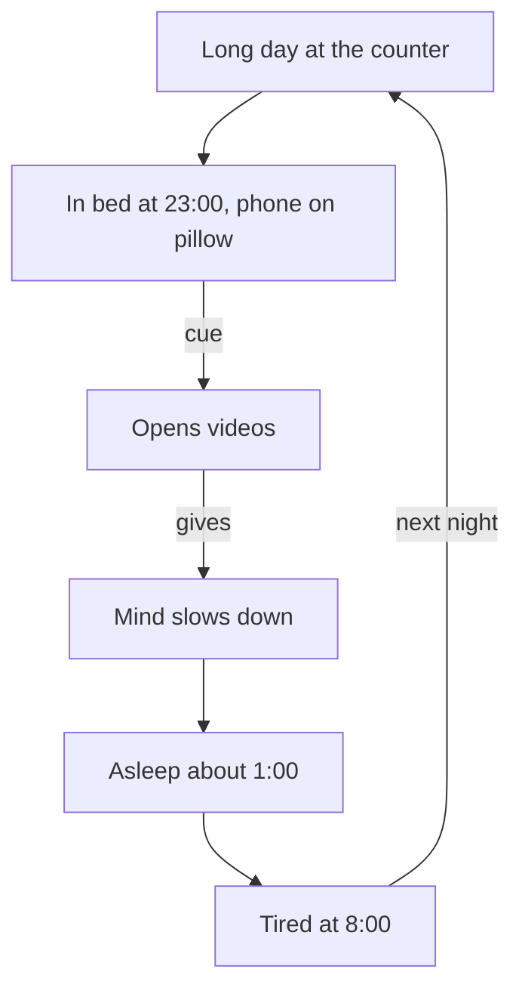

<BigWordAlert term="Unwanted habit" plainEnglish="A habit that a situation starts for you, which you would rather not do, because it costs you sleep, money, time or focus." whyItMatters="An unwanted habit runs on cues, just like a good one. So the tools that build habits can also weaken one, without a nightly fight." />

## Maha's nights

Maha is 25. She works at the counter of a neighbourhood pharmacy, and her shift starts at 8:00. All day she reads prescriptions, finds boxes on high shelves, explains doses to worried parents and counts change. It is work that needs care. A wrong box or a wrong dose matters. Maha, her family and everyone else in this module are fictional.

Her evenings are full too. She helps her mother with dinner, sits with her younger sisters while they finish their homework, and talks with her father about the day. By 23:00 the flat is quiet. Maha lies down in bed, and her phone lies on the pillow beside her, plugged into its charger. The charger is there because the phone is also her alarm clock.

"Just a few videos," she tells herself. The first video is funny. The second is about a recipe. The third starts before the second has finished. Most nights, when she finally puts the phone down, it is about 1:00. Her alarm goes off at 6:45. At the counter the next morning, she reads each prescription twice to be sure, and by 11:00 her eyes feel heavy.

Maha does not think scrolling is a crime. She enjoys some of the videos, and she has learned a few useful things from them. But she does not like what it costs her: tired mornings, slow afternoons and a feeling of having lost time she never decided to spend.

## What she has tried

Maha has tried to change. One Sunday she promised herself: "From tonight, the phone goes down at 23:30." It worked on Sunday. On Monday she stopped at 00:15. By Wednesday she was back to 1:00.

On another Monday she deleted the video app completely. That night she lay in the dark for a while, then opened a different video site in her phone's browser. On Tuesday she installed the app again, "just for one video a friend sent". By the weekend, nothing had changed except that she felt worse about herself. "I have no willpower," she told her sister. "Other people can stop. I cannot."

Before you read on, think about her two attempts.

```predict
prompt: "Maha deleted the video app on Monday, and the phone stayed on her pillow. Before you read on: if she deletes it again next week, do you expect it to stay deleted?"
options:
  - id: probably-not
    label: "Probably not, the cue and the need are still there"
  - id: probably-yes
    label: "Probably yes, without the app she cannot scroll videos"
correctOptionId: probably-not
explanation: "Deleting the app removed one route to the videos, but everything that starts the habit stayed: lying in bed at 23:00, tired, with the phone on the pillow and a mind that wants to slow down. The browser offered another route on the same night, and a friend's video brought the app back. When the cue and the need stay, the habit looks for a way through."
```

## Why promises and deleting did not last

Both of Maha's attempts aimed at the moment of scrolling itself. The promise asked her to stop in the middle of the habit, at 23:30, when she was already tired and already watching. Deleting the app took away one tool, but it left the situation exactly as it was. The diagram shows that situation as a loop.



What to notice: the loop has a cue (lying in bed at 23:00 with the phone on the pillow), a routine (opening videos) and something the routine gives her (her mind slows down after a busy day). You met these parts in module 1 as the cue, the routine and the reward. The promise attacked the routine at its strongest point. Deleting the app removed one way to do the routine. Neither touched the cue, and neither offered another way to meet the need. So the loop kept turning. A tired morning even makes the next night more likely, because a tired person reaches for the easiest way to switch off.

This is the main idea of the module. An unwanted habit is not a sign of a weak person. It is a loop that a situation starts, and it gives you something real. To weaken it, you work on the situation and the need, not only on the moment of giving in.

## Weaken, not erase

It helps to be honest about what this module can and cannot do. Habit research has found that old habits are not erased. The link between a cue and a routine stays in memory, even after years. When the old cue comes back, the old habit can come back with it. So the goal of this module is to weaken a habit: to meet its cue less often, to put a better routine in its place, and to catch it early when it starts. A weakened habit still knocks on the door sometimes. You simply open it less often.

This is also why one bad night does not mean the plan has failed. If Maha changes her nights and then, one evening, finds herself scrolling at 00:30, the old habit has not won. It has shown her which cue is still in place. In chapter 4.4 you will see how she handles a night like that: she notices, acts, writes one line about what happened, and goes back to her plan the next night.

Look at what her nights cost in plain numbers, too. If she falls asleep at about 1:00 and the alarm rings at 6:45, she sleeps for less than six hours on most nights, before a day of careful work. Nobody needs a lecture to see that this is a cost worth reducing. The question is how, and the answer is not "try harder".

## A word about willpower

Maha's sister told her, kindly, that she just needed more discipline. Many people believe this, and many AI chat tools and social media posts repeat it. Chapter 4.2 looks at what research really found about willpower. The short version is hopeful: people who seem very disciplined mostly do not win by resisting harder. They have arranged their days so that they face fewer temptations in the first place.

That matters for Maha. She works a careful job all day. By 23:00 she has little energy left for a fight. A plan that depends on winning that fight every night is a plan for the nights she has the most energy, and those are not the nights that need it.

## Why this matters for work and study

Unwanted habits rarely look dramatic. They look like a few videos, a quick check of messages, a sweet drink from the shop at the bus stop, a game on the phone before starting work. Each one is small. Repeated every day, each one costs sleep, money, time or focus. For a fellow building a career, those costs add up: tired mornings at a job, a freelance deadline that slips, a study plan with no evening left for it.

The skills in this module are practical. You will learn to find what starts a habit and what it gives you, to change the situation so the habit starts less often, to choose a better action for the same moment, and to notice when the habit begins so you can stop it early. None of this needs special tools. A phone charger moved to the kitchen and a paper book by the bed will do a lot of the work in Maha's story.

This course helps with everyday habits. Some habits are closer to an addiction or a health problem, and if a habit feels out of your control, harms your health or comes with low moods that do not lift, a mentor, a doctor or a counsellor is the right help, and asking for that help is a sensible and strong step.

## What this module covers

You will follow Maha through three changes. First, you will see what research found about willpower, and why facing fewer temptations works better than resisting more of them. Second, you will find the cue and the need behind her scrolling, and choose a new routine that meets the same need. Third, you will move the cue out of her bedroom, add friction, and learn to notice the moment the habit starts, including what to do on a night when it slips through.

At the end, in the gate, you will write a plan to weaken one unwanted habit. You can use one of your own, or a provided case: Hamza, who spends 5 shekels every morning on a sweet drink from the shop next to his bus stop.

## Try it tonight

Pick one small habit you would like to do less. Do not try to stop it yet. The next time it starts, notice where you are, what time it is and what is in your hand, and write one line about it on paper. That one line is the first piece of evidence for this module. If you prefer not to look at your own habits, answer for Maha: what is within reach of her hand at 23:00, and why is it there?

<LearningObjectives items={["Explain what research found about willpower, and why facing fewer temptations works better than resisting more", "Find the cue and the need behind an unwanted habit", "Choose a replacement routine that meets the same need at the same cue", "Remove or avoid a cue, add friction, and notice the moment a habit starts", "Write a plan to weaken one unwanted habit, yours or a provided case"]} />

## Key words

| Word | Plain English |
|---|---|
| **Temptation** | A moment when an unwanted habit is easy to start and you feel pulled toward it |
| **Willpower** | Choosing what you want for the long term over the pull of the moment |
| **Need** | What a habit gives you: rest, calm, company, fun or a break |
| **Replacement routine** | A new action for the same cue that meets the same need |
| **Urge** | The pull you feel to start a habit, often before you notice it |

## What is in this module

| Chapter | You will practise |
|---|---|
| 4.2 | What research found about willpower, and counting the temptations you face |
| 4.3 | Finding the cue and the need, and choosing a replacement routine |
| 4.4 | Removing the cue, adding friction, and noticing the moment a habit starts |
| 4.5 | A graded quiz with five cases, including an AI answer to check |
| 4.6 | A plan to weaken one unwanted habit, yours or Hamza's |

**Next:** Why willpower is not the plan: what happened when many laboratories tested the willpower idea, and how disciplined people really do it.
