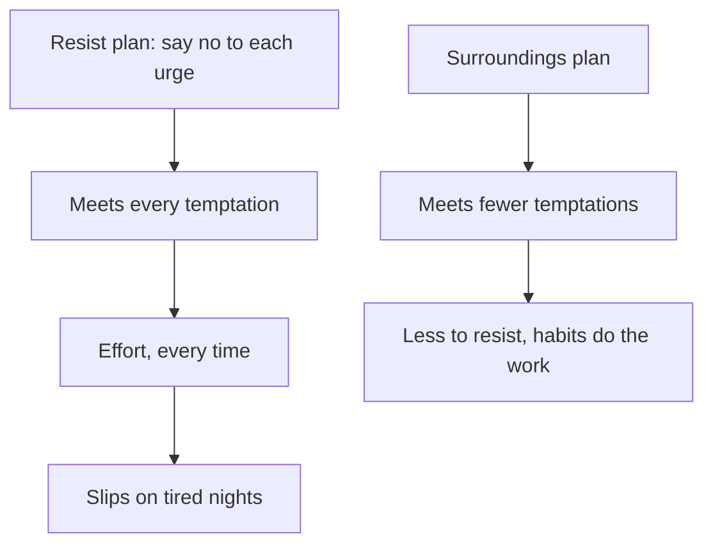

## "How do you do it?"

Ruba is the pharmacist Maha works with. She is in her thirties, calm and quick, and Maha has never seen her scroll on her phone at work. Ruba leaves at 16:00, and she says she is usually asleep by 22:30. One quiet afternoon, while they put away a delivery of boxes, Maha finally asks her. "How do you have so much discipline? I promise myself every night, and every night I fail."

Ruba laughs. "I am not strong. My phone lives in my locker at work, so I never see it light up. At home it charges in the hall, and I use an old alarm clock. At night there is nothing to say no to, because the phone is not there."

Maha had imagined Ruba fighting her phone all evening and winning. In fact, Ruba hardly fights at all. That difference is the subject of this chapter, and research has a lot to say about it.

## The idea in plain words

Willpower, from the key words in chapter 4.1, is choosing what you want for the long term over the pull of the moment. It is real. Everyone uses it, every day: to answer a difficult customer politely, to keep reading when a chapter is hard, to put the phone down once.

The trouble is not that willpower is fake. The trouble is using it as the whole plan. A plan that says "I will resist" asks you to say no every time the temptation appears. If the temptation appears eight times a night, that is eight times a night, every night, often when you are most tired. Even a person who says no most of the time will give in sometimes. And every loss feels like proof that you are weak, which makes the next night harder.

There is another way. Instead of planning to resist more, you plan to meet less. You change the place, the timing and the things around you so that the temptation shows up less often. A temptation you never meet is one you cannot give in to.

## What research found

For years, a popular idea said that willpower is like a battery that runs down. Use some of it on one task, the idea went, and you have less left for the next one. Researchers called this <GlossaryTerm term="ego depletion" definition="The idea that self-control is a limited supply that gets used up by effort, like a battery running down." />. It was in many books and talks, and many people still believe it.

Then researchers tested it with great care. In one large test, 23 laboratories ran the same classic experiment with more than 2,000 people. A later test used 36 laboratories and more than 3,500 people. When many laboratories repeated the classic experiments carefully, they did not find the effect. That does not prove that people never get tired. It means the simple battery story did not hold up when it was tested properly.

A second line of research looked at people who score high on self-control. Across six studies with more than 2,000 people, those with better self-control had stronger good habits, such as regular study, exercise and sleep times. Those habits explained part of why they did well, for example in their grades. An earlier study found that people with better self-control reported trying to resist temptations less often, not more.

Habit researchers sum it up this way: people who seem disciplined usually face fewer temptations. They have habits and surroundings that make the good choice the normal one. They are not fighting all day. Ruba is a good example.

Research also explains why changing a habit feels so hard. It is not mainly because your willpower is weak. Old habits keep being started by the same cues, again and again. So the useful question is not "how do I become stronger?" It is "how do I meet the cue less often?"

## Count the temptations

Maha decides to test this idea on her own nights. For one week, she keeps a small paper card by her bed and makes a tally mark each time she feels pulled to open the video app. She counts about 8 a night, and she resists about half of them. In this example, that is 28 give-ins a week: 8 a night, times 7 nights, times the half she does not resist.

Now she has two possible plans. She could face half as many temptations, which would bring her to 14 give-ins a week. Or she could keep all 8 and resist more of them. How much more? Decide what you expect before you test it.

```predict
prompt: "Maha meets 8 temptations a night and resists half (28 give-ins a week). To get down to 14 give-ins a week without facing fewer temptations, how often would she need to resist?"
options:
  - id: sixty
    label: "About 60 percent of them, every night"
  - id: seventy-five
    label: "About 75 percent of them, every night"
correctOptionId: seventy-five
explanation: "Yes, about 75 percent. With 8 a night, she would have to resist 6 of the 8 instead of 4, every single night, to reach 14. Resisting 60 percent gives about 22. Halving the temptations reaches 14 with no extra resistance at all, and it is done once, by changing her surroundings."
```

Use the sliders below. Start with Maha's numbers, then try the "try this" values.

<InteractiveCanvas slug="fewer-temptations" />

**What this shows:** give-ins a week worked out from the temptations you meet and the share you resist, and how much resistance it would take to match facing half as many temptations.

**Try this:** read the third number at Maha's settings, the resistance needed to match halving; then lower the temptations from 8 to 4 and watch the give-ins halve.

**What changed:** halving the temptations halves the give-ins at any level of resistance. To get the same result by resisting, she would need to resist 75 percent instead of 50, every night.

**Limits of the model:** this is arithmetic on example numbers, not a research finding, and real temptations are not all the same size.

## The worked example: where Maha's 8 came from

Counting gave Maha something new: a list. Here is how she used it, step by step.

**Step 1: sort the tally marks by what started them.** Her card showed four kinds of moment. Notifications from the video app itself: 2 a night. Messages in two group chats, one for family and one for friends: 2 a night. Picking up the phone to check the time: 3 a night. Setting the alarm: 1 a night. That makes 8. Every one of them starts with the phone lighting up or with Maha picking it up for another reason.

**Step 2: ask which sources she can remove without a struggle.** She turns off notifications from the video app and the two group chats from 22:00 to 7:00. Nobody in her family needs her to reply at midnight, and she tells them so. That removes 4 of the 8 moments in one change. It took two minutes, once.

**Step 3: work out the new total.** With 4 temptations a night, resisting the same half, she has 4 times 7 times one half, which is 14 give-ins a week instead of 28. She has not become any stronger. She simply meets half as many temptations.

**Step 4: compare with the resisting plan.** If she had kept all 8 temptations and pushed her resistance from 50% to 60%, she would have 8 times 7 times 0.4, which is 22.4, about 22 give-ins a week. To reach 14 by resisting alone, she would need 75%: 6 of every 8 urges, every night, including the most tired ones. Halving the temptations reaches 14 with one change, made once.

**Step 5: look at what is left.** Three of the remaining four moments come from checking the time on her phone, and one from setting the alarm. Both exist only because the phone is her clock. That points to her next change, which chapter 4.4 follows: if the phone is not her clock, it does not need to be beside her pillow at all.

The diagram shows the two plans side by side.



The left road asks for effort at every temptation, so it fails most on the nights with the least energy. The right road asks for effort once, when you change the surroundings, and then the habit and the room carry you. That is the road the research describes for people who seem disciplined.

## Where people go wrong

A common mistake is to treat a habit as a test of character. "If I were a better person, I could stop." Maha believed this, and it made her nights worse, because every give-in felt like proof that she was weak. A habit is a loop that a situation starts. Changing the situation is not cheating. It is how people who seem disciplined actually do it.

A second mistake is the opposite overcorrection: "willpower does not exist, so there is no point trying." That is not what the research found. Self-control is real and useful, especially in the moment, as chapter 4.4 shows. What failed the careful tests was the battery story. And a plan that relies on resisting alone is weak for other reasons, as the arithmetic above shows.

A third mistake is to think that disciplined people never feel temptation. They do. They report fewer moments of resisting, because they meet fewer temptations, not because they feel nothing.

A last mistake is to keep temptations close on purpose, to "train" your willpower: leaving the phone on the pillow to practise saying no. Nothing in this chapter supports that. Plan your surroundings, not a struggle.

<Callout type="info" title="Count before you change">
A tally card by the place where the habit happens shows you where the temptations come from. One week of tally marks often points straight at the change that removes the most.
</Callout>

## Try it today

Choose one unwanted habit, small and everyday. Tonight or tomorrow, keep a paper card nearby and make a tally mark every time you feel pulled toward it. Next to each mark, write one word for what started it: a sound, a place, a person, a feeling. Then find the source with the most marks, and remove it if you can do so easily. If you prefer not to track your own habit, use Maha's list above and find a change she has not yet made.

## Check your understanding

```quiz
type: mcq
question: "Hiba, a freelance designer, keeps a tally card during her two focused work hours on her three home days. Pulls to check her phone, by what started them, over those three days: the design group chat, 15; email, 3; a news app, 4; checking the time, 2. Which single change removes the most pulls?"
options:
  - "Delete the news app from her phone for the whole week"
  - "Mute the design group chat during her two focused work hours"
  - "Put a small clock on her desk so she stops checking the time"
  - "Resist harder, and count each pull she resists as a win"
correct: 1
explanations:
  - "This removes a real source, but only 4 of her 24 pulls. The biggest source stays."
  - "Yes. The group chat started 15 of her 24 pulls. Muting it during her work hours removes the largest source with one change, and she does not have to resist those pulls at all."
  - "A clock helps, but checking the time started only 2 of the 24 pulls."
  - "This keeps every one of the 24 pulls and asks her to win more of them. It is a plan to resist, not to meet fewer temptations."
```

```quiz
type: mcq
question: "Anas, the youth coach, sees his players checking their phones during training. His strong talk about self-discipline cut the checking for 3 days, then it came back. The phones sit on the bench beside the pitch, where players see them light up. The club's locker room is 30 metres away. Which plan follows this chapter?"
options:
  - "Give a second, stronger talk about self-discipline"
  - "Fine any player who checks a phone during training"
  - "Let players check their phones after each drill"
  - "Ask players to leave their phones in the locker room"
correct: 3
explanations:
  - "The first talk worked for 3 days, because it asked players to resist the same temptation every time a phone lit up beside them."
  - "A fine makes each give-in more costly, but the phones still light up on the bench, so the temptation is met just as often."
  - "This adds planned checks, so players meet the phone even more often during training."
  - "Right. With the phones 30 metres away, players stop seeing them light up. They face far fewer temptations, so there is much less to resist."
```

**Next:** Same cue, same need, new routine: what Maha's scrolling gives her, and what could give her the same thing.
