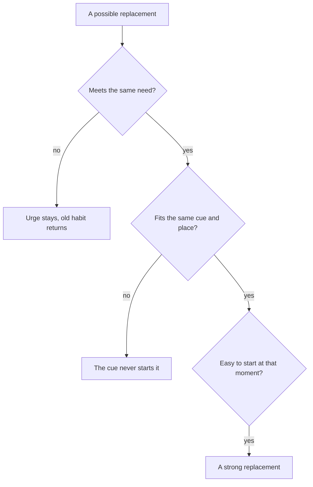

## A night in the dark

After her talk with Ruba, Maha tries something bold. On Saturday night she leaves the phone on the kitchen table, goes to bed at 23:00, and lies in the dark with nothing at all.

It does not go well. At first she feels proud. Then the day starts to replay in her head: the man who shouted about a price, the mother with the feverish baby, the box she nearly gave to the wrong customer. She turns over. She turns back. At 23:40 she gets up, fetches the phone from the kitchen and opens a video. Within ten minutes, she feels calmer. She falls asleep at about 0:30.

The next morning, Maha is disappointed in herself. But she has also learned something important. Taking the videos away left a gap, and her mind rushed to fill it. The scrolling was doing a job for her. Until something else does that job, the habit has a reason to come back.

## The idea in plain words

Every unwanted habit gives you something. You met the reward in module 1. In this module, the key words in chapter 4.1 call it the need, because it is often something you really need, not only something you enjoy. Rest after a long day. A quiet mind. Company when the house is empty. A break from a hard task. A bit of fun.

The need is not the problem. The routine is. Maha's need to slow her mind down at night is healthy and normal. Scrolling videos until 1:00 is just one way to meet it, and a costly one. So the plan is not to remove the need. It is to keep the cue, meet the same need, and change the action. This course calls the new action a replacement routine.

This has a practical side that matters a lot. If you only remove a habit, you leave an empty moment at the same cue, and the old routine is the easiest thing to put back in it. If you put a new action in that moment, the cue has something new to start.

## What research found

Habit researchers advise choosing a new action to do, rather than only something to stop. Their reason is simple: you cannot build a habit of not doing something. A habit is an action that a situation starts. "Not scrolling" is not an action. "Reading one short story" is.

Research on breaking habits also supports if-then plans that name the cue and a replacement. Studies found that plans like "when this situation comes, I will do this instead of my usual habit" helped people act differently in that moment. These plans help most when people really want the change, and they are weaker against very strong old habits. So a replacement is a strong first tool, but not always enough on its own. Chapter 4.4 adds the tools for the cue itself.

How do you find the need? There is no laboratory test for it, but there is a practical method. Try a different action at the same cue and see whether the urge goes away. If the urge fades, the new action met the need. If it stays, it did not, and the need may be something else. Maha's night in the dark was a test of this kind, even though it felt like a failure.

## Find the need, then choose

Maha thinks hard about her test. With no phone, her mind raced and she felt restless. When she opened the videos, she calmed down. So the need is not really the videos: it is her mind slowing down after a busy day.

Now she must choose a replacement. Before you step through her week, decide which one you expect to work.

```predict
prompt: "Maha's need at 23:00 is for her mind to slow down. Which replacement do you expect to work better in bed at that time?"
options:
  - id: story-book
    label: "A paper book of short stories by a small lamp"
  - id: vocabulary
    label: "English vocabulary practice, lying in bed"
correctOptionId: story-book
explanation: "Both are better uses of time than scrolling, and vocabulary practice is a good habit. But it is effortful thinking, and her need at 23:00 is the opposite: a mind that slows down. A short story asks little of her and gives her mind something calm to follow, so it meets the same need at the same cue."
```

Step through Maha's night below. Notice what stays the same in both rows, and what changes.

<InteractiveCanvas slug="maha-night-loop" />

**What this shows:** the cue and the need behind Maha's scrolling, and a new routine that meets the same need at the same cue.

**Try this:** at step 4, before you go on, say what the need is in your own words; at the last step, name what is still in the bedroom that starts the old routine.

**What changed:** the cue stayed (in bed at 23:00) and the need stayed (a quiet mind). Only the routine changed, and on 4 of 6 nights the night ended at about 23:45 instead of 1:00.

**Limits of the model:** needs are often mixed, a one-night test is a practical method rather than a research finding, and a replacement is weaker when the old cue still lies on the pillow.

## The worked example: Maha's replacement, step by step

**Step 1: write the habit as a cue, a routine and a need.** Cue: lying in bed at 23:00, tired, the house quiet, the phone on the pillow. Routine: opening the video app and watching short videos. Need: her mind slowing down after a busy day of customers. Writing all three keeps her from mixing them up. The cue is a situation, the routine is an action, and the need is what the action gives her.

**Step 2: test the need.** Maha tries three nights. Night one, no phone and nothing else: restless, and the old routine came back at 23:40. Night two, a downloaded audio story played from the shelf across the room with the screen off: calmer, asleep at about 0:00. Night three, a paper book of short stories by a small battery lamp: one story, then sleepy, asleep at about 23:45. The urge to scroll was weakest on night three. That is her evidence.

**Step 3: check the replacement against the cue.** A good replacement must fit the same moment and place. The book can live on her pillow during the day, so when she lies down at 23:00, it is the first thing her hand finds. The lamp runs on a battery she charges in the power hours, so the book works whether the power is on or off. Two steps to start: switch on the lamp, open the book. The phone, still on the pillow for now, needs fewer steps. She notes this as a weak point.

**Step 4: write the if-then plan.** "When I lie down at 23:00, I read one short story." The plan names the cue exactly and an action she can see. It says "one short story", not "read for a while", so she knows when she has done it.

**Step 5: watch the first week honestly.** In this example, she read on 4 of 6 nights, and on those nights she was asleep by about 23:45. On the other 2, she was very tired, the phone lit up beside her, and the old routine won. Four nights out of six is a real change from almost none. The two lost nights point to the next problem: the old cue is still right beside her. A replacement meets the need, but it has to compete with a phone that takes zero steps.

The diagram shows the three questions Maha asked about each possible replacement.



A replacement has to pass all three questions. Vocabulary practice fails the first one at 23:00: it does not slow her mind down. A walk after dinner might calm her, but it fails the second: it does not happen in bed at 23:00, so the cue cannot start it. The book passes all three. If a replacement fails the third question, chapter 3.3 has the answer: remove steps from it, as Maha did by keeping the book on her pillow.

## Mistakes to avoid

A common mistake is to remove a habit and leave the moment empty. Maha's night in the dark showed what happens: the need is still there, the moment is empty, and the easiest thing to put back is the old routine.

A second mistake is to choose a replacement for what is good for you instead of what meets the need. Vocabulary practice is useful, but at 23:00 it is the wrong tool for a tired mind. If your replacement does not meet the need, you will feel the old urge underneath it, and the old routine will win on tired nights.

A third mistake is to guess the need without testing it. Many people assume that their scrolling is about boredom when it is about loneliness, or about fun when it is about avoiding a hard task. One quick test at the same cue tells you more than a week of guessing. If the urge stays, try a different need.

A fourth mistake is to expect the replacement to work every time. Against a strong habit, with the old cue still in place, a replacement will lose on some nights. That does not mean it failed. It means you need the next tool too, and chapter 4.4 brings it.

## Try it today

Choose one unwanted habit, or use Maha's. Write it in three parts: the cue, the routine and the need. Then plan one small test for the next time the cue comes: a different action at the same moment. Afterwards, ask one question: did the urge fade or stay? If it faded, you have found a replacement that meets the need. If it stayed, try a different action, or rethink what the need is.

## Check your understanding

```quiz
type: mcq
question: "Hiba, the freelance designer, works alone at home on 3 days a week and spends her whole lunch hour scrolling. On the 2 days she works at her cousin's shop, with people around, she rarely opens her phone at lunch. She says the flat feels very quiet at midday. Which need and replacement fit these facts best?"
options:
  - "Need: rest. Replacement: a 20-minute nap after lunch"
  - "Need: news. Replacement: a newspaper at lunch"
  - "Need: company. Replacement: lunch with a neighbour"
  - "Need: none. Replacement: delete the app at lunch"
correct: 2
explanations:
  - "Nothing in the facts points to tiredness. The difference between her days is whether people are around, not how rested she is."
  - "If she wanted news, she would read it on the shop days too. She does not, so news is not what the scrolling gives her."
  - "That fits the facts. She scrolls on the quiet days alone and not on the days with people around, and she mentions the quiet. Company is the need, so lunch with a neighbour, or a call to a friend, meets it at the same cue: lunch."
  - "Every habit gives something. Deleting the app leaves the quiet lunch hour empty, and the need for company will look for another way in."
```

```quiz
type: mcq
question: "Hatem, who runs a sweets shop with his brother, plays a phone game while each tray bakes, about 20 minutes, and twice last week a batch burned. He says the game 'passes the wait'. He wants a replacement routine. Which one fits both the need and the cue?"
options:
  - "Read a few pages of a book at home after work"
  - "Listen to a recorded talk on his way home"
  - "Read a few pages on a stool beside the oven"
  - "Play the game in the back room, door shut"
correct: 2
explanations:
  - "Reading is calm, but at home after work there is no wait to pass. The cue, a batch in the oven, never starts it, so the game stays free to fill the wait."
  - "A talk could pass time, but not at the moment that matters. The wait at the oven still has nothing in it except the phone."
  - "Right. The same cue, a batch in the oven, now starts a routine that passes the wait, and he stays beside the oven, so the bread does not burn."
  - "This keeps the same routine and moves him farther from the oven, so the burned batches would get worse, not better."
```

**Next:** Remove the cue and add friction: the phone leaves Maha's bedroom, and she learns to notice the moment the habit starts.
