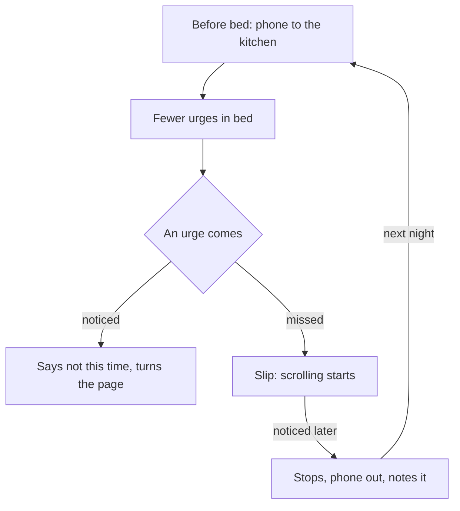

## Two nights out of six

Maha looks at her first week with the book. On 4 nights out of 6, she read one story and was asleep by about 23:45. She is pleased, and a little surprised. But the other 2 nights bother her. On both, she was very tired, the phone lit up on the pillow beside her, and before she had decided anything, she was watching videos.

She notices something about those two nights. The book did not fail because it was boring. It failed because the phone was right there, closer than the book, and it needed zero steps. The replacement routine met her need. The old cue was simply louder.

Her sister suggests the obvious answer: "Then do not let the phone sleep next to you." Maha laughs. "It is my alarm." Then she stops laughing, because that is not a law of nature. It is a choice she made years ago, and she can make a different one.

## The idea in plain words

This chapter teaches two tools, and the order matters.

The first tool works **in advance**. Before the habit's moment arrives, you remove or avoid the cue, and you add friction, the small extra effort you met in chapter 3.3. For Maha, that means the phone does not come into the bedroom at night. If it is not on the pillow, it cannot light up there, and reaching for it takes real steps. You do this once, at a calm time, so the hard moment never has to be a fight.

The second tool works **in the moment**. Even with the cue removed, an urge will sometimes arrive: a thought, a memory, a habit of the hand. When it does, you watch for the start of the habit, notice it, and tell yourself plainly: "not this time". Then you do the next action of your replacement routine. Noticing turns an automatic pull into something you can see, and what you can see, you can stop.

The two tools fit together. Removing the cue means fewer urges arrive. Noticing means the urges that do arrive are less likely to become the habit. And because slips will still happen, there is a third part: a plan for what to do when the habit slips through.

## What research found

Habit researchers have found that changing or avoiding cues reduces the pull of old habits. When the cue does not appear, the old routine has nothing to start it. Removing a cue is something you do in advance, and it is one of the strongest tools for unwanted habits.

A study by Jeffrey Quinn, Wendy Wood and colleagues looked at the moment itself. In two diary studies, people tracked how they tried to control their unwanted habits. The people who controlled strong bad habits best watched closely for the moment the habit started and told themselves "don't do it". The researchers found that this worked by giving people more control in the moment, not by making the habit weaker. In those studies, simply trying to stay away from the situation helped people with temptations, but not with strong habits, perhaps because habit cues are easy to miss. That is why this chapter uses both tools: change the room in advance, and watch for the start in the moment.

Research also explains what does not work. Many people try not to think about the habit at all. A review of 31 studies found that thoughts people try to push away tend to come back afterwards, sometimes stronger. Distraction is also unlikely to stop a habit, because habits can run while your attention is elsewhere. Your hand can open an app while your mind is busy. So "just do not think about it" is a weak plan. Plan what you will do instead.

## One good night and one slip

Maha's new plan has three parts: the phone charges in the kitchen, a cheap battery clock is her alarm, and the book waits on her pillow. On the second Thursday, she comes home late, tired, with the phone still in her hand. Before you step through her nights, decide what you expect to work best on a night like that.

```predict
prompt: "On the slip night, Maha finds she has been scrolling in bed for 30 minutes. Which response do you expect to work better?"
options:
  - id: stop-thinking
    label: "Tell herself firmly to stop thinking about the videos"
  - id: notice-act
    label: "Notice it, name it, and walk the phone to the kitchen"
correctOptionId: notice-act
explanation: "Trying not to think about the videos tends to bring the thought back, and the phone would still be in her hand. Noticing and naming the habit gives her control in the moment, and walking the phone to the kitchen removes the cue for the rest of the night. It turns a slip into a short one."
```

Step through both nights below. Watch the direction of the arrows: where the phone goes, and when it comes back.

<InteractiveCanvas slug="phone-out-of-the-bedroom" />

**What this shows:** one night with the plan and one slip night, with the cue removed in advance, friction added and the urge noticed in the moment. **Try this:** at step 5, find what brought the old cue back into the bedroom, and which line in step 7 deals with it. **What changed:** on the plan night, the urge came and passed, and she was asleep at 23:40; on the slip night, noticing and acting turned 1:00 into 00:15, and one new if-then line covers late nights from now on. **Limits of the model:** two nights cannot show every slip; noticing gives control in the moment but does not make the habit disappear, and some urges will win before they are noticed.

## The worked example: Maha's plan, step by step

**Step 1: remove the cue in advance.** The phone lived on her pillow because it was her alarm. So Maha moves the alarm's job to a small battery clock, about 15 shekels in this example, and plugs the phone into a charger on the kitchen shelf at 22:45 every night. She tells her family that she will not see messages after 22:45, so nobody worries. Removing a cue often means moving the useful job it was doing first.

**Step 2: add friction.** The kitchen is two doors from her room, past her parents' door. To fetch the phone at night, she would have to get up, walk there in the dark and switch on a light. That is at least three steps, and nothing about them is automatic. She also logs out of the video app at night, which adds one more step if she ever does fetch the phone.

**Step 3: keep the replacement ready.** The book of short stories and the battery lamp stay on her pillow, from chapter 4.3. Now the book is the easiest thing within reach when she lies down. Removing the cue and adding a replacement work together: the moment is not empty, and the old routine is far away.

**Step 4: plan the words for the moment.** Maha writes the exact sentence she will use: "That is the scrolling habit. Not this time." She also writes her next action: turn the page. When the urge comes at 23:10 on the first night, she does not argue with it or try to push the thought away. She names it, says the sentence, and turns the page.

**Step 5: plan for slips.** Her plan for a night when the habit slips through: notice, stop, walk the phone to the kitchen, write one line on her card the next morning, and go back to the plan at the next cue. No extra punishment, no new rules at midnight. A slip noticed at 23:50 costs much less than a slip that runs until 1:00.

**Step 6: check two weeks of nights.** In this example, the phone stayed in the kitchen on 12 of 14 nights, and on 11 of those 12 she was asleep before midnight. Both slip nights came after she got home late and walked in with the phone in her hand. That pattern gives her the new line: "If I come home late, I plug the phone in the kitchen before I take off my shoes." The slip did not prove the plan wrong. It showed her exactly where the plan was thin.

The diagram shows how the two tools and the slip plan connect.



The first tool sits at the top: it cuts down how many urges reach her at all. The second tool sits in the middle: it catches most of the urges that still arrive. The slip loop at the bottom is not a failure branch; it is part of the plan. It leads back to the start, with one more line of learning each time.

## Where people go wrong

A common mistake is to use only one tool. Noticing without removing the cue means watching for the same urge many times every night, which is tiring, and tired people miss urges. Removing the cue without a plan for the moment works until the day the cue comes back, as it did on Maha's late nights.

A second mistake is "just do not think about it". Pushing a thought away tends to bring it back. Instead of trying not to think about the habit, name it when it appears and do your planned action.

A third mistake is removing a cue without moving its job. If the phone is your alarm, your torch and your clock, sending it to the kitchen leaves you with no alarm, no torch and no clock. Find another way to do each job first, then move the cue.

A fourth mistake is treating a slip as the end. "I already ruined tonight, so I might as well keep going" turns a 20-minute slip into a 2-hour one. A slip is information about where your plan is thin. Notice it, act, write one line, and restart at the next cue. Module 5 looks at slips and restarting in more detail.

## Try it today

Choose one unwanted habit, or use Maha's. Write three lines. First: the cue you will remove or avoid, and any job it does that needs a new home. Second: one step of friction you will add. Third: the exact words you will say when you notice the urge, and the action you will do instead. Then do the first line today, at a calm moment, before the habit's usual time arrives.

## Check your understanding

```quiz
type: mcq
question: "Mazen bakes from 4:00 to 13:30. At 14:00 he gets home, switches on the television, falls asleep on the sofa until 17:00 and then sleeps badly at night. He wants a 30-minute rest and then time with his children. Which plan uses both tools from this chapter, in order?"
options:
  - "Try hard not to think about the television when he gets home"
  - "Keep the television on, but promise to switch it off at 14:30"
  - "Unplug it each morning; say 'not now' when he reaches for it"
  - "Unplug the TV, and drop the whole plan if he plugs it back in"
correct: 2
explanations:
  - "Trying not to think about something tends to bring the thought back. This plan also leaves the cue, the television, ready to start."
  - "This keeps the cue switched on and asks for a fight at 14:30, when he is already tired and half asleep."
  - "Right. Unplugging in the morning removes the cue and adds friction in advance. Noticing the reach and saying 'not now' is the tool for the moment."
  - "Unplugging removes the cue, which is good, but treating one slip as the end of the plan throws away all the days it worked."
```

```quiz
type: mcq
question: "Hiba, the freelance designer, checks her phone under the desk during client video calls, and twice a client noticed. She tried 'not thinking about the phone' during calls, and found she thought about it more. Which advice fits what research found?"
options:
  - "Phone in another room; watch for the reach"
  - "Push the thought of the phone away even harder"
  - "Doodle on paper so her mind forgets the phone"
  - "Allow one quick check per call to calm the urge"
correct: 0
explanations:
  - "Right. The phone in another room removes the cue in advance, and watching for the reach gives her control if an urge still comes."
  - "Pushing a thought away tends to bring it back. She has already seen this happen in her own calls."
  - "Distraction is unlikely to stop a habit, because a habit can run while her attention is on something else."
  - "A planned check adds a temptation to every call, so she meets the urge more often, not less."
```

**Next:** A graded quiz with five cases on willpower, replacement routines and removing cues, including an AI answer to check.
