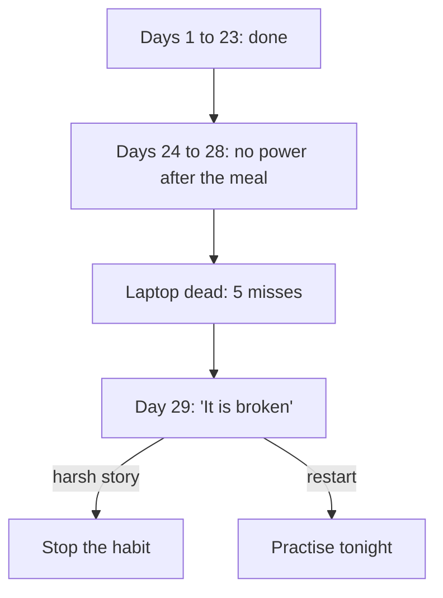

<BigWordAlert term="Restart" plainEnglish="Doing the habit again at the next cue after a missed day, even in its smallest version, instead of waiting for a better moment." whyItMatters="Every habit has missed days. The habits that last belong to people who restart quickly, not to people who never miss." />

## Twenty-three ticks

Yousef is 25. He lives with his parents and his younger brother, and in the mornings he helps at his uncle's phone repair shop. In the evenings he studies for a networking certificate exam, which is about three months away. If he passes, he can apply for remote IT support jobs. Like every person in this course, Yousef is fictional, but his month is a very ordinary one.

At the start of the month, Yousef made a plan using what he had learned about habits. He chose one small, clear action and tied it to something that happens every day. His habit: "After the evening meal, I sit at the family laptop and do 20 minutes of practice questions." The laptop sits on a small desk in the corner of the living room. Above the desk, Yousef pinned a paper calendar. Every evening that he did his 20 minutes, he drew a tick on that day.

The plan worked. On day 1 he had to push himself to sit down. By the second week, he sometimes found himself at the desk before he had decided to go. By the third week, sitting down after the meal felt normal. He did not have to decide. The line of ticks grew longer: 5, 10, 15, 20. On day 23, his brother looked at the wall and said, "Twenty-three days. You will never stop now." Yousef was proud of that line of ticks.

## The week the power went

Then came a week of long power cuts. From day 24, the power came only after midnight, for a few hours. In the evenings the flat was dark, apart from one rechargeable lamp in the kitchen. The family laptop is old. Its battery lasts only a few minutes without a charger, so on those evenings it would not even start.

On day 24, Yousef finished the evening meal, walked to the desk out of habit, pressed the power button, and nothing happened. He shrugged and went to sit with his family. On day 25 it was the same. On days 26, 27 and 28 he did not even walk to the desk. There was no point: the screen would stay black. Five evenings, five empty squares on the calendar.

On day 29 the power came back in the evening. After the meal, Yousef stood in front of the calendar. Twenty-three ticks, then five empty squares.

```predict
prompt: "It is day 29. The power is back, and Yousef is standing in front of his calendar: 23 ticks, then five empty squares. Do his 23 evenings of practice still count for something?"
options:
  - id: still-count
    label: "Yes, and starting again tonight protects them"
  - id: back-to-zero
    label: "No, after five misses he is back at day 1"
correctOptionId: still-count
explanation: "The 23 evenings are not wasted. Research tested one missed day, not five, so this is the course's advice rather than a finding: a longer gap makes the next start harder, and the way to protect the practice is to restart at the next cue. All five misses were evenings with no power, and tonight the power is on. Yousef did not see it this way at first, as you will read next."
```

He felt something heavy in his chest. "It is broken," he thought. "Twenty-three days for nothing. If I start again tonight, I start at day 1. Maybe I am just not a disciplined person." He picked up the pen, then put it down. For a moment he thought about taking the calendar off the wall and throwing it away.

## What Yousef got wrong, and what he got right

Most people can see the right answer for someone else: do the questions tonight. Yet in his own life, standing in front of the calendar, Yousef nearly did the opposite. This is why the module exists. The facts are simple. The feelings after a missed day are strong, and they push people toward the wrong choice.

Look at what Yousef believed. He believed the five misses wiped out the 23 days. Research cannot promise exactly what five missed days do to a habit: the study you met in module 1 tested one missed day, and found that it did not undo the progress. For longer gaps, the course says this. A longer gap makes the next start harder. The days you practised are not wasted, and the way to protect them is to restart at the next cue. Yousef answered questions and learned topics on 23 evenings, and nothing takes that work away. On day 24 he also walked to the desk before he remembered the power was off. The cue was still starting him.

He also believed the misses were about him: "Maybe I am not a disciplined person." But look at the cause. Every one of the five misses happened on an evening with no power, and his habit needed a laptop that needs power. The calendar does not show that, because it has only ticks. A tick says "done"; an empty square says nothing at all about why. Yousef was filling the empty squares with a story about his character. A more useful story was available: "My habit has no version for evenings without power."

Here is what he got right. He chose one small habit, tied it to a meal that happens every day, and kept a simple record. He did 23 days in a row, which is a strong start by any measure. And on day 24, he still went to the desk. The habit was alive. What he did not have was a plan for a missed day.

## Why this matters for study and work

Every fellow will meet Yousef's week sooner or later. Power cuts, weak internet, guests who stay all evening, a family member who needs care, a move to a new home, a client deadline that eats three evenings. None of these is a personal failure. They are ordinary facts of the week, and a habit plan that assumes they will not happen is a plan for someone else's life.

Long goals are where this matters most. A certificate exam, a portfolio, a new language and a client base all take months. Over months, missed days are certain. The difference between people who reach long goals and people who do not is often not how many days they miss. It is how quickly they come back. A person who misses 6 days in a month and restarts the next day each time has done 24 days of work. A person who misses one day, decides the month is ruined and stops for two weeks has done far less, and the long gap makes the next start much harder.

There is also a cost that does not show on a calendar. When Yousef told himself "I am not disciplined", he was close to giving up more than a habit. He was close to giving up on the exam and the job behind it. Thoughts like that grow quietly after a missed day. This module gives you a different way to read a missed day, so the thought does not get to decide for you.

The diagram shows Yousef's month and the two roads in front of him on day 29.



What to notice: the misses came from the power, not from Yousef. Nothing in the first three boxes is a choice he made. The only real choice in the whole diagram is at the last box, on day 29: which road to take. Road one ("stop the habit") throws away a habit that was working for one reason, a week with no evening power. Road two ("practise tonight") keeps the habit and its 23 days of growth. It also leaves a question to solve: what should the habit look like on the next dark evening?

## What this module covers

This module teaches four skills. Each one answers a part of Yousef's problem.

The first is tracking that helps. Yousef's calendar recorded ticks. A better tracker records the action you control and adds a few words on each missed day. Those few words turn an empty square into information. You will see Yousef's tracker find a cause that his memory got wrong.

The second is counting that does not punish you. A streak counter (days in a row) goes back to zero after one miss. Days done out of 30 hardly moves. You will learn which numbers to watch, why the length of a gap matters more than the streak, and how to keep a streak without letting one miss break it.

The third is the difference between a slip and giving up. A slip is a missed day. Giving up is a decision you make after it. You will learn a short restart plan, how to be kind to yourself without being careless, and how to use a new week or month as a push without waiting for it.

The fourth is patience with slow results. Yousef's practice scores did not jump in the first month. The habit can get easier long before the results show. You will learn to judge a habit by how easy it is to start, not only by its results.

<LearningObjectives items={["Track a habit simply, recording the action you control, with a short note on each missed day", "Count days done and the longest gap, and explain why one miss matters less than the story told after it", "Tell a slip from giving up, and write a restart plan with the smallest version at the next cue", "Keep going when results come later than the effort, judging the habit by how easy it is to start", "Read a tracker for what caused the misses, and choose one specific change"]} />

## Key words

| Word | Plain English |
|---|---|
| **Tracker** | A simple record of whether you did the habit each day, on paper or a phone, with a few words of note |
| **Streak** | The number of days in a row you did the habit without a miss |
| **Days done** | How many days you did the habit in a period, for example 25 of 30 |
| **Gap** | Missed days in a row; the longest gap is the most days in a row you missed |
| **Slip** | One missed day, or a few; not the same as giving up |
| **Restart plan** | A short written plan for the next cue after a miss: when, and which version |

## What is in this module

| Chapter | You will practise |
|---|---|
| 5.2 | Tracking the action, with a note on each missed day, on Yousef's tracker card |
| 5.3 | Counting days done and the longest gap, and restarting at the next cue |
| 5.4 | Telling a slip from giving up, writing a restart plan, and keeping going through slow results |
| 5.5 | A practice check with five short cases, including an AI answer to check |
| 5.6 | A review of your course habit tracker so far, or Nada's, and a restart plan |

**Next:** How to track a habit so that your record tells you why you missed, not only that you missed.
