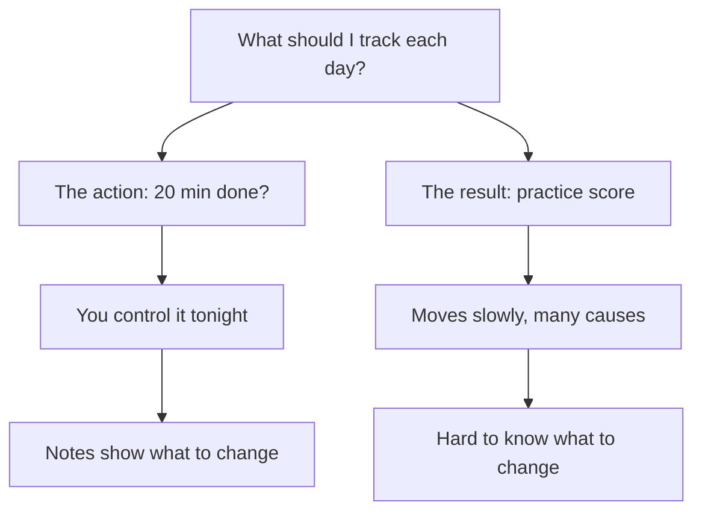

## A week Yousef remembers wrongly

Yousef did sit down on day 29. The power was on, the meal was over, and he did his 20 minutes of practice questions with the five empty squares above his head. On day 30 he did it again. Then the week went on, and by Friday night, day 35, he had missed three more evenings.

When his brother asked how the week had gone, Yousef had an answer ready. "Not great. The shop was busy, I was tired, and on tired days I just cannot make myself sit down." It sounded true. He had been tired. He remembered coming home with aching feet at least twice that week. He was already thinking about a plan to fix his tiredness: maybe he should practise in the morning instead, before the shop.

But this week was different from his first month in one way. After the empty squares on his calendar, Yousef had decided that his record should tell him more than "done" or "not done". So this week he had used a new card. On Friday night he took it out and read it.

## What a useful tracker records

You met the word tracker in the key words of chapter 5.1, and you started ticking a card for your course habit in module 2. This chapter is about making that record useful. A useful tracker has three parts, and none of them takes more than a few seconds a day.

The first part is **the action you control**. Yousef tracks "20 minutes of practice questions after the evening meal". He does not track his practice score, his hours of study or whether he feels ready for the exam. Those are results. Results matter, but they move slowly, they have many causes, and on any one day you cannot choose them. The action is the part you can choose tonight, so it is the part worth counting.

The second part is **a tick or a cross**. One mark per day, nothing more. Do not use colours that shout at you or words like "failed". A cross is a fact, the same kind of fact as a tick.

The third part is **a few words**. On a missed day, write why, in plain words: "power off", "guests until 23:00", "forgot". On a done day, add a word or two if something stood out: "tired, did it anyway", "smallest version", "started without thinking". These words take five seconds to write. Later, they are the only evidence you have about why the misses happened. Without them, your memory fills the gap, and memory is not a careful witness.

## What research found about tracking

Writing down whether you did something seems almost too simple to matter. The research says it does. Across many studies, people who kept track of their progress reached their goals more often, especially when they wrote it down or shared it with someone. The effect was real but not huge: tracking helps, it does not do the work for you. Most of these studies were about health goals, such as exercise, so treat the finding as a strong hint for study habits, not a promise.

Researchers on goals have also noticed the opposite pattern. People often avoid checking their progress when they expect bad news, the way you might avoid opening a message you think will upset you. Researchers call this the ostrich problem, after the old story that the bird hides its head in the sand. After a bad week, the temptation is to stop looking at the card. That is exactly the week when the card has the most to tell you.

One more point from earlier in the course. A tracker supports a habit; it is not the habit. The cue, the meal finishing, is still what starts Yousef's practice. A tracker that reminds you is useful, but module 2 showed that reminders help you repeat an action without building the habit itself. The card's main job is to give you evidence.

Before you step through his card, make your own guess.

```predict
prompt: "Yousef missed three evenings this week and believes tiredness was the cause. What do you expect the notes on his three missed days to have in common?"
options:
  - id: tired
    label: "Tiredness after a long day at the shop"
  - id: no-power
    label: "No power after the evening meal"
correctOptionId: no-power
explanation: "All three crosses say there was no power after dinner, and both evenings he wrote 'tired' were ticks. His memory joined two true facts, a tiring week and three misses, into a cause that the card does not support. This week the power went off only on some evenings, at different hours, so the cuts were easy to forget."
```

Step through Yousef's week one day at a time. Before step 9, try to say what the three crosses have in common.

<InteractiveCanvas slug="tracker-week-notes" />

**What this shows:** one week of tracking with a tick or a cross and a few words each day, and how reading the words finds the cause of the misses.

**Try this:** look only at the ticks and crosses, and ask whether a tick-only calendar could have told Yousef why he missed.

**What changed:** at step 9 the story moved from "I miss on tired days" to "I miss on evenings with no power", and the change Yousef wrote at step 10 follows from the notes, not from his memory.

**Limits of the model:** this week has one clear cause; real weeks are often messier, so keep writing notes for another week or two before you change anything.

## Reading the card, step by step

Here is Yousef's week as he wrote it, so you can see each step of his reasoning.

| Day | Mark | Note |
|---|---|---|
| Saturday | Tick | Tired after the shop. Did it. |
| Sunday | Tick | 20 min, easy start. |
| Monday | Cross | Power off after dinner. Laptop dead. |
| Tuesday | Tick | Very tired. Did it anyway. |
| Wednesday | Cross | No power after dinner. |
| Thursday | Tick | Power on. 20 min. |
| Friday | Cross | Power off all evening. |

**First, count.** Four ticks and three crosses: done 4 of 7. That is not a disaster, and it is not a perfect week. It is a number to explain.

**Second, group the notes.** Two notes mention tiredness: Saturday and Tuesday. Both are ticks. Three notes mention the power: Monday, Wednesday and Friday. All three are crosses. No cross mentions tiredness, guests or forgetting.

**Third, compare the card with memory.** Yousef's memory said "tired days". The card says tired days were done days. So a plan to fix tiredness, such as moving practice to the morning, would aim at the wrong cause. It might even break a cue that works: the evening meal, which started his practice on all four done days.

**Fourth, find what the misses depend on.** The habit needs the laptop, and the laptop needs power. On evenings when the power is on, the habit runs, tired or not. On evenings when it is off, the habit has no version that can happen. That is the same gap that broke his streak on days 24 to 28, now showing up in a quieter way. This week the power went off only on some evenings, at different hours, so it did not feel like "a week of power cuts", and his memory skipped over them.

**Fifth, write one change at the cause.** Yousef writes on the card: "If there is no power after the evening meal, then I do 10 questions from my paper notebook by the lamp." To make it possible, he copies a page of practice questions into a notebook whenever the power is on. This is the backup version from module 3, written as an if-then plan from module 2. He keeps the anchor and the full version the same. One change, aimed at the cause the notes found.

Notice what made this possible: a few words a day. Without them, Yousef had two true facts, a tiring week and three misses, and his mind joined them into a cause. The notes kept the facts apart.

## What to track: the action, not only the result

Many people track the thing they want in the end: their weight, their savings, their marks. It feels like the honest number. The diagram shows why the action is usually more useful to track day to day.



Follow the two branches. On the left, the action is something Yousef can do or not do tonight, so a cross points straight at what got in the way. On the right, his practice score depends on the topic, the difficulty of the questions, his sleep and many other things. A low score on Wednesday does not tell him what to change. Results are still worth checking now and then, perhaps once every week or two. But for the daily record, track the step you control. Research on tracking found bigger effects when the thing people tracked matched what they wanted to change, and the thing you are changing is the habit.

## Common mistakes with trackers

**Ticks only.** A calendar of ticks shows that you missed, never why. Yousef's first calendar had five empty squares and no words, and he filled them with a story about his character. Add a few words, especially on the crosses.

**Tracking too much.** Some people start a tracker with six columns: minutes, pages, mood, sleep, water, score. It takes five minutes a day, and within two weeks it stops. Track one habit, one mark and a few words. You can always add more later, but a short tracker that you keep beats a long one that you drop.

**A tracker that judges.** A red cross with "lazy!" next to it is not a fact, it is a verdict. It makes the card painful to read, and a painful card gets hidden, which is the ostrich problem again. Write what happened, the way you would write it about a friend.

**A tracker that needs power.** A phone tracker is fine, but on Yousef's dark evenings his phone battery is precious too. A paper card inside your notebook works with no power and no internet. If you use a phone, keep a paper card as a backup.

**Never reading it.** The card's value comes when you read it, once a week, with a pencil in your hand. Count the ticks, group the notes, and ask what the misses have in common. Module 7 shows you how to read a whole month.

<Callout type="tip" title="Five seconds a day">
Keep the card where the habit happens, with a pencil. Mark it as soon as you finish, or as soon as you know you will miss. Write the reason in your own words, even just two of them.
</Callout>

## Your turn today

Make a tracker card for your course habit, or copy Yousef's layout if you prefer: one line a day with the day, a tick or a cross, and a few words. Paper is enough. Put it inside the notebook or next to the place where the habit happens, so it is there when you finish. Tonight, write your first line. If you already have a tracker, add a notes column and write a word next to your last three crosses if you can still remember why they happened. If you cannot remember, that is the best reason to start writing them now.

## Check your understanding

```quiz
type: mcq
question: "Duaa studies pharmacy and shares a flat with two cousins. Her habit: 'After I make my morning tea, I read 2 pages of my notes.' She did it on 10 of 14 days. Three misses say 'kitchen busy, no tea'. One says 'slept at my aunt's'. Three ticks say 'very tired'. Which change do her notes support first?"
options:
  - "Go to bed earlier, since she wrote 'very tired' three times"
  - "Move all her reading to the evening, when the kitchen is quiet"
  - "Add a second anchor for busy mornings, like pouring water"
  - "Read 4 pages on calm mornings to make up for the busy ones"
correct: 2
explanations:
  - "All three 'very tired' notes are on ticks. She read on her tired mornings, so tiredness is not what stops her."
  - "Her tea anchor works on 10 of 14 mornings. Moving every day to the evening throws away a cue that works, to fix the few days it fails."
  - "That fits the notes. Three of her four misses came when the kitchen was busy and the tea, her anchor, did not happen. A second anchor for those mornings, as you met in 2.4, aims at that cause."
  - "Extra pages on calm mornings do nothing for the busy ones, so the same misses would come back."
```

```quiz
type: mcq
question: "Manar, a nursing student, tracks her evening flashcards in a phone notes app. She marked 9 of her first 10 evenings. Then the power began going off after 19:00, her phone was often flat, and her last four entries are blank. Which change keeps her record going?"
options:
  - "Keep a paper card and pencil inside her box of flashcards"
  - "Set a phone alarm at 21:00 to remind her to fill it in"
  - "Fill in the whole week each Friday from memory"
  - "Pause her tracking until the power schedule settles"
correct: 0
explanations:
  - "Exactly. Paper works with no power, and a card in the box is there the moment she finishes her cards."
  - "An alarm needs the same phone battery that is failing. On a flat phone it will not ring."
  - "Memory is not a careful witness. She already cannot say which of the blank evenings she did, and a week later it would be harder."
  - "Pausing hides the weeks with the most to show, and power schedules can stay irregular for a long time."
```

**Next:** Missing a day without losing the habit: which numbers to count, and why the length of a gap matters more than a streak.
