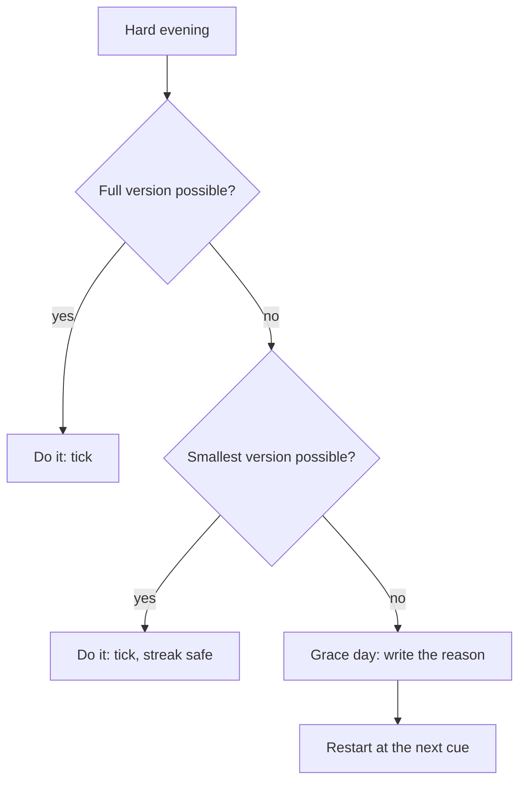

## "Two, after twenty-three"

On the evening of day 30, Yousef finished his practice questions and drew a tick. His brother looked up from his phone. "So what is the streak now?"

"Two," said Yousef. Saying it out loud hurt more than he expected. Two days in a row, after twenty-three. The streak counter made his whole month look like a beginning.

Later, when the flat was quiet, he counted the calendar a different way. Days done: 23, then 5 empty squares, then 2. That is 25 days done out of 30. He had answered practice questions on 25 evenings this month. Same calendar, same ticks, two numbers that told very different stories: "2" and "25 of 30".

This chapter is about which numbers to watch after a missed day, and about the one rule this course asks you to follow when you miss.

## The rule: restart at the next cue

The rule is short. **Restart at the next cue.** When you miss a day, the next time your cue comes, do the habit, even in its smallest version. Do not wait for Monday, the first of the month or a day when you feel ready. Do not try to make up for the missed day. Just do the habit at the next cue.

Why this rule? Chapter 1.4 gave you two facts from research, and the rule follows from both. The first fact: in the study that followed people building a daily habit for twelve weeks, missing one day did not undo their progress. The habit kept growing soon after a single miss. That study tested one missed day, not longer breaks. The second fact: the length of the gap does matter. In a large study of gym members, the longer it had been since someone's last visit, the less likely they were to go again.

So for gaps longer than one day, the course gives you this advice. A longer gap makes the next start harder. The days you practised are not wasted, and the way to protect them is to restart at the next cue. Each cue that passes without the habit makes the following one a little easier to let pass too.

After a slip, it is easy to think "I have already failed, so why bother". Researchers who help people avoid relapse call this a common trap, and they teach people to see a slip as a lesson about what got in the way. Yousef met this trap on day 29, when he looked at five empty squares and thought about throwing the calendar away. The five misses cost him five evenings. Giving up would have cost him the habit.

You may have heard a similar rule. The writer James Clear gives a popular rule: never miss twice. It is good advice, not a research finding. This course's version is simpler: restart at the next cue. It does not ask you to count misses or to panic after the first one. It asks one thing: what is the next cue, and what is the smallest version I can do there?

## What research says about streaks

You met the streak in the key words of chapter 5.1: days in a row without a miss. Many people find streaks motivating, and research agrees that they can help, with a warning. Across seven studies, people who saw an intact streak in their record kept going more than people who saw a broken one, even when their real past behaviour was the same. The effect of a broken streak was stronger when people blamed themselves for the break, and weaker when they had a way to repair it.

That gives two practical lessons. First, a streak is useful while it is going, so you do not have to throw it away. Second, if you use a streak, build in a repair before you need one. Two repairs work well. One is a **grace day**: one day a week may be missed without breaking the streak, as long as you write the reason. The other is to count the smallest version as done, so a hard day can still keep the streak going.

One more finding points the same way. A very large study tested 54 different programmes designed to get gym members to exercise more. The programme that worked best gave people small rewards for coming back after they missed a workout. Coming back, not never missing, was the behaviour worth rewarding.

The canvas lets you move Yousef's missed days around and compare three numbers: the streak on day 30, the days done, and the longest gap. Predict first.

```predict
prompt: "Suppose Yousef misses just one day, day 24, and does all the other days of the month. On day 30, which number has fallen more from a perfect month: his streak counter or his days done?"
options:
  - id: streak
    label: "The streak counter falls much further"
  - id: same
    label: "Both fall by about the same amount"
correctOptionId: streak
explanation: "A perfect month ends with a streak of 30 and 30 days done. With one miss on day 24, the streak on day 30 counts only days 25 to 30, so it shows 6. Days done shows 29. One miss cost the streak 24 days and cost the month 1 day. The streak measures how long since your last miss; days done measures how much you did."
```

Move the sliders and watch the three numbers. Start with the first "try this" line, which matches the question you just answered.

<InteractiveCanvas slug="streak-or-done-count" />

**What this shows:** the same 30-day calendar counted three ways. **Try this:** put 5 misses on days 24 to 28, then spread them out. **What changed:** days done stays at 25, the longest gap falls from 5 days to 1, and the canvas tells you when it had to move the first miss earlier to fit. **Limits of the model:** it is pure counting, and it does not show that misses in a row harm a habit more than spread misses; that has not been tested.

## Your turn first

From here on, the help in this course gets lighter on purpose. You will often try a step yourself before you see it done. Here is Yousef's card for days 36 to 47, after he added the paper version for dark evenings. Before you read on, count four things on a piece of paper: days done, the longest gap, the streak on day 47, and the longest run.

| Day | Mark | Note |
|---|---|---|
| 36 | Tick | No power. Paper version, 10 questions |
| 37 | Tick | 20 min |
| 38 | Tick | 20 min |
| 39 | Cross | Family dinner at my uncle's, home at 1:00 |
| 40 | Tick | 20 min |
| 41 | Tick | Paper version |
| 42 | Tick | 20 min |
| 43 | Tick | 20 min, started without thinking |
| 44 | Cross | Visited grandmother, home late |
| 45 | Cross | Visited grandmother again, home late |
| 46 | Tick | 5 questions, smallest version |
| 47 | Tick | 20 min |

Keep your four numbers. You will check them after the worked example below.

## Yousef's month, counted properly

Here is Yousef's first month counted the way this chapter suggests. Every number comes from his calendar: done on days 1 to 23, missed on days 24 to 28, done on days 29 and 30.

| Number | Yousef's month | What it tells him |
|---|---|---|
| Days done | 25 of 30 | How much practice he actually did |
| Streak on day 30 | 2 days | How long since his last miss |
| Longest run | 23 days | The habit was strong before the power cuts |
| Longest gap | 5 days | The danger point, and what caused it |

**Days done** is the headline. 25 of 30 is a strong month by any fair measure. It means 25 evenings of 20 minutes: more than eight hours of practice questions.

**The streak** is the least useful number here. It says "2" because his last miss was two days ago. That is true, and it says nothing about how good the month was.

**The longest run** says the habit was working: 23 days in a row while the evenings had power.

**The longest gap** is the number to act on. A longer gap makes the next start harder, and five days was the longest stretch in his month; he nearly did not restart. Nobody knows exactly when a gap becomes "too long", so this course's advice is simple: notice any gap of two days or more and plan the next cue. The cause of Yousef's gap is clear from the dates: it is exactly the five evenings without power. Chapter 5.2 showed the change that follows, a paper version for dark evenings, so a dark evening becomes a small tick instead of a cross.

Now try the other road. If Yousef had listened to the thought on day 29 and waited for the first of next month, days 24 to 30 would all be crosses. Days done: 23 of 30. Longest gap: 7 days, and the next cue would be another day away. Waiting does not give a clean start. It gives a longer gap.

**Check your count of days 36 to 47.** Days done: 9 of 12. Longest gap: 2 days, days 44 and 45. Streak on day 47: 2 days. Longest run: 4 days, days 40 to 43. Notice what the paper version did: days 36 and 41 had no power, and both are ticks. Notice also that the 2-day gap ended with the smallest version on day 46, which is a restart at the next cue doing its job. If one of your numbers was different, count the run and the gap again with your finger on each row.

Finally, Yousef adds a repair to his tracker so that the next hard week does not break his streak for no good reason. His rule: "A day counts if I do the full version or the smallest version: 5 questions on paper. If I am away from home and cannot do even that, I may use one grace day a week, with the reason written down." He writes the rule at the top of his card, before he needs it.

## A repair rule, as a decision

A repair rule should be decided in advance, when you are calm, not on the evening you miss. The diagram shows Yousef's rule as a short set of questions he can answer on a hard evening.



Follow the questions from the top. Most hard evenings stop at the second question, because the smallest version needs almost nothing: no power, no laptop, five minutes. Only a truly impossible day reaches the grace day, and even then the last box is the same as always: restart at the next cue. The rule protects the streak, but its real job is to keep the gap short.

## Traps after a missed day

**"I broke it, so I start over from day 1."** This treats a habit like a counter that resets. Restarting the count can be fine as bookkeeping. Restarting the habit from zero in your head is the trap, because the days you practised are not wasted.

**"Missing days does not matter."** That is the opposite mistake. Many missed days lowered how strong habits became in the research, and long gaps made the next time less likely. A miss is information to act on, not something to ignore.

**Waiting for a clean start.** Monday, a new month or the end of a busy week can feel like a better moment. Each day of waiting is another day added to the gap. Chapter 5.4 shows how to use a new week as a push without waiting for it.

**Catching up.** After two misses, some people plan a double session: 40 minutes instead of 20. A double session is harder to start than a normal one, so it raises the barrier when you need it lowest. Restart with the normal version, or the smallest one.

**A repair that hides a pattern.** A grace day every few days is no longer a repair; it is a way of not seeing your misses. Keep grace days rare and always write the reason, so your notes can still show what keeps going wrong.

<Callout type="info" title="Two numbers for your card">
At the end of each week, write two numbers at the bottom of your tracker: days done, and the longest gap. If a gap reaches two days, ask what is in the way and plan the next cue.
</Callout>

## Try it on your own card

Look at your course habit tracker, or Yousef's days 36 to 47 if you prefer. Count days done so far and find your longest gap. Then write a repair rule at the top of your card, in one or two lines: what counts as done on a hard day (your smallest version), and whether you allow a grace day. Finally, name your next cue in words: "The next time I finish breakfast...". If you missed today, that next cue is your restart, and nothing else needs to happen first.

## Check your understanding

```quiz
type: mcq
question: "Rana, a primary school teacher, reads one English story after the school bell at 13:30. In 30 days she read on 21, with no two misses in a row. Six of her nine misses say 'parents came in at 13:30'; three say 'forgot'. She says: 'One miss does not matter, so my month is fine.' Which reply fits this course?"
options:
  - "She is right, since none of her gaps was longer than one day"
  - "She should reset her count to day 1 and aim for no misses"
  - "She should add a weekly grace day to cover the missed days"
  - "Many misses still matter, and her notes point to parents' visits"
correct: 3
explanations:
  - "Short gaps are good news, but nine misses is a lot. Research found that many missed days lowered how strong habits became, even when spread out."
  - "Starting the count again helps nothing. Her 21 days are not wasted, and her notes already show what to work on."
  - "A grace day every week would hide six misses with one clear cause. A repair should be rare, not a cover for a pattern."
  - "That fits the course. One miss did little harm in the research, but many misses lowered habit strength. Six of her nine misses share one cause, so that is where a change should aim."
```

```quiz
type: mcq
question: "Karim practises spreadsheets after his afternoon nap and likes his streak. His cousin's wedding is in another town next Thursday. He will leave at 7:00, come home after midnight, and have no time to practise. Which plan keeps his streak useful and his notes honest?"
options:
  - "Use one grace day for Thursday and write the reason on the card"
  - "Practise twice on Wednesday so that Thursday is already covered"
  - "Mark Thursday as done, since the wedding is outside his control"
  - "Reset his count to zero after the wedding, to keep it strict"
correct: 0
explanations:
  - "Yes. A grace day decided in advance repairs the streak without hiding the miss, and the written reason keeps his record true. He restarts after his nap on Friday."
  - "Practising twice on Wednesday does not happen on Thursday, so the record would still be untrue, and a double session is harder to start."
  - "Writing 'done' on a day he did not practise makes his tracker less useful. A grace day protects the streak and keeps the record true."
  - "A reset makes a planned family day feel like a failure. Broken streaks hit harder when people blamed themselves and softer when a repair was possible."
```

**Next:** Slow results, slips and starting again: how to tell a slip from giving up, write a restart plan, and keep going when the results are slow.
