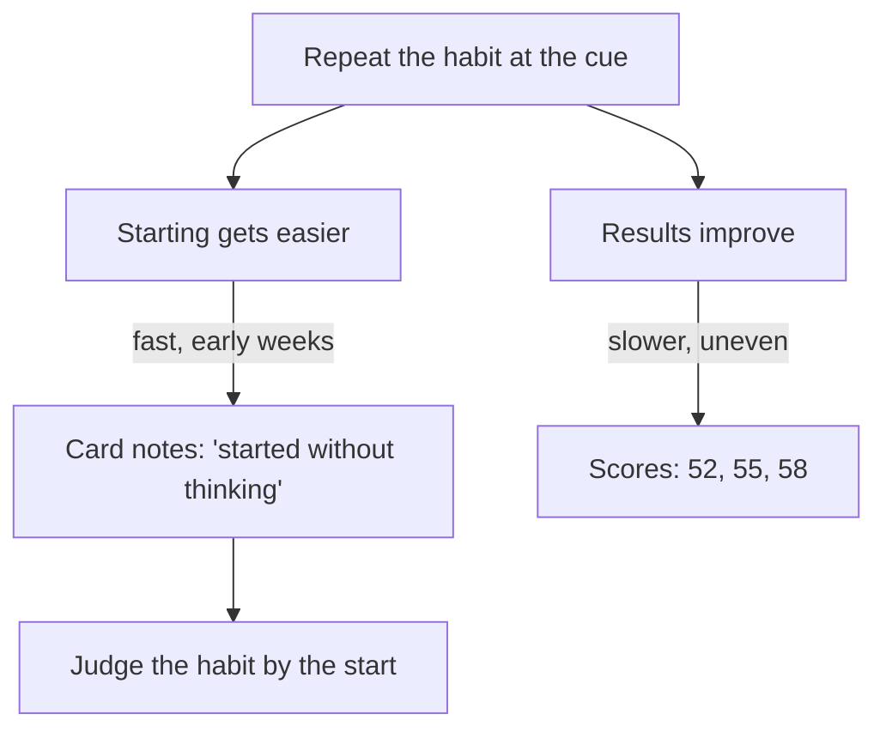

## Eight weeks, three points

Every Saturday morning before the shop, Yousef takes one full practice test and writes the score on the back of his tracker card. In this example, the exam's pass mark is 70 percent. His scores so far: 52 percent in week 1, 55 in week 4, 58 in week 8.

In week 8 he looks at those three numbers and feels tired in a new way. "Eight weeks of practice, almost every evening, and I have moved six points. At this speed I will never reach 70." A friend from the shop has told him about a different course that promises fast results. Yousef starts to wonder whether his 20 minutes a day is a waste of time.

The same week, two more crosses appear on his card. On Wednesday and Thursday he helps his uncle move house and gets home after 23:00, too late and too tired for anything. On Thursday night, lying awake, the two thoughts join together: "My scores are not moving, and now I am missing days again. Maybe I should just stop."

This chapter is about both thoughts: results that come slowly, and what to do the day after a slip.

## Two things that grow at different speeds

Yousef is looking at his scores and ignoring something else. In week 1, as chapter 5.1 told you, he had to push himself to sit down. He had no notes then, only ticks, but he remembers it well. His new card, started in week 5, tells the rest. In week 5 one note said "easy start". In week 8, four notes say "started without thinking". On most evenings he now finishes the meal and is at the desk before he has decided anything.

Two different things grow at different speeds. The habit itself gets easier fastest in the first weeks. Chapter 1.4 showed this shape from research: habit strength rises quickly at first and then levels off. The results you want, such as marks, skill or fitness, can take longer to show. That second part is an everyday observation, not a research finding, but most people who have learned a language or an instrument will recognise it. Scores depend on many things at once: the topics in the test, how tired you are, which questions came up. They move slowly, and they move unevenly.

So judge the habit by how easy it is to start, not only by the results. Yousef's card shows a habit that is forming well: done on most days, and easier to start each week. His scores are rising too, slowly, from 52 to 58. Six points in eight weeks is not nothing; it is what slow, real progress often looks like. If he stopped now, he would lose the part that took the most work to build, the habit, just as it started to run by itself.

Do not expect a sudden jump either. Expect slow, uneven change, and check the results every week or two, not every day. A score that wobbles from one week to the next tells you very little; a direction over a month tells you more.

## A slip is not giving up

Now the second thought. Yousef has two crosses for a good reason: he was helping his family. That is a slip, from the key words in 5.1: one missed day, or a few. Giving up is something else. A slip is one missed day. Giving up is a decision. You can have the first without the second.

The trap is that a slip can feel like proof. "I missed again, so I am the kind of person who fails." Chapter 5.3 showed that researchers who help people avoid relapse call this a common trap. The way out is not to feel nothing. It is to notice what happened, and then decide what happens at the next cue.

Before you read how Yousef did that, make a prediction about his Friday.

```predict
prompt: "It is Thursday night. Yousef missed Wednesday and Thursday helping his uncle move house. Which plan for Friday after the evening meal is more likely to get him back to the habit?"
options:
  - id: double
    label: "A double session of 40 minutes to catch up"
  - id: smallest
    label: "The smallest version of 5 questions"
correctOptionId: smallest
explanation: "The double session asks for more than a normal evening, on the evening when starting is hardest. The smallest version asks for about five minutes, so it will almost surely happen, and it keeps the gap at two days. The full 20 minutes can come back on Saturday. A restart should be easy to start, not a punishment for missing."
```

Step through the two roads from Yousef's missed days. Before step 6, check your prediction.

<InteractiveCanvas slug="slip-or-give-up" />

**What this shows:** the same two missed days leading down two roads. **Try this:** compare steps 3 and 5, which start from exactly the same misses, and name what is different. **What changed:** the thought after the misses, not the misses themselves, decided where the habit went. **Limits of the model:** real restarts sometimes fail; when one does, write a new plan and try again at the next cue.

## Kind first, then a plan

Being kind to yourself sounds soft, but research suggests it helps you improve. In experiments, students who were kind to themselves after failing a test studied longer for the next one than students who were simply told to feel good about themselves. In another study, students who forgave themselves for putting off study before one exam put it off less before the next. Kind is not the same as careless. Kind means "this happens to people, and I can plan for it". Careless means "it does not matter". The kind response still ends with a plan.

The restart plan from the key words in 5.1 is that plan, written in one line. It has two parts and sometimes a third. **When:** the next cue, named exactly. **What:** a version you will surely do, usually the smallest version. And if the slip had a cause that will come back, **one change** for that cause. Write it on the card, the night of the slip if you can.

## Yousef's restart plan, step by step

Here is how Yousef turned Thursday night's two thoughts into a plan. Each step is short enough to do in a few minutes, lying awake or not.

**Step 1: name what happened, as a fact.** On the card, next to the two crosses: "Wed, Thu: helping uncle move house, home after 23:00." Not "lazy", not "failed again". A fact, the same kind he would write about a friend.

**Step 2: ask whether the cause will come back.** Helping his uncle move is a one-time event, so there is nothing to fix. If the cause were something that repeats, such as late shifts every Wednesday, the plan would need one change for it.

**Step 3: name the next cue and the version.** "Friday, after the evening meal: 5 practice questions on paper, even if I am tired." The cue is one he already trusts. The version is so small that tiredness cannot stop it.

**Step 4: decide what happens after.** "Saturday: the full 20 minutes again." This keeps the smallest version as a bridge, not a new, smaller habit.

**Step 5: read the slow results fairly.** Yousef also writes a note about his scores: "52, 55, 58. Up 6 in 8 weeks. Habit much easier to start. Check again in two weeks." He decides to keep the habit and look at his scores every two weeks rather than worry about them every evening. If, after a few more weeks, the habit is solid and the scores are still stuck, the habit is not the problem; the practice method might be, and that is a separate change for later.

On Friday he does the 5 questions. It takes about five minutes. On Saturday he does the full 20, then takes his weekly practice test. The month ends with two crosses that have a clear note, not a broken habit.

## Using a new start without waiting for it

What if Yousef had taken road 1 and stopped for a while? Then a restart plan still works, and a new beginning in time can help. Researchers including Katy Milkman noticed that people start goals more often after a new beginning: a new week, a new month, a birthday, the start of a term. This has been seen in several large data sets and some experiments, though it has not yet been tested as widely as some other findings. The researchers suggest that a new beginning makes past failures feel like they belong to an older version of you.

You can use this. A new week or month is a good moment to restart a habit that has stopped. But do not wait for it. Each day of waiting adds to the gap, and a longer gap makes the next start harder. Use the next cue first. Use a new week as an extra push if the next cue has already passed you by many times.

## Two speeds, side by side

The diagram puts the two speeds next to each other, so you can see why judging a habit only by its results misleads you in the early weeks.



Both arrows leave the same box: every repetition builds the habit and the result at once. But they arrive at different speeds. The left branch shows up first, in notes like "started without thinking". The right branch shows up later, and unevenly. If you watch only the right branch in week 8, you may quit just as the left branch has done its hardest work. Watch the left branch to judge the habit, and the right branch every week or two to judge the method.

## Mistakes after a slip

**Judging in week one.** The first weeks are when the habit grows fastest, so they are a poor time to quit. Give a habit months, not days, before you decide it is not working.

**Treating a slip as proof about you.** Two crosses for a family move say nothing about your character. Write the fact, then the plan.

**Being hard on yourself to stay disciplined.** Many people believe harsh words keep them on track. The self-compassion experiments point the other way: kindness, followed by a plan, led to more effort, not less.

**Making the restart a punishment.** A double session, an extra hour, a promise never to miss again. Each one makes the next start harder. Restart small.

**Waiting for a fresh start.** "I will begin again on the first of the month" sounds like a plan, but it is a longer gap. Restart at the next cue, and let the new month be a push, not a gate.

<Callout type="tip" title="Write the restart plan on the card">
The night you miss, write one line under the cross: "Next cue: ... Version: ...". In the morning you will not have to decide anything.
</Callout>

## Try it today

Look at your course habit, or Yousef's card if you prefer. If you have a recent cross, write a restart plan under it now: the next cue, the version, and one change if the cause will come back. If you have no crosses, write the plan you would use, so it is ready before you need it. Then add one line about results: what result are you hoping for, and how often will you check it? Every week or two is enough. Your daily card is for the habit.

## Check your understanding

```quiz
type: mcq
question: "Duaa, the pharmacy student, reads 2 pages of her notes after her morning tea. In 5 weeks she read on 31 of 35 mornings. Her weekly quiz scores, in this example: 61, 60, 63, 62, 64. In week 1 she wrote 'had to push myself' 4 times; in week 5, 'started without thinking' 5 times. What do the facts support?"
options:
  - "The habit is failing, because her scores have barely moved"
  - "The habit is forming, and her scores may take longer to follow"
  - "Her method needs changing now, because five weeks shows enough"
  - "Her reading is too short, so she should read 6 pages a day"
correct: 1
explanations:
  - "Scores move slowly and unevenly, and hers are rising a little. Her notes show the habit getting easier to start, which is what forms first."
  - "That fits the facts. She read on 31 of 35 mornings, and starting has become much easier, so the habit is forming. Results such as quiz scores can take longer to show."
  - "Five weeks is early. Habits take months, not days, and the habit is the part that is clearly improving."
  - "Tripling the pages makes the habit harder to start, and nothing in the facts says 2 pages is the problem."
```

```quiz
type: mcq
question: "Manar, the nursing student, reviews 10 flashcards after the evening meal. From this month she works at a clinic desk every Saturday and Sunday until 21:00. This weekend she missed both evenings, with the note 'clinic until 21:00, too tired'. Which restart plan fits what this chapter teaches?"
options:
  - "Restart on Monday after the meal, with no other change"
  - "Restart on Monday, and do 3 cards on the bus home on clinic days"
  - "Restart on the first of next month with a clean new card"
  - "Restart on Monday, and leave weekends off the card from now on"
correct: 1
explanations:
  - "Monday is the right next cue, but the cause comes back every weekend. With no change, next weekend brings two more crosses."
  - "Yes. Monday is the next cue, and because the clinic shifts will repeat, the plan adds one change for them: a smaller version on a cue that still happens on those days."
  - "Waiting for next month makes the gap much longer. A new month can be a push, but Monday's meal comes first."
  - "Leaving weekends off hides two misses a week instead of planning for them. A small version on clinic days keeps the habit going and the record honest."
```

**Next:** A practice check with five short cases on tracking, missed days and restarting, including an AI answer to check.
