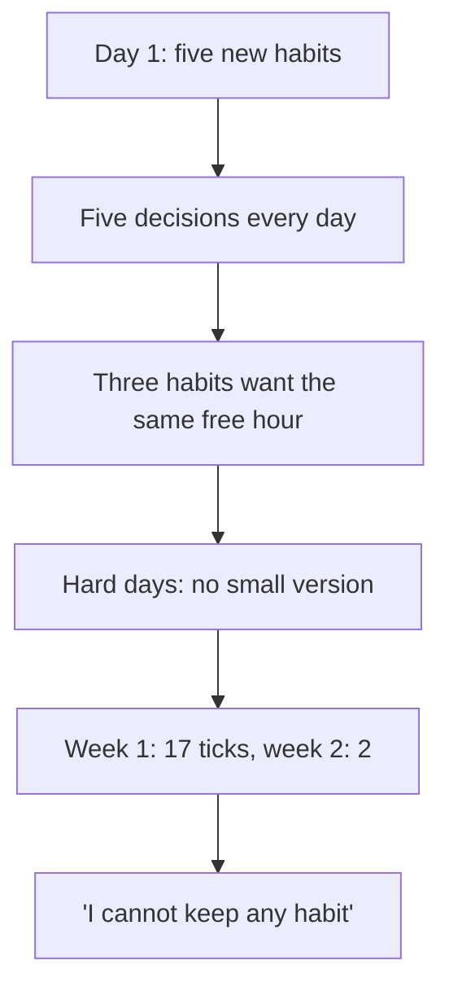

<BigWordAlert term="Daily rhythm" plainEnglish="The fixed points that come back in your day in the same order: waking up, work, meals, prayers, caring for family, going to bed." whyItMatters="Habits last when they sit on fixed points you already have, not on free time you hope to find." />

## Five lines on a card

Dina is 27. She works part-time as a remote software tester for a small company abroad. From 8:30 to 12:30, Sunday to Thursday, she checks the company's website for errors and writes test reports in English. She lives with her mother and her younger brother, who works long days at a garage. Her mother finds stairs and long standing hard, so in the afternoons Dina cooks lunch, keeps her company and helps with whatever she needs. Like every person in this course, Dina is fictional, but her week will feel familiar to many fellows.

On the first day of the month, Dina sat down with a cup of tea and a clean card. She had been reading about habits, and she felt ready for a new start. She wrote five lines:

"Study English for 30 minutes. Walk for 30 minutes. Sleep by 23:00. Read 20 pages of a book. Drink 8 glasses of water."

Every one of these habits made sense. Her company had told the testers that clearer English in their reports would matter more and more. She sat at a laptop all morning and wanted to move more. She often fell asleep after 1:00 and woke tired. She missed reading, which she had loved at school. And she knew she drank too little water on hot days. Looking at the card, she felt proud. "This month," she thought, "I am going to change."

## How the month went

Day 1 went perfectly. She studied English after work, walked in the evening, read before bed, drank her water and was asleep by 23:00. Five ticks. Day 2 was nearly as good: four ticks, but she fell asleep at midnight because she wanted to finish her 20 pages.

By day 3 the cracks were showing. Her mother needed more help than usual that afternoon, and the free hour Dina had planned for English disappeared. She promised herself she would study in the evening instead. But the evening was also when she had planned her walk, and after the walk she was tired, and reading in bed kept her up past midnight again. On day 4 her company sent a long list of tests that took until 13:30. On day 5 relatives came for the evening. Each day, a different habit fell off.

Here is Dina's card for the first two weeks, as ticks per habit.

| Habit | Week 1 (7 days) | Week 2 (7 days) |
|---|---|---|
| English, 30 minutes | 4 | 1 |
| Walk, 30 minutes | 3 | 0 |
| Sleep by 23:00 | 2 | 0 |
| Read 20 pages | 3 | 1 |
| 8 glasses of water | 5 | 0 |
| **All five** | **17 of 35** | **2 of 35** |

In the second week she ticked the card only twice, on days 8 and 9. After that she stopped marking it at all. On day 14 she found it under a pile of test reports, looked at the empty second half, and felt a familiar heaviness. "I cannot keep any habit," she thought. "I start strong, and then everything falls apart. Maybe I am just not that kind of person."

## Why five at once faded

Dina's thought is understandable, and it is wrong. Look at what the card really shows. In week 1, with five new habits at once, she still managed 17 ticks. She was not lazy. She was trying to do five new things every day, each needing its own time, its own energy and its own decision.

Think about what each habit asked of her. None of the five had a clear cue. "Study English" did not say when or after what. "Walk" and "study" both wanted the same late afternoon, the one part of her day that her mother's needs could take at any moment. "Read 20 pages" and "sleep by 23:00" pulled against each other, because reading happened in bed. "8 glasses of water" was spread across the whole day with no moment to start it. So every day began with five small decisions: when, where and whether. You met this in module 1: a new behaviour goes through deciding every time, while a habit runs from a cue. Dina had five behaviours that all needed deciding, on days that already had little room.

Notice also how the misses spread. When one habit fell, it often knocked over another: the late English pushed the walk later, the late walk pushed the reading later, the reading pushed sleep past midnight. Five new habits did not just add up. They competed for the same few free hours.

And there was no plan for a hard day. When her mother needed her, or the test list ran long, or relatives came, there was no smallest version of anything. A hard day meant five crosses, and five crosses in one day feel much worse than one.

To be honest about the evidence: no study has tested exactly five new habits against one. The advice in this module is the course's reasoning from what research does show. Simple habits with a clear daily cue form best. People carry out what they intend only about half the time, and a plan that names the moment helps. And a new behaviour needs a decision every time until it becomes a habit. Put those facts together, and five new habits on one day means five chances a day for the moment to pass.

Dina also got some things right, and they are worth keeping. She chose habits that matter in her life, not habits from someone else's list. She tracked them on a card, so she has evidence instead of only a feeling. And her week 1 shows that she can do each of these things on an ordinary day. What she needs is not a different person. She needs a different order.

## Why this matters for study and work

Many fellows will recognise Dina's month. A new month, a new term or a new job brings a burst of energy, and the energy writes a long list. Study, exercise, sleep, reading, prayer on time, less phone, more water, a side project. Every item is good. Together, they ask for more decisions than a full day can hold, and they often collapse together, which leaves a person feeling worse than before they started.

This matters because the stakes are real. Dina's English affects her job. Her sleep affects her mornings at work and her patience in the afternoons. A collapse of all five habits takes the important one down with the others. The fix is not more willpower or a stricter list. It is a better order: choose one habit first, fit it to a fixed point in the day, protect the time it needs, and add the next habit only when the first one runs by itself.

The diagram shows how Dina's month unfolded.



Read it from top to bottom. Nothing in the first four boxes is about Dina's character. Box B is about the number of habits, box C about how they compete for time, and box D about the missing plan for hard days. Only the last box is a judgement about Dina, and it does not follow from the boxes above it. A person who managed 17 ticks in a week of five new habits is not someone who "cannot keep any habit". She is someone who started too many at once.

## What this module covers

This module teaches you to build habits for a whole life, not just a single neat routine.

First, how to choose. Chapter 6.2 shows Dina comparing three possible first habits: daily English, sleeping by 23:00 and a 10-minute walk. You will see that the right first habit depends on what matters most this month, and that each repetition is a small piece of evidence about who you are becoming.

Second, how to protect study and focused work. Chapter 6.3 follows one of Dina's English study blocks: a start signal, the phone out of the room, the next step written down, and a calm way to handle the moment her mother calls her.

Third, how to fit habits into a daily rhythm. Chapter 6.4 looks at the fixed points in a day: waking, work shifts, meals, prayer times and caring for family. It shows why a habit tied to an event, such as a meal, moves with the day when the seasons change, while a habit tied to a clock time can drift out of place. It also covers sleep, family time and what to do when a day changes completely.

<LearningObjectives items={["Choose one habit to start first, by what matters now, how small it can be, its anchor and how it helps the rest of the day", "See each repetition as a small piece of evidence about the kind of person you are becoming", "Protect a study or focused work block with a start signal, the phone out of the room and a written next step", "Place habits on the fixed points of your day, such as meals and prayer times, and adjust them when the day or the season changes", "Shrink a habit to its smallest version when a guest, a move or new hours change your day"]} />

## Key words

| Word | Plain English |
|---|---|
| **Fixed point** | Something that happens every day at a known moment, such as waking, a meal, a prayer time or the start of a work shift |
| **One habit at a time** | Starting one new habit, and adding the next only when the first starts on most days without a push |
| **Focused work** | Work or study that needs your full attention for a stretch of time, such as solving problems or writing |
| **Start signal** | A small action you do every time before a habit, such as filling a glass of water, so starting needs no decision |
| **Protected time** | A block of time kept for one task, with interruptions planned for in advance |

## What is in this module

| Chapter | You will practise |
|---|---|
| 6.2 | Choosing the first habit with Dina, by changing what matters most |
| 6.3 | Protecting a study or focused work block, and handling interruptions at home |
| 6.4 | Placing habits on the fixed points of a day, through the seasons and on changed days |
| 6.5 | A graded quiz with five short cases |
| 6.6 | A weekly rhythm plan for your course habit, or Nada's |

Before you read on, think about Dina's card for a moment.

```openquestion
prompt: "Look at Dina's card and her story. Why do you think her five habits faded, even though she really wanted all of them? Name two reasons, using facts from her story."
required: true
minWords: 25
allowSpeechInput: true
modelAnswer: "One reason is that she started five new habits at once, so every day began with five decisions about when and where, on days that already had little free time. A second reason is that the habits competed: English and the walk both wanted the late afternoon, and reading in bed pushed her sleep past midnight. A third possible reason is that she had no smallest version for hard days, so when her mother needed her or relatives came, everything fell at once."
```

**Next:** How to choose the one habit to start first, and why each repetition counts as evidence.
