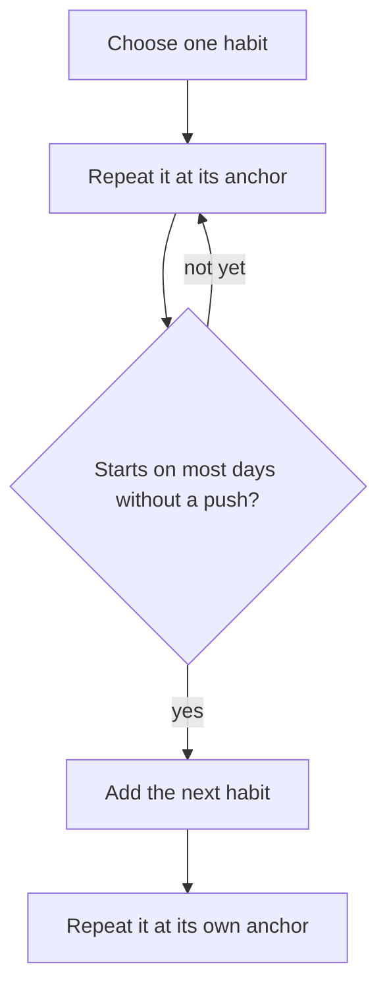

## Three candidates on the back of a card

On day 15, Dina turned her old card over. On the back she wrote one question: "If I could keep only one of these, which one?" Her brother, eating his breakfast before the garage, looked over her shoulder. "Why only one? You want all five."

"I do," she said. "And I managed all five for about four days." She crossed out two lines straight away. Reading 20 pages could wait; she loved it, but nothing depended on it this month. Water, she decided, needed a full bottle on her desk more than a new habit. That left three candidates: daily English, sleeping by 23:00, and a short walk, now 10 minutes instead of 30.

All three were good. All three would help. And she could already feel the pull to keep all three, "just small". This chapter is about why one is enough to start, and how to choose which one.

## One habit first

Starting one new habit at a time is the course's advice, built on what earlier modules showed. A new behaviour needs a decision every time until a cue starts it by itself. Simple habits with a clear daily cue form best. And module 1 showed that a habit takes weeks to months to start by itself, with big differences between people. Three new habits at once means three decisions a day, for many weeks, on days that already have little room.

So start one, and **add the next when the first one starts on most days without a push**. Your tracker will tell you when: notes like "started without thinking" appear, crosses become rare, and the habit happens even on tired days. For many people and many habits, that takes several weeks or longer. That is not slow. It is the time it takes, and it is time well spent, because a habit that runs by itself leaves room for the next one.

How do you choose the first? Four questions help.

**Does it matter most now?** Some habits matter every month; some matter especially this month. A habit tied to a real need right now, a job, an exam, a family duty, has a reason behind it on the days you do not feel like it.

**Can it be very small?** You met the smallest version in module 2. Some habits shrink easily: one paragraph of English, a walk to the corner. Others are hard to shrink: going to bed by 23:00 is a single moment that either happens or does not.

**Does it have a clear anchor?** A habit that follows something you already do every day, in the right place, starts more easily than one that needs a free moment you hope to find.

**Does it help the rest of the day?** Some habits make other parts of life easier. Sleep is the clearest example: a rested morning helps work, study and patience with family.

No single answer decides. The right first habit depends on how much each question matters to you this month. The canvas lets you see this with Dina's own scores.

## Each repetition is evidence

There is one more idea in this chapter, and it is about how you see yourself. On day 14, Dina said, "Maybe I am just not that kind of person." Many people talk to themselves this way. A missed habit becomes proof of a fixed character: not disciplined, not a reader, not a morning person.

Here is a more useful way to look at it. Each time you do the habit, you collect a little evidence about the kind of person you are becoming. Not a big claim, not a new label: one small piece of evidence. Ten mornings of English are ten pieces of evidence that Dina is someone who works on her English. James Clear's book makes a similar point. The evidence comes first, from what you do; you do not have to believe anything about yourself before you start.

A related idea is about difficulty. When a new habit feels hard, that does not mean it is "not for people like you". Hard can mean it matters. Psychologists who study how people read difficulty have found that the same struggle can feel like a sign that a goal is important, or a sign that it is "not for people like me", depending on whether the goal feels like it belongs to someone like you. This research is mostly about school, but the idea is useful for habits too. Dina's English is hard some days because it matters to her work, not because she is the wrong person to learn it.

```predict
prompt: "Dina scores three habits from 1 to 5 on four questions. On 'Helps the rest of the day', sleep scores 5, the walk 3 and English 1. With her starting weights the totals are English 32, sleep 26 and walk 25, and that question has the lowest weight, 1. If her tired mornings make her raise it to 3, very important, does the first habit change?"
options:
  - id: english-stays
    label: "No, English stays first because it matters most"
  - id: sleep-first
    label: "Yes, sleeping by 23:00 moves to first"
correctOptionId: sleep-first
explanation: "Raising that weight from 1 to 3 adds 2 points for each point of score. Sleep scores 5 on helping the rest of the day, so it gains 10 points and reaches 36. English scores 1, so it gains 2 and reaches 34. The walk reaches 31. A different month, with different needs, gives a different first habit."
```

Change the weights and watch the totals. Start with the first "try this" line.

<InteractiveCanvas slug="which-habit-first" />

**What this shows:** three possible first habits, each scored from 1 to 5 on four questions, with the scores multiplied by how much each question matters to Dina this month.

**Try this:** set every weight to 1 and see English and sleep tie at 14 points, so the weights, not the scores alone, make the decision.

**What changed:** raising "Helps the rest of the day" moved sleep from second to first, because sleep scores highest on exactly that question.

**Limits of the model:** the scores are Dina's own judgement, a gap of one or two points means both habits are reasonable choices, and the model picks only the first habit, not the whole plan.

## Dina's choice, worked through

Here are Dina's scores and her reasons for each. A score is from 1 (poor) to 5 (strong).

| Question | Weight | English, daily | Sleep by 23:00 | 10-minute walk |
|---|---|---|---|---|
| Matters most now | 3 | 5 | 3 | 2 |
| Can be very small | 2 | 4 | 2 | 5 |
| Has a clear anchor | 2 | 4 | 4 | 3 |
| Helps the rest of the day | 1 | 1 | 5 | 3 |

**Matters most now.** Her company has asked for clearer English in test reports. That is about her income this month, so English gets 5. Sleep matters to her, 3. The walk is good for her but nothing depends on it yet, 2. She gives this question weight 3, very important.

**Can be very small.** English shrinks easily: on a hard day, she can read one paragraph aloud. That is a 4. The walk is the easiest to shrink, a walk to the bakery and back, so 5. Sleep is hard to shrink, because 23:00 is a single moment, so 2. Weight 2.

**Has a clear anchor.** English can follow "after I send my last test report", which happens every working day at about 12:30 at the same table: 4, not 5, because she does not work on Fridays and Saturdays. Sleep can follow "after I help my mother to bed", which happens every night: 4. The walk would follow lunch, but her afternoons move with her mother's needs: 3. Weight 2.

**Helps the rest of the day.** Sleep helps everything: 5. The walk gives her some energy for the afternoon: 3. English helps her reports but not the rest of her day: 1. Dina gives this question weight 1, nice to have, because this month her mornings are tiring but manageable.

Now the totals. English: 5 x 3 + 4 x 2 + 4 x 2 + 1 x 1 = 15 + 8 + 8 + 1 = 32. Sleep: 3 x 3 + 2 x 2 + 4 x 2 + 5 x 1 = 9 + 4 + 8 + 5 = 26. Walk: 2 x 3 + 5 x 2 + 3 x 2 + 3 x 1 = 6 + 10 + 6 + 3 = 25. English comes first by 6 points.

Dina writes her one habit on a new card: "After I send my last test report, I open my English book and do one exercise." Her smallest version: "Read one paragraph aloud." For Fridays and Saturdays, she adds a second anchor: "after I wash the breakfast dishes". On the back of the card she writes "Next: sleep by 23:00" and parks the other habits there. They are not abandoned; they are waiting their turn.

The canvas shows why this choice belongs to this month. If her mornings had been much harder, the same scores would have put sleep first. Neither answer is wrong. The method's value is that it makes Dina say what matters most, out loud, before she chooses.

## Adding habits one at a time

Choosing the first habit is half of the plan. The other half is the order after it. The diagram shows the order the course suggests.



Follow the loop in the middle. The question in box C is answered by your tracker, not by a date or a feeling: are the crosses rare, and do your notes say the start is easy? Until the answer is yes, the loop goes back to repeating the first habit. When it is yes, the next habit starts, with its own anchor, so the two do not compete for the same moment. For Dina, sleep will follow "after I help my mother to bed", which is far from her English anchor at 12:30. Two habits on two different fixed points do not fight each other the way her first five did.

## Mistakes when choosing

**Choosing the most impressive habit.** "Wake at 5:00 and study for two hours" sounds strong and rarely lasts. Choose by the four questions, not by how the habit sounds.

**Choosing a habit with no anchor.** If you cannot finish the sentence "After I ..., I will ...", the habit will depend on finding free time. Find the anchor first, or choose a different habit.

**Keeping the others "just small".** Three small new habits are still three decisions a day. Park the others in writing, so you know they are not forgotten.

**Using labels as a technique.** Telling yourself "I am a runner" before you have run is not a proven method; in research, clever identity wording effects have sometimes failed to repeat. The evidence comes from repetitions, not from a label.

**Reading difficulty as a sign it is not for you.** A hard first week means the habit is new, not that it is wrong for you. Shrink it to its smallest version and keep collecting evidence.

<Callout type="tip" title="Park, do not delete">
Write the habits that are waiting on the back of your card, in the order you plan to add them. It is easier to say "not yet" to a good habit when you can see its turn is coming.
</Callout>

## Try it today

Write down every habit you would like to build, or use Dina's five. Cross out any that can wait a month without harm. For the two or three that are left, score each from 1 to 5 on the four questions, and decide which question matters most to you this month. Add up the totals, then look at the winner and ask: can I finish the sentence "After I ..., I will ..."? If you already have a course habit that is running well, use the same questions to choose the habit that comes next, and write when you will know it is time to add it.

## Check your understanding

```quiz
type: mcq
question: "Rana, the teacher, wants one new habit. Lesson planning matters now, for an inspection in 3 weeks; it can shrink to 3 lines and follow the evening meal. Swimming would help before a holiday in 4 months, but the pool is far away and open on Fridays only. Reading English news has no fixed moment in her day. Which habit should come first?"
options:
  - "Swimming, since the holiday makes it worth starting early"
  - "English news, since it can fit into any spare moment"
  - "Lesson planning, after the evening meal each day"
  - "All three together, each one kept very small"
correct: 2
explanations:
  - "The holiday is 4 months away, and a far-away pool open only on Fridays gives a weekly habit with no daily anchor. It can wait its turn."
  - "Fitting 'any spare moment' means it has no anchor, so it depends on finding free time."
  - "That fits the four questions. It matters most now, it can be very small, and it follows a fixed point every day."
  - "Three new habits mean three decisions a day. Start one, and add the next when it starts on most days without a push."
```

```quiz
type: mcq
question: "Manar, the nursing student, reviews 10 flashcards after the evening meal, with 3 cards on the bus home on clinic days. For the last 4 weeks her card shows 7, 6, 7 and 7 days done, and four notes in week 4 say 'started without thinking'. She wants to add a 10-minute walk. What does her card support?"
options:
  - "Wait two more months before she adds anything new"
  - "Add the walk now, tied to a different fixed point in her day"
  - "Add the walk now, just before the cards at the same moment"
  - "Add the walk and a reading habit, since both can be small"
correct: 1
explanations:
  - "There is no fixed number of days to wait. Her card is the test, and it shows the flashcards starting easily on most days."
  - "Correct. Crosses are rare and her notes say the start is easy, so the first habit runs by itself. A different fixed point keeps the two habits from competing."
  - "Two habits on the same moment compete for it, and a walk before the cards could push the cards later. A different fixed point keeps both safe."
  - "Two new habits at once repeats Dina's mistake on a smaller scale. Add one, and wait for it to start easily before the next."
```

**Next:** Study and focused work habits: a start signal, the phone out of the room, the next step written down, and what to do when someone needs you.
